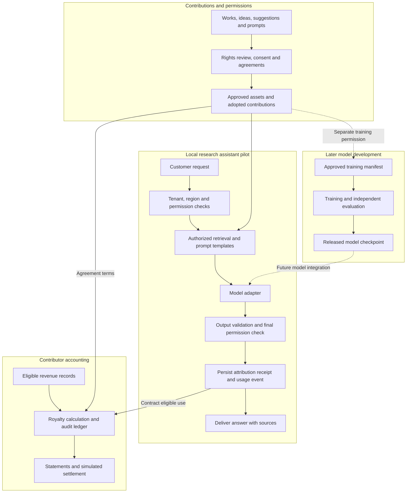

# Sovereign Source AI

**An AI laboratory and language model platform designed around permission, attribution and contributor compensation.**

Sovereign Source AI (`sovsrc.llm`) aims to develop capable language models while respecting intellectual property and rewarding licensed works and accepted ideas, suggestions, prompts and workflows. Its proposed infrastructure connects source permissions to model use, attribution receipts and auditable royalty accounting.

**Status: specification stage.** This workspace contains project and implementation specifications. The application, trained model and production payment system have not been implemented.

## Documentation

| Document | Purpose |
| --- | --- |
| [Codex implementation specification](docs/SOVEREIGN_SOURCE_AI_CODEX_SPEC.md) | Requirements, architecture, data records, APIs, milestones and acceptance tests. |
| [Project specification](docs/origin/Sovereign_Source_AI_Project_Specification_v0_1.docx) | Laboratory strategy, proposed economics, governance and policy references. |

## Architecture

The initial product is a research assistant using an approved corpus. It checks permissions, supplies evidence for answers and records eligible contribution use. An independently trained foundation model is a later research milestone.



Permission checks and financial decisions operate outside the model. A citation identifies supporting evidence; it does not establish ownership or prove which training example caused an answer. Usage records must be durable before metered content is delivered.

## Core commitments

- **Permission before use:** record the allowed purpose, recipients, territory and duration for each asset.
- **Honest attribution:** distinguish verified quotations, retrieved support, recorded reuse, training participation and estimated influence.
- **Explicit contribution agreements:** compensate accepted use without treating every submitted idea or ordinary prompt as an automatic royalty claim.
- **Private conversations by default:** shared training and contribution enrollment require separate consent.
- **Reproducible payments:** preserve event history, calculate exact amounts and prevent duplicate settlement.
- **Sovereign deployment controls:** specify data location, administrative access, keys, model versions and update authority.
- **Review and appeal:** support disputed ownership, missing credit, payment corrections and permission revocation.

## Proposed contributor economy

The draft allocates **20% of eligible collected revenue** to a contributor pool. Eligible revenue deducts refunds, chargebacks, sales taxes and directly charged payment processing fees; it does not deduct general operating expenses.

| Track | Share of contributor pool | Proposed allocation basis |
| --- | --- | --- |
| Training and licensed corpus | 60% | Approved, deduplicated training exposure and predefined quality weights. |
| Prompt and workflow reuse | 20% | Verified eligible paid executions of accepted versions. |
| Adopted ideas and suggestions | 20% | Agreed adoption points supported by reviewed implementation evidence. |

These are proposed contractual terms, not existing statutory royalty rates. Minimum guarantees, retrieval fees and bounties follow their own agreements. The [royalty engine specification](docs/SOVEREIGN_SOURCE_AI_CODEX_SPEC.md#12-royalty-engine) defines offsets, rounding, reserves, disputes and settlement examples.

## Implementation roadmap

| Milestone | Deliverable |
| --- | --- |
| M0 | Local setup, domain model, migrations and synthetic fixtures. |
| M1 | Private submissions, scoped grants, review, agreement acceptance and adoption. |
| M2 | Research assistant with authorized retrieval and source receipts. |
| M3 | Usage capture, royalty calculations, statements and simulated payments. |
| M4 | Disputes, revocation, exports, audit views and end-to-end verification. |
| M5 | Commercial integrations, signed licenses and independent review. |
| M6 | An owned research model trained on admitted data. |
| M7 | A frontier candidate that passes capability, rights and safety evaluations. |

The first implementation targets **M0–M4**, using synthetic fixtures and deterministic model and payment adapters. Real payouts, production deployment and large training runs are subsequent work.

## Start with Codex

Open the [implementation specification](docs/SOVEREIGN_SOURCE_AI_CODEX_SPEC.md) and use this prompt:

```text
Read applicable repository instructions and docs/SOVEREIGN_SOURCE_AI_CODEX_SPEC.md.
Implement milestones M0–M4 as a working local Sovereign Source AI pilot.

Reuse existing repository patterns. Use synthetic fixtures and deterministic
model and payment adapters by default. Keep sources/ read-only.

Verify scoped permissions, tenant isolation, honest attribution, durable usage
capture, exact royalty accounting, revocation and disputes. Document setup and
report verification results and remaining production dependencies.
```

The proposed greenfield stack is React and TypeScript, a Python API, PostgreSQL, private object storage and one background worker. The implementation should reuse suitable existing infrastructure. Setup commands will be documented when the application exists.

## Completion criteria

The local pilot is complete when a contributor can submit material, a reviewer can approve its permitted use, a customer can receive a supported answer, and an eligible use produces a reproducible statement and simulated settlement.

Verification must also cover denied access, cross-tenant isolation, revocation during generation, fabricated citations, duplicate events, financial rounding, disputed payments and worker recovery. See the [verification requirements](docs/SOVEREIGN_SOURCE_AI_CODEX_SPEC.md#16-verification-requirements) and [definition of done](docs/SOVEREIGN_SOURCE_AI_CODEX_SPEC.md#19-local-definition-of-done).

## Policy and governance

The specification includes a [Trump administration policy mapping](docs/SOVEREIGN_SOURCE_AI_CODEX_SPEC.md#18-trump-administration-policy-mapping), with primary references for Super Intelligence terminology, creator compensation, frontier security, procurement and international deployment. The reference date is October 10, 2026; applicability must be reviewed before production claims or procurement.

Project commitments are distinct from government policy and legal requirements. Frontier capability, complete source provenance and production readiness must be supported by evaluation evidence.

## Working in this workspace

The project directory is `/home/niccolox/Projects/sovsrc.llm`. The original project specification is preserved under `docs/origin/`; the implementation specification is under `docs/`. Follow applicable `AGENTS.md` instructions when adding implementation work. Any synced files under `sources/` remain read-only references.
