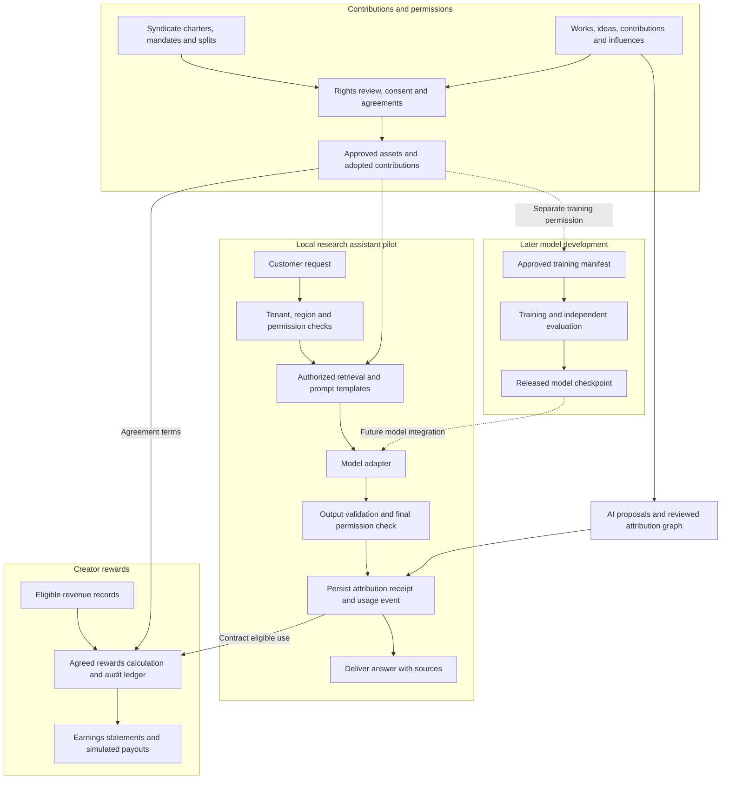

# Super Sovereign Source LLM IP

**An LLM that respects intellectual property and ideas.**

Super Sovereign Source LLM IP (`sovsrc.llm`) aims to build a capable large language model that uses source material with permission, recognizes the people behind it and lets eligible creators earn from agreed contribution use. Its **Super Intellectual Property (SIP)** framework recognizes works, ideas, contributions and influences through scoped permissions, AI-assisted attribution, voluntary contributor syndicates and auditable creator rewards.

SIP expands what the project records, recognizes and rewards through evidence and agreements. It is a proposed framework, not an assertion that a new statutory IP right already exists. Ownership, permission, credit, governance and payment are recorded separately.

**Status: specification stage.** This workspace contains project and implementation specifications. The application, trained model and production payment system have not been implemented.

**Research recommendation, 12 October 2026:** evaluate KL3M for a provenance-focused pilot and OLMo-core with newly initialized weights for a foundation trained on SIP-admitted sources. Self-hosted gpt-oss-120b is a conditional teacher candidate; no frontier teacher has qualified under the strict lineage requirement. The [consolidated model decision](docs/MODEL_SELECTION_RESEARCH_SUMMARY.md) explains the tradeoffs and the existing Nemotron 3 Ultra selection.

## Documentation

| Document | Purpose |
| --- | --- |
| [Startup go-to-market plan](docs/STARTUP_GO_TO_MARKET_PLAN.md) ([tactic register](docs/STARTUP_GTM_TACTIC_REGISTER.md)) | First customer segment, paid readiness and pilot offers, creator supply, pricing and cost tests, founder-led acquisition, 90-day milestones and a conditional 12-month revenue plan. |
| [Research summary: foundation model and training teacher](docs/MODEL_SELECTION_RESEARCH_SUMMARY.md) | Consolidated recommendation across source rights, commercial permissions, lineage, model capability, training tools, suppliers, attribution and creator rewards. |
| [Production plan using open-source and frontier models](docs/PRODUCTION_SYSTEM_PLAN.md) | Model routing and commercial boundaries, deployable stack, source receipts, creator accounting, training admission, reliability gates, staffing and an illustrative operating budget. |
| [USA Sovereign Source AI index — single-page comparison](docs/USA_SOVEREIGN_AI_INDEX.md) ([HTML version](docs/usa-sovereign-ai-index.html)) | Ten US lab/provider candidates and ten open-source paths across ten parameters, including Berkeley, Stanford and MIT; licenses, ancestry, IP permissions and creator rewards. |
| [Current project and implementation specification, v0.7](docs/SOVEREIGN_SOURCE_AI_CODEX_SPEC.md) | SIP framework, syndicate marketplace, commercial-platform research, requirements, architecture, APIs, milestones and acceptance tests. |
| [Solution architecture and Nemotron training plan](docs/SOLUTION_ARCHITECTURE.md) | Researched stack responsibilities, Rust/Python contracts, Prefect workflows, PostgreSQL isolation, model selection and training gates. |
| [Nemotron research: alternatives without disclosed Qwen ancestry](docs/NEMOTRON_NO_QWEN_RESEARCH.md) | Historical alternative candidates and evidence; Ultra is the current selected target and does not pass the earlier ancestry screen. |
| [OLMo July 2024 lineage audit](docs/OLMO_7B_0724_LINEAGE_RESEARCH.md) | Exact checkpoint and tokenizer evidence, Dolma filtering, indirect GPT-4 influence, RoPE research ancestry and limits on independence claims. |
| [Nemotron speed, accuracy and cost review](docs/NEMOTRON_PERFORMANCE_SOURCE_REVIEW.md) | The supplied BestAIFor article checked against primary sources, with a cost-per-verified-outcome evaluation plan for Ultra. |
| [Frontier lab terms and creator rewards audit](docs/FRONTIER_LAB_IP_AND_CREATOR_REWARDS_AUDIT.md) | Eight organizations compared on IP, training permissions, attribution and compensation, with recommendations for SIP rights and rewards. |
| [Meta Muse research for Sovereign Source](docs/META_MUSE_SOVEREIGN_SOURCE_RESEARCH.md) | Wonder, Spark and Glimmer compared on competing-model permissions, local deployment, lineage, Contributor pricing and SIP creator rewards. |
| [Palantir sovereign AI and independent Sovereign Source](docs/PALANTIR_SOVEREIGN_AI_RESEARCH.md) | Sovereign AI OS, NVIDIA, BYOM, deployment partners and current commercial terms compared with an independent SIP core and creator-rewards architecture. |
| [National sovereign AI projects and commercial champions](docs/NATIONAL_SOVEREIGN_AI_PROJECTS_RESEARCH.md) | Canada, Australia, France, Arab states and selected global peers compared on ownership, compute, model control, source rights and creator rewards; public projects, private champions and partnership options. |
| [OpenAI restrictions on developing competing LLMs](docs/OPENAI_COMPETING_MODEL_RESTRICTIONS_RESEARCH.md) | Output-use restrictions, business exceptions, distillation, enforcement, commercial exposure and unresolved boundaries for Sovereign Source. |
| [Pathway from ChatGPT to an independent LLM with content rewards](docs/CHATGPT_TO_INDEPENDENT_LLM_PATHWAY.md) | Negotiated permission or independent development, treatment of earlier assistance, Nemotron licensing, contributor agreements and commercial release evidence. |
| [Gemini commercial restrictions on competing LLMs](docs/GEMINI_COMMERCIAL_RESTRICTIONS_RESEARCH.md) | API, Cloud, consumer and Workspace restrictions; limited exceptions, commercial exposure and the separate Gemma licensing route. |
| [Upstream AI data suppliers and development communities](docs/UPSTREAM_AI_DATA_SUPPLIERS_RESEARCH.md) | Expert-data suppliers, licensed-content sellers, lab relationships, industry publications, public and gated communities, and a SIP procurement shortlist. |
| [Hermes Agent research](docs/HERMES_AGENT_RESEARCH.md) | Architecture, desktop and mobile access, model routing, licensing, deployment and a proposed integration with SIP permissions and content rewards. |
| [OpenCode 2 for development and training operations](docs/OPENCODE_2_SOVEREIGN_SOURCE_RESEARCH.md) | Local MIT software versus hosted competing-model restrictions, Python/Rust integration, controlled experiment tools, attribution evidence, creator rewards and a bounded evaluation plan. |
| [KL3M research for independent model development](docs/KL3M_CLEAN_ROOM_RESEARCH.md) | US provenance, model and dataset distinctions, commercial licensing, certification, clean-room limits and a proposed attribution and rewards pilot. |
| [Perplexity research for Sovereign Source](docs/PERPLEXITY_SOVEREIGN_SOURCE_RESEARCH.md) | Competing-product restrictions, Search data terms, publisher rewards, Qwen embedding lineage and a conditional integration architecture. |
| [SkyRL research for Sovereign Source](docs/SKYRL_SOVEREIGN_SOURCE_RESEARCH.md) | Apache-licensed post-training, model lineage, Ultra compatibility, verifiable attribution behavior and separation of RL scores from creator payments. |
| [Sovereign Source Super Intellectual Property license](licenses/SS-SIP-0.1.md) | Custom license draft for source sharing, contributor attribution and documented influence notices. |
| [Syndicate marketplace terms](licenses/SYNDICATE-MARKETPLACE-TERMS-0.1.md) | Opt-in participation, listings, commissions, creator rewards, earnings, payouts and appeals. |
| [Licensing guide and examples](licenses/README.md) | Adoption instructions, open-source design references and unaccepted attribution/order templates. |
| [Original project specification, v0.1](docs/origin/Sovereign_Source_AI_Project_Specification_v0_1.docx) | Historical source for laboratory strategy, proposed economics, governance and policy references. |

## Super Intellectual Property and syndicates

A syndicate is a voluntary group that administers selected works, ideas, contributions and influences under an accepted charter. Members choose what to enroll and what authority to delegate. A syndicate can negotiate permitted uses, preserve individual credit and administer agreed revenue splits; joining does not automatically transfer ownership or license a member's work.

| SIP subject | Recognition and participation |
| --- | --- |
| IP and source works | Reviewed rights, scoped licenses and evidence of use. |
| Ideas and research | Concrete proposals, adoption records and agreed rewards. |
| Contributions | Implementation, improvements, prompts, workflows, curation and evaluation. |
| Influences | Documented acknowledgments and lineage; credit-only unless compensation is expressly agreed. |
| Combined and derivative work | Preserved upstream obligations and separately recorded new contributions. |

AI helps identify references, possible duplicates, contribution relationships and missing credit. Authorized reviewers accept or correct those proposals. A similarity score cannot establish ownership, permission or payment eligibility. Member mandates, contribution-specific splits, exit terms and disputes are versioned and auditable.

## License and syndicate marketplace

The proposed **Sovereign Source Super Intellectual Property License (SS-SIP-0.1)** permits use, modification, redistribution and commercial activity while requiring source access for distributed covered portions, contributor credit and preservation of documented influences. Its attribution duties include a correction and enforcement process. Unknown ancestry and AI-generated allegations do not automatically become required credits or royalty claims.

The license is intended to preserve open-source freedoms and is a **custom draft for legal review, not an OSI-approved license**. It applies only where an authorized holder identifies covered material and expressly adopts it. The draft does not relicense this entire repository or replace third-party and Nemotron terms.

The accompanying marketplace framework lets syndicates list open material, commissions, services, additional permissions and voluntary revenue agreements. Accepted orders define authority, delivery, credits, fees and beneficiary splits. **SIP Creator Rewards** is the proposed program for earning through those contribution agreements. Using the open license requires no marketplace membership or royalty; paid agreements cannot withdraw those public rights. The local pilot will demonstrate listings and orders with synthetic parties and simulated payouts.

## Architecture

The initial product is a research assistant using an approved corpus. It checks permissions, supplies evidence for answers and records eligible contribution use. The [US-focused model selection index](docs/USA_SOVEREIGN_AI_INDEX.md) prioritizes auditable training through Ai2 and Stanford-origin Marin/Levanter. A foundation model trained entirely on SIP-admitted data remains a separate research program.

| Technology | Role |
| --- | --- |
| Rust and Axum | API, permission enforcement, syndicate decisions, response authorization and exact accounting. |
| Python and Pydantic | Shared contracts, validation, data preparation, evaluation and training configuration. |
| Pydantic AI | Evidence-grounded answers and reviewed attribution proposals. |
| Prefect | Ingestion, manifests, training supervision, evaluation and settlement workflows. |
| PostgreSQL and pgvector | Authoritative records, authorized retrieval, transactional outbox and ledger. |
| Nemotron 3 Ultra, vLLM and NeMo Megatron Bridge | Model inference, model-specific training and evaluated checkpoint export. |

**Selected model: NVIDIA Nemotron 3 Ultra.** Use `nvidia/NVIDIA-Nemotron-3-Ultra-550B-A55B-BF16` as the reference for inference and SIP adaptation, and evaluate its NVFP4 variant for serving. The [architecture](docs/SOLUTION_ARCHITECTURE.md#nemotron-checkpoint-selection) now uses Ultra-specific training and compute plans. This replaces the Nano target and Minitron recommendation.

**Recommended commercial foundation: NVIDIA AI Enterprise with NeMo.** The [platform comparison and integration requirements](docs/SOVEREIGN_SOURCE_AI_CODEX_SPEC.md#commercial-platform-decision-and-research) recommend TollBit or direct creator agreements for licensed content and Stripe Connect for payouts, while retaining Databricks and ProRata as alternatives. SIP keeps permission decisions, reviewed attribution, syndicate splits and accounting in its own core. Start with licensed retrieval and recorded-use rewards before adaptation; commercial support and integrations remain to be established.

Ultra's current download license is **OpenMDW-1.1**. NVIDIA discloses Qwen and DeepSeek in its training sources, so Ultra **does not meet the earlier no-Qwen condition**. That conflict remains recorded; selection does not certify ancestry or clear upstream content rights. SIP additions still require admitted sources, accepted attribution and creator-reward agreements. [Ultra card](https://huggingface.co/nvidia/NVIDIA-Nemotron-3-Ultra-550B-A55B-BF16), [license](https://openmdw.ai/license/1-1/).



Permission checks and financial decisions operate outside the model. A citation identifies supporting evidence; it does not establish ownership or prove which training example caused an answer. Usage records must be durable before metered content is delivered.

## Core commitments

- **Permission before use:** record the allowed purpose, recipients, territory and duration for each asset.
- **Honest attribution:** distinguish verified quotations, retrieved support, recorded reuse, training participation, acknowledged influence and estimated influence.
- **Super Intellectual Property:** recognize documented ideas, contributions and acknowledged influences alongside formal IP rights, with a clear basis for every claim.
- **Voluntary syndicates:** require accepted charters and scoped mandates; preserve individual credit, agreed benefit shares and accrued obligations through member exit.
- **Explicit contribution agreements:** compensate accepted use without treating every submitted idea or ordinary prompt as an automatic royalty claim.
- **Private conversations by default:** shared training and contribution enrollment require separate consent.
- **Reproducible payments:** preserve event history, calculate exact amounts and prevent duplicate settlement.
- **Sovereign deployment controls:** specify data location, administrative access, keys, model versions and update authority.
- **Review and appeal:** support disputed ownership, missing credit, payment corrections and permission revocation.

## SIP Creator Rewards

**Bring your ideas. Get credited. Earn from agreed use.**

The proposed program rewards useful source material, original contributions and documented influences when they meet an accepted agreement's earning conditions. Creators can participate individually or through a syndicate that administers their agreed shares.

1. **Submit your contribution:** identify what you created, improved, licensed or influenced, with supporting evidence and upstream credits.
2. **Confirm eligibility:** complete rights and contribution review and accept the terms, earning rules and beneficiary shares.
3. **Record qualified use:** count the training exposure, paid execution, adoption or accepted delivery specified by your agreement. Duplicate events and unsupported claims do not create additional earnings.
4. **Track earnings and payouts:** review provisional estimates, posted balances, adjustments and payment status. The pilot labels every payout as simulated.

Original contributions can include a new idea, analysis, implementation, prompt or improvement that adds identifiable value. Building on others' work preserves their credit and required permissions. Licensed source material can earn under its own agreement; an influence earns only through an expressly accepted share. Credit alone does not create a payout.

### Proposed rewards pool

The draft allocates **20% of eligible collected revenue** to a creator rewards pool, called the contributor pool in the accounting specification. Eligible revenue deducts refunds, chargebacks, sales taxes and directly charged payment processing fees; it does not deduct general operating expenses.

| Track | Share of contributor pool | Proposed allocation basis |
| --- | --- | --- |
| Training and licensed corpus | 60% | Approved, deduplicated training exposure and predefined quality weights. |
| Prompt and workflow reuse | 20% | Verified eligible paid executions of accepted versions. |
| Ideas, contributions and influences | 20% | Agreed adoption points supported by reviewed evidence; influence shares require explicit agreements. |

These are proposed contractual terms, not existing statutory royalty rates. Minimum guarantees, retrieval fees and bounties follow their own agreements. The [royalty engine specification](docs/SOVEREIGN_SOURCE_AI_CODEX_SPEC.md#12-royalty-engine) defines offsets, rounding, reserves, disputes and settlement examples.

Rewards are contractual compensation when earned under accepted terms. Program eligibility changes cannot erase accrued obligations; creators can request corrections and appeal disputed decisions.

Syndicates distribute a contribution's allocation using accepted beneficiary shares within these existing tracks. For example, a `$2,000` allocation split 60/25/15 pays `$1,200` to an idea contributor, `$500` to an implementation contributor and `$300` to an acknowledged influence contributor. Credit-only influences receive acknowledgment without payment. The default administration fee is zero, and membership in multiple syndicates cannot multiply the same entitlement.

## Implementation roadmap

| Milestone | Deliverable |
| --- | --- |
| M0 | Local setup, domain model, migrations and synthetic fixtures. |
| M1 | Private submissions, grants, syndicate mandates, license records, reviewed listings, accepted orders and splits, and adoption. |
| M2 | Research assistant with authorized retrieval, reviewed contribution and influence links, and source receipts. |
| M3 | Usage capture, royalty calculations, member allocations, statements and simulated payments. |
| M4 | Disputes, attribution corrections, marketplace cancellation/delisting, member exit, dissolution, exports and end-to-end verification. |
| M5 | Commercial integrations, signed licenses and independent review. |
| M6 | Nemotron 3 Ultra adaptation on admitted SIP data, evaluated exports and disclosed provenance; the earlier ancestry requirement needs a recorded resolution before release. |
| M7 | A frontier candidate that passes capability, rights and safety evaluations. |

The first implementation targets **M0–M4**, using synthetic fixtures and deterministic model and payment adapters. Real payouts, production deployment and large training runs are subsequent work.

## Start with Codex

Open the [implementation specification](docs/SOVEREIGN_SOURCE_AI_CODEX_SPEC.md) and use this prompt:

```text
Read applicable repository instructions, docs/SOVEREIGN_SOURCE_AI_CODEX_SPEC.md
and docs/SOLUTION_ARCHITECTURE.md.
Implement milestones M0–M4 as a working local Super Sovereign Source LLM IP pilot.

Reuse existing repository patterns. Use synthetic fixtures and deterministic
model and payment adapters by default. Keep sources/ read-only.

Implement Super Intellectual Property with voluntary syndicates, scoped
mandates, reviewed contribution and influence links, and accepted member splits.
Include the synthetic marketplace journey and preserve the distinction between
public license grants and optional paid orders described in licenses/README.md.
Verify permissions, tenant isolation, honest attribution, durable usage capture,
exact royalties, member exit, revocation and disputes. Document setup and report
verification results and remaining production dependencies.
```

The selected stack uses React and TypeScript, a Rust/Axum core, Python with Pydantic and Pydantic AI, Prefect, PostgreSQL and private object storage. Nemotron serving and GPU training have separate profiles. Setup commands and exact dependency pins will be documented when the application exists.

## Completion criteria

The local pilot is complete when individual contributors and syndicate members can submit material, accept scoped terms, obtain reviewed attribution and share eligible proceeds through reproducible statements and simulated settlement. The demonstration includes a licensed work, an adopted idea, an agreed influence share and a separate credit-only influence.

Verification must also cover denied access, tenant and member privacy, mandate withdrawal during generation, unsupported AI attribution, duplicate claims across portfolios, financial rounding, disputed payments, member exit and worker recovery. See the [verification requirements](docs/SOVEREIGN_SOURCE_AI_CODEX_SPEC.md#16-verification-requirements) and [definition of done](docs/SOVEREIGN_SOURCE_AI_CODEX_SPEC.md#19-local-definition-of-done).

## Policy and governance

The specification includes a [Trump administration policy mapping](docs/SOVEREIGN_SOURCE_AI_CODEX_SPEC.md#18-trump-administration-policy-mapping), with primary references for Super Intelligence terminology, creator compensation, frontier security, procurement and international deployment. The reference date is October 10, 2026; applicability must be reviewed before production claims or procurement.

Project commitments are distinct from government policy and legal requirements. Frontier capability, complete source provenance and production readiness must be supported by evaluation evidence.

## Working in this workspace

The project directory is `/home/niccolox/Projects/sovsrc.llm`. The original project specification is preserved under `docs/origin/`; the implementation specification is under `docs/`. Follow applicable `AGENTS.md` instructions when adding implementation work. Any synced files under `sources/` remain read-only references.
