# Frontier Lab Terms Audit for Sovereign Source AI

**Project:** Super Sovereign Source LLM IP  
**Framework:** Super Intellectual Property and SIP Creator Rewards  
**Research date:** October 10, 2026  
**Status:** Research and product design draft. Public terms review, not a legal opinion, contract adoption or certification of a provider's training corpus.

Sovereign Source AI should combine permissioned model development with evidence-based attribution, content rewards and contractual royalties for works, ideas, contributions and documented influences. The most useful distinction in the frontier-lab terms is between ownership of submitted material, permission to reuse it, permission to train another model, and an obligation to compensate its contributors. Those rights and obligations must be recorded separately.

The recommended direction is to retain the project's Nemotron adaptation target, subject to review of the exact checkpoint license, while building an independent rights registry, contribution review process and rewards ledger around it. This can demonstrate permission and compensation for SIP-added material. It cannot establish that every upstream training source was enrolled, attributed or paid.

## Principal findings

1. **Output ownership is a limited allocation between contracting parties.** It does not establish exclusive authorship, clear third-party material, or authorize every downstream use. OpenAI and Anthropic qualify their allocations by applicable law; Google disclaims ownership of generated content while retaining separate use restrictions. [OpenAI content terms](https://openai.com/policies/terms-of-use/), [Anthropic commercial terms, section B](https://www.anthropic.com/legal/commercial-terms), [Gemini generated content terms](https://ai.google.dev/gemini-api/terms).
2. **Training permission is a separate procurement question.** The reviewed business terms from OpenAI, Anthropic, Google, Grok and Meta restrict competing-model development or output training, with different exceptions. Ownership language is insufficient approval for a Nemotron training dataset. [OpenAI section 3.3 and definitions](https://openai.com/policies/services-agreement/), [Anthropic section D.4](https://www.anthropic.com/legal/commercial-terms), [Gemini use restrictions](https://ai.google.dev/gemini-api/terms), [Grok section 3.2](https://x.ai/legal/terms-of-service-enterprise), [Meta section 10.1](https://dev.meta.ai/legal/terms-of-service).
3. **Service feedback can have different terms from protected customer content.** Several reviewed instruments permit uncompensated feedback use. SIP should offer an explicit contribution route for proposals intended to earn credit or compensation. [OpenAI feedback terms](https://openai.com/policies/terms-of-use/), [Mistral section 2.4](https://legal.mistral.ai/terms/commercial-terms-of-service/), [Meta section 9](https://dev.meta.ai/legal/terms-of-service).
4. **Creator rewards and content licensing already have precedents.** X describes a program tied to qualifying platform activity. OpenAI's Financial Times announcement describes licensed content and attributed presentation. Neither supplies a general entitlement for every idea or influence entering an LLM. [X program terms](https://legal.x.com/en/original-content-rewards-terms.html), [Financial Times partnership announcement](https://openai.com/index/content-partnership-with-financial-times/).
5. **The SIP opportunity is an operational commitment.** The reviewed standard instruments do not establish a general, contributor-level system combining consent, documented intellectual relationships, contractual allocation, portable statements and independent appeals across this expanded universe. This is a conclusion about the reviewed documents, not a claim that the labs never license data, pay creators or maintain private arrangements.

## Scope and audit method

The sample covers OpenAI, Anthropic, Google DeepMind through Gemini, xAI/Grok, Meta, Mistral and DeepSeek, plus NVIDIA because Nemotron is the selected training target. It is a comparison of commercially relevant terms, not a capability ranking or an exhaustive list of frontier developers. X is included separately as a rewards precedent.

Each assessment distinguishes consumer access, business or developer access, and independently distributed model weights. A subscription, API account and downloaded checkpoint can impose different conditions. The review examines ownership, provider reuse, downstream training, attribution, compensation and practical control. It does not audit actual training datasets, signed enterprise amendments, implementation compliance or the merits of litigation.

Sources are provider terms, official model repositories, program materials and public legal authorities. The version register records displayed dates separately from the research date. The Anthropic consumer page retrieved for this review expressly covers EEA and Swiss consumers; Mistral's consumer page covers consumers outside the EEA. Those findings must not be silently generalized to other regional agreements. Google Gemini Apps privacy guidance is identified as guidance rather than a substitute for its complete consumer contract.

**Interpretation rules:** “Express permission” remains subject to the instrument's scope and conditions. “No general entitlement identified” describes the reviewed text, not undisclosed contracts. A proposed SIP control below is a design recommendation unless it already appears in the linked project specification. Before adopting a service or releasing weights, preserve the applicable terms and incorporated policies with their versions and obtain a review for the actual parties, jurisdiction and use.

## Comparison of the reviewed arrangements

| Organization and route | Data and training distinction | Credit and compensation distinction | Consequence for SIP |
| --- | --- | --- | --- |
| [OpenAI](#openai) | Consumer opt-out and business explicit-agreement rules differ; competing-model restriction has limited business exceptions. | Output allocation and feedback terms do not create a general contributor royalty. | Separate inference access from training approval. |
| [Anthropic](#anthropic) | Retrieved consumer terms allow training subject to opt-out exceptions; commercial content has a no-training provision. | Commercial feedback remains separately reusable without obligation. | Review both submission channel and agreement. |
| [Google DeepMind](#google-deepmind-and-gemini) | Gemini API treatment depends on billing and region; competitive training is restricted. | Grounding and attribution conditions are distinct from ownership. | Do not convert search results into a training corpus by default. |
| [xAI and Grok](#xai-and-grok) | Consumer content grants differ from enterprise controls; enterprise output training requires an express order-form exception. | Service attribution is different from credit to underlying creators. | Keep Grok terms separate from X rewards terms. |
| [Meta](#meta) | Hosted Standard and Contributor Services differ; Llama weights have an independent license. | Llama notices and branding do not establish source-contributor payments. | Pin the access route and model license. |
| [Mistral](#mistral) | Commercial training exceptions depend on settings, feedback, order forms and preview use. | Royalty-free service grants coexist with separate model licenses. | A paid account alone is an insufficient data-use control. |
| [DeepSeek](#deepseek) | Hosted terms expressly contemplate distillation; general terms include improvement use and an opt-out. | R1 notices and inherited base licenses must remain intact. | Permission to distill still needs source and privacy review. |
| [NVIDIA Nemotron](#nvidia-nemotron) | Downloaded weights support local adaptation under the applicable license. | Redistribution notices and litigation-related termination need review. | Retain the target conditionally; disclose upstream provenance limits. |

The provider sections supply the sources and qualifications for each row. None of these rows is a procurement approval or a conclusion that generated material is free of third-party rights.

## Provider findings

### OpenAI

Consumer terms retain input rights and assign OpenAI's output interests, subject to law. They permit improvement use with a training opt-out, caution that outputs may overlap, and allow feedback use without compensation. [Consumer terms, Content and Feedback](https://openai.com/policies/terms-of-use/).

The Services Agreement limits customer-content use and requires explicit agreement for development or improvement. Its competing-model restriction has narrow exceptions for certain internal classification or organization models and customization through OpenAI services; these are not general permission to train a competing LLM. [Services Agreement, sections 3.3, 4 and Permitted Exception](https://openai.com/policies/services-agreement/).

**SIP implication:** obtain independent authorization for any proposed training use. A customer-content protection provision does not establish contributor payments or audited provenance for the provider's base model. Keep publisher contracts separate from ordinary customer terms.

### Anthropic

The retrieved EEA/Swiss consumer terms retain input interests and assign Anthropic's output interests. Training can occur unless the user opts out, with exceptions for feedback and material flagged for safety review. These terms also restrict competitive development. [Consumer terms, sections 3–4](https://www.anthropic.com/legal/consumer-terms).

Commercial terms prohibit training on Customer Content, allocate inputs and outputs to the customer as specified, and treat Customer Content as confidential. Feedback is separately usable without obligation. Building a competing product, including training competing models, requires express approval. [Commercial terms, sections A.3, B, D.4 and E](https://www.anthropic.com/legal/commercial-terms).

**SIP implication:** distinguish ordinary service feedback, security reporting and compensated contributions. Do not assume that a confidential commercial interaction authorizes transferring its outputs into Nemotron training, or that the consumer page describes every region.

### Google DeepMind and Gemini

Gemini API unpaid use generally permits product and model improvement, including human review. Paid-service treatment excludes prompt and response use for product improvement; billing configuration and the EEA/Swiss/UK exception matter. The terms restrict competing-model development. Google claims no ownership of generated content, but applicable attribution and grounding restrictions remain. Search-grounded results have separate limits on training, collection, storage and display. [Gemini API Additional Terms, Use Restrictions, Unpaid Services, Paid Services and Grounding](https://ai.google.dev/gemini-api/terms).

For Gemini Apps, the privacy guidance says activity can support training when Keep Activity is enabled. With it disabled, future chats are not used to improve AI models unless feedback is submitted; temporary chats have their own treatment. Retention and safety processing remain separate questions. [Gemini Apps Privacy Hub, activity and temporary chats](https://support.google.com/gemini/answer/13594961).

**SIP implication:** record the endpoint, billing project, region and data controls. Keep licensed SIP retrieval separate from externally grounded results whose terms may prevent ingestion or reuse.

### xAI and Grok

The current pages at x.ai identify the contracting provider as SpaceXAI LLC. Consumer terms combine retained user-content interests with a broad, enduring royalty-free content license, logged-in training controls, and a service-attribution requirement referring to brand guidelines. These are provider permissions and branding conditions, not a creator royalty schedule. [Consumer terms, section 4](https://x.ai/legal/terms-of-service).

Enterprise terms state that User Content will not train models or develop new products, subject to disclosures and customer-controlled settings. They assign output interests while prohibiting its use to train AI systems unless an order form expressly permits it. [Enterprise terms, sections 3.1–3.2](https://x.ai/legal/terms-of-service-enterprise).

**SIP implication:** an X creator payout is not evidence of Grok training permission or payment for a source's contribution to a model. Confirm both contracts if a workflow touches both services. Review the brand guidelines before distributing consumer-service outputs in a SIP product.

### Meta

The October 9, 2026 Meta Model API terms distinguish Standard Services, whose request content is not used to train Meta Models, from Contributor Services, which permit training and prohibit confidential submissions. Coding-harness subscriptions default to Contributor treatment unless changed. Output ownership does not remove the competing-model restriction. Feedback is reusable without compensation. [Meta Model API terms, sections 3–6, 9 and 10.1](https://dev.meta.ai/legal/terms-of-service).

The separate Llama 4 license permits modification and distribution subject to notices, prescribed branding, naming conditions for distributed models trained or improved with Llama materials or outputs, and a large-user commercial threshold. Its incorporated policy excludes certain EU-domiciled users from multimodal license grants, with an end-user exception. [Llama 4 license, sections 1–2](https://github.com/meta-llama/llama-models/blob/main/models/llama4/LICENSE), [Llama 4 acceptable use policy](https://github.com/meta-llama/llama-models/blob/main/models/llama4/USE_POLICY.md).

**SIP implication:** a locally licensed Llama checkpoint and a hosted Meta request are separate admission decisions. Neither branding compliance nor the term “Contributor” demonstrates SIP consent or rewards.

### Mistral

Commercial terms allocate customer data and output interests while providing an operational data license. Training exceptions cover product settings, feedback, order forms and Labs or Preview Models; qualifying training data receives an enduring royalty-free grant. Feedback provisions also cover associated data and output. Image outputs have a specific competing-image-model restriction. [Commercial terms, sections 2.4, 3–4](https://legal.mistral.ai/terms/commercial-terms-of-service/).

Outside-EEA consumer terms permit training where the user has not opted out or supplies feedback, and impose separate restrictions on web-search third-party content. [Consumer terms, section 4](https://legal.mistral.ai/terms/row-consumer-terms/).

Mistral Large 3 was separately released under Apache 2.0. That release does not establish a common license for every Mistral model or API offering. [Mistral 3 release announcement](https://mistral.ai/news/mistral-3/).

**SIP implication:** approve an exact product and configuration. Prefer a reviewed downloadable checkpoint when testing independent operation; do not infer unrestricted synthetic-training permission from a hosted output-ownership clause.

### DeepSeek

General terms allocate input and output interests and expressly permit lawful uses including training other models. They also describe de-identified improvement use with an opt-out and require AI disclosure when publishing outputs. [Terms of Use, sections 3.1 and 4](https://cdn.deepseek.com/policies/en-US/deepseek-terms-of-use.html).

The developer agreement supplements those general terms and expressly includes distillation among permitted uses. It does not, by that permission alone, establish that API data is exempt from all provider improvement use. [Open Platform terms, introduction and section 4.2](https://cdn.deepseek.com/policies/en-US/deepseek-open-platform-terms-of-service.html).

R1's repository identifies its code and weights as MIT-licensed and permits distillation, while identifying Llama and Qwen bases for distilled variants. Preserve applicable inherited licenses and MIT notices. [R1 license explanation](https://github.com/deepseek-ai/DeepSeek-R1#7-license), [MIT license](https://github.com/deepseek-ai/DeepSeek-R1/blob/main/LICENSE).

**SIP implication:** this provides a clearer documented training route than the restricted hosted routes above. It still requires review of input rights, provider processing, output content and the precise checkpoint lineage; permission is not provenance certification.

### NVIDIA Nemotron

The selected `nvidia/NVIDIA-Nemotron-3-Nano-30B-A3B-BF16` card identifies the NVIDIA Nemotron Open Model License and describes upstream data categories, including crawled and synthetic material. It does not represent that those contributors joined SIP. [Official model card](https://huggingface.co/nvidia/NVIDIA-Nemotron-3-Nano-30B-A3B-BF16).

The license permits commercial use and derivatives, disclaims ownership of outputs, and imposes redistribution and notice conditions. Section 2 terminates the relevant grant for specified patent or copyright litigation alleging infringement by the work or an output. Section 7 includes indemnification obligations, and section 8 permits uncompensated feedback use. [Nemotron license, sections 2–3 and 7–8](https://www.nvidia.com/en-us/agreements/enterprise-software/nvidia-nemotron-open-model-license/).

**SIP implication:** retain Nemotron as a conditional technical target, not an approved legal conclusion. Review litigation termination and indemnity against the project's role representing creators. Preserve NVIDIA obligations and audit SIP additions separately. A model-weight license cannot retrospectively enroll or compensate the original corpus.

## Rewards and licensing precedents

### X Original Content Rewards

X's overview connects creator eligibility, original content and qualifying impressions to payouts. It distinguishes originality from having the necessary IP permissions. The program terms reserve substantial discretion over calculation, participation and payment cadence, and include threshold-related consequences on cancellation or termination. This is a platform rewards arrangement, not a general training-data royalty system. [Program overview](https://help.x.com/en/using-x/original-content-rewards), [program terms, sections 2–7](https://legal.x.com/en/original-content-rewards-terms.html).

**Recommended SIP adaptation:** use the accessible vocabulary of eligibility, qualified use, earnings and payouts. Make the eligible event a documented use or adoption under an accepted agreement. Preserve accrued balances and explain adjustments. Do not import impression-based scoring, subscription gates or discretionary changes to amounts already earned. SIP's existing language reference remains in the [licensing guide](../licenses/README.md#creator-rewards-language).

### Publisher licensing

The Financial Times and OpenAI announced a licensing partnership covering attributed summaries, quotations and links, with FT material also supporting model usefulness. The public announcement does not publish a generally available royalty formula. It establishes a negotiated licensing precedent, not an entitlement for every publisher, author or idea contributor. [April 29, 2024 announcement](https://openai.com/index/content-partnership-with-financial-times/).

**Recommended SIP adaptation:** make licensing and credit terms accessible to individuals and voluntary syndicates through standard schedules, portable records and auditable allocations. Originality alone must not decide eligibility: licensed archives, careful annotation and acknowledged influences can provide value under their own agreements.

## The expanded universe of Super Intellectual Property

SIP should expand recognition, agreements and accounting while accurately identifying the legal basis of each relationship. Under U.S. copyright principles, an idea or method is distinct from its protectable expression. The Copyright Office also distinguishes sufficient human expression in AI-assisted work from merely prompting an AI system. Contractual rewards may recognize useful activity without claiming a copyright in every idea or output. [Copyright Office Circular 31](https://www.copyright.gov/circs/circ31.pdf), [AI copyrightability report summary](https://www.copyright.gov/newsnet/2025/1060.html).

The following is a proposed classification for project records, not a declaration that each category carries identical statutory rights.

| Subject | What to record | Possible agreed reward | Boundary |
| --- | --- | --- | --- |
| Authored works and code | Work/version, contributors, rights holder, license and notices | License fee, qualified-use share, minimum guarantee | Credit and payment do not repair missing permission. |
| Datasets and collections | Item provenance, selection/curation, privacy basis and database terms | Corpus allocation, curation fee | A collection license may not cover every item. |
| Ideas and research proposals | Concrete proposal, independent submission evidence and adoption decision | Adoption bounty or accepted share | No monopoly over an abstract idea or independent discovery. |
| Prompts and workflows | Reusable version, authorship, upstream inputs and execution evidence | Qualified-execution reward | Ordinary private chat is not automatic enrollment. |
| Evaluation and annotation | Task, method, acceptance criteria and verified delivery | Service fee, bounty or agreed contribution share | Protect confidential examples and evaluator identities. |
| Implementation and improvements | Change record, evaluation and accepted deliverable | Commission or adoption share | Record jointly authored and pre-existing components separately. |
| Influences and mentorship | Specific acknowledgment, its basis, review status and uncertainty | Credit by default; negotiated share where accepted | Similarity and graph position do not establish ownership or debt. |
| Know-how and inventions | Confidential disclosure, authority, applicable patent or trade-secret assessment | Scoped license or milestone payment | Public credit must not disclose a protected secret. |
| Identity and collective knowledge | Consent, representative authority, cultural protocols and permitted presentation | Separate compensation or collective benefit agreement | An individual uploader cannot automatically speak for a person or community. |
| Synthetic material and derivatives | Generator, provider terms, source lineage, transformations and human work | Accepted production or curation reward | Generation does not remove upstream obligations or create an AI beneficiary. |

Keep **ownership, permission, credit, governance and economic participation** as five separate dimensions. A rights holder can decline a syndicate; a contributor can earn without owning the source work; a mentor can receive acknowledgment without a payment claim. Multiple registrations of the same relationship must not multiply its economic entitlement.

For an EU deployment, assess whether the project is a provider of a general-purpose AI model or a downstream system, then determine the applicable obligations and dates. Article 53 addresses copyright policy and public training-content summaries; the Commission explains that relevant obligations also apply to open-source model providers. A SIP ledger can supply evidence but is not itself a compliance determination or a replacement for underlying permissions. [AI Act, Article 53](https://eur-lex.europa.eu/eli/reg/2024/1689/oj/eng), [Commission guidance](https://digital-strategy.ec.europa.eu/en/faqs/guidelines-obligations-general-purpose-ai-providers).

## Recommended rights and rewards structure

### Separate service access from contribution enrollment

Use ordinary service terms for responding to a customer's request, with shared training disabled by default. Present contribution enrollment as a distinct action that identifies the submitted version, authorized uses, credit preferences, payment mechanism and withdrawal consequences. A positive rating or support ticket should not silently enroll the associated conversation or become a blanket waiver of an accepted contribution agreement.

Offer scoped permissions for retrieval, evaluation, fine-tuning, continued pretraining, synthetic generation and redistribution. A grant for one purpose must not become a grant for all purposes. Where the project relies on public-domain status or another lawful basis, record that basis and review it; do not fabricate an author signature or pretend every lawful use requires a paid license.

The existing drafts provide two building blocks: [SS-SIP-0.1](../licenses/SS-SIP-0.1.md) for covered-material source sharing and attribution, and [marketplace terms](../licenses/SYNDICATE-MARKETPLACE-TERMS-0.1.md) for optional commercial obligations. They remain custom drafts for qualified review, not OSI-approved instruments or blanket grants over the repository and upstream weights.

Keep optional rewards separate from public software rights. The Open Source Definition requires free redistribution and rights that reach recipients without another license agreement. Making every downstream user join a paying syndicate would undermine that design. Enforce agreed royalties against the responsible contracting party; preserve public-license conditions within their actual scope. [Open Source Definition, sections 1 and 7](https://opensource.org/osd).

### Make earnings traceable to accepted events

Retain the [existing proposed economics](SOVEREIGN_SOURCE_AI_CODEX_SPEC.md#12-royalty-engine): 20% of eligible collected revenue, divided 60% for corpus participation, 20% for prompts/workflows and 20% for ideas/contributions/influences. These are project contract options, not market standards or statutory rates. Fixed commissions, retrieval fees and minimum guarantees retain their separately agreed rules.

For each earning mechanism, identify the payer, product or cohort, funding source, eligible event, deductions, scoring policy, period and beneficiary schedule. Treat training exposure as an agreed allocation proxy, not proof that an example caused a particular answer. Treat a model-evaluation improvement as evidence of an accepted contribution, not an automatic measure of legal ownership.

A $2,000 allocation with a 60/25/15 accepted syndicate split pays $1,200 to the idea contributor, $500 to the implementation contributor and $300 to the agreed influence beneficiary. A separate credit-only influence earns no allocation. Repeated events, duplicate assets and overlapping syndicates must not create a second liability for the same mechanism.

Statements should show estimated earnings separately from posted balances, holds, adjustments and confirmed payouts. Preserve the existing proposed defaults of monthly statements within 15 days, undisputed payment within 45 days, and a $25 carry-forward threshold with the specified annual payment treatment. Signed terms control. No payment has been made or promised merely by publishing this research.

### Use attribution with explicit evidence levels

| Evidence category | Permitted description | What it does not prove |
| --- | --- | --- |
| Identified quotation or reused code | A specified span or component was reused from a recorded version. | Complete ownership or permission for every downstream use. |
| Retrieved supporting source | The source supports a stated answer claim. | That it caused the base model to learn the fact. |
| Recorded training participation | An example appears in a manifest and the recorded run lineage. | Its exact causal share of a particular output. |
| Accepted adoption | A proposal or deliverable was adopted under a reviewed decision. | A universal right over similar independent work. |
| Acknowledged influence | A responsible participant identifies a specific intellectual relationship. | An automatic royalty or endorsement. |
| Estimated influence | A method suggests a relationship with disclosed uncertainty. | A verified origin, ownership finding or payable event. |

AI may identify candidates, match references and summarize evidence. Authorized reviewers approve credit changes; parties accept economic terms. Keep corrections, rebuttals and independent appeals available. Review contested amounts without blocking unrelated earnings, and avoid public disclosure of confidential evidence while resolving a claim.

## Implications for the solution architecture

The [selected architecture](SOLUTION_ARCHITECTURE.md) already places rights and accounting in Rust/Axum, structured contracts and AI work in Python/Pydantic/Pydantic AI, workflows in Prefect and authoritative records in PostgreSQL. Apply the audit as admission policy and evidence requirements within those components.

```mermaid
flowchart TD
    A[Work, idea or contribution] --> B[Rights and authority review]
    T[Provider and model terms] --> B
    B --> C[Versioned permission and reward agreement]
    C --> D[Approved retrieval or training manifest]
    D --> E[Nemotron inference or adaptation]
    E --> F[Reviewed attribution and durable use record]
    F --> G[Contractual reward calculation]
    G --> H[Statements and confirmed payouts]
    I[Corrections and appeals] --> B
    I --> F
    I --> G
```

| Component | Proposed audit control |
| --- | --- |
| Rust and Axum | Enforce purpose-specific permissions, accepted versions, provider restrictions and final authorization; post financial records independently of AI judgments. |
| Python and Pydantic | Validate common records for sources, grants, model revisions, evidence and agreements. A valid schema cannot establish a lawful grant. |
| Pydantic AI | Produce bounded attribution proposals and supported responses; never invent rights holders, accept mandates or determine payouts. |
| Prefect | Coordinate ingestion, terms review tasks, manifests, training and reconciliation; recheck authorization on retries and resume. |
| PostgreSQL | Store versioned decisions, evidence references, accepted splits and immutable postings; enforce tenant boundaries and event deduplication. |
| Nemotron release registry | Pin weights, tokenizer, license and notices; link adapters to approved manifests and inherited restrictions. |
| Deployment profile | Specify region, operators, key custody, storage, telemetry, subprocessors, backups, update authority and export procedures. |

Every admitted training item should resolve to its origin, acquired version, rights basis, purpose, provider/model restrictions, transformation history, review decision and economic agreement if applicable. Store public credit separately from private identity and contract evidence. Record a real digest only after capturing the relevant artifact; a URL or fabricated hash is insufficient version evidence.

Maintain two provenance statements for a Nemotron derivative: **upstream base model disclosures** and **audited SIP additions**. Build a fully SIP-admitted foundation model only through the separate research program with evidence covering the whole corpus. Local hosting supplies operational control; it does not remove the model's license or establish lawful origin for all its data.

## Required proof before a production claim

The following are proposed acceptance conditions for the project's claims, not capabilities already implemented.

| Claim | Required evidence |
| --- | --- |
| Permissioned SIP additions | Every admitted item resolves to an approved rights basis and exact version; unresolved material is quarantined. |
| Permitted synthetic training | Every generator route has an approved contract/license decision; restricted API output is rejected from manifests. |
| Reliable attribution | Test quotations, retrieved support, missing references and disputed influences against a reviewed reference set; report false credits and missed credits separately. |
| Human review of influence | Unsupported AI proposals cannot change rights, beneficiary shares or posted balances. |
| Reproducible rewards | An independent reviewer can recalculate statements from accepted policies and deduplicated events; the $2,000 example reconciles exactly. |
| Real payouts | Provider confirmation and ledger reconciliation distinguish sent, failed, reversed and confirmed transfers. Pilot events remain visibly simulated. |
| Effective withdrawal | New uses stop where the agreement requires; surviving licenses, accrued obligations and historical evidence remain correctly handled. Do not promise universal unlearning. |
| Sovereign operation | Verify the declared data region, administrative access, key custody, outbound connections and restoration process for the offered deployment. |
| Honest model release | Ship actual upstream notices, model lineage, SIP manifest scope and stated limits; do not claim universal provenance from an adapter audit. |
| Fair disputes | Demonstrate a missing-credit correction, a contested share, a conflict-free appeal and continued payment of unrelated undisputed balances. |

## Decisions and research still required

| Priority | Decision or evidence | Responsible role |
| --- | --- | --- |
| Before using a provider | Capture the complete applicable agreement, product policies, region and settings; approve inference, evaluation and training separately. | Rights reviewer and deployment owner |
| Before distributing a Nemotron derivative | Review the exact license, including litigation termination, indemnity, notices and compatibility with SS-SIP additions. | Licensing counsel and release owner |
| Before admitting real contributions | Finalize service terms, contribution enrollment, syndicate authority, payment schedule and privacy disclosures for actual parties. | Legal and contributor operations |
| Before claiming sound attribution | Establish reference datasets and acceptable error thresholds, including duplicate and adversarial influence claims. | Research and independent review |
| Before using rewards scores | Validate whether the proposed exposure, execution and adoption measures are understandable, resistant to manipulation and acceptable to contributors. | Contributor governance and finance |
| Before real payouts | Establish funded obligations, payer identity, provider onboarding, tax handling, reconciliation and appeals. | Finance and legal |
| Before an EU model release | Determine provider role, applicable current rules and dates, copyright policy and training-summary obligations. | Regulatory counsel and model owner |
| Before an end-to-end provenance claim | Audit the entire base corpus or build the separately permissioned foundation model; an upstream license is insufficient evidence. | Research and rights review |

This audit does not change accepted agreements or activate a marketplace. Its immediate contribution is a documented basis for the existing specification, license drafts and training admission decisions.

## Source version register

All entries were reviewed on **October 10, 2026**. Dates below are the source's displayed effective, update or release dates where stated. Live URLs can change; these entries are not archived contractual snapshots. Relevant clauses and direct links appear with the findings above.

| Instrument | Displayed version or scope | Clauses used |
| --- | --- | --- |
| OpenAI Terms of Use | Effective January 1, 2026; separate regional terms referenced | Feedback; Content; Using our Services |
| OpenAI Services Agreement | Effective January 1, 2026; updated December 1, 2025 | 3.3; 4; Permitted Exception |
| Anthropic Consumer Terms | Effective October 8, 2025; retrieved EEA/Swiss version | 3–4 |
| Anthropic Commercial Terms | Effective June 17, 2025 | A.3; B; D.4; E |
| Gemini API Additional Terms | Effective March 23, 2026 | Use Restrictions; Generated Content; data and Grounding sections |
| Gemini Apps Privacy Hub | Live guidance; not treated as a contractual effective date | Keep Activity; temporary chats; feedback |
| Grok consumer terms | Last updated September 11, 2026; SpaceXAI LLC named | 4 |
| Grok enterprise terms | Last updated August 14, 2026 | 3.1–3.2 |
| Meta Model API terms | Last updated October 9, 2026 | 3–6; 9; 10.1 |
| Llama 4 Community License | Version effective April 5, 2025 | 1–2; incorporated acceptable use policy |
| Mistral commercial and outside-EEA consumer terms | Effective September 25, 2026 | Commercial 2.4, 3–4; consumer 4 |
| Mistral 3 release announcement | December 2, 2025 | Apache 2.0 release statement |
| DeepSeek Terms of Use | Last updated March 27, 2026 | 3.1; 4 |
| DeepSeek Open Platform terms | Released April 22, effective April 29, 2026 | Incorporation of general terms; 4.2 |
| DeepSeek R1 repository and MIT license | Live repository; checkpoint/revision pin still required | README section 7; license notices |
| NVIDIA Nemotron Open Model License | Last modified December 15, 2025 | 2–3; 7–8 |
| Nemotron 3 Nano 30B-A3B BF16 card | Live model card; checkpoint/revision pin still required | Governing license; training-data disclosures |
| X Original Content Rewards terms | Effective August 7, 2026 | 2–7; linked program overview |
| Financial Times and OpenAI announcement | April 29, 2024 | Licensing and attributed presentation |
| Copyright Office Circular 31 | Official explanatory circular | Idea/expression distinction |
| Copyright Office AI Part 2 summary | January 29, 2025 | Human expression and AI assistance |
| EU AI Act and Commission guidance | Regulation 2024/1689; guidance updated November 11, 2025 | Article 53; role and obligation explanations; confirm current application before release |
| Open Source Definition | Live OSI definition | Free redistribution; distribution of license |

### Limits of the audit

The review does not cover every incorporated policy, regional variant, bespoke commercial amendment or model release. It does not audit Amazon, Alibaba/Qwen, Cohere, AI21 or other labs as standalone providers, and it does not investigate each lab's underlying corpus or litigation record. Third-party hosting can add another agreement. Complete those reviews when a specific supplier, checkpoint or launch jurisdiction enters the project scope.

Refresh the affected assessment before a new provider integration, material terms change, new model release or production launch. Preserve historical agreements and accrued obligations when later rules change. No recurring monitoring is configured by this document.
