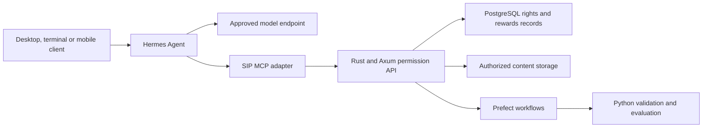

# Hermes Agent research for Sovereign Source

**Research date: 11 October 2026.** Hermes Agent is Nous Research's open-source agent application. It can provide a configurable desktop, terminal and messaging interface for research, coding and tool execution. For Sovereign Source, its strongest potential role is an operator interface connected to the project's permission and attribution services. Its software license does not establish the rights, ancestry or training permissions of the models and content used through it.

**Recommendation:** evaluate a self-hosted Hermes instance with a deliberately selected model and a small set of SIP tools. Keep authoritative rights decisions, contribution records and reward accounting in the existing Rust/Axum and PostgreSQL architecture. This is a proposed integration, not an implemented or benchmarked deployment.

## Product identity and release scope

Several Nous-related names refer to different artifacts:

| Name | What it is | Consequence for this project |
| --- | --- | --- |
| Hermes Agent | Agent software that coordinates a model, tools, sessions and interfaces. | Evaluate its code, deployment and integrations. |
| Hermes models | Separately released model checkpoints. For example, Hermes 3 Llama 3.1 8B is a fine-tuned Llama checkpoint. | Audit the exact model's ancestry and license. |
| OpenHermes 2.5 | An instruction/chat dataset containing synthetic examples. | Audit dataset provenance and permitted uses independently. |
| Nous Portal | A hosted model and tool access service usable from Hermes. | Review routing, service terms and costs separately from the agent code. |
| Hermex | An independent iPhone/iPad client for a running Hermes backend. | Evaluate the mobile client and backend connection separately. |

Sources: [Hermes Agent documentation](https://hermes-agent.nousresearch.com/docs), [Hermes 3 model card](https://huggingface.co/NousResearch/Hermes-3-Llama-3.1-8B), [OpenHermes dataset card](https://huggingface.co/datasets/teknium/OpenHermes-2.5), [Nous Portal documentation](https://hermes-agent.nousresearch.com/docs/integrations/nous-portal) and [Hermex App Store listing](https://apps.apple.com/us/app/hermex/id6767006319).

The GitHub latest-release endpoint identified **v0.21.6**, published **8 October 2026**, with target commit `818c13be1dc4fd28987e1e881a9408224afd4535`. Its release notes say the tag and Docker release advanced while desktop and Termux packages remained on their existing builds. Documentation is continuously updated, so a feature described there must be checked against the actual distribution installed. [Release metadata](https://api.github.com/repos/NousResearch/hermes-agent/releases/latest), [versioned release notes](https://github.com/NousResearch/hermes-agent/releases/tag/v0.21.6).

## Architecture and learning behavior

Hermes has a Python agent core with entry points for terminal use, messaging, an API server, batch operation and programmatic integration. The documented `AIAgent` orchestrates prompt construction, provider selection, model requests, tool execution and persistence. Session history uses SQLite with FTS5 search. Tools can use local execution, containers or remote backends; MCP and plugins extend the available capabilities. [Architecture](https://hermes-agent.nousresearch.com/docs/developer-guide/architecture).

| Capability | Documented behavior | SIP implication |
| --- | --- | --- |
| Persistent memory | Stores reusable notes and user preferences; searches past sessions. | Helpful context, but memories need references to authoritative records. |
| Skills | Creates and updates reusable `SKILL.md` procedures and supporting resources. | Preserve source, version and contributor attribution for adopted procedures. |
| Tools | Calls filesystem, terminal, browser and other integrations. | Give each integration only the permissions needed for its task. |
| Messaging gateway | Routes messages and sessions across supported platforms. | Bind platform identities to authenticated SIP users. |
| MCP | Supports tool servers over local processes or HTTP. | Provides a practical connection to the SIP API. |
| Trajectory export | Produces conversation and tool-use records in ShareGPT-compatible JSONL. | Useful evidence, subject to a separate training-data admission decision. |

Sources: [memory](https://hermes-agent.nousresearch.com/docs/user-guide/features/memory), [skills](https://hermes-agent.nousresearch.com/docs/user-guide/features/skills), [messaging](https://hermes-agent.nousresearch.com/docs/user-guide/messaging), [MCP](https://hermes-agent.nousresearch.com/docs/user-guide/features/mcp) and [trajectory format](https://hermes-agent.nousresearch.com/docs/developer-guide/trajectory-format).

The advertised learning loop primarily concerns accumulated memories, skills and session recall. Those mechanisms do not by themselves demonstrate automatic updates to the underlying model weights. Training trajectories are a separate capability: the documented library/runner option enables saving, while the batch runner saves trajectories as part of its workflow. A training-compatible file format supplies no independent permission to train on its contents. [Memory behavior](https://hermes-agent.nousresearch.com/docs/user-guide/features/memory), [export controls](https://hermes-agent.nousresearch.com/docs/developer-guide/trajectory-format#controlling-trajectory-saving).

## Desktop and mobile access

Hermes Desktop shares the agent's configuration, sessions, skills and memory with its other interfaces. It includes chat, files, settings and voice features. The official web dashboard is another interface; it should not be confused with the separate community project named `hermes-webui`. [Desktop documentation](https://hermes-agent.nousresearch.com/docs/user-guide/desktop), [Hermex backend explanation](https://hermexapp.com/).

| Platform or route | Availability at the research date | Important limitation |
| --- | --- | --- |
| macOS and Windows desktop | Official desktop application and documented installation paths. | Architecture and package support vary; consult the platform matrix. |
| Linux | Official CLI support; desktop source/build paths exist. | The platform matrix says Linux desktop packaging is disabled in the release workflow. |
| iPhone and iPad | Hermex is a free third-party native client. | Requires a reachable Hermes backend; agent execution takes place on that backend. |
| Android on aarch64 | Official Termux installation path with Tier 2 support. | Terminal experience; Android can stop background processes. |
| iPhone or Android messaging apps | Hermes integrations include Telegram, WhatsApp, Discord and others. | The messaging service becomes another participant in the data path. |

Sources: [platform support](https://hermes-agent.nousresearch.com/docs/getting-started/platform-support), [Android guide](https://hermes-agent.nousresearch.com/docs/getting-started/termux), [Hermex listing](https://apps.apple.com/us/app/hermex/id6767006319) and [messaging gateway](https://hermes-agent.nousresearch.com/docs/user-guide/messaging).

No first-party Nous iOS or Android app was identified in the reviewed official platform documentation. Hermex explicitly states that it is unaffiliated with Nous Research. Its listing describes sessions, streamed responses, file diffs, approvals, tasks and notifications. The standard connection uses Hermes Web UI; the listing also advertises optional **Bot Mode beta** for direct connection to an agent host. Support should be verified for the chosen mode and installed version, rather than assuming all Hermes backends expose the same interface. [Hermex listing](https://apps.apple.com/us/app/hermex/id6767006319).

For the initial pilot, desktop or terminal use offers the fewest components. Add mobile access after validating authentication and session continuity. Hermex is a concrete iPhone option; the official messaging gateway is another route across phone platforms.

## Model selection and deployment costs

Hermes supports multiple inference providers and custom compatible endpoints, including locally served models. The model and its serving environment are deployment choices, not properties guaranteed by the Hermes brand. Tool-calling reliability and context support must be tested for the specific checkpoint and server. [Provider guide](https://hermes-agent.nousresearch.com/docs/integrations/providers).

The current configuration guide says auxiliary tasks normally inherit the main model, with overrides available for functions such as compression, vision, voice and title generation. It also supports separate delegation settings and fallback chains. Therefore, a model restriction must cover **primary, auxiliary, delegated and fallback requests**. Inspect the effective configuration and actual request records, particularly when upgrading an older installation. [Configuration guide](https://hermes-agent.nousresearch.com/docs/user-guide/configuration#auxiliary-models).

Nous Portal offers unified hosted access to models and tools, with per-tool configuration. Its documentation describes routing some model requests through other providers. A Portal login consequently does not prove that requests stay within Nous infrastructure or a particular jurisdiction. For a strictly controlled deployment, prefer an explicit endpoint and approved tool destinations whose execution and storage locations are documented. This is a deployment recommendation based on the service's routing description. [Nous Portal](https://hermes-agent.nousresearch.com/docs/integrations/nous-portal).

Budget separately for the agent host, inference, search/browser or other services, storage and maintenance. Self-hosting the agent does not require self-hosting the model; choosing local model inference adds its own hardware requirements. The MIT software license and a free mobile client do not include these operating resources. Exact costs require a model choice and measured workload.

## Licensing and ancestry boundaries

The agent repository's [MIT license at the reviewed release commit](https://github.com/NousResearch/hermes-agent/blob/818c13be1dc4fd28987e1e881a9408224afd4535/LICENSE) permits commercial use and modification of the covered software, subject to preserving its copyright and permission notice in copies or substantial portions. It includes warranty and liability disclaimers. That grant covers the software; model licenses, provider contracts, plugins and retrieved content require their own review.

Using Hermes to call a commercial model does not itself remove that provider's output-use restrictions. Conversely, using Hermes Agent does not automatically require the Hermes model family or OpenHermes training data. For a US-model ancestry condition, pin and review the chosen checkpoint and all auxiliary services. Repository ownership alone cannot certify the full execution path as free of Chinese models or research influences.

For Sovereign Source, carry forward the [independent LLM development pathway](CHATGPT_TO_INDEPENDENT_LLM_PATHWAY.md). A stored conversation may combine human instructions, model-generated text, licensed documents, tool results and code. Admit each intended training use according to its provenance and applicable permissions; an export operation should not automatically move the whole conversation into a training corpus.

## Proposed integration with Sovereign Source

The existing [solution architecture](SOLUTION_ARCHITECTURE.md) supplies the appropriate authority boundaries. Hermes would serve as an optional agent interface. Rust/Axum would continue to enforce permissions and record approved use; Python with Pydantic and Pydantic AI would handle validated processing and evaluation; Prefect would run durable ingestion and training workflows; PostgreSQL would hold contribution, rights and accounting records.

MCP is a documented integration mechanism; the SIP adapter and application behavior in this diagram are proposed work. A small initial tool set could retrieve permitted passages, fetch an attribution record, submit a proposed contribution link and inspect a workflow's status. Tool results should carry stable source IDs and relevant permission decisions. Model-generated attribution remains a proposal until the application's review process accepts it.

Keep reward accounting in a transactionally recorded service with idempotent requests and agreed beneficiary splits. Agent memory is useful for conversation continuity, but PostgreSQL remains the authoritative record of consent, rights and payment eligibility. Browsing a page or recalling an idea is not enough evidence to assign a royalty. SIP reward rules come from accepted contribution agreements and recorded eligible use.

This role does not replace the selected Nemotron target or create a new model-training stack. It adds an interface through which users could operate the existing architecture.

## Operational findings and pilot acceptance

Hermes documents user allowlists, pairing, command approval and container execution options. These controls should be exercised through the intended interface, including mobile approvals and unattended tasks. Profiles and conversation boundaries are useful organizational features, but a multi-tenant SIP service still needs independently enforced authorization. [Security documentation](https://hermes-agent.nousresearch.com/docs/user-guide/security).

The v0.21.6 notes report fixes involving dashboard authentication, untrusted Git filters and email sender parsing. They also distinguish server releases from desktop and Termux updates. Track the deployed server and client versions separately when evaluating whether a relevant fix is present. [Release notes](https://github.com/NousResearch/hermes-agent/releases/tag/v0.21.6).

A bounded pilot should demonstrate:

1. **Model control:** request records identify the approved model and provider for main, auxiliary, delegated and fallback calls.
2. **Permission enforcement:** permitted content is returned, denied content remains inaccessible, and tool receipts identify the applicable decision.
3. **Attribution and rewards:** accepted sources survive answer generation and export; repeated requests cannot duplicate reward events.
4. **Mobile continuity:** the selected client resumes the intended session and delivers an approval to the correct authenticated user.
5. **Training admission:** exported trajectories retain provenance and stay outside training until their intended use is approved.

Measure task completion, failed tool calls, citation accuracy, latency and total operating cost on a small set of licensed research tasks. No installation, performance benchmark or runtime security test was performed for this document. Its capability findings come from official documentation, versioned release material and the mobile app publisher's listing; the integration and acceptance criteria are project proposals.
