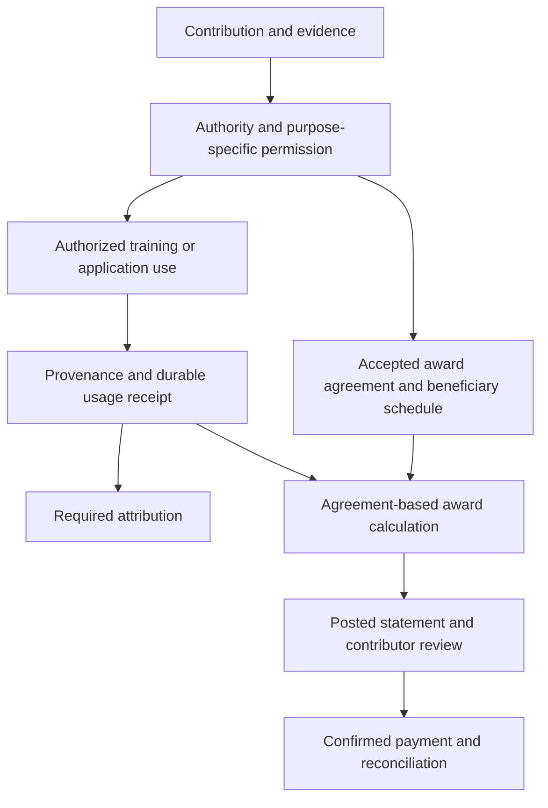

# Sovereign Source LLM Rights and Content Awards 1.0

**Independent Editor's Draft — 15 October 2026**  
**Draft revision:** 0.1 · **Short name:** LRCA · **Record version:** `lrca-0.1`

| Publication information | Value |
| --- | --- |
| Proposing project | Super Sovereign Source LLM IP |
| Framework | Super Intellectual Property, or SIP |
| Intended audience | Model developers, training-data suppliers, publishers, contributors, syndicates, application operators and auditors |
| Source document | [LLM Rights and Content Awards specification](LLM_RIGHTS_AND_CONTENT_AWARDS_SPEC.md) |
| Feedback | [Project issues](https://github.com/niccolox/sovsrc.llm-ip-ideas/issues) |
| Related implementation plan | [Sovereign Source project specification](SOVEREIGN_SOURCE_AI_CODEX_SPEC.md) |
| Related agreements | [Licensing guide](../licenses/README.md) and [syndicate marketplace terms](../licenses/SYNDICATE-MARKETPLACE-TERMS-0.1.md) |

## Abstract

LLM Rights and Content Awards defines a proposed interoperability standard for AI systems that obtain permission for source use, preserve attribution and compensate eligible contributors. It connects contributions to rights records, model and dataset provenance, observed-use receipts, accepted award agreements and auditable settlement.

The standard covers works, research, datasets, code, ideas, prompts, workflows, evaluations, improvements and acknowledged influences. It records legal rights separately from contractual participation and credit. **Content Awards** are benefits earned under accepted contribution agreements; they may include money and separately identified recognition. Calling compensation an award does not make an accrued payment discretionary.

The objective is a portable chain of evidence from contribution to authorized use to contributor benefit. Model weights alone cannot supply this chain. Conforming systems maintain it through their data, training, retrieval, attribution and accounting infrastructure.

## Status of this document

This is an independent proposal written in the style of a W3C technical specification. It is **not a W3C Recommendation, Working Draft, Community Group report or endorsed standard**. No W3C working group, patent-policy commitment or certification program is asserted.

Revision 0.1 defines an abstract data model, processing requirements, two JSON message bindings and a conformance test inventory. It has no demonstrated interoperable implementations. The existing Sovereign Source repository remains at the specification stage. Publication or implementation of this draft does not itself accept an agreement, establish ownership, issue a license or create a payment obligation.

The proposal uses existing web standards where they fit, without claiming that its JSON messages already conform to ODRL, PROV-O or JSON-LD. Its conformance structure follows the distinction between product classes, normative requirements and informative guidance described in the [W3C Specification Guidelines](https://www.w3.org/TR/qaframe-spec/).

## Table of contents

1. [Scope and design goals](#lrca-section-1)
2. [Conformance](#lrca-section-2)
3. [Terminology](#lrca-section-3)
4. [Data model and record integrity](#lrca-section-4)
5. [Permission and contributor authority](#lrca-section-5)
6. [Training and model provenance](#lrca-section-6)
7. [Attribution and observed use](#lrca-section-7)
8. [Content Awards and syndicate distribution](#lrca-section-8)
9. [Accounting and settlement](#lrca-section-9)
10. [Privacy security and sovereign operation](#lrca-section-10)
11. [JSON interchange](#lrca-section-11)
12. [SIP contributor pool profile](#lrca-section-12)
13. [Conformance tests](#lrca-section-13)
14. [Standards alignment and implementation](#lrca-section-14)
15. [Open issues and change control](#lrca-section-15)
16. [References](#lrca-section-16)

<a id="lrca-section-1"></a>

## 1 Scope and design goals

*This section is informative.*

The standard lets a contributor answer five questions: what was contributed, who could authorize its use, how it was used, what credit is required and what benefit is owed. A laboratory can carry the answers across suppliers, training runs, model releases and downstream applications. A community syndicate can administer shared contributions without losing individual credit or obscuring payments.

Covered operations include acquisition, indexing, embedding, retrieval, generation, pretraining, adaptation, evaluation, distillation and model distribution. A deployment can implement a subset and disclose it through the conformance classes below.

The standard does not prescribe a model architecture, vendor, country of origin, blockchain, universal royalty rate or proprietary payment rail. It does not turn every fact or idea into exclusive property. It does not resolve copyright disputes, establish legal exceptions or prove that an individual training example caused a generated answer. These boundaries allow recognition and contracted rewards for a broader universe of contributions without conflating recognition with ownership.

An illustrative lifecycle is:



An award agreement is optional for otherwise authorized open use. The diagram's award branch applies only where an accepted earning mechanism exists.

<a id="lrca-section-2"></a>

## 2 Conformance

### 2.1 Requirement language

Sections 2–11 and 13 are normative. Section 12 is normative only for implementations expressly claiming the optional SIP contributor pool profile. Other sections, examples, notes and diagrams are informative.

Uppercase requirement terms, including **MUST**, **MUST NOT**, **SHOULD** and **MAY**, follow BCP 14 as specified in [RFC 2119](https://www.rfc-editor.org/rfc/rfc2119.html) and [RFC 8174](https://www.rfc-editor.org/rfc/rfc8174.html). Lowercase uses have their ordinary meanings.

### 2.2 Conformance classes

| Class | Required behavior | Applicable sections |
| --- | --- | --- |
| Rights Issuer | Register contributions, review authority and issue versioned permission and attribution records | 2–5, 7.1, 10, 11.1, 13 |
| Training Consumer | Admit authorized data, record actual training use and disclose model lineage and inherited obligations | 2–7, 10, 11.1–11.3, 13 |
| Serving Consumer | Enforce source permissions, preserve required credit and issue durable use receipts | 2–5, 7, 10, 11.1–11.3, 13 |
| Awards Operator | Apply accepted award agreements, distribute shares, issue statements and reconcile payments and disputes | 2–5, 7.2, 8–11, 13 |

A class MUST satisfy the requirements addressed to its role in the applicable sections. Consuming a supporting record requires validating it, not assuming every responsibility of its issuer. A combined implementation MUST satisfy the union of its claimed classes.

**An end-to-end LRCA Content Awards deployment MUST include a Rights Issuer, at least one Consumer class and an Awards Operator**, with authenticated record exchange between them. The roles MAY be operated by different organizations. A citation-only interface or a trained checkpoint on its own MUST NOT claim end-to-end Content Awards conformance.

A conformance statement MUST identify the exact draft revision, implementation version, classes, supported operations, optional profiles, extensions, test results and deployment boundary. It MUST distinguish simulated settlement from actual payment support. It MUST NOT imply W3C certification or complete legal clearance. Unmet MUST requirements invalidate the affected class claim; deviations from SHOULD requirements MUST be explained.

### 2.3 Extensibility

Extensions MUST have versioned identifiers and documented semantics. They MUST NOT weaken a core requirement. An unknown extension affecting permission, mandatory attribution, award eligibility or financial calculation MUST cause the affected action to stop with `unsupported_requirement`. Unknown informational metadata MAY be preserved without interpretation.

<a id="lrca-section-3"></a>

## 3 Terminology

| Term | Definition |
| --- | --- |
| Contribution | Identified material or a documented activity offered for use, acknowledgment or an agreed benefit. An idea is represented by its documented proposal and evidence, not an exclusive claim over every similar idea. |
| Contribution version | An immutable description of a particular contribution and its referenced evidence or content. |
| Contributor | A person or organization responsible for a contribution. Contributor status does not automatically imply ownership or licensing authority. |
| Rights holder | A party claiming or establishing authority over specified rights in specified material. The record includes the claim's evidence and review status. |
| Permission basis | An identified public license, accepted grant, public-domain determination or reviewed legal basis authorizing a particular operation. |
| Attribution claim | An evidenced statement about authorship, quotation, support, reuse, training participation, adoption or influence. |
| Qualified use | A deduplicated event that satisfies an accepted award agreement's earning conditions. Observed use and qualified use are distinct. |
| Content Award | A contractual contributor benefit with an identified earning mechanism, obligor and beneficiary. Monetary awards and nonmonetary recognition are separate benefit types. |
| Award agreement | Accepted terms defining qualification, benefit calculation, beneficiaries, payment duties and dispute handling. A listing or proposed offer is not acceptance. |
| Syndicate | A voluntary administrator for identified contributors and assets under scoped, accepted mandates. |
| Usage receipt | A record of an observed operation, its authorization evidence, applicable agreement versions and attribution. It does not by itself prove legal title or causal model influence. |
| Award statement | A versioned calculation and accounting record explaining provisional or posted benefits for an accounting period. |
| Sovereign deployment profile | Explicit controls over execution location, processing parties, administration, keys and export. Sovereignty does not itself establish source permissions. |

<a id="lrca-section-4"></a>

## 4 Data model and record integrity

### 4.1 Common requirements

**DM-01.** Records MUST have a globally unique absolute URI identifier, an issuer, a creation timestamp, a record type and a specification version. References MUST identify immutable versions. A material change MUST receive a new identifier and reference the version it supersedes. A recipient MUST reject different record contents presented under the same issuer and identifier.

Record IDs and references use [RFC 3986](https://www.rfc-editor.org/rfc/rfc3986.html) URI syntax. They need not be public URLs or publicly resolvable. Timestamps MUST use the [RFC 3339](https://www.rfc-editor.org/rfc/rfc3339.html) format with a known UTC offset; UTC `Z` is the exchange default. Creation time, operation time, agreement effective time and accounting cutoff MUST remain distinguishable.

**DM-02.** An issuer MUST retain evidence of its authority to make the asserted record. Processors MUST authenticate an issuer and apply an explicit trust policy before relying on its records. A digest, signature or registry entry MUST NOT be treated as proof that the underlying rights claim is true.

**DM-03.** Original records, corrections and supersession links MUST remain auditable subject to lawful retention and erasure requirements. Privacy-required deletion MUST use a restricted deletion record describing the affected identifiers and retention basis, without reproducing deleted personal data. Financial obligations MUST NOT be silently deleted with source content.

### 4.2 Supporting records

The following table defines the minimum abstract information for supporting records. An implementation MUST retain the fields relevant to its role, with an explicit reason for an unavailable value. Missing information required for authorization or payment MUST block that action. These supporting records MAY use an agreed external format; its format and version MUST be declared and available to authorized recipients. Revision 0.1 standardizes JSON bindings for Usage Receipts and Award Statements in section 11, rather than defining a wire schema for every supporting record.

| Record | Required information |
| --- | --- |
| Party | Stable identifier, role, permitted display identity, contact or service endpoint, and restricted legal identity where needed for contracting or payment |
| Contribution version | Kind, title or description, contributors, material or evidence reference, source version, content digest where material is available, upstream references, review status and credit preferences |
| Authority mandate | Delegator, delegate, contribution scope, delegated actions, start and end conditions, acceptance evidence, revocation and survival rules |
| Permission record | Contribution versions, identified rights or interests, authorizing parties or reviewed basis, permitted operations, applicable recipients and purpose, time and territory scope, restrictions, duties, terms reference, effective status and review evidence |
| Attribution claim | Subject and upstream contribution versions, relationship type, evidence, claimant, reviewer where reviewed, status, required credit form and disclosure limits |
| Training manifest | Run and dataset versions, admitted contribution references, permission snapshots, transformation history, deduplication method, exposure units and their meter, training operation, participating model dependencies and resulting artifacts |
| Model provenance | Checkpoint identity and digest, parent checkpoints, training-manifest references, tokenizer and learned dependencies, teacher/synthetic-data provenance, redistribution terms, unresolved lineage and surviving obligations |
| Award agreement | Parties and obligor, covered contributions and uses, acceptance evidence, effective dates, earning mechanism, meter or score policy, monetary or recognition benefit, split schedule, adjustments, payment terms and disputes |
| Split schedule | Applicable agreement and contribution, effective interval, beneficiary identifiers, exact shares, fee treatment, approval evidence and mandate references |
| Settlement record | Award-statement lines, beneficiary, currency and amount, payment attempt identity, provider or payment-rail reference, state, timestamps and reconciliation evidence |
| Dispute or correction | Claimant, affected records and amounts, reason, supporting evidence, response deadlines, reviewer, decision and any resulting adjustment references |

Content digests, when used, MUST identify the exact bytes and representation being hashed. This draft's digest representation is `{ "algorithm": "sha-256", "value": "<64 lowercase hexadecimal characters>" }`, using SHA-256 as described in [RFC 6234](https://www.rfc-editor.org/rfc/rfc6234.html). Hashes of normalized text MUST also identify the transformation and version. A source URL alone is not an immutable content version.

### 4.3 Claims and status

Attribution and authority claims MUST distinguish `asserted`, `reviewed`, `disputed`, `rejected` and `superseded` states. A reviewed claim MUST identify the reviewer, evidence and review scope. Review means an administrative assessment; it MUST NOT be presented as a court determination of title.

Accepted credit, licensing authority, ownership, governance votes and economic shares MUST be stored as separate assertions. AI confidence, similarity and graph centrality MUST NOT substitute for these records.

Rights records MUST identify the interest actually evaluated, such as copyright, patent rights, database rights, confidentiality, trade secrets, trademark or identity permissions, or a contractual contribution interest. A clearance for one interest MUST NOT imply clearance for another. An idea or influence MAY receive credit and contracted awards without an assertion of exclusive statutory ownership.

<a id="lrca-section-5"></a>

## 5 Permission and contributor authority

### 5.1 Purpose-specific admission

**RI-01.** Before an operation, the Consumer MUST identify an applicable permission basis for the actual contribution version, operator, recipients, purpose, location and time. The basis MUST cover every operation performed, including external processing. Acquisition or public accessibility alone MUST NOT be interpreted as permission for training or redistribution.

The core operation vocabulary is `acquire`, `index`, `embed`, `retrieve`, `generate_with_context`, `reproduce`, `pretrain`, `fine_tune`, `distill`, `evaluate`, `distribute_model` and `adopt_contribution`. Implementations MUST distinguish these operations. Permission for one MUST NOT imply another unless the referenced terms expressly cover both. `generate_with_context` identifies use of supplied material in an inference request; reproduction in the response still requires its applicable basis. `adopt_contribution` records reviewed adoption of a proposal, workflow or improvement under its applicable terms; it does not imply that an idea is exclusively owned.

**RI-02.** A direct grant MUST identify an authorized grantor and reliable acceptance or license-adoption evidence where required. A syndicate grant MUST additionally identify an effective mandate covering that asset and action. Membership alone MUST NOT transfer ownership or grant authority over a member's entire portfolio.

**RI-03.** A public-domain or legal-exception basis MUST identify the jurisdiction, operation, evidence, accountable reviewer and review date. The standard supplies no substantive determination that an exception applies. `unknown` MUST NOT be treated as permission.

### 5.2 Resolution and enforcement

A permission decision MUST record the selected basis, applicable duties, relevant versions, evaluated context and outcome. A Consumer MUST stop the affected operation on missing authority, unmet duties, unresolved material conflict or an unsupported restriction. A failure response SHOULD identify a correctable reason without revealing confidential evidence.

An independent, valid public-license basis MAY authorize use without a paid agreement. A competing paid offer or an unsupported third-party claim MUST NOT automatically override that basis. The Consumer MUST evaluate actual applicable obligations and the dispute evidence; restrictions from unrelated grants MUST NOT be blindly combined.

**RI-04.** Marketplace membership and payments MUST NOT be imposed as additional conditions on rights already available under a selected public license. Open-license notices and duties MUST still be honored. A separate agreement MAY purchase additional services, permissions or benefits without withdrawing existing public rights.

### 5.3 Withdrawal and survival

Withdrawal requests MUST identify their scope and effective time. Consumers MUST stop new operations lacking a surviving basis and evaluate existing copies, checkpoints and ongoing obligations under the applicable terms. A withdrawn listing MUST NOT be represented as revoking every previously granted license. Existing earned awards MUST remain accounted for.

When a remedy requires removal, retraining, unlearning or restricted distribution, the operator MUST record the required action, affected artifacts, evidence of completion and any residual limitations. It MUST NOT claim that deleting a source file proves removal of its effects from model weights.

<a id="lrca-section-6"></a>

## 6 Training and model provenance

**TR-01.** A Training Consumer MUST produce an admission manifest before training and reconcile it with actual consumed data after the run. Each admitted contribution MUST resolve to permission evidence for the training operation. The manifest MUST record exclusions, deduplication, transformations and actual exposure according to the declared meter. An available dataset entry MUST NOT be reported as trained on when it was never consumed.

**TR-02.** Checkpoint provenance MUST distinguish newly initialized training from continued pretraining, adaptation, merging and distillation. It MUST record parent weights and relevant learned dependencies, including tokenizers, embedding models, filtering models, teachers and reward models. Unknown ancestry MUST be marked unknown. It MUST NOT be described as independent or fully permissioned solely because the final checkpoint has a permissive license.

**TR-03.** Synthetic training examples MUST retain their generating-model and service references, the applicable output-use terms and any incorporated source obligations. Distillation requires an applicable teacher-use basis as well as rights to any supplied content. Generating a paraphrase MUST NOT automatically clear upstream duties.

**TR-04.** Model releases MUST carry an accessible provenance summary and an authorized audit path to restricted manifests. Surviving attribution and award obligations MUST be associated with the covered model family or descendant scope defined by the agreement. Renaming or distilling a covered product MUST NOT erase those obligations.

A model card MAY provide corpus-level acknowledgment. It MUST distinguish dataset participation from demonstrated support for an individual response. An estimated training influence MUST be labeled as an estimate with its method, scope and uncertainty; it MUST NOT be presented as a verified causal royalty meter.

<a id="lrca-section-7"></a>

## 7 Attribution and observed use

### 7.1 Attribution relationships

**AT-01.** Implementations MUST distinguish these relationships:

| Relationship | Evidence represented |
| --- | --- |
| `quotation` | Identified source passage reproduced in an output |
| `retrieved_support` | A retrieved source passage supporting an identified response claim |
| `recorded_reuse` | An observed reuse or transformation of a contribution |
| `training_participation` | Contribution exposure recorded in a training run |
| `adopted_contribution` | Reviewed adoption of an idea, workflow or improvement |
| `acknowledged_influence` | An accepted acknowledgment with its recorded scope |
| `estimated_influence` | A method-dependent hypothesis, with uncertainty and review status |

AI MAY propose relationships. An authorized review process MUST accept a proposal before it changes mandatory credit, permissions or award eligibility. A citation alone MUST NOT assert ownership, a payment entitlement or model-training membership.

**AT-02.** Required credit MUST accompany the supported output or its agreed notice surface and survive supported exports. It MUST preserve the agreed name or alias, contribution identifier, required license notice and applicable relationship. An operator MUST NOT use a source in an output mode that cannot satisfy its mandatory attribution. Confidential credit MAY use an agreed restricted view; confidentiality MUST NOT be used to silently omit required credit.

### 7.2 Usage receipts

**US-01.** A Consumer MUST record observed operations independently of whether they earn an award. A receipt MUST distinguish acquired material, model-context inclusion, reproduced or cited material, actual training exposure and accepted adoption. These observations MUST NOT be merged into a single unexplained popularity score.

Each operation MUST have an economic event identifier stable across retries, a contribution version, permission references and a timestamp. Where an award agreement may apply, the Consumer MUST freeze its applicable agreement and split-schedule versions at the agreement's eligibility time. The Awards Operator MUST separately evaluate qualification against those snapshots.

Meters MUST specify unit, measurement stage, algorithm and version, deduplication boundary and treatment of retries. Token meters MUST additionally identify tokenizer artifacts, normalization, source/context/output stage and treatment of repeated or cached material. Model-provider compute tokens and licensed-content tokens MUST be reported separately. A token counter MUST NOT imply ownership of ordinary language or a universal royalty on every generated token.

### 7.3 Serving sequence

**US-02.** A Serving Consumer MUST:

1. Authenticate the requesting principal and evaluate tenant, purpose and deployment restrictions.
2. Filter candidates before unauthorized source retrieval or external processing.
3. Confirm permissions for selected contributions, prompts, processing services and the requested operations.
4. Generate the response, then validate reproduced content and required attribution.
5. Recheck relevant permissions immediately before delivery, accounting for effective changes and surviving grants.
6. Durably persist the use receipt and financial-event handoff before releasing metered content.
7. Deliver the response with the permitted attribution and receipt view.

If durable event capture fails, the affected delivery MUST stop. Background retries MUST NOT create another economic event. Protected output MUST be buffered unless a streaming protocol proves equivalent authorization, attribution and durable capture before each released portion.

**US-03.** Preparation, delivery attempt and confirmed delivery MUST remain distinguishable. A later delivery outcome MUST be a linked record, not a silent rewrite of an earlier receipt. If a contract pays on attempted use, successful delivery or another event, the award calculation MUST use that exact condition. A lost connection MUST NOT be treated as proof of delivery.

<a id="lrca-section-8"></a>

## 8 Content Awards and syndicate distribution

### 8.1 Accepted earning terms

**AW-01.** An Awards Operator MUST obtain an accepted agreement before treating a contribution as enrolled in a Content Awards mechanism. Enrollment MUST identify the obligor, contributions, qualified-use rules, benefit type, calculation policy, payment currency where relevant, beneficiaries, effective dates and acceptance evidence. Material changes MUST follow the agreement's approval procedure and MUST NOT silently alter already earned amounts.

Permitted monetary mechanisms include fixed licensing fees, qualified-use fees, revenue shares, adoption bounties, minimum guarantees and separately funded grants. The agreement MUST state the funding and calculation basis. Registration, view count, citation count or influence estimation alone MUST NOT create a payable obligation.

Recognition MAY include credit, acknowledgments or contribution credentials. Recognition MUST NOT substitute for promised money without the beneficiary's accepted amendment. Ordinary private prompts and conversations MUST NOT be enrolled merely because a user interacted with a product; shared contribution enrollment and training consent require distinct recorded choices.

### 8.2 Economic allocation

**AW-02.** Each qualified event MUST resolve to one agreement and split schedule per earning mechanism. Distinct mechanisms MAY apply when expressly agreed. Duplicate registrations, overlapping portfolios, multiple attribution paths and processing retries MUST NOT duplicate the same liability.

The policy MUST define how value is allocated, including scores, weights, caps, exclusions, guarantees, offsets, fees and rounding. Beneficiary shares MUST be expressly accepted. They MUST NOT be inferred from AI-assigned confidence, credit order, voting power or graph centrality. An influence estimate alone remains insufficient evidence of qualified use.

Where an influence contributor receives a named share of an adopted contribution, the operator MUST NOT also award adoption points for the same economic contribution. A separate influence award requires a distinct, evidenced and accepted earning basis.

### 8.3 Syndicate mandates and splits

**AW-03.** Participation MUST be voluntary and asset-scoped. An Awards Operator MUST verify the syndicate's authority to enroll assets, agree terms, change schedules and receive funds. Delegated licensing authority and payment collection authority MUST be independently identifiable.

Beneficiary shares MUST sum exactly to 100% of the distributable amount. An administration fee MUST be either a disclosed deduction before splitting or a share within the split, never both for the same fee. Schedule changes MUST have effective times and approval evidence. Overlapping effective schedules for the same mechanism MUST be resolved before posting.

Members MUST have access to their applicable mandates, credits, calculations and statements. Exit MUST preserve accrued balances and surviving agreements. A syndicate vote or a new attribution claim MUST NOT retroactively redirect a posted beneficiary allocation.

### 8.4 Disputes and appeal

**AW-04.** Operators MUST provide a documented route for missing credit, authority conflicts, meter errors, fraud and payment disputes. It MUST identify response deadlines, evidence access, conflict-of-interest handling, a reasoned decision and an appeal path.

Only specifically contested amounts or legally restricted amounts MAY be held. Unrelated undisputed sums MUST continue through normal settlement. A bookkeeping reserve MUST NOT be described as legal escrow unless the actual arrangement supports that claim. An administrative decision MUST NOT be presented as a binding determination of a nonparty's ownership.

<a id="lrca-section-9"></a>

## 9 Accounting and settlement

### 9.1 Exact accounting

**AC-01.** Monetary values MUST use integer minor units with an explicit currency and scale. Intermediate calculations MUST use exact decimal or rational arithmetic. Binary floating point MUST NOT determine a payable amount. Currencies MUST be settled separately; any conversion MUST record its agreed rate, time, source and fees.

**AC-02.** Each posted statement MUST retain the agreement, policy, meter, eligibility, revenue and split snapshots needed to reproduce it. Posting MUST atomically create balanced ledger entries and the statement reference. An idempotent retry MUST return the existing economic result. It MUST NOT post it again.

**AC-03.** Posted financial records MUST be append-only. Refunds, corrections, late events and reversals MUST create linked adjustments under the applicable agreement. A new estimate MUST NOT silently replace an earned balance. Minimum guarantees and fixed fees MUST remain payable as agreed even when they exceed a variable award pool.

### 9.2 State and payment evidence

Calculation state and payment state MUST remain separate:

| Dimension | States and meaning |
| --- | --- |
| Calculation | `provisional`: estimate; `posted`: recorded liability or adjustment with ledger evidence |
| Payment | `not_initiated`, `initiated`, `confirmed`, `failed`, `returned` |
| Restriction | A separately recorded hold amount, reason, authority and review date; it does not erase the liability |

**AC-04.** A payment MUST be marked `confirmed` only when the payment rail's agreed confirmation evidence is recorded. Initiation, a queue entry or a screenshot of a requested transfer is insufficient. Returned payments MUST create a reconciliation event and update outstanding amounts without deleting the original confirmation history. A simulated payment MUST be visibly marked simulated.

Statements MUST show gross awards, allowed deductions, distributable amounts, beneficiary allocations, holds, adjustments and payment references. Beneficiaries MUST receive an accessible explanation and an export of their own records without exposure of other contributors' private identities. Thresholds and carry-forward rules MUST be disclosed; a threshold MUST NOT silently forfeit accrued balances.

<a id="lrca-section-10"></a>

## 10 Privacy security and sovereign operation

**PS-01.** Implementations MUST separate public attribution from private legal identities, contracts, prompts and payment details. Access MUST be limited by role, tenant and purpose. Pseudonyms MUST be supported where compatible with the applicable credit and contracting terms. Receipt exports MUST omit unnecessary private content; a redacted view MUST identify itself as a view and preserve a controlled audit path.

**PS-02.** Records MUST have authenticated origin and integrity protection in storage and exchange. Operators MUST document issuer trust, credential rotation, access revocation, retention and recovery. This draft does not standardize a portable signature suite; deployments MUST disclose their chosen mechanism. A tamper-evident record still requires source and authority review.

**PS-03.** Rights metadata, retrieved documents and model outputs MUST be treated as untrusted input. Content MUST NOT change permissions, approve its own attribution, redirect beneficiaries or authorize payments. Financial-policy execution MUST be outside model-generated reasoning. External URI resolution MUST use an explicit access policy to prevent unauthorized network access and data disclosure.

**PS-04.** Operators MUST assess duplicate claims, fabricated authorship, collusive usage, synthetic engagement, poisoned data and replayed receipts. Fraud controls MUST preserve evidence, explain affected decisions and support appeal. A statistical suspicion MUST NOT silently confiscate unrelated balances.

**PS-05.** Private conversations MUST remain outside shared contribution enrollment and shared model training unless the applicable separate consents and source permissions have been recorded. Consent to answer a request MUST NOT be treated as consent to those additional uses.

A claimed sovereign deployment profile MUST state permitted locations and processing parties, administrator access, key control, backup locations, model-update authority and export rules. Every external service involved in content processing MUST be evaluated against that profile. Self-hosting alone MUST NOT be presented as proof of full sovereignty or source-rights compliance.

<a id="lrca-section-11"></a>

## 11 JSON interchange

### 11.1 Common envelope and validation

Messages MUST be UTF-8 JSON under [RFC 8259](https://www.rfc-editor.org/rfc/rfc8259.html). Object member names MUST be unique. A recipient MUST reject malformed values, duplicate members, unknown core fields, missing required fields, unsupported record versions and unresolved critical extensions before performing the affected action. Extensions belong only in `extensions`.

The following fields are required on both bound record types. Tables in this section are normative; examples are illustrative.

| Field | JSON type | Rule |
| --- | --- | --- |
| `specVersion` | string | Exactly `lrca-0.1` |
| `type` | string | `UsageReceipt` or `AwardStatement` |
| `id` | string | Immutable absolute URI |
| `issuer` | string | Issuing Party URI |
| `createdAt` | string | RFC 3339 timestamp with known offset |
| `visibility` | string | `public`, `participants` or `restricted`; actual access still requires authorization |
| `evidenceRefs` | array of strings | Immutable evidence URIs; empty only when no external evidence is required |
| `extensions` | array of objects | Empty by default; each entry has exactly `id` (versioned URI), `critical` (boolean) and `value` (JSON value) |

Optional common fields are `supersedes` (prior record URI) and `correctionOf` (record URI). They MUST NOT be used to mutate a posted statement in place. Every permission, financial or mandatory-credit extension MUST set `critical` to `true`.

References MUST resolve within the authorized audit context before decisions that depend on them. Public dereferencing is not required. A recipient MAY transport records in a bundle or refer to an authenticated registry; this draft does not mandate HTTP endpoints or register a new media type. `application/json` is sufficient for this binding.

JSON integers used for `scale` MUST be in 0–18. All monetary amounts and usage counts are decimal integer strings: `0` or a nonzero decimal digit followed by zero or more decimal digits. Adjustment money MAY additionally have a leading minus sign; `-0`, leading zeros, decimals and exponent notation are invalid. URI arrays MUST NOT contain duplicate values.

### 11.2 Usage Receipt binding

| Additional field | JSON type | Rule |
| --- | --- | --- |
| `eventId` | string | Economic event URI, stable across retries and receipt stages |
| `occurredAt` | string | Timestamp of the observed operation |
| `operation` | string | One core operation from section 5.1 |
| `stage` | string | `prepared`, `observed`, `delivery_attempted`, `delivery_confirmed` or `delivery_failed` |
| `operator` | string | Responsible Consumer Party URI |
| `deployment` | string | Versioned deployment-policy URI |
| `artifact` | string | Exact model, run or product version URI |
| `contribution` | string | One contribution-version URI; issue separate receipts for distinct contributions |
| `permissionRefs` | nonempty array of strings | Selected permission-record URIs |
| `agreementRefs` | array of strings | Applicable award-agreement version URIs; empty for no enrolled mechanism |
| `splitRefs` | array of strings | Applicable split versions; required entries for enrolled mechanisms that distribute benefits |
| `attributionRefs` | array of strings | Attribution-claim URIs; empty only where none apply |
| `meter` | object | Exactly `policy` (versioned meter URI), `unit` (nonempty string) and `quantity` (nonnegative integer string) |
| `relatedReceipt` | string, optional | Earlier receipt URI for a later stage or correction |

The meter policy MUST define any fraction as a scaled integer unit. `prepared` means authorized preparation, not completed use; `observed` records the operation itself. Delivery-stage receipts MUST link to the prior stage, carry the same `eventId` and MUST NOT independently duplicate a charge. Multiple delivery attempts MUST be distinguishable in evidence. The applicable agreement determines which observations qualify.

### 11.3 Usage Receipt example

*Informative. Synthetic identities and references; the supporting records are not included in this example. The receipt records use of a passage as context, with a separately agreed earning condition. It does not assert successful customer delivery.*

```json
{
  "specVersion": "lrca-0.1",
  "type": "UsageReceipt",
  "id": "urn:example:receipt:context-42:v1",
  "issuer": "urn:example:party:operator",
  "createdAt": "2026-10-15T16:00:01Z",
  "visibility": "participants",
  "evidenceRefs": ["urn:example:evidence:context-42:v1"],
  "extensions": [],
  "eventId": "urn:example:event:context-42",
  "occurredAt": "2026-10-15T16:00:00Z",
  "operation": "generate_with_context",
  "stage": "observed",
  "operator": "urn:example:party:operator",
  "deployment": "urn:example:deployment:us-private:v1",
  "artifact": "urn:example:model:research-assistant:v3",
  "contribution": "urn:example:contribution:research-note:v2",
  "permissionRefs": ["urn:example:permission:context-use:v1"],
  "agreementRefs": ["urn:example:agreement:context-fee:v1"],
  "splitRefs": ["urn:example:split:research-note:v1"],
  "attributionRefs": ["urn:example:attribution:research-note:v1"],
  "meter": {
    "policy": "urn:example:meter:unique-context-inclusion:v1",
    "unit": "qualified_context_inclusion",
    "quantity": "1"
  }
}
```

### 11.4 Award Statement binding

This binding covers monetary awards. Nonmonetary recognition remains a separately typed supporting record and MUST NOT be mixed into monetary totals.

| Additional field | JSON type | Rule |
| --- | --- | --- |
| `periodStart`, `periodEnd` | strings | Timestamps for a nonempty half-open interval: start included, end excluded |
| `cutoffAt` | string | Evidence cutoff timestamp, at or after `periodEnd` |
| `obligor` | string | Party URI responsible for the liability |
| `currency` | string | Three uppercase letters identifying an ISO 4217 currency; one currency per statement |
| `scale` | integer | Decimal places in the statement's minor unit; the agreement MUST fix it consistently for that currency |
| `calculationState` | string | `provisional` or `posted` |
| `lines` | nonempty array of objects | Line fields defined below |
| `totalMinor` | string | Signed sum of line `amountMinor` values |
| `ledgerTransaction` | string, conditional | Ledger transaction URI; REQUIRED for `posted`, absent for `provisional` |
| `settlementRefs` | array of strings | Settlement-record URIs; empty until relevant records exist |

Each line has exactly: `id` (unique URI), `beneficiary` (Party URI), `contribution` (version URI), `agreement` (version URI), `split` (version URI), `calculation` (reproducible calculation-record URI), `basisRefs` (nonempty array of evidence or receipt URIs), `amountMinor` (signed integer string), `heldMinor` (nonnegative integer string) and `adjustmentOf` (array of prior line URIs, empty for an original earning).

Negative amounts MUST be adjustments with nonempty `adjustmentOf`. A positive correction MAY also reference earlier lines. `heldMinor` MUST be zero for a negative or zero line and MUST NOT exceed a positive `amountMinor`. Holds remain part of the posted total, not a deduction from the liability. Calculation records MUST expose gross amount, fees, share, rounding and any guarantee or offset to the authorized auditor. Payment state belongs to referenced settlement records, not a mutable statement field.

### 11.5 Award Statement example

*Informative. An adopted contribution earns USD 2,000 under an accepted agreement, split 60% to its idea contributor, 25% to its implementation contributor and 15% to its acknowledged influence contributor. There is no administration fee. This example is independent of the context-use receipt above and illustrates posting, not a completed payment.*

```json
{
  "specVersion": "lrca-0.1",
  "type": "AwardStatement",
  "id": "urn:example:statement:adoption-october:v1",
  "issuer": "urn:example:party:awards-operator",
  "createdAt": "2026-11-01T12:00:00Z",
  "visibility": "participants",
  "evidenceRefs": ["urn:example:evidence:adoption-7:v1"],
  "extensions": [],
  "periodStart": "2026-10-01T00:00:00Z",
  "periodEnd": "2026-11-01T00:00:00Z",
  "cutoffAt": "2026-11-01T10:00:00Z",
  "obligor": "urn:example:party:laboratory",
  "currency": "USD",
  "scale": 2,
  "calculationState": "posted",
  "lines": [
    {
      "id": "urn:example:statement-line:adoption-7:idea",
      "beneficiary": "urn:example:party:idea-contributor",
      "contribution": "urn:example:contribution:adoption-7:v1",
      "agreement": "urn:example:agreement:adoption-7:v1",
      "split": "urn:example:split:adoption-7:v1",
      "calculation": "urn:example:calculation:adoption-7:idea:v1",
      "basisRefs": ["urn:example:evidence:adoption-7:v1"],
      "amountMinor": "120000",
      "heldMinor": "0",
      "adjustmentOf": []
    },
    {
      "id": "urn:example:statement-line:adoption-7:implementation",
      "beneficiary": "urn:example:party:implementation-contributor",
      "contribution": "urn:example:contribution:adoption-7:v1",
      "agreement": "urn:example:agreement:adoption-7:v1",
      "split": "urn:example:split:adoption-7:v1",
      "calculation": "urn:example:calculation:adoption-7:implementation:v1",
      "basisRefs": ["urn:example:evidence:adoption-7:v1"],
      "amountMinor": "50000",
      "heldMinor": "0",
      "adjustmentOf": []
    },
    {
      "id": "urn:example:statement-line:adoption-7:influence",
      "beneficiary": "urn:example:party:influence-contributor",
      "contribution": "urn:example:contribution:adoption-7:v1",
      "agreement": "urn:example:agreement:adoption-7:v1",
      "split": "urn:example:split:adoption-7:v1",
      "calculation": "urn:example:calculation:adoption-7:influence:v1",
      "basisRefs": ["urn:example:evidence:adoption-7:v1"],
      "amountMinor": "30000",
      "heldMinor": "0",
      "adjustmentOf": []
    }
  ],
  "totalMinor": "200000",
  "ledgerTransaction": "urn:example:ledger:posting:adoption-7",
  "settlementRefs": []
}
```

<a id="lrca-section-12"></a>

## 12 SIP contributor pool profile

*This section is normative only when an accepted agreement expressly selects `SIP-Pool-0.1`. It preserves the project's proposed economics; it is not a universal LRCA fee.*

### 12.1 Revenue and allocation

For each agreed period, product scope and currency:

```text
R = collected revenue attributed to covered products
    - refunds
    - chargebacks
    - sales taxes
    - directly charged payment processing fees

P = 0.20 × max(R, 0)

Corpus track = 0.60 × P
Prompt and workflow track = 0.20 × P
Idea, contribution and influence track = 0.20 × P

Contribution allocation = track amount × contribution score / total eligible track score
```

**SP-01.** Compute, salaries, marketing and general overhead MUST NOT be deducted in calculating `R`. Bundle allocation, product scope, cohort mapping and revenue adjustments MUST be versioned and agreed before eligible use.

**SP-02.** Corpus scores MUST use deduplicated, capped training exposure and predefined weights within the agreed model cohort. Prompt/workflow scores MUST use verified eligible paid executions under disclosed weights and fraud rules. Idea/contribution scores MUST use reviewed adoption points. Influences qualify only through expressly agreed shares or separate, nonduplicative adoption agreements. Retrieval fees MUST follow their own agreed mechanism and MUST NOT be silently converted to training exposure.

**SP-03.** If a track has no eligible score, its allocation MUST be reserved for reconciliation under the agreement. It MUST NOT be redistributed to another track without accepted authority. Minimum guarantees, per-use fees and bounties remain obligations even when they exceed the pool. An offset MUST apply only where expressly accepted, at its named contribution or beneficiary level, once; it MUST NOT reduce other beneficiaries' shares.

### 12.2 Rounding and syndicate shares

**SP-04.** Round the nonnegative total pool to currency minor units using round-half-up. Distribute each rounded pool across tracks, contributions and beneficiaries by the largest-remainder method: take integer floors, then assign residual minor units in descending fractional-remainder order. Break ties by ascending UTF-8 byte order of the immutable track, contribution or beneficiary URI. The policy MUST freeze these identifiers and the calculation order. Do not round scores before allocation.

This profile defaults to a zero administration fee. An accepted fee schedule MUST state its amount or exact formula, recipient and whether it is a pre-distribution deduction or a beneficiary share. A deduction MUST be rounded by the same declared monetary rule before the remaining sum is split. The same fee MUST NOT appear in both positions.

For illustration, USD 1,000,000 of eligible revenue produces a USD 200,000 pool: USD 120,000 for corpus contributions and USD 40,000 for each other track. A contribution earning 5% of the adoption track receives USD 2,000. Its accepted 60/25/15 schedule produces USD 1,200, USD 500 and USD 300. A credit-only influence receives acknowledgment without an allocation.

<a id="lrca-section-13"></a>

## 13 Conformance tests

An implementation MUST publish results for each applicable test below and additional tests covering its claimed operations. Each result MUST state implementation version, test inputs, expected outcome, actual outcome and any limitation. Passing JSON validation alone is insufficient for actor or end-to-end conformance.

| Test | Applies to | Input or condition | Required outcome |
| --- | --- | --- | --- |
| CT-01 | All | Same record ID with changed content | Reject the conflicting record; retain audit evidence |
| CT-02 | Consumers | Retrieval permission supplied for pretraining | Refuse training admission without a separate applicable basis |
| CT-03 | Issuer, Consumers | Syndicate lacks an asset-specific mandate | Do not issue or rely on its grant for that asset |
| CT-04 | Consumers, Awards | Open-license use with no accepted paid agreement | Honor public-license duties; create no marketplace charge from that use alone |
| CT-05 | Issuer, Awards | High-confidence AI influence proposal without review or agreement | Preserve it as a proposal; create no mandatory credit or payable allocation |
| CT-06 | Serving | Permissions change during generation and no surviving basis permits delivery | Withhold the affected output at the final check |
| CT-07 | Serving | Durable receipt/event write fails | Do not release the affected metered content |
| CT-08 | Serving, Awards | Network retry and duplicate event delivery | Preserve one economic event and at most one liability per mechanism |
| CT-09 | Training | Manifest lists an item never consumed | Exclude it from reported actual training exposure |
| CT-10 | Training | Synthetic data without applicable teacher-output permission | Reject admission or hold it pending an applicable reviewed basis |
| CT-11 | Awards | Shares total 99% or conflicting schedules apply | Refuse posting until corrected or resolved |
| CT-12 | Awards | USD 2,000 with an accepted 60/25/15 split and zero fee | Post USD 1,200, USD 500 and USD 300; total USD 2,000 |
| CT-13 | SIP profile | One minor unit split equally among three beneficiaries | Award it to the first immutable beneficiary URI under the tie rule; preserve total |
| CT-14 | SIP profile | A track has zero eligible score | Reserve its amount for reconciliation; do not divide by zero or reallocate silently |
| CT-15 | Awards | USD 10,000 allocation with an agreed offsetting USD 12,000 minimum | Owe USD 12,000 at the specified level; leave other contributors' shares intact |
| CT-16 | Awards | Posted line disputed in part; another line undisputed | Hold only the contested part absent a separate legal restriction; continue other settlement |
| CT-17 | Awards | Transfer initiated, later fails | Never report confirmed payment; retain liability and attempt history |
| CT-18 | All | Export requested by another tenant | Deny unauthorized records without leaking private identities or source text |
| CT-19 | Consumers | Required credit cannot survive chosen export | Refuse that source/output combination or use a permitted alternative |
| CT-20 | Awards | Member exits after qualified use | Preserve the applicable frozen schedule and accrued balance |
| CT-21 | All | Unknown critical extension or unsupported record version | Stop the affected action with `unsupported_requirement` |
| CT-22 | Awards | Post-period refund changes an earlier award | Post an authorized linked adjustment; retain the original statement |
| CT-23 | Serving, Awards | Receipt exists but delivery confirmation is absent | Do not qualify a successful-delivery fee without its required evidence |
| CT-24 | All | Valid-looking but unauthenticated issuer | Do not rely on its permission or payment instructions |

<a id="lrca-section-14"></a>

## 14 Standards alignment and implementation

*This section is informative.*

### 14.1 Relationship to existing standards

| Standard | Useful alignment | Boundary |
| --- | --- | --- |
| [ODRL Information Model 2.2](https://www.w3.org/TR/odrl-model/) | Permissions, prohibitions, duties, parties and assets; separate offered and agreed terms | A future LRCA ODRL profile would need a published vocabulary and conflict rules. A policy expression does not establish the issuer's legal authority. |
| [PROV-O](https://www.w3.org/TR/prov-o/) | Contributions and checkpoints as entities; training and adoption as activities; contributors and operators as agents | Derivation and attribution assertions do not themselves establish ownership or calculate royalties. Estimated influence must remain distinguishable from observed derivation. |
| [Web Annotation Data Model](https://www.w3.org/TR/annotation-model/) | Anchoring credit and supporting evidence to a source or response segment using selectors | Selectors must refer to the correct version; reproducing a full source in an annotation can disclose restricted content. |
| [W3C Specification Guidelines](https://www.w3.org/TR/qaframe-spec/) | Explicit conformance classes, requirements, optional features and testable claims | Following specification-writing guidance does not create W3C status. |

An ODRL offer can describe terms available for acceptance, while an agreement represents granted terms. LRCA preserves that distinction in marketplace enrollment. PROV-O can express lineage without turning every upstream relationship into a payment claim. Web Annotation can attach a citation to the relevant passage while a separate award agreement determines economic eligibility. These are proposed mappings, not a completed cross-standard serialization.

### 14.2 Sovereign Source implementation mapping

| Existing technology | Proposed implementation responsibility |
| --- | --- |
| Python and Pydantic | Typed record models, ingestion validation, manifests, fixtures and exact calculation inputs |
| Pydantic AI | Evidence-grounded responses and reviewable attribution proposals |
| Rust and Axum | Authorization decisions, receipt APIs, idempotency and controlled posting endpoints |
| PostgreSQL | Versioned agreements, mandates, event uniqueness, atomic ledger transactions and transactional outbox |
| Prefect | Ingestion, training admission, reconciliation, reporting and settlement orchestration |
| Training and serving engines | Exact model/run identity, source-use instrumentation and policy-controlled outputs |

LRCA leaves these choices optional. An implementation can replace the stack while preserving the records and externally observable requirements. Existing [SIP marketplace terms](../licenses/SYNDICATE-MARKETPLACE-TERMS-0.1.md) supply proposed agreement concepts; this technical draft neither accepts those terms nor changes the [SS-SIP license draft](../licenses/SS-SIP-0.1.md).

<a id="lrca-section-15"></a>

## 15 Open issues and change control

*This section is informative.*

Revision 0.1 leaves these items for implementation and community review:

1. Complete schemas and canonical test vectors for supporting records, with cross-language validation and explicit migration rules.
2. A portable integrity/signature profile, issuer discovery and key-compromise handling across independent registries.
3. Formal ODRL and PROV mappings, vocabulary identifiers and negotiated transport bindings.
4. Privacy-preserving cross-operator deduplication and proof of qualified use without disclosure of private prompts.
5. Auditable training exposure and adopted-contribution scorecards that resist manipulation at useful cost.
6. Jurisdiction-specific contracts, tax and payment requirements, and procedures for legally required deletion or restrictions.
7. A streaming profile that preserves pre-release permission checks, mandatory attribution and durable event capture.

Proposed changes should identify affected requirements, compatibility impact and test cases. A breaking change to record interpretation requires a new record-version identifier. Accepted agreements and posted obligations remain governed by their referenced versions.

Before proposing a stable 1.0 release, the project should demonstrate two independently implemented Consumers exchanging records with an Awards Operator, replayable monetary test vectors, security and contributor review, and a published implementation report. Any submission to a standards organization would follow that organization's actual process.

<a id="lrca-section-16"></a>

## 16 References

### 16.1 Normative references

- **BCP 14:** [RFC 2119](https://www.rfc-editor.org/rfc/rfc2119.html) and [RFC 8174](https://www.rfc-editor.org/rfc/rfc8174.html), requirement terminology and uppercase interpretation.
- **JSON:** [RFC 8259](https://www.rfc-editor.org/rfc/rfc8259.html), JSON interchange syntax.
- **Date and time:** [RFC 3339](https://www.rfc-editor.org/rfc/rfc3339.html), timestamp representation.
- **URI:** [RFC 3986](https://www.rfc-editor.org/rfc/rfc3986.html), identifier syntax.
- **SHA-256:** [RFC 6234](https://www.rfc-editor.org/rfc/rfc6234.html), secure hash algorithms.
- **Currency codes:** [ISO 4217 Maintenance Agency](https://www.six-group.com/en/products-services/financial-information/market-reference-data/data-standards.html), maintained currency-code lists. Statements preserve the code and scale applicable to their agreement and accounting period.

### 16.2 Informative references

- W3C, [ODRL Information Model 2.2](https://www.w3.org/TR/odrl-model/).
- W3C, [PROV-O: The PROV Ontology](https://www.w3.org/TR/prov-o/).
- W3C, [Web Annotation Data Model](https://www.w3.org/TR/annotation-model/).
- W3C, [QA Framework: Specification Guidelines](https://www.w3.org/TR/qaframe-spec/).
- Sovereign Source, [project and implementation specification](SOVEREIGN_SOURCE_AI_CODEX_SPEC.md).
- Sovereign Source, [syndicate marketplace terms](../licenses/SYNDICATE-MARKETPLACE-TERMS-0.1.md).
- Sovereign Source, [licensed content and premium-token billing research](LICENSED_CONTENT_PREMIUM_TOKEN_BILLING_RESEARCH.md).

### 16.3 Revision history

| Revision | Date | Change |
| --- | --- | --- |
| 0.1 | 15 October 2026 | Initial independent proposal covering rights, attribution, training provenance, Content Awards, syndicates, accounting, JSON receipts and statements, and conformance tests |
