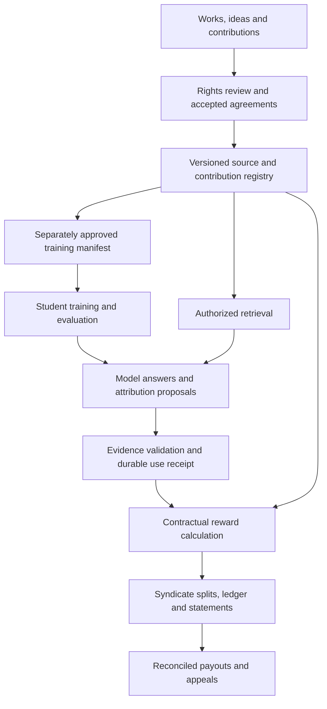

# Choosing a foundation and teacher for an LLM that respects and rewards IP

**Project:** Super Sovereign Source LLM IP

**Research synthesis:** 12 October 2026

**Scope:** The repository's model, licensing, lineage, supplier, attribution, rewards and training research. Recommendations are for evaluation; no model has been benchmarked or approved for production by this project.

**Recommendation: start with KL3M-003-3.7b for a small, provenance-focused pilot. For a foundation whose training permissions and contributor records Sovereign Source controls from inception, train newly initialized weights using Ai2's OLMo-core on a separately admitted corpus. Evaluate self-hosted gpt-oss-120b as a capable teacher only if its unresolved upstream provenance is acceptable. Under the strict requirement for verified absence of Chinese model ancestry, no frontier-capability teacher has qualified in this research.**

This prioritizes the project's IP commitments over headline benchmark scores. A model's license can permit commercial competition without proving permission for every historical training source. Attribution and creator payments also require infrastructure and agreements beyond the weights.

## The decision in one page

| Decision | Recommended choice | Reason | Qualification |
| --- | --- | --- | --- |
| Existing base for the first rights-focused pilot | **`alea-institute/kl3m-003-3.7b`** | Most directly aligned source-permission disclosures among the reviewed downloadable language models; commercial adaptation permitted. | Small, domain-oriented base. Checkpoint-specific provenance and certification scope still need confirmation. |
| Long-term foundation with controlled source admission | **New weights trained with OLMo-core** | Lets SIP choose the corpus, tokenizer, filters, teachers and contributor agreements before training. | This is a new training program, not adoption of an already cleared OLMo checkpoint. Capability, cost and evidence must be built. |
| Capable general teacher to evaluate | **Self-hosted `openai/gpt-oss-120b`**; use `gpt-oss-20b` for cheaper experiments | Permissive download terms, local control and useful reasoning/tool capabilities. | Conditional: no complete source-rights or ancestry assurance. It is not an approved teacher for the strict provenance track. |
| Teacher for the stricter provenance track | **No external frontier teacher by default.** Consider KL3M for narrow tasks after admission. | Expert-authored demonstrations and executable verifiers avoid adding an undocumented frontier teacher. | KL3M is a limited candidate, not a demonstrated frontier teacher; its evidence gaps remain. |
| Previously selected large model | **Nemotron 3 Ultra remains the recorded specification target** | NVIDIA deployment and training ecosystem; a capability-oriented alternative. | Disclosed Qwen/DeepSeek dependencies fail the earlier exclusion. Its selection does not resolve that conflict. |

The choices above are project judgments supported below, not a measured universal ranking. This synthesis recommends a provenance-first development path; it does not silently replace the Ultra selection in the implementation specification.

### Ten decision parameters

“Unresolved” means the reviewed evidence does not establish the requirement. It does not mean infringement or prohibited ancestry has been proven. The last column describes a proposed build, not an available model.

| Parameter | KL3M-003-3.7b | Existing OLMo checkpoints | gpt-oss-120b | Nemotron 3 Ultra | New SIP model with OLMo-core |
| --- | --- | --- | --- | --- | --- |
| 1. US organizational connection | ALEA / 273 Ventures | Ai2 | OpenAI | NVIDIA | Project-controlled; US-led toolkit |
| 2. Independent deployment | Downloadable | Downloadable | Downloadable | Downloadable | Designed into build |
| 3. Weight license | CC BY 4.0 | Apache 2.0 for reviewed releases | Apache 2.0 | OpenMDW-1.1 | Decide for owned artifacts; preserve upstream terms |
| 4. Commercial competition under download terms | Permitted within license | No competing-model ban identified | No competing-model ban identified | No competing-model ban identified | Control release policy within upstream grants |
| 5. Source-permission evidence | Explicit public-domain claims; incomplete original records | Inspectable data is not source-by-source permission | Incomplete for SIP certification | Disclosures do not establish universal clearance | Require evidence before admission |
| 6. Verified absence of Chinese learned dependencies | Unresolved | Release/stage dependent; unresolved | Unresolved | Fails: disclosed dependencies | Enforce and document before training |
| 7. Reproducibility | Original infrastructure gaps | Strong disclosure relative to reviewed alternatives | Weights available; full training reconstruction unavailable | Recipes/data disclosures; not complete SIP proof | Retain executed manifests and checkpoints |
| 8. Task capability evidence for SIP | Needs narrow-domain evaluation | Needs exact-checkpoint evaluation | Needs teacher-quality evaluation | Needs attribution/cost evaluation | Unknown until trained and evaluated |
| 9. Inherited creator-level rewards | No SIP system established | No SIP system established | No SIP system established | No SIP system established | Contractual records from admission onward |
| 10. Best project role | Provenance pilot | Audit and experimental baseline | Conditional synthetic-data teacher | Conditional large-model target | Long-term controlled foundation |

A US developer is not proof of US-only data, labor, infrastructure or research. Track weight parents, synthetic teachers, model-based filters, judges and tokenizers separately from software and scholarly influences. Nationality inferred from a person's name or the language of a document is not lineage evidence. No reviewed option supports a claim of having no international intellectual influences.

## Why these choices

### KL3M: the best existing candidate for the IP-focused pilot

The exact card describes a 3.69B-parameter model with a 4,096-token context, trained in February–March 2024 on a US subset of the Kelvin Legal DataPack that its developers believe is entirely public domain. It identifies limited instruction alignment and explicitly anticipates fine-tuning or use in training larger models. Some original collection/training infrastructure was not donated. These are provider disclosures, not a completed independent corpus audit. [Checkpoint card](https://huggingface.co/alea-institute/kl3m-003-3.7b).

The project also claims training from scratch without other LLMs' synthetic data. Fairly Trained lists the KL3M family, but its directory does not identify every covered checkpoint hash. Confirm the exact certification scope and reconcile the checkpoint's US public-domain claim with the certification program's global public-domain criterion. [KL3M disclosures](https://kl3m.ai/), [certified models](https://www.fairlytrained.org/certified-models), [certification requirements](https://www.fairlytrained.org/certifications).

CC BY 4.0 permits commercial adaptation with applicable attribution, notice and modification duties. It does not guarantee third-party clearance or grant every type of IP right. Preserve those upstream freedoms when applying SIP terms to new contributions. [License text](https://creativecommons.org/licenses/by/4.0/legalcode.en).

**Practical use:** test source-grounded extraction and answers in a bounded legal, regulatory or scientific collection. Commission appropriate instruction examples and test whether the model can perform the task. Its provenance orientation does not establish advanced science or mathematics capability. The separate, later KL3M dataset cannot substitute for the original checkpoint's training history. [Detailed KL3M audit](KL3M_CLEAN_ROOM_RESEARCH.md).

### OLMo-core: the best researched route to a foundation with controlled inputs

Ai2 releases Apache-licensed training building blocks and official model recipes in OLMo-core. Reuse the reviewed software while independently selecting the data and initializing new weights. Do not run an unmodified recipe that silently imports its original corpus, tokenizer or filters. [OLMo-core repository](https://github.com/allenai/OLMo-core), [software license](https://github.com/allenai/OLMo-core/blob/main/LICENSE).

Existing OLMo models remain valuable for inspection and comparison. The newer `allenai/Olmo-3-1025-7B` card discloses staged training, datasets, intermediate checkpoints and Apache licensing. Its final base also includes mid-training and long-context stages; “base” does not mean “never exposed to instruction or reasoning data.” Each stage needs its own source and generator audit. Findings about July 2024 OLMo cannot certify Olmo 3. [Olmo 3 card](https://huggingface.co/allenai/Olmo-3-1025-7B).

The earlier OLMo-7B-0724 investigation illustrates why filters matter: its Dolma 1.7 pipeline used OpenHermes 2.5 among the positive sources for a quality classifier, and that mixture contains GPT-4 outputs. This is an indirect data-selection dependency, not evidence that OLMo inherited GPT-4 weights or that every synthetic row entered pretraining. An audit must distinguish these relationships rather than labeling the entire chain independent. [Ai2's filter disclosure](https://allenai.org/blog/olmo-1-7-7b-a-24-point-improvement-on-mmlu-92b43f7d269d), [OpenHermes source mixture](https://huggingface.co/datasets/teknium/OpenHermes-2.5).

**Practical use:** first prove the source-to-training-to-rewards records on a small experimental model. Scale only after obtaining enough admitted data and measuring learning quality. Stanford-origin Marin/Levanter is an alternative training route in the [US index](USA_SOVEREIGN_AI_INDEX.md); a university affiliation does not itself clear a released checkpoint or its synthetic datasets.

### gpt-oss: a useful teacher with a clearly separate access route

The downloaded `openai/gpt-oss-120b` has an Apache 2.0 license. The reviewed usage policy requires compliance with applicable law and contains no competing-model prohibition. Our reading is that this permits a self-hosted teacher route without the competitive-output restriction of OpenAI's hosted services; it is not a waiver of unrelated contracts or third-party rights. [Weight license](https://huggingface.co/openai/gpt-oss-120b/blob/main/LICENSE), [usage policy](https://huggingface.co/openai/gpt-oss-120b/blob/main/USAGE_POLICY).

OpenAI distinguishes these downloaded models from ChatGPT and its API. Using an OpenAI-compatible local endpoint does not itself mean requests go to OpenAI. A hosting company's own contract still needs review. [Official open-weight FAQ](https://help.openai.com/en/articles/11870455-openai-open-weight-models-gpt-oss).

The release reports reasoning and tool-use capabilities, with quantized inference fitting 120b on an 80 GB GPU and 20b in 16 GB. Those are provider deployment claims, not this project's measured training-memory requirements. The release also describes training informed by proprietary OpenAI models. The materials reviewed do not provide the complete rights and teacher/filter inventory required for SIP's strict ancestry assurance. [Release and training overview](https://openai.com/index/introducing-gpt-oss/).

**Practical use if admitted:** generate source-grounded questions, proposed answers, tool traces and critiques from already authorized inputs, then independently check them. Treat the model as a candidate generator, never an authority on ownership. Record its dependency even when a human edits the result. Benchmark it against Gemma 4 and Ultra only within their respective admission policies; this recommendation does not claim it wins every current capability benchmark.

### Nemotron Ultra: keep its capability role and lineage limitation explicit

The selected artifact is `nvidia/NVIDIA-Nemotron-3-Ultra-550B-A55B-BF16`, an adapted reasoning/chat checkpoint rather than the separately released base. NVIDIA discloses 550B total parameters, 55B active per token, and training sources involving Qwen and DeepSeek. Choosing its base variant would require a separate audit, not an assumption that those dependencies disappear. [Ultra model card](https://huggingface.co/nvidia/NVIDIA-Nemotron-3-Ultra-550B-A55B-BF16).

OpenMDW-1.1 permits use and modification, imposes distribution notice obligations and places no restrictions on outputs. It also has litigation-triggered termination provisions and leaves third-party rights clearance to the user. It is a commercially usable base/teacher candidate under that license, but it fails the project's earlier learned-lineage exclusion. [OpenMDW-1.1](https://openmdw.ai/license/1-1/).

The earlier commercial-platform recommendation—NVIDIA AI Enterprise with NeMo—remains relevant for an Ultra deployment. Software support does not supply missing contributor permissions. Ultra's raw BF16 weights alone are approximately **1.1 TB** by the nominal calculation `550 billion × 2 bytes`, before runtime or training state. Start smaller when proving the rights and payments workflow. [Architecture and compute plan](SOLUTION_ARCHITECTURE.md).

## Which other researched routes are useful?

| Route | Consolidated conclusion |
| --- | --- |
| **Gemma 4** | Apache-licensed downloaded models are a distinct alternative to Gemini services. Worth a controlled base/teacher comparison; no complete SIP source-rights or US-only supply-chain certification established. [Current card](https://ai.google.dev/gemma/docs/core/model_card_4). |
| **Phi-4, Grok-1 and Llama releases** | Alternative downloadable artifacts with differing licenses and capability profiles. Exact versions matter: Grok-1 permissions cannot be transferred to Grok-2 or hosted Grok; Llama carries custom obligations. None resolves the full permission-and-rewards requirement. [Version-specific index](USA_SOVEREIGN_AI_INDEX.md). |
| **Marin/Levanter, Berkeley and MIT projects** | Useful training or serving infrastructure. Some released models import excluded teachers; software such as SkyRL, vLLM or StreamingLLM is not itself a foundation model. [Research index](USA_SOVEREIGN_AI_INDEX.md). |
| **Pythia, MPT, RedPajama, Cerebras-GPT and OpenLLaMA** | Historical open research baselines for training, scaling and attribution experiments. The existing review establishes no source-permission advantage sufficient to select them over the proposed KL3M pilot. [Baseline comparison](USA_SOVEREIGN_AI_INDEX.md). |
| **Nova Forge and Databricks** | Managed customization or infrastructure alternatives, with separate portability, contract and data-admission questions. A commercial platform is not itself proof of an unrestricted teacher or exportable foundation model. [Platform comparison](SOVEREIGN_SOURCE_AI_CODEX_SPEC.md#commercial-platform-decision-and-research), [US index](USA_SOVEREIGN_AI_INDEX.md). |
| **Perplexity** | Publisher rewards are a useful business precedent, but hosted distillation/competition restrictions prevent treating it as a default teacher. Search access is not a training license; the reviewed embedding model has Qwen ancestry. [Perplexity audit](PERPLEXITY_SOVEREIGN_SOURCE_RESEARCH.md). |
| **Hermes Agent** | A possible interface and tool-running layer. Its agent software license does not approve the models and services it calls or implement SIP settlement. [Hermes research](HERMES_AGENT_RESEARCH.md). |
| **Mistral and Chinese model families** | Informative comparisons in the historical terms audit, but outside the user's US-only model shortlist. Permissive training terms do not override the origin requirement. [Frontier audit](FRONTIER_LAB_IP_AND_CREATOR_REWARDS_AUDIT.md). |

### Hosted frontier services are not default teachers

| Service route | Restriction relevant to a directly competing LLM |
| --- | --- |
| OpenAI business/API services | Output-based competitive model development is restricted. The stated exceptions for internal classification/organization and OpenAI-provided customization do not generally authorize an independent competing foundation model. [Section 3.3 and definitions](https://openai.com/policies/services-agreement/). |
| Anthropic commercial services | Building a competing product, including training competing models, requires express approval. [Section D.4](https://www.anthropic.com/legal/commercial-terms). |
| Gemini API / AI Studio | The reviewed terms prohibit using the services to develop competing models. Other Google contracts have their own scope. [API terms](https://ai.google.dev/gemini-api/terms), [Google route audit](GEMINI_COMMERCIAL_RESTRICTIONS_RESEARCH.md). |
| Hosted Grok enterprise | Output training requires express permission in an order form; review the incorporated AUP as well. [Section 3.2](https://x.ai/legal/terms-of-service-enterprise). |
| Perplexity | Distillation and competitive-product restrictions require permission under the reviewed terms. [Detailed findings and sources](PERPLEXITY_SOVEREIGN_SOURCE_RESEARCH.md). |

Output ownership and provider promises not to train on customer data answer different questions from customer permission to train a competing model. A paid subscription or a different intermediary does not establish the necessary permission. The [OpenAI restrictions audit](OPENAI_COMPETING_MODEL_RESTRICTIONS_RESEARCH.md) and [independent development pathway](CHATGPT_TO_INDEPENDENT_LLM_PATHWAY.md) cover earlier assistance and negotiated authorization.

## How to train without losing the IP commitments

The recommended default is a **source-controlled training track**. The gpt-oss and Ultra options belong in separately admitted experiments until their unresolved requirements have a recorded disposition.

1. **Admit original material first.** Record the work, author, rights holder, agreement, permitted purposes, jurisdiction, expiry and upstream notices. Permission to retrieve is separate from permission to train, generate synthetic derivatives or distribute resulting artifacts.
2. **Commission demonstrations and tasks.** Pay experts for original examples, critiques, verifiers and evaluations. Record employment-related ownership, borrowed material and any model assistance. Keep source families separated across training and held-out evaluation.
3. **Use an optional teacher only after admission.** Store the checkpoint revision, license, hosting terms, input source IDs, generated example, reviewer decision and synthetic-data designation. Discard unsupported claims and unauthorized reproductions. A polished paraphrase is not source clearance.
4. **Apply supervised fine-tuning first.** Teach evidence use, supported citation, abstention and permission-aware tool calls. Compare the result with the unchanged model using identical retrieval and task budgets.
5. **Add reinforcement learning with verifiable rewards where useful.** Score executable mathematics/code checks and validated citation/permission behavior. A deterministic verifier can reduce dependence on another LLM judge; its tasks and software still need provenance. Teacherless RL does not repair a student's inherited training history.
6. **Release with records.** Publish the applicable model license, credits, admitted-data description, known gaps and evaluation results. Maintain private contractual evidence where public disclosure is not authorized.

SkyRL is an Apache-licensed **training framework**, not the teacher. Its custom environments can exercise attribution behavior, but the reviewed support matrix did not establish Ultra compatibility. NVIDIA's NeMo RL documentation provides an explicit Ultra recipe. Pin and test the chosen model/runtime combination rather than importing a Qwen-based quickstart. [SkyRL findings](SKYRL_SOVEREIGN_SOURCE_RESEARCH.md), [NeMo RL Ultra guide](https://docs.nvidia.com/nemo/rl/nightly/guides/models/nemotron/nemotron-3-ultra.html).

No teacher creates an automatic legal clean-room defense. Licensed adaptation, synthetic-data training and independently initialized pretraining are different claims. This synthesis is AI-assisted research, not cleared training data or evidence of independent implementation. Preserve its origins and evaluate any development use under the applicable agreements. [Clean-room analysis](KL3M_CLEAN_ROOM_RESEARCH.md#clean-room-claims-and-independent-development).

## How the model respects and rewards contributions

The model proposes answers and source links. **SIP must enforce permission, validate attribution and calculate payment outside the model.** The proposed flow combines the existing architecture and marketplace drafts:

| Component | Responsibility |
| --- | --- |
| Python, Pydantic and Pydantic AI | Validate manifests and examples; orchestrate grounded answers and attribution proposals. |
| Prefect | Coordinate ingestion, review, training, evaluation and settlement workflows. |
| Rust / Axum | Enforce access, accepted agreements, eligible use and exact financial calculations. |
| PostgreSQL / pgvector | Store authoritative rights, contribution lineage, authorized retrieval records and the accounting ledger. |
| OLMo-core / SkyRL / NeMo RL | Train or adapt the admitted student; tool choice depends on the model and training stage. |

Track distinct evidence: **training participation, retrieved support, verified quotation, recorded adoption, acknowledged influence and estimated influence**. A generated citation cannot prove that a particular training document caused an answer. Keep influence estimates separate from confirmed use; allocate royalties using accepted contractual rules rather than a model's confidence score.

For example, a scientist licenses a paper and enrolls a proof technique. Training exposure can earn under one agreement, retrieved use under another, and adoption of the technique under a reviewed contribution agreement. An acknowledged upstream influence receives an agreed share only if the parties established that entitlement. Deduplicate events and make overlapping payment rules explicit.

The current draft proposes a **20% pool of eligible collected revenue**, with contribution tracks and syndicate splits. It remains a proposal, not a statutory rate or a live payment program. The custom SS-SIP license is not OSI-approved; marketplace participation and royalties are voluntary arrangements that must preserve upstream open-license freedoms. [Rewards specification](SOVEREIGN_SOURCE_AI_CODEX_SPEC.md#12-royalty-engine), [license guide](../licenses/README.md), [marketplace terms](../licenses/SYNDICATE-MARKETPLACE-TERMS-0.1.md).

## What the supplier research changes

The upstream market offers three different inputs: permissioned existing works, commissioned expert contributions, and retrieval access. The shortlist includes direct rights holders plus Created by Humans and Defined.ai for content, Surge/Turing/Mercor/Invisible for expert work, and TollBit/Brave/ProRata for access or licensing exploration. These are procurement leads, not approved suppliers; named lab relationships have different evidence and dates. [Supplier research and evidence register](UPSTREAM_AI_DATA_SUPPLIERS_RESEARCH.md).

Require samples with rights evidence, permitted training and derivative uses, named or pseudonymous contributor roles, teacher provenance, subcontractors, credit requirements and compensation terms. A vendor invoice does not establish that an author receives continuing royalties. X and Perplexity provide rewards-program precedents, but their traffic or publisher formulas do not measure causal training influence. SIP needs its own accepted earning rules. [Rewards precedents](FRONTIER_LAB_IP_AND_CREATOR_REWARDS_AUDIT.md#rewards-and-licensing-precedents), [Perplexity research](PERPLEXITY_SOVEREIGN_SOURCE_RESEARCH.md).

Industry magazines, supplier blogs and professional communities are discovery channels. The supplier report distinguishes primary customer disclosures from reporting and public group entry pages from unread private discussions. No confidential forum or procurement contract was inspected.

## Evaluation and spending decision

Approve a larger run only after the same held-out task set establishes useful answers, supported citations, appropriate abstention, permission enforcement and reproducible reward records. Compare unchanged model, supervised adaptation and any RL adaptation. Require zero unauthorized deliveries and duplicate settlements in the acceptance suite; report actual counts and remaining uncertainty rather than claiming universal correctness.

Use **cost per verified outcome**, including failed attempts, retries, inference, tools and human validation. The earlier BestAIFor comparison concerns Super and Qwen, so it cannot establish Ultra's performance. [Performance-source review](NEMOTRON_PERFORMANCE_SOURCE_REVIEW.md).

There is no researched fixed budget that covers both a small adaptation and new frontier pretraining. Estimate each proposed run from measured throughput:

`training hours = planned processed tokens / measured aggregate tokens per second / 3,600`

Add evaluation, checkpoint and restart overhead, then price GPU-hours, source licenses, experts, engineering, storage and operations separately. Include teacher generation costs when used. A model fitting in memory does not establish affordable training. No compute purchase, training run, model deployment or production payout is part of this publication.

## Research map and evidence limits

| Research area | Documents incorporated |
| --- | --- |
| Overall product, stack and commercial platform | [Specification](SOVEREIGN_SOURCE_AI_CODEX_SPEC.md), [architecture](SOLUTION_ARCHITECTURE.md) |
| US models, universities, tools and lineage constraints | [Ten-parameter index](USA_SOVEREIGN_AI_INDEX.md), [single-page comparison](usa-sovereign-ai-index.html), [Nemotron ancestry research](NEMOTRON_NO_QWEN_RESEARCH.md) |
| Capability and cost methodology | [Nemotron performance-source review](NEMOTRON_PERFORMANCE_SOURCE_REVIEW.md) |
| Hosted commercial restrictions and independent development | [Frontier terms audit](FRONTIER_LAB_IP_AND_CREATOR_REWARDS_AUDIT.md), [OpenAI audit](OPENAI_COMPETING_MODEL_RESTRICTIONS_RESEARCH.md), [Gemini audit](GEMINI_COMMERCIAL_RESTRICTIONS_RESEARCH.md), [development pathway](CHATGPT_TO_INDEPENDENT_LLM_PATHWAY.md) |
| Source rights and upstream procurement | [KL3M audit](KL3M_CLEAN_ROOM_RESEARCH.md), [supplier and community research](UPSTREAM_AI_DATA_SUPPLIERS_RESEARCH.md) |
| Agents, search and post-training | [Hermes](HERMES_AGENT_RESEARCH.md), [Perplexity](PERPLEXITY_SOVEREIGN_SOURCE_RESEARCH.md), [SkyRL](SKYRL_SOVEREIGN_SOURCE_RESEARCH.md) |
| Attribution, influence and voluntary syndicates | [SS-SIP draft](../licenses/SS-SIP-0.1.md), [marketplace terms](../licenses/SYNDICATE-MARKETPLACE-TERMS-0.1.md), [licensing guide](../licenses/README.md) |

Primary model cards, core licenses, certification materials and the hosted restrictions cited above were rechecked for this synthesis. Detailed supplier relationships and secondary alternatives retain the dates and qualifications in their linked reports; this is not a fresh audit of every supplier contract or model family. Public disclosures are evidence of stated practices, not an independent inspection of all training data.

**Recommended sequence:** KL3M provenance and capability pilot → source and rewards system → small independently initialized model → larger training only after evidence and economics justify it. Keep gpt-oss as a conditional teacher experiment and Ultra as the recorded capability target; neither currently establishes the stricter provenance promise.
