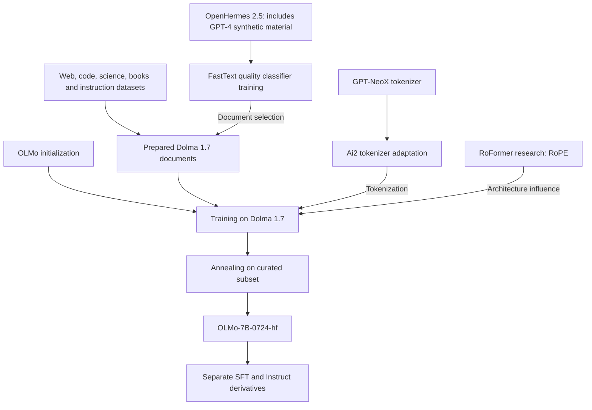

# OLMo-7B-0724-hf lineage research

**Reviewed: 10 October 2026.** The requested name `OLMo-7B-0724-h` is interpreted as Ai2's **`allenai/OLMo-7B-0724-hf`**, the July 2024 base checkpoint. This review concerns that artifact, rather than the entire OLMo family.

**Finding:** OLMo has no disclosed Chinese pretrained-weight parent in the evidence reviewed. However, it cannot be certified free of all Chinese research influence or every indirect model dependency. Its architecture uses RoPE, introduced by researchers at Zhuiyi Technology in Shenzhen. Its data preparation also has a documented connection to proprietary synthetic content through OpenHermes 2.5. Those relationships have different meanings and should occupy separate fields in Sovereign Source's provenance records.

## Decision for Sovereign Source

| Requirement | Finding | Assessment |
| --- | --- | --- |
| US lead developer | Allen Institute for AI developed the checkpoint. | Meets the US-developer criterion. |
| No Chinese pretrained-weight parent | The release describes training from scratch; no Qwen or DeepSeek weight parent is disclosed. | Supported by documentation; not an independent weights audit. |
| No Chinese tokenizer dependency | Artifact comparison confirms the published GPT-NeoX tokenizer derivation. | No such dependency identified. |
| No Chinese teacher anywhere upstream | Complete generator and filtering manifests are unavailable in the reviewed evidence. | Not established. |
| No Chinese research or ideas | OLMo uses RoPE, whose originating paper identifies a Shenzhen institution. | Fails this broader definition. |
| No proprietary-model-output influence | Dolma 1.7's quality filter used OpenHermes 2.5, a mixture containing GPT-4 outputs. | Cannot claim an entirely independent pipeline. |
| Exclusively US suppliers | Dolma includes TII's RefinedWeb, among other international sources. | Does not meet an exclusively US supply-chain definition. |
| All historical content licensed and rewarded under SIP | Public dataset availability supplies no such evidence. | Not established. |

The evidence for each assessment follows. OLMo remains a useful candidate for studying auditable training. It is **not a certified replacement satisfying every earlier independence requirement**. This research does not change the project's selected Nemotron 3 Ultra target.

## Checkpoint identity and training history

| Field | Identified artifact |
| --- | --- |
| Repository | `allenai/OLMo-7B-0724-hf` |
| Revision observed | `1ee306df318ee15bfe4a76ebd5c002b0105b1ab6` |
| Repository last modified | 16 July 2024, 17:00:55 UTC |
| Artifact type | Base model in Hugging Face Transformers format; six Safetensors weight shards |
| Configuration | `OlmoForCausalLM`, 32 layers, hidden size 4,096, 32 attention heads, 4,096-token context |
| Tokenizer configuration | `GPTNeoXTokenizer` |

Identity comes from the [repository API](https://huggingface.co/api/models/allenai/OLMo-7B-0724-hf), [pinned model configuration](https://huggingface.co/allenai/OLMo-7B-0724-hf/blob/1ee306df318ee15bfe4a76ebd5c002b0105b1ab6/config.json) and [tokenizer configuration](https://huggingface.co/allenai/OLMo-7B-0724-hf/blob/1ee306df318ee15bfe4a76ebd5c002b0105b1ab6/tokenizer_config.json). The accompanying [evidence manifest](research/olmo-7b-0724-hf-evidence.json) records revisions, downloaded artifact hashes and comparison results. Weight shards and the full training corpus were not downloaded.

The [July model card](https://huggingface.co/allenai/OLMo-7B-0724-hf/blob/1ee306df318ee15bfe4a76ebd5c002b0105b1ab6/README.md) describes training from scratch on Dolma 1.7 for **2.7 trillion tokens**, followed by **50 billion tokens** of annealing on a rebalanced subset. That is **2.75 trillion training tokens**. The second stage includes Wikipedia, OpenWebMath and FLAN while excluding Dolma Common Crawl, CC News and MegaWika. This supports independent initialization, rather than inheritance of another company's foundation-model weights.

The exact relationship to April checkpoints needs clarification. At the inspected [OLMo repository revision](https://github.com/allenai/OLMo/tree/090253dac6688f2532509daa7aa2eb5fae50e956/configs/official-0724), the April and July YAML configurations are byte-identical. Both use `run_name: OLMo-1.7-7B` and `load_path: null`. Configuration equality does not establish which checkpoint resumed which run. A contributor response in [issue 746](https://github.com/allenai/OLMo/issues/746) gives a different token history from the release card. Therefore, 2.75T is reported here as the card's claim, not a reconciled execution record. Neither a precise April-to-July continuation chain nor a 4T total should be certified from those conflicting materials.

## Lineage relationships

The diagram combines the documented recipe with verified tokenizer comparisons. The OpenHermes edge concerns **selection of training documents**. It does not demonstrate that OLMo directly learned from every OpenHermes response or inherited a teacher's weights. Edges describe dependencies; they do not calculate contribution value or payment entitlement.

## Tokenizer ancestry verified against artifacts

The [original OLMo paper](https://arxiv.org/html/2402.00838v3) describes adapting the GPT-NeoX tokenizer. Comparing the actual July tokenizer JSON with the published Ai2 and EleutherAI artifacts supports that account:

| Comparison with the July tokenizer | Ai2 `gpt-neox-olmo-dolma-v1_5` | EleutherAI `gpt-neox-20b` |
| --- | --- | --- |
| Vocabulary | All 50,280 token-to-ID entries match. | 50,254 shared token strings; 50,253 retain the same ID. |
| BPE merge rules | All 50,009 match. | All 50,009 match. |
| Normalizer and pre-tokenizer | Match. | Match. |
| Post-processor | Differs. | Differs. |
| Entire JSON file | Different bytes. | Different bytes. |

The [target tokenizer](https://huggingface.co/allenai/OLMo-7B-0724-hf/blob/1ee306df318ee15bfe4a76ebd5c002b0105b1ab6/tokenizer.json), [Ai2 reference](https://huggingface.co/allenai/gpt-neox-olmo-dolma-v1_5/blob/8571ec72989ee67572049df907dec46cebe92335/tokenizer.json) and [EleutherAI reference](https://huggingface.co/EleutherAI/gpt-neox-20b/blob/c292233c833e336628618a88a648727eb3dff0a7/tokenizer.json) are pinned in the manifest. These are structural comparisons, not a claim of byte-identical tokenizers or inheritance of GPT-NeoX model weights.

## Training data and upstream models

Dolma 1.7 combines web text, code, academic material, books, reference material and instructions. Its [dataset card](https://huggingface.co/datasets/allenai/dolma/blob/7f48140530a023e9ea4c5cfb141160922727d4d3/README.md) identifies Common Crawl-derived sources, RefinedWeb, C4, Reddit, StarCoder, peS2o, arXiv, Stack Exchange, FLAN, OpenWebMath, AlgebraicStack, Project Gutenberg, MegaWika and Wikipedia/Wikibooks. Source-corpus size and repeated training-token exposures are different quantities.

Several names can produce misleading ancestry claims:

| Source or component | Relationship that the evidence supports |
| --- | --- |
| FLAN | Instruction examples included during base training. Their use does not establish distillation from the FLAN-T5 model. The Dolma card describes reproducing the collection using Google's code. |
| `tulu_flan` training paths | The published July YAML names a FLAN data preparation path. This is not evidence that the complete Tulu instruction mixture trained the base checkpoint. |
| StarCoder | A code dataset source. Its presence does not show inherited StarCoder weights. |
| RefinedWeb | A web corpus released by the Technology Innovation Institute in the UAE. Its use does not imply Falcon-model distillation. |
| OpenWebMath | A filtered web corpus with its own language, mathematical-content and quality screening dependencies. These belong in a complete upstream audit. |

Sources: [July training configuration](https://github.com/allenai/OLMo/blob/090253dac6688f2532509daa7aa2eb5fae50e956/configs/official-0724/OLMo-7B-0724.yaml), [RefinedWeb card](https://huggingface.co/datasets/tiiuae/falcon-refinedweb) and [OpenWebMath card](https://huggingface.co/datasets/open-web-math/open-web-math).

### MegaWika does not establish translated training text

The [MegaWika paper](https://arxiv.org/html/2307.07049v1) describes a wider resource involving machine translation and generated questions, including Meta M2M100 and Google translation. However, Dolma specifically identifies its MegaWika source as **English web pages cited by Wikipedia**. The parent resource's additional components do not prove those translations or generated questions entered OLMo. A claim that MegaWika automatically makes this checkpoint translation-model-distilled would exceed the evidence.

### OpenHermes creates an indirect proprietary-output dependency

Ai2's [Dolma 1.7 release explanation](https://allenai.org/blog/olmo-1-7-7b-a-24-point-improvement-on-mmlu-92b43f7d269d) states that a FastText classifier distinguishes higher-quality from lower-quality documents. Its positive training sources include **OpenHermes 2.5**, alongside reference, scientific, mathematical and other text. The [published filter code](https://github.com/allenai/dolma/blob/669f534823b08d266a8fff01f8a1c916a5a56576/python/dolma/taggers/quality.py) separately identifies the Dolma 1.7 classifier and its downloadable model artifact.

The [OpenHermes 2.5 card](https://huggingface.co/datasets/teknium/OpenHermes-2.5/blob/b82037821055c377bed0d495e72e46de3bc72e84/README.md) describes a primarily synthetic instruction/chat mixture. It names GPT-4-only Chatbot Arena and ShareGPT subsets, GPT4-LLM, GPTeacher and other sources. It also acknowledges a missing source page for one component. The exact OpenHermes rows used to fit Ai2's classifier are not established by the release explanation.

The documented relationship is therefore **a synthetic-containing mixture used to train a filter that selects pretraining documents**. It defeats an assurance of complete independence from proprietary model outputs. It does not establish direct OpenAI distillation of the released OLMo weights, and it does not establish Chinese-model output use. In particular, the broader LMSYS collection's model roster must not be substituted for the explicitly GPT-4-only subset named in OpenHermes.

FastText language identification and other classifiers are also model dependencies, even though they are not frontier generative teachers. The [Dolma language taggers](https://github.com/allenai/dolma/blob/669f534823b08d266a8fff01f8a1c916a5a56576/python/dolma/taggers/language.py) reference the `lid.176.bin` language classifier. A complete assurance needs these artifact versions and their training provenance, alongside the text-generator records.

## Chinese research influence through RoPE

The July configuration enables rotary position embeddings. RoPE encodes token positions in attention computations. The [RoFormer paper](https://arxiv.org/html/2104.09864v5), which introduced it, lists Zhuiyi Technology, Shenzhen, as the authors' affiliation; the [OLMo paper](https://arxiv.org/html/2402.00838v3) cites that work.

For this project's expanded concept of ideas and influences, that is a documented Chinese institutional research contribution. An absolute exclusion of Chinese-origin ideas would therefore exclude this OLMo architecture. A policy limited to Chinese pretrained weights or generative teachers should record RoPE separately rather than treating it as evidence of such a dependency. This distinction follows the actual relationship, not assumptions about authors' names or ethnicity.

## Base, SFT and Instruct are separate artifacts

The base checkpoint must not inherit every provenance claim about its derivatives. The [July Instruct card](https://huggingface.co/allenai/OLMo-7B-0724-Instruct-hf) describes instruction tuning with Tulu 2 followed by preference training with cleaned UltraFeedback. Those additions require their own generator and source audits. Likewise, OLMo 2, OLMo 3 and later Dolma recipes cannot be projected backward into this July 2024 checkpoint.

Base status also does not mean instruction-free or exclusively human-written input: FLAN is already part of the documented base recipe. The absence of a separate chat-tuning stage cannot establish the origin of every pretraining document.

## Licensing, attribution and content rewards

The checkpoint's card identifies **Apache 2.0** for model and code. The Dolma card identifies **ODC-BY** for the dataset and states that underlying source terms remain applicable. Model permission, source-content rights and permissions covering synthetic-data generation are separate evidence requirements. Neither a permissive model license nor a public dataset listing proves all underlying material is SIP-authorized or compensated. See the [model card](https://huggingface.co/allenai/OLMo-7B-0724-hf) and [Dolma license discussion](https://huggingface.co/datasets/allenai/dolma#licensing-information).

The GPT-4 connection warrants an artifact-specific commercial review; it is not a finding that every downstream OLMo user automatically becomes bound by an upstream party's OpenAI agreement. Applicable contracts, permissions and rights have to be established. The [independent-development pathway](CHATGPT_TO_INDEPENDENT_LLM_PATHWAY.md) remains the project's broader framework.

For SIP, record initialization, tokenizer adaptation, dataset inclusion, filter influence and architectural research as different contribution relationships. Preserve attribution supported by evidence. Reward eligibility should follow accepted agreements and reviewed use records; this lineage graph alone establishes neither individual payout amounts nor a legal royalty entitlement.

## Evidence needed for stronger assurance

Before advertising a model derived from this checkpoint as satisfying a strict ancestry policy, obtain:

1. **Checkpoint continuity:** the final weight hashes, original training checkpoint, conversion record and reconciled April/July run history.
2. **Executed data recipe:** exact corpus manifests, sampling schedule and annealing inputs tied to that run.
3. **Filter provenance:** classifier binaries and hashes, training samples, source revisions and synthetic-generator records, especially for the OpenHermes subset.
4. **Rights evidence:** source-specific authority and terms, plus separate agreements for any SIP attribution and rewards commitments.

The present defensible description is **a US-led OLMo base model with documented training and tokenizer provenance, no identified Chinese weight parent, a Chinese-origin architectural influence, and an indirect dependency on a dataset containing proprietary-model outputs**. It offers substantially more material to inspect than an undocumented checkpoint, while leaving the broader independence claim unresolved.
