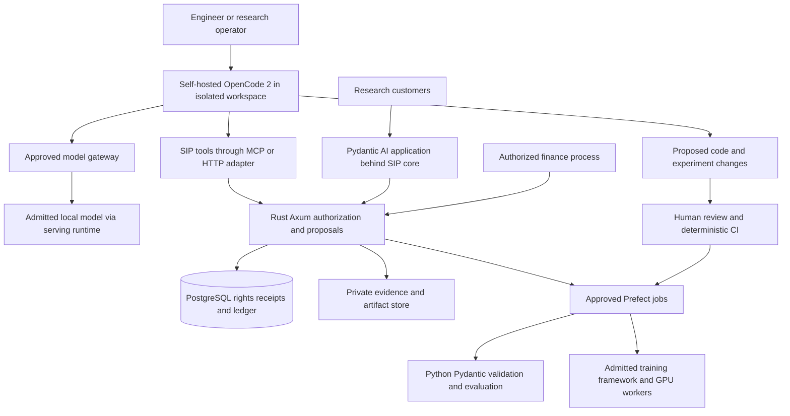

# OpenCode 2 for Sovereign Source development and training operations

**Research date: 12 October 2026. Status: proposed integration, with no installation or runtime validation performed.**

**Evaluate self-hosted OpenCode 2 as the engineering assistant and operator interface for Sovereign Source.** It can help implement the Python/Rust stack, prepare experiments, inspect results and connect to narrowly scoped project tools. Keep production authorization, training admission and creator settlement in the existing SIP services. OpenCode supplies an agent runtime; model training still requires admitted data, a training framework, compute and independent evaluation.

The candidate path is **local OpenCode + an independently approved model endpoint + SIP-controlled tools**. The commercial permissions section below explains why the deployment and model-access choices matter.

## Project identity and current release

“Open Code 2” is interpreted here as **OpenCode 2 from Anomaly**, the second generation of the OpenCode coding agent. The official changelog lists **v2.0.27 on 12 October 2026**. The current V2 documentation specifies the `@opencode/cli` package and `opencode` command. Older beta pages and V1 installation examples are not the deployment reference. Pin the selected binary, package integrity and corresponding source/license evidence before a pilot. [Release notes](https://opencode.ai/changelog), [V2 introduction](https://opencode.ai/v2/docs).

V2 has a background service, terminal/desktop/web interfaces, custom providers, MCP connections and extension APIs. Its HTTP API and plugins differ from V1. The official migration guide also says V2 does **not** run language servers or provide LSP diagnostics, even though the general homepage advertises LSP support. Use explicit Python checks and Rust compiler/test commands. [Migration guide](https://opencode.ai/v2/docs/migrate-v1/).

| Capability | Relevance to this project | Qualification |
| --- | --- | --- |
| Local coding agent and multiple interfaces | Implement and review contracts, ingestion, attribution and accounting code | An assistant's successful task report does not replace review or tests. |
| Custom model endpoint | Connect to a controlled local serving gateway | API compatibility does not establish model rights or lineage. [Providers](https://opencode.ai/v2/docs/providers/) |
| MCP tools | Expose source metadata, validation jobs and experiment status | Build a SIP adapter; there is no established native SIP integration. [MCP documentation](https://opencode.ai/v2/docs/mcp-servers/) |
| Plugins and hooks | Add receipts, route metadata and development checks | V2 extensions require their own implementation and validation. [Plugin API](https://opencode.ai/v2/docs/build/plugins/) |
| HTTP API and TypeScript client | Build an internal operations interface around sessions | The API is marked experimental; isolate it behind a small adapter. [API](https://opencode.ai/v2/docs/api), [client](https://opencode.ai/v2/docs/build/client/) |
| Worktree tools | Separate proposed code changes from the main checkout | Introduced in the v2.0.27 release; a Git worktree is not a security boundary. [Release notes](https://opencode.ai/changelog) |

## Commercial permissions and source rights

### Separate the software from the service

The reviewed repository's MIT license permits commercial use, modification and redistribution subject to retaining the required copyright and permission notice. It contains no competing-model prohibition. Preserve upstream notices when distributing a modified harness; the SIP draft cannot replace the upstream grant. Confirm the exact installed artifact and dependencies as part of procurement. [MIT license](https://github.com/anomalyco/opencode/blob/dev/LICENSE).

OpenCode's hosted terms, effective **15 August 2026**, expressly distinguish non-hosted open-source software, which is governed by its repository license. For the hosted services, the restrictions include using output to:

> “develop artificial intelligence models that compete with the Services or any Third Party Models”

The terms also restrict automated output extraction and address third-party provider conditions and possible improvement use of unpaid-account content. Output ownership does not cancel the restrictions. [OpenCode Terms of Use](https://opencode.ai/legal/terms-of-service).

**Project interpretation:** require written permission for competing-model development through hosted OpenCode services. The broad wording does not establish an exemption for generated training code, design advice or evaluation labels.

| Access path | Proposed decision for Sovereign Source |
| --- | --- |
| Local MIT software with a self-hosted, admitted model | Preferred evaluation path; separately establish source grants, model license, usage policy and lineage. |
| Local software with a direct frontier API or subscription connection | Assess the underlying provider agreement for the actual task. A different client does not change output restrictions. |
| OpenCode-hosted inference or a free hosted model | Not selected without written permission for the proposed use. |
| Local software plus a commercial model host | Review both downloaded-weight rights and the host's contract, data handling and processor location. |

This interpretation is a contracting input, not a legal opinion or a clean-room defense. The existing [OpenAI research](OPENAI_COMPETING_MODEL_RESTRICTIONS_RESEARCH.md), [Gemini research](GEMINI_COMMERCIAL_RESTRICTIONS_RESEARCH.md), [frontier comparison](FRONTIER_LAB_IP_AND_CREATOR_REWARDS_AUDIT.md) and [independent-development pathway](CHATGPT_TO_INDEPENDENT_LLM_PATHWAY.md) remain applicable to provider selection.

### Preserve the model admission requirement

An open-source harness does not make its selected model open-source, independently trained or cleared for competitive development. Keep separate records for software, weights, tokenizer, teachers, model-based filters, evaluation judges and source material.

The project's existing US-origin and no-Chinese-learned-lineage requirements remain active. No general frontier teacher has passed that screen in the current research. Nemotron 3 Ultra retains its disclosed Qwen/DeepSeek conflict; choosing it in OpenCode does not change that finding. gpt-oss remains a conditional candidate, and KL3M's provenance orientation does not demonstrate that it can reliably drive a coding agent. Tool calling, long-context behavior and code correctness need task-specific evaluation. [Model decision](MODEL_SELECTION_RESEARCH_SUMMARY.md).

If no model qualifies, retain human implementation and deterministic tooling while the audit proceeds. Do not silently enable a convenient default, anonymous free model or fallback. A supplier's nationality is not a substitute for checkpoint evidence.

## Proposed stack integration

Use OpenCode in the development and research environment. Retain Pydantic AI for the customer-facing research assistant and Prefect for durable workflows. The OpenCode service is replaceable without changing customer rights or payment records.



The model gateway in this proposal enforces project, purpose, approved processor and model revision. It is not a generic automatic router. Give the OpenCode workspace access only to development files and approved task inputs; keep full corpora, production credentials and financial identities in services with their own access controls.

| Existing component | OpenCode can assist with | Responsibility retained by the component |
| --- | --- | --- |
| Python and Pydantic | Draft schemas, ingestion transformations and validation tests | Parse and validate accepted contracts and artifacts deterministically. |
| Pydantic AI | Implement application agents and evaluate source-grounded answers | Run the customer workflow with authorized evidence and bounded model routes. |
| Prefect | Prepare recipes and inspect flow results through approved tools | Schedule, retry and supervise durable ingestion, evaluation and training jobs. |
| Rust and Axum | Implement APIs, permission checks, source receipts and idempotency | Authorize actions and accept or reject state changes. |
| PostgreSQL and pgvector | Propose migrations, retrieval queries and accounting tests | Hold authoritative rights, accepted attribution and financial history. |
| OLMo-core or an admitted alternative | Prepare reviewed configuration and diagnose bounded experiments | Execute actual gradient training and checkpointing. |
| NeMo or SkyRL where admitted | Assist with adaptation/RL experiment implementation | Perform the relevant training; RL reward scores do not determine royalties. |
| vLLM or another tested runtime | Diagnose a private compatible serving route | Serve the approved checkpoint with measured resource limits. |

These are integration proposals built on the [production plan](PRODUCTION_SYSTEM_PLAN.md), not native OpenCode integrations verified in this repository. Adding a TypeScript plugin does not require rewriting the Python/Rust core. Prefer a small Python MCP adapter or direct HTTP integration initially; use the documented TypeScript client if an operator UI later benefits from it.

## SIP tools exposed to the assistant

Start with read-only information and reversible proposals. Every tool authenticates a principal and checks tenant, purpose and grant versions in the SIP core. A session ID is useful for correlation, not authorization: OpenCode explicitly documents that its MCP session metadata must not be used as authentication. [MCP session context](https://opencode.ai/v2/docs/mcp-servers/).

| Proposed tool | Input and result | Boundary |
| --- | --- | --- |
| `source_status` | Asset/version IDs → permitted-use summary and missing evidence | Return only metadata the caller may see; no unrestricted corpus search. |
| `source_excerpt` | Approved task and passage IDs → authorized excerpt plus source receipt | Recheck rights before delivery and before an external processor receives text. |
| `propose_attribution` | Evidence IDs and proposed relationship → reviewable proposal | Cannot create ownership, accepted influence or a payable balance. |
| `validate_manifest` | Frozen manifest ID → deterministic admission report | Reject unresolved dependencies and unapproved purposes. |
| `propose_experiment` | Admitted manifest, recipe and model IDs → costed proposal | No raw shell, arbitrary code path or unlimited GPU request. |
| `experiment_status` | Authorized run ID → state, metrics and artifact references | Metrics are read-only and remain separate from payout decisions. |
| `run_validation` | Approved validation-suite revision → test report | Execute in an isolated worker with bounded resources. |
| `simulate_rewards` | Synthetic/approved period inputs → reproducible simulation | Simulation cannot post a payable or initiate a transfer. |

An authorized operator can approve an experiment outside the assistant's session. Bind approval to the exact code digest, immutable recipe, model revision, manifest, budget, resource ceiling and expiry. The job service revalidates this envelope before enqueueing. A repeated tool call returns the same job identity; it must not launch another expensive training run.

Keep production payout credentials and direct ledger writes outside OpenCode. Use the existing reviewed settlement process for real obligations. The assistant can explain a calculation, identify missing evidence and draft a correction request, with the deterministic core and authorized reviewers deciding the outcome.

## Evidence and creator rewards

### Capture useful evidence at the authoritative boundary

An OpenCode transcript documents an engineering interaction. It does not establish source ownership, causation inside a model, an accepted syndicate mandate or actual payment. Session logs may contain private code and licensed excerpts; export and retention need their own permission and access policy.

Reuse the specification's `Contribution`, `RightsGrant`, `AgreementVersion`, `ResearchRequest`, `EvaluationRun` and `ModelVersion` records. Add a development-run evidence envelope only where needed, linked to these records rather than creating a parallel rights database.

| Evidence group | Proposed fields |
| --- | --- |
| Execution identity | Internal run ID, authenticated actor, tenant/project, approved purpose, OpenCode release and config digest |
| Model dependency | Actual provider/endpoint, exact checkpoint or provider revision, license/terms reference, helper-model identities and call kind |
| Source dependency | Asset/version IDs, passage digests, grant and agreement versions, admitted-use decision |
| Result lineage | Code/patch digest, generated-artifact IDs, transformation parents, human review and tests |
| Operational cost | Physical attempt IDs, token/GPU usage, retries, time and infrastructure cost |
| Commercial eligibility | Accepted contribution/adoption ID, earning rule, beneficiary schedule and governing period |

Persist authoritative source-use and qualifying economic events transactionally in PostgreSQL, with an outbox and stable deduplication identity, before releasing metered results. Include every actual billed attempt in cost accounting; credit an earning event only under its agreement. A retry can cost money without creating another contributor entitlement.

This design is necessary because the official OpenCode client documents **live-only event subscriptions without replay or automatic reconnection**. A disconnected event listener can miss activity. Use its stream for progress displays and diagnostics; record rights and financial events inside the SIP tools that perform the action. [Client event semantics](https://opencode.ai/v2/docs/build/client/).

### Reward people under accepted agreements

OpenCode could make the project's contribution graph more observable by associating reviewed patches, dataset curation, evaluation work and prompt/workflow revisions with their evidence. Contributor enrollment, human/AI disclosure, adoption and an accepted earning rule still determine eligibility. AI similarity is a proposal for investigation, never a royalty percentage.

For example, a scientist enrolls a paper for a specified training use; an evaluator contributes accepted examples; a workflow author supplies an adopted tool procedure. The training worker records the paper actually consumed, and the core records eligible workflow execution or contribution adoption. The agreed tracks and beneficiary schedules allocate compensation. An assistant merely reading the paper during coding does not establish that it entered training or caused a later answer.

Retain the draft **20% of eligible collected revenue** pool and its **60/20/20 corpus/workflow/contribution allocation** only where adopted. Empty training cohorts follow the reserve rule, not invented exposure. Retrieval fees, minimums and bounties remain separate unless an identified contractual offset applies. Development-token expense does not reduce the reward base through an unapproved deduction. [Royalty specification](SOVEREIGN_SOURCE_AI_CODEX_SPEC.md#12-royalty-engine).

Credit OpenCode and relevant libraries under their licenses. Paying their maintainers or recognizing an upstream scholarly influence is a separate voluntary agreement, not an automatic obligation created by installing software. Preserve public open-license freedoms and record any additional compensation without making marketplace membership compulsory.

## Training and independent development

Separate three purposes: software engineering, customer inference, and model development. The same file or output may have different permissions for each. Record purpose at intake and preserve restrictions through copies, human edits, synthetic labels and downstream artifacts.

1. **Define the task and evidence.** Freeze source-family holdouts and success criteria before proposing experiments. Keep evaluation references separate from optimization data.
2. **Admit the inputs.** Verify source grants, original contributor agreements, tokenizer and model ancestry, teachers and any model-based filters. A retrieval permission is not training permission.
3. **Prepare reviewed code.** OpenCode can propose data validators, training recipes and test changes. Humans and CI approve exact versions; generated code is reviewed for provenance and inherited license obligations.
4. **Execute through Prefect and the training framework.** Use a bounded smoke experiment, save/resume checks and a consumed-data record. The chat session must not own a long-running GPU process.
5. **Evaluate and release.** Compare the unchanged baseline, adapted candidate and retrieval-assisted version under the same conditions. Record source coverage, citation support, capability, contamination, compute and financial reconciliation.

Start with expert-authored examples and executable verifiers under the existing model plan. Enable synthetic generation or model judging only when the particular model, inputs and downstream competitive use are admitted. Do not automatically export agent histories, accepted coding patches, hidden reasoning, critiques or test fixtures into training.

A fresh foundation using OLMo-core remains a separate program with independently admitted inputs. OpenCode can help implement and inspect that program; it supplies neither frontier-scale data nor a demonstrated learning recipe. Scale only after small experiments show useful learning, provenance completeness and viable source economics. [Foundation recommendation](MODEL_SELECTION_RESEARCH_SUMMARY.md), [SkyRL assessment](SKYRL_SOVEREIGN_SOURCE_RESEARCH.md).

## V2 controls and integration pitfalls

**Permissions are not a sandbox.** OpenCode's security documentation says it does not isolate the agent, and the V2 permission documentation says shell commands run with the host user's authority. Run the assistant in a restricted container or VM with separate identities, limited mounts and enforced egress. A shell allowlist cannot safely identify every possible filesystem or network effect. [Security model](https://github.com/anomalyco/opencode/blob/dev/SECURITY.md), [V2 permissions](https://opencode.ai/v2/docs/permissions/).

| Area | Finding | Proposed treatment |
| --- | --- | --- |
| Provider admission | V2 policies support provider allow/deny controls; unmatched actions are allowed and malformed statements may be dropped with warnings | Deny providers by default, allow one gateway, fail startup checks on invalid policy and enforce the same rule outside the process. [Policies](https://opencode.ai/v2/docs/policies/) |
| Configuration authority | Policies use different precedence from ordinary configuration, including higher-level and Console policy | Inspect the effective configuration in an isolated profile; repository settings alone are insufficient. [Policies](https://opencode.ai/v2/docs/policies/) |
| Auxiliary model calls | Plugin hooks distinguish primary, compaction, title and transient generation; WebSocket traffic has separate hooks | Cover every route and transport at the gateway. A primary HTTP hook alone is incomplete. [Plugin hooks](https://opencode.ai/v2/docs/build/plugins/) |
| Plugin loading | V2 discovers local plugins and merges plugin entries from multiple locations | Review all loaded packages/config paths, pin revisions and give plugins no independent production authority. [Plugin loading](https://opencode.ai/v2/docs/plugins/) |
| V1 compatibility | Plugin and server API contracts changed; V2 does not provide LSP diagnostics | Test the V2 adapter and run explicit checks such as Python type/lint/test tools and `cargo check`/`cargo test`. [Migration](https://opencode.ai/v2/docs/migrate-v1/) |
| Sharing and remote access | Current V2 sharing documentation says session sharing is unsupported; browser pairing is a separate capability | Do not promise share links. Keep pairing private and secure the operator API under the pinned release's supported authentication. [Sharing](https://opencode.ai/v2/docs/sharing/), [pairing](https://opencode.ai/v2/docs) |
| Background requests | Warming can make real billable provider calls and is off when omitted or set to false | Leave it off initially; include helper calls and retries in cost and egress tests. [Warming](https://opencode.ai/v2/docs/warming/) |
| Local state and snapshots | Snapshots use a separate local Git object database; undo is not secure erasure | Inventory storage, backups and deletion behavior before admitting private sources; deleting a checkout file is insufficient. [Snapshots](https://opencode.ai/v2/docs/snapshots/) |

### Illustrative local provider policy

The following is a **design example**, not an installed or validated configuration. `admitted-coder` is a placeholder resolved by a future SIP gateway to one audited model revision. The loopback endpoint assumes that gateway is in the same network namespace; remote/container deployment requires an authenticated private endpoint and a revised network policy.

```json
{
  "$schema": "https://opencode.ai/config.json",
  "model": "sip-local/admitted-coder",
  "share": "disabled",
  "warming": false,
  "providers": {
    "sip-local": {
      "name": "SIP approved local gateway",
      "package": "@opencode/ai/providers/openai-compatible",
      "settings": { "baseURL": "http://127.0.0.1:8000/v1" },
      "models": { "admitted-coder": { "name": "Admitted coding model" } }
    }
  },
  "experimental": {
    "policies": [
      { "action": "provider.use", "resource": "*", "effect": "deny" },
      { "action": "provider.use", "resource": "sip-local", "effect": "allow" }
    ]
  }
}
```

The example follows the documented provider and policy shapes. Validate against the selected release's schema and effective configuration, including helper models and inherited plugins. It does not configure tool permissions, authentication, a sandbox or source-level authorization. Those controls must exist before use. Keep the controlling policy outside agent-writable files. [Provider configuration](https://opencode.ai/v2/docs/providers/), [configuration reference](https://opencode.ai/v2/docs/config/), [policy semantics](https://opencode.ai/v2/docs/policies/).

The gateway must reject any unregistered model ID even if a UI offers it. OpenAI-compatible here describes a wire format, not a request to OpenAI. Audit actual network destinations, including package downloads, model discovery, updates, web search, MCP and optional remote services. A local model selection alone does not prove an offline system.

## Bounded pilot and decision criteria

Run a two-week engineering evaluation only after selecting an admitted coding model or obtaining the necessary permission for a narrowly defined alternative. Use synthetic parties, development data and simulated rewards. The schedule is an estimate for the tool integration, not for training a frontier model.

| Stage | Work | Required evidence |
| --- | --- | --- |
| Days 1–2 | Pin V2, isolate its profile and workspace, configure the approved gateway | Binary/license inventory, effective configuration and successful denied-route tests. |
| Days 3–5 | Connect read-only source status and deterministic validation through a small adapter | Correct authorization, bounded inputs, stable run IDs and no production credentials. |
| Days 6–8 | Assist with schemas, a Rust permission check, a Prefect dry run and a synthetic reward simulation | Reviewed diffs and deterministic results; no unapproved training launch or real payout. |
| Days 9–10 | Interrupt sessions and event listeners, retry tools, revoke a grant and change model availability | Durable core records, no duplicated jobs/payables, and failure instead of an unauthorized fallback. |

Compare 20 representative engineering tasks against the current human-reviewed workflow, using the same admitted model where possible to isolate the harness effect. Track accepted completion, review time, defects, all model calls, failed attempts and total cost. Proposed adoption criteria are at least 16 accepted tasks, no unresolved critical boundary failure, complete evidence for all qualifying events, and at least a 15% reduction in median completion-plus-review time. These are project targets, not reported benchmarks.

Include adversarial cases: source text that asks for a forbidden upload; a plugin attempting a different provider; a compaction/title request on a blocked route; duplicate experiment submission; a missing event stream; and a fabricated contribution claim. Validate the external boundaries, not only a reassuring model response.

An illustrative evaluation allowance is **40 engineer hours × $100/hour = $4,000**, plus **$300–$1,000** for isolated compute, storage and inference: **$4,300–$5,000 total**. Rates and time are assumptions; procurement/legal review and training compute are additional. Budget GPU/model capacity separately and estimate development cost per accepted task, not per chat message. This research creates no expenditure or infrastructure commitment.

Adopt the harness if the pilot demonstrates useful engineering productivity and enforceable boundaries. Retain the existing development workflow if compatibility, audit gaps, model eligibility or review overhead outweigh the benefit. Keep OpenCode replaceable through the same SIP API contracts so tool choice cannot control contributor rights or accrued rewards.

## Recommended next implementation

Add a development-tool admission record and a small read-only SIP MCP adapter first. Follow with an experiment-proposal tool and deterministic simulation once the core exists. Reuse the [production plan's](PRODUCTION_SYSTEM_PLAN.md) authorization and ledger design, and the [current specification's](SOVEREIGN_SOURCE_AI_CODEX_SPEC.md) milestones. A future OpenCode plugin can improve operator experience after the external controls work.

This recommendation changes neither the Nemotron selection nor the lineage requirement. It adds a candidate engineering interface to help build the rights, evidence, training and reward infrastructure on which the frontier-model ambition depends.
