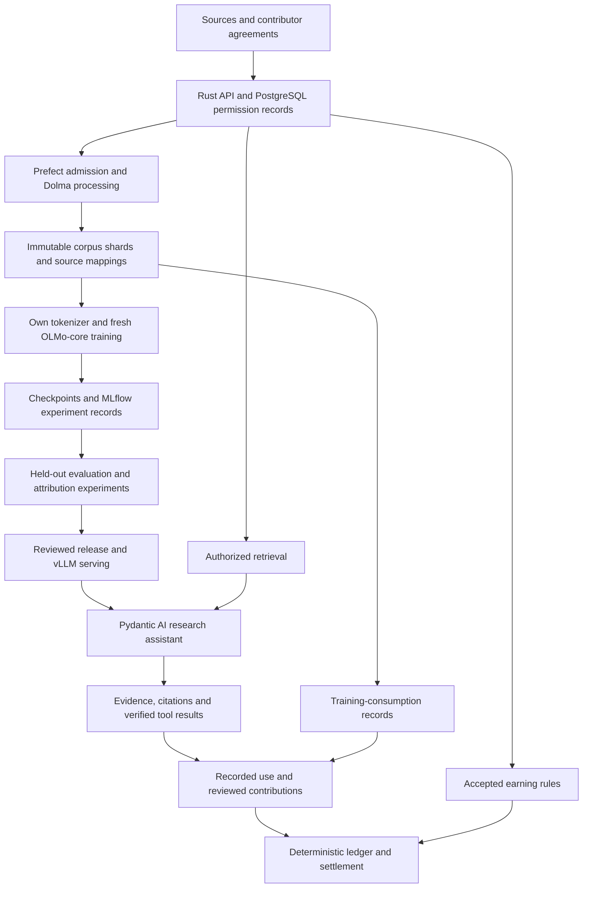

# Open-source science and development kits for a research-oriented LLM

**Project:** Super Sovereign Source LLM IP (`sovsrc.llm`)

**Research date:** 13 October 2026

**Status:** Technology research and proposed experiments. No packages have been installed, models trained or compatibility benchmarks run for this document.

## Recommendation

Build the first independent research model with **PyTorch, Ai2 OLMo-core, the Dolma toolkit and a separately admitted corpus**. Train its tokenizer on approved material, initialize new weights, and record the complete experiment. Use **EleutherAI's evaluation harness and self-hosted MLflow** to measure and preserve results. Add **vLLM** for serving after checking model compatibility. These are software choices; the associated projects' default datasets and released checkpoints require separate admission. [OLMo-core](https://github.com/allenai/OLMo-core), [Dolma](https://github.com/allenai/dolma), [evaluation harness](https://github.com/EleutherAI/lm-evaluation-harness), [MLflow](https://github.com/mlflow/mlflow), [vLLM](https://github.com/vllm-project/vllm).

For Sovereign Source, the distinctive research contribution should be an experimentally evaluated connection between **source permissions, recorded training consumption, evidence-backed answers and contributor rewards**. The training framework supplies numerical machinery. SIP supplies the source agreements and reviewed attribution records; its ledger applies accepted earning rules.

The strongest alternatives are **Marin/Levanter** for open development and JAX-based experiments, **torchtitan** for PyTorch systems research, and **NVIDIA Megatron Bridge/Core** for demanding GPU training. **nanochat** is an accessible small-scale learning and experimentation route. None is a substitute for obtaining sufficient, suitable training data.

This recommendation develops the independent-foundation route in the [model-selection summary](MODEL_SELECTION_RESEARCH_SUMMARY.md). It does not change the existing Nemotron 3 Ultra reference selection or resolve its disclosed ancestry conflict. It complements the [commercial training-platform comparison](COMMERCIAL_LLM_PRETRAINING_PLATFORMS_RESEARCH.md): those providers supply infrastructure or managed operations; this document examines the scientific and software stack running on that infrastructure.

## What makes an LLM research-oriented?

There are two relevant meanings, and Sovereign Source needs both:

| Meaning | Required evidence | What alone is insufficient |
| --- | --- | --- |
| **A model that can be studied scientifically** | Inspectable training code, data documentation, initialization records, intermediate checkpoints, repeatable evaluations and controlled experiments. | Downloadable final weights. |
| **A model that helps people conduct research** | Faithful citations, usable mathematics and code tools, evidence retrieval, uncertainty handling, reproducible calculations and evaluations on actual research tasks. | Fluent scientific prose or a high general benchmark score. |

OLMo's research program explicitly includes training and evaluation resources beyond weights. EleutherAI's Pythia provides an instructive experimental design: common data order across model sizes and 154 checkpoints per model for studying learning over time. Reuse these transparency principles; their released data and weights are not automatically SIP-cleared inputs. [OLMo paper](https://arxiv.org/abs/2402.00838), [Pythia research suite](https://github.com/EleutherAI/pythia).

Scientific inspectability can coexist with controlled access to licensed content. Publish methods, metadata and distributable artifacts; preserve authorized audit access to restricted materials. An experiment whose private corpus cannot be independently accessed has a reproducibility limitation that should be stated in its report.

## The computer science behind the stack

The following is a proposed curriculum and experiment map, rather than a claim that every method should be implemented in the first release.

| Area | Core ideas | Experiment or implementation question |
| --- | --- | --- |
| Information theory and tokenization | Subword vocabularies, BPE/unigram models, normalization, cross-entropy and compression. | Does a vocabulary preserve mathematics, code and names efficiently? Compare token counts and held-out bits per byte; losses from different tokenizers are not directly interchangeable. |
| Neural architectures | Embeddings, attention, residual connections, normalization, positional representations and feed-forward layers. | Start with a dense decoder Transformer; vary one architectural choice while controlling data and compute. |
| Numerical optimization | Automatic differentiation, AdamW, learning-rate schedules, gradient clipping and numerical precision. | Does a change improve learning at a fixed budget without instability? Keep a simple baseline and retain failed runs. |
| Scaling and experimental design | Parameter count, training tokens, data mixture, compute allocation, ablations and uncertainty. | Measure smaller runs before forecasting a larger one. Scaling-law estimates depend on the recipe and data distribution. |
| Distributed systems | Data parallelism, sharded optimizer/model state, tensor and pipeline parallelism, communication and checkpoint recovery. | Can the same experiment resume correctly, and does adding GPUs improve useful throughput? |
| GPU systems | Memory bandwidth, fused kernels, attention tiling, activation checkpointing and compilation. | Profile the bottleneck before optimizing. Faster kernels must preserve acceptable numerical behavior. |
| Data engineering | Parsing, deduplication, source identity, sampling, contamination detection and immutable manifests. | Can every training segment be traced through transformations to an admitted source? |
| Post-training | Supervised fine-tuning, preference optimization and reinforcement learning with verifiable rewards. | Does the trained behavior generalize to unseen research tasks, including cases where abstention is correct? |
| Retrieval and formal methods | Information retrieval, citation verification, symbolic computation, executable tests and proof checking. | Does the cited passage support the claim? Does the calculation or formal proof actually check? |
| Attribution and mechanism design | Counterfactual influence estimates, provenance graphs, contribution review and incentive rules. | Which evidence supports acknowledgment, which supports a contractual payment, and how can participants game the rule? |

Primary foundations include the [Transformer paper](https://arxiv.org/abs/1706.03762), [FlashAttention's memory-aware attention algorithm](https://arxiv.org/abs/2205.14135) and [compute-optimal training research](https://arxiv.org/abs/2203.15556). These support architecture, systems and compute-allocation reasoning; they do not establish a universal recipe or an IP clearance.

**Best structured learning resource:** Stanford's **CS336: Language Modeling from Scratch**, Spring 2026. Its public materials cover tokenizers and model construction, GPU/distributed systems, scaling, data processing and alignment/reasoning. Use it to build team understanding; observe the licenses and course rules attached to materials reused. [Official course and assignments](https://cs336.stanford.edu/).

## Training kits compared

The ordering reflects fit for this project's independent research program, not measured speed. Listed licenses describe the principal software repository; dependencies, model weights, datasets and hosted services have their own terms.

| Kit | Principal software license | What it provides | Recommended role and tradeoff |
| --- | --- | --- | --- |
| **Ai2 OLMo-core** | Apache-2.0 | PyTorch model-training building blocks and official OLMo recipes, launchable with `torchrun`. | **Default research trainer.** Adapt its data boundary and initialize new weights. Existing recipes are useful references, but their tokenizer and corpus must be replaced or admitted. [Source](https://github.com/allenai/OLMo-core). |
| **Marin with Levanter** | Apache-2.0 | Open development workflows covering curation through evaluation; Levanter provides JAX training with named tensors. | **Best alternative for an open research laboratory**, especially with JAX/TPU expertise. A different runtime and workflow require a deliberate choice rather than a second default trainer. [Marin](https://github.com/marin-community/marin), [Levanter](https://github.com/marin-community/levanter). |
| **PyTorch torchtitan** | BSD-3-Clause | Research-oriented pretraining and post-training, composing sharded, tensor, pipeline, context and expert parallelism. | **Best for distributed-systems experiments.** Active development can require PyTorch nightlies; freeze a working combination. Supported foreign model families are not selected inputs. [Source](https://github.com/pytorch/torchtitan). |
| **NVIDIA Megatron Bridge/Core** | Bridge: Apache-2.0; audit the selected Core revision and dependencies too. | Scalable PyTorch training and checkpoint conversion, including pretraining, SFT and LoRA. | **Best fit for an NVIDIA training program or the existing Ultra architecture.** More hardware/runtime specialization. Bridge documents random-initialization pretraining separately from pretrained-checkpoint conversion. [Capabilities](https://github.com/NVIDIA-NeMo/Megatron-Bridge), [Bridge license](https://raw.githubusercontent.com/NVIDIA-NeMo/Megatron-Bridge/main/LICENSE). |
| **Karpathy nanochat** | MIT | A compact single-node pipeline spanning tokenization, pretraining, fine-tuning, evaluation and inference. | **Best learning and small-experiment harness.** Useful for proving the whole lifecycle before investing in distributed infrastructure. Published speedruns use particular data, hardware and metrics; they are not this project's budget. [Source](https://github.com/karpathy/nanochat). |
| **Hugging Face Transformers** | Apache-2.0 | Widely used model definitions and training/inference interfaces. | **Best interoperability layer and flexible baseline.** Instantiate a reviewed configuration for new weights; loading a pretrained model is a different lineage decision. [Source](https://github.com/huggingface/transformers). |
| **DeepSpeed** | Apache-2.0 | Distributed-training optimizations including ZeRO, offloading and parallelism. | **Alternative optimization engine** where profiling or an existing recipe warrants it. It is not a complete rights, data or evaluation system, and should not be added alongside another sharding engine without a supported integration. [Source](https://github.com/deepspeedai/DeepSpeed). |

For the first program, choose **one trainer**. A small dense model is easier to inspect, compare and instrument than a large mixture-of-experts system. Add architectural complexity only to test a stated hypothesis or satisfy a measured requirement.

### Current maintenance and compatibility findings

These details matter when selecting a starting revision:

- **Levanter moved into Marin in November 2025.** New development is in `marin/lib/levanter`; the older standalone repository points there. Use the current monorepo when assessing support. [Migration notice](https://github.com/marin-community/levanter).
- **HELM entered maintenance mode on 1 June 2026.** It remains useful for holistic evaluation and inspecting results, but should not be assumed to be the most actively evolving default. [HELM repository](https://github.com/stanford-crfm/helm).
- **Hugging Face Tokenizers' main branch documents a transition to v1.0.0.rc.0**, with Python training and offset functionality among features being restored. Use a tested release with the required training, serialization and offset behavior, or evaluate SentencePiece. Do not copy a prerelease installation command into the production plan. [Current Tokenizers README](https://github.com/huggingface/tokenizers), [SentencePiece](https://github.com/google/sentencepiece).
- **The evaluation harness documents new CLI/configuration and plugin interfaces.** Pin the tool and task definitions together; do not assume an older tutorial command matches current behavior. [Harness documentation](https://github.com/EleutherAI/lm-evaluation-harness).

These observations are a research snapshot, not a tested dependency lockfile. Training, serving and application services should have separate environments with explicitly verified interfaces.

## Supporting development technologies

| Layer | Open-source candidate | Use in Sovereign Source |
| --- | --- | --- |
| Numerical runtime | [PyTorch](https://github.com/pytorch/pytorch), BSD-style; alternative [JAX](https://github.com/jax-ml/jax), Apache-2.0. | PyTorch for the default trainer and attribution experiments; JAX for a deliberately selected Marin route. |
| Corpus curation | [Dolma toolkit](https://github.com/allenai/dolma), Apache-2.0. | Tag, filter, deduplicate and prepare admitted data. It includes Rust-backed deduplication and extensible processing; keep SIP permissions outside heuristic quality filters. |
| Tokenizer training | [SentencePiece](https://github.com/google/sentencepiece), Apache-2.0; or a verified [Tokenizers](https://github.com/huggingface/tokenizers) release, Apache-2.0. | Train a vocabulary on approved text, version it, and test mathematical symbols, code whitespace, normalization and unknown-character behavior. Tokenizer training data is part of lineage. |
| Dataset access and preparation | [Hugging Face Datasets](https://github.com/huggingface/datasets), Apache-2.0; [Apache Arrow](https://arrow.apache.org/overview/) for columnar interchange. | Build reproducible preprocessing and inspection jobs. Put immutable corpus shards and checkpoints in object storage, not PostgreSQL rows. Store references and metadata in the database. |
| Supervised and preference training | [Open Instruct](https://github.com/allenai/open-instruct) or [TRL](https://github.com/huggingface/trl), Apache-2.0. | Compare base, SFT and preference-trained checkpoints on the same held-out tasks. Use admitted demonstrations/preferences. Open Instruct points supported SFT workloads toward OLMo-core. |
| Parameter-efficient adaptation | [PEFT](https://github.com/huggingface/peft), Apache-2.0. | Test LoRA-style adaptation where appropriate. An adapter retains dependency on its base model; it does not create independent ancestry. |
| Reinforcement learning | [SkyRL](https://github.com/NovaSky-AI/SkyRL), Apache-2.0. | Optional later experiments on research tool use, source selection and verifiable tasks. Its current components include a unified training library and task environments. [Project-specific assessment](SKYRL_SOVEREIGN_SOURCE_RESEARCH.md). |
| General evaluations | [lm-evaluation-harness](https://github.com/EleutherAI/lm-evaluation-harness), MIT. | Fixed, versioned baseline tasks plus custom research tasks. Store prompts, scoring rules, sampling parameters and raw outputs, subject to data permissions. |
| Holistic evaluations | [Stanford HELM](https://github.com/stanford-crfm/helm), Apache-2.0. | Optional comparative analysis across several dimensions and inspection of individual results; account for maintenance status. |
| Experiment records | [MLflow](https://github.com/mlflow/mlflow), Apache-2.0. | Self-host run parameters, metrics and artifact references. Use an authoritative run ID shared with SIP manifests. A tracking server does not replace permission checks or accounting. |
| Training-data attribution | [MIT MadryLab TRAK](https://github.com/MadryLab/trak), MIT. | Estimate which training examples influence a specified model behavior; validate on small models against controlled retraining. |
| Model-internal research | [NNsight](https://github.com/ndif-team/nnsight), MIT. | Inspect or intervene on activations and gradients. Use local execution for restricted material; remote research infrastructure introduces a separate data-access decision. |
| Mathematical verification | [Lean 4](https://github.com/leanprover/lean4), Apache-2.0; [SymPy](https://github.com/sympy/sympy), BSD license. | Check formalized proofs and symbolic calculations. Preserve assumptions and tool outputs. Neither tool verifies arbitrary empirical scientific claims. |
| Serving | [vLLM](https://github.com/vllm-project/vllm), Apache-2.0. | Serve an approved, compatible checkpoint and batch evaluations. Validate export and tokenizer equivalence before comparing results across runtimes. |

Software availability is only one part of openness. An NVIDIA deployment also uses components governed by NVIDIA's SDK terms; describing the whole GPU stack as permissively open source would be inaccurate. Record the actual drivers, toolkit, libraries and container contents. [NVIDIA CUDA SDK agreement](https://docs.nvidia.com/cuda/eula/index.html).

## A research assistant built around the model

Retain the proposed [Python, Pydantic, Pydantic AI, Prefect, Rust/Axum and PostgreSQL architecture](SOLUTION_ARCHITECTURE.md), with the following responsibilities. These are proposed application boundaries, not claims of existing implementation.

| Component | Responsibility |
| --- | --- |
| Python and Pydantic | Validate source manifests, training configurations, evaluation records and tool results. Schemas check structure; they do not prove a claim true. |
| Pydantic AI | Coordinate authorized retrieval, calculations, model calls and structured research answers. Return evidence references and uncertainty; propose attribution for review. |
| Prefect | Schedule ingestion, corpus preparation, training submission, evaluation and settlement workflows. Let the ML trainer manage gradients and distributed collectives. |
| Rust and Axum | Enforce authenticated permissions, accepted grants, tenant boundaries and allowed state changes. |
| PostgreSQL and pgvector | Store rights, source identities, contribution links, run manifests, authorized retrieval indexes and financial records. Audit embedding and reranker models separately. |
| Object storage | Retain permissioned source versions, processed shards, tokenization mappings, checkpoints and evaluation artifacts with content digests. |
| Isolated compute workers | Run the trainer and research tools under explicit resource and data-access limits. Model-generated code must not inherit unrestricted platform credentials. |

A useful research answer should include the claim, supporting source/version, relevant passage, calculation or proof artifact where applicable, and the boundary between evidence and inference. A DOI or URL that exists is insufficient if its contents do not support the claim.

Start with text retrieval and narrowly scoped code/mathematics tools. Assess PDF parsing, tables, figures and multimodal models separately as the chosen research domain requires them. Domain usefulness must be demonstrated by domain experts; a small model trained from scratch is initially a research instrument, not an assumed replacement for a frontier assistant.

## Attribution research and content rewards

### Keep different kinds of evidence distinct

| Evidence | What it can establish | What it cannot establish by itself |
| --- | --- | --- |
| Permission and contributor record | The accepted grant, credited roles and applicable earning rules. | Whether a particular output depended on the source. |
| Training-consumption record | Which source versions and segments were sampled, under which run and repetition counts. | How much each example caused a particular answer. |
| Retrieval/citation receipt | Which material was retrieved, supplied to the model or cited in a response. These should be separate event types. | That every supplied passage affected the answer, or that a citation proves training influence. |
| Estimated training influence | A method-dependent estimate of effects on a specified prediction, loss or behavior. | Legal title, exact ownership percentages or a universally correct royalty allocation. |
| Reviewed idea/influence relationship | An accepted acknowledgment or contribution relationship, with evidence and an agreed scope. | A new exclusive statutory right over an idea. |

For interoperable provenance, W3C **PROV-DM** supplies entities, activities, agents and relationships such as derivation and attribution. Map source versions to entities, transformations/training to activities, and contributors/operators to agents. Extend it with SIP grants, mandates and earning-rule identifiers; the standard itself does not establish rights or calculate payments. [W3C provenance model](https://www.w3.org/TR/prov-dm/).

### Which scientific methods are useful?

**TRAK** uses projected model-gradient features to estimate data attribution and evaluate counterfactual behavior. It is a strong candidate for a bounded research prototype because it comes with open code and an explicit evaluation methodology. A useful first question is whether its scores predict the effect of withholding a source cohort from a small model. This is a project experiment proposal, not an established result for SIP. [TRAK paper](https://proceedings.mlr.press/v202/park23c.html), [implementation](https://github.com/MadryLab/trak).

**TracIn** estimates training-example influence using gradients and saved checkpoints. Its approximation and dependence on the chosen checkpoints make it an informative comparison method. Define the target precisely: influence on a passage's likelihood is different from influence on a research answer's correctness. [Original Google research paper](https://proceedings.neurips.cc/paper/2020/hash/e6385d39ec9394f2f3a354d9d2b88eec-Abstract.html).

**Activation interventions with NNsight** help study how a model computes a behavior. They answer a different question from identifying the authors whose material entered training. An attention pattern or a useful internal feature is not a source-ownership certificate. [NNsight](https://github.com/ndif-team/nnsight).

The experiment should test sensitivity to random seed, checkpoint choice, duplicates, paraphrases, interacting sources and the target metric. Include source-group removal and retraining on a tractable subset as a reference. Measure attribution cost and storage as well as correlation with observed effects. Do not assume a result at a small scale transfers to a frontier model.

### Proposed payment integration

Use accepted source-use agreements for initial rewards. Financial records should identify the earning rule, eligible event, contribution, source version, syndicate split and adjustment history. Treat influence scores as **experimental evidence for review** until an adopted contract explicitly defines a validated scoring rule and its dispute process.

Keep payments based on recorded use distinguishable from estimates of causal influence. Distinguish estimated, earned, reserved, disputed and paid amounts. An RL reward is an optimization signal; it is not a creator payment. Open content must remain usable under its own license without mandatory marketplace membership. The existing [marketplace terms](../licenses/SYNDICATE-MARKETPLACE-TERMS-0.1.md) and [licensing guide](../licenses/README.md) govern the proposed opt-in approach, subject to actual acceptance.

## Proposed end-to-end architecture

Carry stable identifiers through parsing, redaction, deduplication, tokenization, sequence packing and sampling. A packed sequence may contain multiple sources, so retain segment boundaries and their source mappings. Hashes verify artifact identity, not permission or authorship. Deduplication should not silently discard contributor relationships when several authorized copies represent the same work.

Record sampler state and consumed intervals so recovery can distinguish replayed work from newly consumed material. Define in the earning rules whether a retry, repeated epoch or duplicated source creates additional eligibility. A payment event must be idempotent under those rules.

## A bounded first research program

This is a proposed sequence, contingent on admitted data, staffing and compute. It is not a fixed-price or fixed-duration training promise.

| Stage | Work | Evidence needed to advance |
| --- | --- | --- |
| **1. Frame the study** | Pick one research domain and hypothesis; define a data-admission policy, test set, baseline and maximum spend. | Named owners, accepted source permissions and predeclared metrics. |
| **2. Prove the data path** | Curate a small authorized corpus; train the tokenizer; preserve source-to-token mappings and withheld evaluation material. | Reproducible manifest, documented exclusions and no unresolved test overlap. |
| **3. Train a small baseline** | Use a dense model in an illustrative **100M–350M parameter** range, or smaller if needed to debug. Test fresh initialization and restart before a substantive run. | Finite/stable loss, useful learning versus a simple baseline, measured throughput and a verified resume/export path. |
| **4. Test a focused hypothesis** | For example, compare two curation policies with matched token and compute budgets. Repeat the core comparison across three seeds if affordable. | Report per-domain effects, variability, compute and failed runs; do not select only the best seed. |
| **5. Study attribution** | Compare training-use records, retrieval evidence and one influence estimator; perform controlled source-group removal/retraining at small scale. | Measured predictive validity, sensitivity, cost and failure cases. Keep payments independent of unvalidated estimates. |
| **6. Add research behavior** | Compare base and admitted SFT; add retrieval and executable checks. Evaluate RL only if a specific behavior and verifier justify it. | Better held-out research outcomes without degraded citation fidelity, permission enforcement or calibration. |
| **7. Decide whether to scale** | Consider a larger pilot, up to roughly 1B parameters, only after data adequacy and learning curves support it. | A measured capacity/cost forecast and a reason the smaller system is insufficient. |

Parameter ranges are planning choices for learning and instrumentation. They do not guarantee publishable results, useful expert reasoning or a particular GPU requirement. Sequence length, optimizer state, batch size, numerical precision and architecture all affect memory and throughput.

Estimate a run from **tokens divided by measured end-to-end tokens per second**, then include evaluation, checkpointing, retries, storage, data acquisition and engineering. For a multi-GPU throughput measurement, multiply elapsed hours by the allocated GPU count to obtain GPU-hours. Compare runs using equivalent workloads, not vendor peak FLOPs. The [platform comparison](COMMERCIAL_LLM_PRETRAINING_PLATFORMS_RESEARCH.md) supplies procurement questions and illustrative compute prices.

### Evaluation requirements

Evaluate more than benchmark accuracy:

- **Learning:** held-out loss by domain, simple-baseline comparisons and controlled data/architecture ablations.
- **Research utility:** expert-scored tasks; reproducible calculations; executable code checks; formal proof acceptance when the task has been correctly formalized.
- **Evidence quality:** citation precision and coverage, unsupported-claim rate, correct abstention, source/version fidelity and contradiction handling.
- **Data independence:** near-duplicate and source-family overlap checks across training, tuning and test sets. Keep the final test set out of repeated optimization.
- **Rights behavior:** authorization and tenant-isolation tests, revoked retrieval access, missing or ambiguous grants, conflicting contributor claims and leakage probes.
- **Attribution quality:** sensitivity and agreement with controlled source-removal experiments, without labeling an estimate as ground truth.
- **Operational integrity:** resume behavior, checkpoint/export equivalence, resource cost and reconciliation of recorded use with eligible ledger entries.

Freeze decoding settings, task versions and scoring code. Separate deterministic verifiers from human judgments and model-based judging; judges are additional learned dependencies with their own provenance. A self-report that the model used a source is not independent evidence.

### Reproducibility package

Each experiment should preserve the code commit, configuration, dependency lockfiles, container digest, hardware/runtime versions, tokenizer digest, corpus manifest, grants snapshot, split definitions, sampler state, seeds, optimizer/scheduler state, checkpoints and evaluation artifacts. Publish the hypothesis, comparisons, failures and limitations alongside results.

A fixed seed alone is insufficient: PyTorch documents reproducibility limits across releases, platforms and CPU/GPU execution. State whether the claim is exact replay within a fixed environment or statistical reproducibility across repeated experiments. [PyTorch reproducibility guidance](https://github.com/pytorch/pytorch/blob/main/docs/source/notes/randomness.md).

## US-origin models, open-source software and upstream lineage

The preferred ecosystem includes Ai2, Stanford-origin Marin, MIT attribution research, Berkeley-origin SkyRL, PyTorch and NVIDIA. Open-source contributors and research influences are international. Institutional location should not be represented as proof of exclusively US intellectual or technical ancestry.

Apply the project's no-Chinese-model-lineage requirement to the actual learned dependencies: initial weights, tokenizer vocabulary, synthetic teachers, reward models, learned quality filters, embedding models and rerankers. A toolkit's ability to load an excluded model does not mean every model trained with that toolkit inherits its weights. Conversely, choosing a US toolkit does not cleanse its sample corpus or teacher outputs.

SkyRL, for example, acknowledges code and lessons from multiple external projects. Software/research influence belongs in a separate record from learned model ancestry. Preserve attribution rather than describing the entire stack as having no foreign influence. [SkyRL acknowledgments](https://github.com/NovaSky-AI/SkyRL#acknowledgement).

The proposed independent run should begin without a synthetic teacher. Human-authored, appropriately licensed demonstrations and deterministic verification allow an initial study without resolving a frontier teacher's upstream lineage. Any later teacher requires the separate commercial-permission and ancestry review described in the [model-selection summary](MODEL_SELECTION_RESEARCH_SUMMARY.md).

New weights, open training code and documented data improve control and auditability. They do not by themselves supply a legal clean-room defense, universal training permission or exact downstream royalties. The [independent-development pathway](CHATGPT_TO_INDEPENDENT_LLM_PATHWAY.md) and [KL3M clean-room analysis](KL3M_CLEAN_ROOM_RESEARCH.md) address those separate questions. This AI-assisted research document is a planning artifact, not an admitted training dataset.

## Decision for Sovereign Source

Adopt **OLMo-core as the first trainer to evaluate**, with Dolma processing of SIP-admitted material, an independently trained tokenizer, MLflow experiment records and a versioned evaluation suite. Run one small dense-model study before selecting a larger training architecture. Keep Marin as the JAX alternative and Megatron Bridge as the NVIDIA scale option.

The first defensible research result would be a reproducible experiment demonstrating that permissioned source records survive the full data/training/answer pipeline, that the model learns a measurable task, and that attribution estimates are evaluated honestly against controlled interventions. Creator payments can then rest on clear agreements and auditable events while the science of training influence continues to improve.
