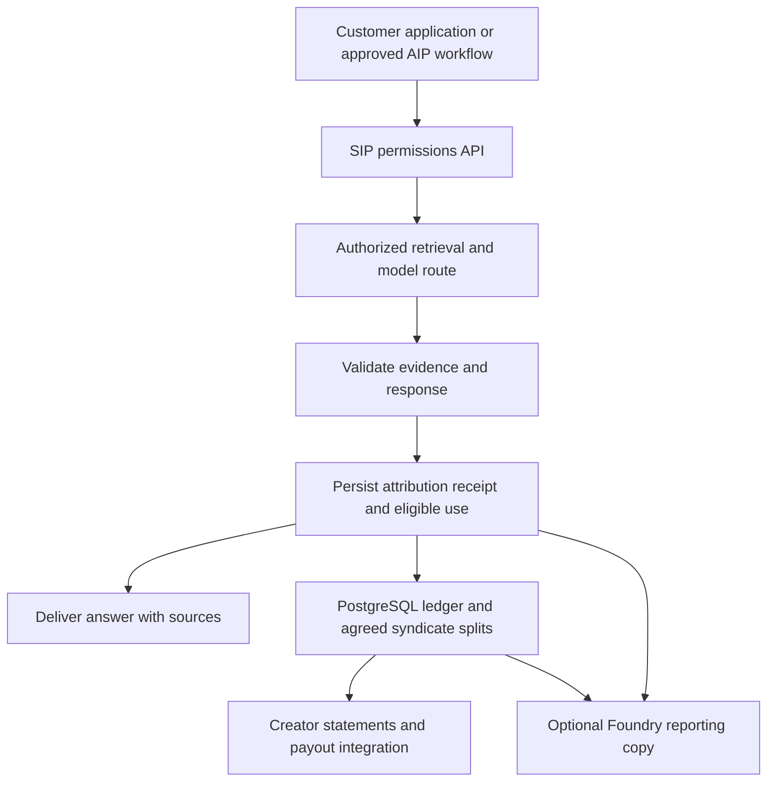

# Palantir sovereign AI and Sovereign Source AI

Research date: 12 October 2026.

**Recommendation: retain an independently controlled SIP core and consider Palantir as an optional enterprise integration.** Palantir offers substantial infrastructure, model deployment and operational governance capabilities. Its sovereignty proposition does not establish source-by-source training permission, model ancestry clearance or creator compensation. Those remain central responsibilities of Super Sovereign Source LLM IP.

Here, **self-source AI** means the project's independent approach: select and control models, admit source material under explicit permissions, preserve attribution and administer creator agreements. This can use owned hardware or contracted cloud capacity. It does not imply that every infrastructure component is built in-house. Sovsrc remains at specification stage; the comparison below distinguishes its intended design from Palantir's documented offerings.

## What Palantir offers

Palantir's Sovereign AI OS Reference Architecture with NVIDIA was announced on 12 March 2026. It combines NVIDIA infrastructure and software with AIP, Foundry, Apollo, Rubix and AIP Hub. Palantir positions it as a deployable enterprise AI stack, including customer model development and adaptation. It is a platform procurement option rather than a particular foundation-model checkpoint. [Joint announcement](https://investors.palantir.com/news-details/2026/Palantir-and-NVIDIA-Team-to-Deliver-Sovereign-AI-Operating-System-Reference-Architecture/).

| Offering or route | Documented capability | Relevance to sovsrc |
| --- | --- | --- |
| Sovereign AI OS with NVIDIA | Validated infrastructure and platform stack; on-premises OEM hardware, dedicated AI clouds or managed hardware | Enterprise deployment candidate when infrastructure, support and governance need a common supplier arrangement. |
| AIP with a registered customer model | Connect an external model endpoint or a model running in a compute module | Potential connection to a SIP-approved model, subject to compatibility and contract scope. |
| Apollo | Software deployment and lifecycle management across connected and disconnected environments | Optional operations layer for distributed or isolated customer installations. |
| Rackspace managed deployment | Foundry and AIP combined with private cloud, sovereign cloud, on-premises infrastructure and managed operations | Alternative to staffing the full deployment operation internally. |
| Nebius partnership | Announced compute and inference integration for eligible Palantir commercial customers | Capacity option requiring confirmation of availability, location and operating terms. |
| FedStart | Deploy eligible applications within Palantir's accredited government environment | Separate route to federal customers; not a general-purpose model or creator marketplace. |

The NVIDIA reference architecture includes Blackwell Ultra hardware, Spectrum-X networking and NVIDIA AI Enterprise. Its three deployment paths provide choices about equipment ownership and operational responsibility; confirm the actual administrative, network and key-management boundaries in the proposed installation. [Reference architecture and deployment paths](https://www.palantir.com/sovereignaios/).

Apollo manages releases across cloud, on-premises and air-gapped environments. This deployment capability does not make an external model API available inside a disconnected network: that requires a locally executable model and its dependencies. [Apollo documentation](https://www.palantir.com/docs/apollo/core/introduction).

Rackspace's **9 July 2026** operating framework covers regulated and sovereign deployments with Palantir. It is a managed delivery option; staffing, access controls and location still need to match the customer agreement. [Rackspace announcement](https://www.rackspace.com/newsroom/rackspace-palantir-launch-operating-framework-regulated-enterprises).

The **8 September 2026** Nebius announcement describes bringing compute and inference inside Palantir's enterprise perimeter **following an integration period**. It supports adaptation of open models on customer data. Treat this as an announced partnership, not confirmation that a particular region, capacity allocation or feature is available today. [Joint release filed with the SEC](https://www.sec.gov/Archives/edgar/data/1513845/000110465926105749/tm2624958d1_ex99-1.htm).

FedStart uses AWS GovCloud and Azure Government infrastructure and provides deployment and accreditation support. It merits consideration only if a federal customer justifies the associated integration and contractual requirements. Confirm the authorization boundary for the specific application. [FedStart](https://www.palantir.com/offerings/fedstart).

## Ten parameters compared

The Palantir column summarizes the sources in this document. The sovsrc column describes requirements and architectural choices, not implemented capabilities.

| Parameter | Palantir sovereign AI | Independent sovsrc design |
| --- | --- | --- |
| 1. Primary objective | Govern organizational data, models and operational decisions | Build AI with admitted sources, documented contributions and agreed creator rewards |
| 2. Deployment control | Multiple infrastructure and operating arrangements | Select infrastructure, administrators, keys and upgrade policy directly |
| 3. Software control | Proprietary platform with integration interfaces | Control project code and releases; audit each dependency's license |
| 4. Model choice | Provider models and customer model integration | Pin approved weights, tokenizers, teachers and serving components |
| 5. Training rights | Depend on the platform agreement and model route | Admit only licensed model and data uses; preserve permission evidence |
| 6. Upstream provenance | Platform governance does not certify a model's full training corpus | Require source and teacher manifests; disclose unresolved ancestry |
| 7. Attribution | Citations, metadata and operational records | Separate retrieved support, training participation, reuse and acknowledged influence |
| 8. Creator rewards | No reviewed offering specifies SIP-style payouts | Contracts, qualified-use receipts, beneficiary shares and an auditable ledger |
| 9. Portability | Open interfaces and exports; application migration still requires work | Keep canonical records, model artifacts and interfaces independently recoverable |
| 10. Delivery and cost | Integrated tools and services; contract-specific charges | More engineering and operational responsibility; control implementation scope |

Palantir's strongest fit is an organization with complex existing systems and demanding operational controls. Sovsrc's intended distinction is how source contributors participate and earn. These aims can coexist in a negotiated deployment.

## Model control and privacy

AIP supports customer models through REST connections and compute modules. Its self-hosting guide describes containerized inference using servers such as vLLM or Ollama, allowing inference within a customer's network, including disconnected deployments. This establishes a technical integration route; it does not certify compatibility with every checkpoint or training framework. [Self-hosting guide](https://www.palantir.com/docs/foundry/aip/self-host-models).

Registered models support rate limits, permissions and supported AIP applications. They do not currently support AIP Assist or Pipeline Builder's Generate and Explain features. Palantir states that registered models carry no additional platform fee for their use; external provider calls are billed by that provider. This is not a statement that Foundry, GPUs or the complete deployment are free. [BYOM documentation](https://www.palantir.com/docs/foundry/aip/bring-your-own-model).

Palantir says its provided third-party model routes have guarantees against retaining prompts/completions or using them for provider training. It also documents regional endpoint limitations and private, governed retraining of customer models. Confirm those protections for the selected route; they do not establish the retention policy of every application log, custom BYOM endpoint or infrastructure service. [AIP security and privacy](https://www.palantir.com/docs/foundry/aip/aip-security).

The project's US-model requirement and no-Chinese-model-lineage requirement must be checked independently of hosting location. A US data center, NVIDIA hardware or Palantir integration cannot establish a checkpoint's teacher ancestry. The existing [model research summary](MODEL_SELECTION_RESEARCH_SUMMARY.md) remains applicable, including Nemotron 3 Ultra's unresolved conflict with the earlier ancestry condition.

## Current commercial restrictions

**The current AIP addendum differs materially from older indexed copies.** Its 5 October 2026 version omits the previous blanket restriction on training another model. Exhibit A still imposes competing-model restrictions on specified OpenAI, Anthropic and xAI routes, and incorporates other model licenses. Technical access therefore does not establish unrestricted teacher rights. [Current addendum and version history](https://palantir.pactsafe.io/aip-legal-3791.html).

The **23 July 2026 Terms of Service**, §5.3(m), still restrict using Palantir technology to develop products with competing or similar functions. Sections 2.1 and 5.3(g) also limit default use to internal purposes and restrict third-party service provision. Customer Data includes customer models and business logic; §5.1 preserves customer ownership, while §5.2 reserves Palantir's technology. Section 8.3 provides a requested 30-day retrieval period after termination. [Current Terms of Service](https://palantir.pactsafe.io/legal-3791.html).

**Assessment for sovsrc:** a commercial model service and contributor marketplace could overlap with this broad scope. Obtain an executed agreement expressly covering external customers, model training, synthetic-data generation, commercial model distribution and the independently owned SIP components. Have qualified counsel resolve applicability to the intended offering and the customer's actual contract. The changed addendum alone is insufficient clearance.

Keep model-specific permissions in a route registry: checkpoint, host, provider agreement, allowed output uses, data-processing scope and effective date. A permitted customer-model route cannot grant rights to reuse outputs from a restricted provider route. Training permission, input ownership and privacy guarantees are separate questions.

## What attribution and rewards still require

AIP Chatbot Studio can cite documents and Ontology objects. Citations for function-backed context and tools need additional prompting and formatting. This is useful evidence presentation, but a displayed citation does not establish source ownership or a contractual earning event. [Citation documentation](https://www.palantir.com/docs/foundry/chatbot-studio/citations).

Foundry supports multi-organization ecosystems where data and application providers participate through a common ontology and controlled sharing. That could support a syndicate interface. The documented pattern does not specify SIP's rights review, creator revenue pool, upstream influence shares, payment calculation or appeals. Those would require domain-specific implementation and agreements. [Ecosystem patterns](https://www.palantir.com/docs/foundry/use-case-patterns/multi-organization-ecosystems).

For example, a licensed mathematical paper might support a paid answer. Sovsrc would need the permitted-use record, exact source version, evidence of eligible use, the accepted earning rule and beneficiary split. If a later result builds on that paper, additional compensation should follow a documented reuse or adoption agreement. Neither a model's confidence nor a citation alone should trigger a royalty.

Self-hosting provides no automatic solution to these questions either. The same rights review and accounting are required when sovsrc runs independently. Expanded recognition of ideas and influences remains contractual; it does not create new statutory IP rights.

## Proposed hybrid architecture

Keep Rust/Axum and PostgreSQL authoritative for SIP permissions, accepted attributions and financial records. Use Python/Pydantic for validation and model contracts, Pydantic AI for permitted inference workflows, and Prefect for ingestion, training admission and settlement. Add a Palantir adapter only for a concrete customer use case.

This is a proposal, not an existing integration. Write permitted usage and accounting events before metered delivery; synchronize reporting copies through an idempotent outbox. Avoid two independently writable payment ledgers. Palantir application actions should invoke the same SIP authorization and settlement services as other clients.

AIP's model data-access policies inspect mandatory Markings on request tokens. An unmarked token passes an allowlist check, and a model-specific policy replaces the enrollment policy. Therefore, add explicit tests for restricted sources, unmarked material and policy overrides; do not equate a Marking with a complete training or payment license. [Markings behavior](https://www.palantir.com/docs/foundry/aip/control-llm-data-access-with-markings).

Palantir documents open data formats, REST/JDBC/S3-compatible interfaces and accessible metadata. These can support synchronization with an independent core. They do not eliminate the engineering required to reproduce application behavior elsewhere. [Interoperability](https://www.palantir.com/docs/foundry/architecture-center/interoperability). Exports also depend on connector support and authorized destination settings. [Export documentation](https://www.palantir.com/docs/foundry/data-connection/export-overview).

## Costs and practical choices

There is no verified all-in public price in the reviewed sovereign offering materials. Request an itemized quote for platform licensing, implementation, infrastructure, model usage, operations, storage, support and exit assistance. AIP's published token-to-compute conversions apply only to specified default contracts and are not a universal dollar price. [AIP compute billing](https://www.palantir.com/docs/foundry/aip/aip-compute-usage).

For comparison, calculate three-year costs for both approaches using the same workload, availability and staffing assumptions:

`platform and infrastructure + model compute + implementation + operations + source licenses + creator payments + migration`

Do not assume that independent software makes engineering free, or that managed deployment eliminates internal governance work. Keep the proposed creator-rewards pool separate from vendor infrastructure spending.

| Choice | When it is justified | Present recommendation |
| --- | --- | --- |
| Independent sovsrc pilot | Proving permissions, attribution and reward economics | Proceed with the existing small, synthetic-data pilot scope. |
| Palantir plus independent SIP services | An enterprise customer already uses Palantir or funds the integration | Preferred Palantir path, conditional on contract scope and demonstrated interoperability. |
| Full Palantir sovereign stack | A substantial operational deployment needs integrated infrastructure and support | Obtain a scoped proposal before making it a platform dependency. |
| Rackspace or Nebius route | Managed operations or GPU capacity is the main constraint | Compare actual available deployments, operator access and total costs. |
| FedStart | A federal application and customer procurement path are identified | Evaluate separately from the general creator marketplace. |

Before a production purchase, require a demonstration that uses an approved model, blocks unauthorized sources, records eligible use, calculates deterministic splits and exports the full SIP record set into an independent installation. Include outage recovery and permission revocation. Establish control over weights, training artifacts, credentials, support access and updates in the agreement.

Palantir is a credible enterprise delivery option for sovsrc. The project's differentiation and portability depend on retaining control of its source agreements, attribution evidence and creator economics, regardless of which operational platform a customer selects.
