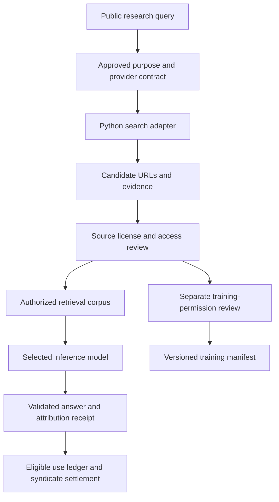

# Perplexity AI for Sovereign Source

**Research date:** 12 October 2026. **Project:** Super Sovereign Source LLM IP. **Status:** vendor research and proposed integration; no account, API integration, partnership or training permission established.

## Decision

**Study Perplexity's publisher compensation model, but do not adopt its hosted services as an unrestricted foundation or training teacher for Sovereign Source.** Its public acceptable-use policy restricts competitive products and distillation. A negotiated search partnership could be useful, subject to explicit permission for the proposed business, appropriate data protections and independent source licensing. [Acceptable Use Policy, §§3–5](https://www.perplexity.ai/en-GB/hub/legal/aup).

Perplexity supplies discovery, generated research and hosted model access. SIP still needs its own contributor agreements, attribution evidence, syndicate mandates and settlement ledger. This assessment does not change the repository's selected Nemotron 3 Ultra target or resolve that target's recorded ancestry conflict.

### Ten-parameter assessment

These are project judgments based on the evidence below, not benchmark scores.

| Parameter | Assessment for Sovereign Source |
| --- | --- |
| 1. Independent competing-model development | **Not approved under standard hosted terms.** See contractual restrictions. |
| 2. Source discovery | Technically useful; deployment conditional on an appropriate agreement. |
| 3. Citation and attribution | Useful evidence pointers; insufficient for ownership or causal influence. |
| 4. Source-content licensing | Separate permissions still needed. |
| 5. Creator payments | Relevant publisher-program precedent; no verified general SIP payout service. |
| 6. Ideas and upstream influences | No reviewed offering establishes SIP's proposed contribution graph and agreed shares. |
| 7. Sovereign operation | Hosted dependency; no reviewed offer supplies a self-hosted equivalent of the full search platform. |
| 8. Confidentiality and retention | Endpoint-specific; Search requires particular caution. |
| 9. No-Qwen / no-Chinese-model lineage | Embedding family fails; other services require exact-model and routing review. |
| 10. Economics and portability | Modest search unit prices; rights, rewards and switching costs remain separate. |

## What Perplexity currently offers

Current documentation distinguishes **Agent, Search, Embeddings and Orchestrator APIs** and provides a migration path from Sonar. Historical Sonar descriptions should not be used as a complete inventory of today's platform. [API documentation index](https://docs.perplexity.ai/llms.txt).

The Search API returns structured web results, including URLs, titles and snippets, with domain, language and regional controls. Agent API adds generated answers with citations. Search is the more natural candidate when SIP needs to evaluate individual source records before using their contents. Domain filters narrow discovery; they do not verify a publisher's authority to license a work. [Search documentation](https://docs.perplexity.ai/docs/search/quickstart).

The Orchestrator catalog is marked **private preview**. It lists `perplexity/nemotron-3-ultra-550b-a55b` alongside models from Moonshot AI and Z.AI. The documentation explicitly distinguishes the hosting prefix from the model's creator. This is a possible future inference supplier, not evidence of available training infrastructure, transferable weights or approved competing-model development. [Orchestrator catalog](https://docs.perplexity.ai/docs/router/models).

## Commercial restrictions and ownership

The reviewed AUP, dated **8 July 2025**, separately addresses:

- **§3.2:** distilling or reverse engineering the services, including underlying third-party models.
- **§3.5:** creating competing, similar or substitute products requires express prior written permission.
- **§4:** applicable third-party acceptable-use policies.
- **§5:** discretionary exceptions, including scientific purposes; these are not automatic research exemptions.

This reaches beyond feeding answers into training: a competing research assistant can also raise contractual issues. Obtain a written scope covering the actual proposed use rather than assuming a search-only integration avoids the restriction. [AUP](https://www.perplexity.ai/en-GB/hub/legal/aup).

The API terms, dated **23 January 2026**, reinforce that assessment:

| Clause | Relevant effect |
| --- | --- |
| §2.3.1 | Customer owns generated outputs as between the parties, to the extent legally possible. |
| §2.3.3 | Perplexity promises not to train generative models on customer content. This is not permission for customers to train models. |
| §§2.4–2.5 | AUP applies to services and outputs; competitive applications can lose API access. |
| §2.6 | Terms of the actual third-party model also apply. |
| §3.2 | Feedback about Perplexity IP is assigned without remuneration. |

The feedback clause matters for SIP: ordinary product suggestions are not automatically paid contributions. A separate contribution agreement would be needed. Output ownership also cannot transfer rights belonging to source authors. [API terms](https://www.perplexity.ai/en-GB/hub/legal/perplexity-api-terms-of-service).

Perplexity's model-terms list links to OpenAI, Anthropic, Google, xAI and Meta terms. Routing through an intermediary does not by itself remove the upstream provider's restrictions. Record the actual model and applicable terms for every approved route. [Third-party terms](https://www.perplexity.ai/en-GB/hub/legal/third-party-models).

**Negotiation requirement:** a project-specific amendment should address competitive products, any intended distillation or synthetic-data use, downstream model obligations, rights to retain evidence and termination continuity. Counsel should confirm its coverage before procurement. No such waiver was found for this project.

## Search has materially different data terms

The **22 September 2025 Search Addendum** preserves customer restrictions, including the AUP, while overriding several provider obligations:

- Other services' zero-retention commitments do not automatically apply (§1.2.2).
- Perplexity can retain and use search inputs and outputs for lawful business purposes; these are excluded from customer confidential information (§2.2).
- Personal data requires specific written authorization (§2.3).
- Customers do not acquire ownership of Search outputs; output-related IP indemnities do not apply (Schedule 1).

**Proposed SIP rule:** block confidential manuscripts, unpublished inventions and personal data from this endpoint unless a negotiated agreement expressly protects the use. Public availability of a query does not establish permission to reuse the returned content. [Search Addendum](https://www.perplexity.ai/en-GB/hub/legal/perplexity-api-terms-of-service-search).

The privacy documentation's zero-retention statement specifically names **Chat Completions**. It should not be generalized to every endpoint. [Privacy and security](https://docs.perplexity.ai/docs/resources/privacy-security).

Agent API documentation separately says conversation state persists server-side and that **`store: false` does not disable persistence**; it hides retrieval visibility. A flag alone cannot establish the project's retention requirement. Confirm contractual coverage, deletion, subprocessors and processing locations for the exact endpoint before transmitting contributor material. [Conversation state](https://docs.perplexity.ai/docs/agent-api/conversation-state).

## Publisher rewards: useful precedent, limited coverage

Perplexity announced publisher advertising-revenue sharing in July 2024. [Contemporaneous reporting](https://techcrunch.com/2024/07/30/perplexitys-plan-to-share-ad-revenue-with-outlets-cited-by-its-ai-chatbot/).

Its later **Comet Plus** announcement describes compensation tied to **human visits, search citations and agent actions**, with participating publishers receiving subscription revenue after a compute allocation. That is directly relevant to rewarding content consumed without a human click. The announcement describes participating publishers, not a universal entitlement for every author or idea used by AI. [Official Comet Plus announcement, French edition](https://www.perplexity.ai/fr/hub/blog/introducing-comet-plus).

Axios reported an **80% publisher share and $42.5 million initial pool** in August 2025. [Launch report](https://www.axios.com/2025/08/26/perplexity-comet-plus-subscription).

Those are announced program economics, not independently verified payouts or a current offer to SIP. This review did not establish the present partner contract, minimum eligibility, allocation weights, payment history or access to a transferable rewards API. It also found no basis for assuming that an ordinary API bill includes royalties for the source material SIP consumes.

### What SIP should add

The following is a proposed SIP design, not a description of Perplexity's implementation:

| Contribution | Evidence for an agreed reward |
| --- | --- |
| Article or paper retrieved for an answer | Authorized asset version, retrieved passage and delivered-answer receipt. |
| Dataset admitted to training | Training permission, manifest membership and recorded exposure; no claim that exposure proves causal influence. |
| Scientific or mathematical idea adopted | Documented proposal, review and acceptance under a contribution agreement. |
| Upstream influence on a new contribution | Reviewed relationship and expressly accepted beneficiary share. |
| Syndicate-administered material | Valid member mandate, versioned split and settlement statement. |

A citation is evidence of a reference. It is not by itself proof of authorship, lawful access, training provenance, ownership or a payment obligation. SIP can recognize ideas through agreements without asserting that every idea is a new statutory property right. See the project's [licensing guide](../licenses/README.md) and [marketplace terms](../licenses/SYNDICATE-MARKETPLACE-TERMS-0.1.md).

## Model lineage and access provenance

Perplexity's published `pplx-embed-v1` and `pplx-embed-context-v1` family uses continued-pretrained **Qwen3**, according to its own model card. The listed MIT license does not alter that ancestry. Exclude this family under the project's no-Qwen condition, including if hosted outside China. An embedding model participates in the retrieval pipeline even when it does not generate the final answer. [Perplexity embedding model card](https://huggingface.co/perplexity-ai/pplx-embed-v1-4b).

Neither a US vendor name nor a `perplexity/` model prefix proves US-only lineage. Exact checkpoint, tokenizer, teacher-data and routing evidence remains necessary. The existing [architecture](SOLUTION_ARCHITECTURE.md#nemotron-checkpoint-selection) already records Ultra's conflict with the earlier ancestry requirement; hosting Ultra through Perplexity would not resolve it.

Source access also deserves verification. Cloudflare reported tests in which it alleged Perplexity evaded crawl restrictions; Perplexity disputed the attribution and interpretation of that traffic. These are opposing primary accounts, not a judicial finding. SIP should require access and license evidence rather than treating search availability as clearance. [Cloudflare investigation](https://blog.cloudflare.com/perplexity-is-using-stealth-undeclared-crawlers-to-evade-website-no-crawl-directives/), [Perplexity response, French edition](https://www.perplexity.ai/fr/hub/blog/agents-or-bots-making-sense-of-ai-on-the-open-web).

## Proposed integration after contractual approval

Keep the platform's existing responsibilities. Perplexity would be a replaceable discovery supplier; the permission and payment records would remain under SIP control.

1. **Python and Pydantic:** validate query purpose, approved endpoint, request identifier, source URL, retrieval time and evidence references. Record rights status as unknown until reviewed. Treat returned text as untrusted input.
2. **Rust and Axum:** enforce tenant permissions and approved external destinations before dispatch; enforce source permissions again before answer delivery. Deny unapproved model fallback routes.
3. **PostgreSQL:** store asset versions, license evidence, agreement versions, attribution relationships and durable usage events. Preserve supplier provenance when retaining material is authorized.
4. **Pydantic AI:** propose cited answers or possible attribution relationships using admitted material. Reviewers resolve disputed claims; the model does not decide ownership or money.
5. **Prefect:** orchestrate source review, expiry checks and training-manifest creation. Export only records with purpose-specific permission and completed review.
6. **Settlement:** calculate agreed rewards from eligible events with idempotency keys and exact amounts. Separate provider charges from creator liabilities; preserve credit-only relationships without fabricating royalties.

The diagram describes proposed boundaries, not an implemented pipeline. Routing a source through review does not cure a contract breach in obtaining it. Both supplier-use permission and source-content permission must exist before dependent work proceeds.

## Indicative supplier costs

Published prices observed on the research date:

| Service | Published price | Illustrative cost |
| --- | --- | --- |
| Standard Search API | $5 per 1,000 successful requests | 100,000 requests: $500 |
| Fast Search API | $1 per 1,000 successful requests | 100,000 requests: $100 |
| Agent standard web-search tool | $2.50 per 1,000 invocations | 100,000 invocations: $250, plus model tokens |
| Agent URL-fetch tool | $0.50 per 1,000 invocations | Additional to search and model charges |

Standalone Search billing is per successful request, including an empty result; a request can contain up to five queries. These estimates exclude licensing, creator rewards, review, storage, taxes and operations. They do not equate retrieval requests with complete answers. [API pricing](https://docs.perplexity.ai/docs/getting-started/pricing).

## Next decision and evidence required

**Recommended disposition: research reference and potential negotiated supplier; no production or training approval.** If pursuing a partnership, request a concrete agreement and evidence package covering:

- The intended competing assistant or LLM business and all proposed output uses.
- Endpoint-specific confidentiality, retention, deletion, regions and subprocessors.
- Authorized source use, evidence retention and any upstream licenses actually passed through.
- Publisher eligibility, auditable allocation rules, dispute handling and whether syndicates can participate.
- Exact model identities, lineage disclosures and controllable fallback behavior.

Once those conditions are met, evaluate a small public-query discovery pilot against direct licensed retrieval. Measure source usefulness, permission-review effort, citation support, latency and cost per accepted source. Make no claim of training independence or universal creator compensation from a successful search pilot.

**Research limits:** public documentation and published reports only; no private contract, authenticated API test, payout audit or legal opinion. Some default-language pages could not be fetched; the legal analysis uses Perplexity's official English (UK) pages, with their displayed dates, and clearly identified official French blog editions. Confirm the agreement actually offered to the project's US entity and any later amendments before relying on this assessment.
