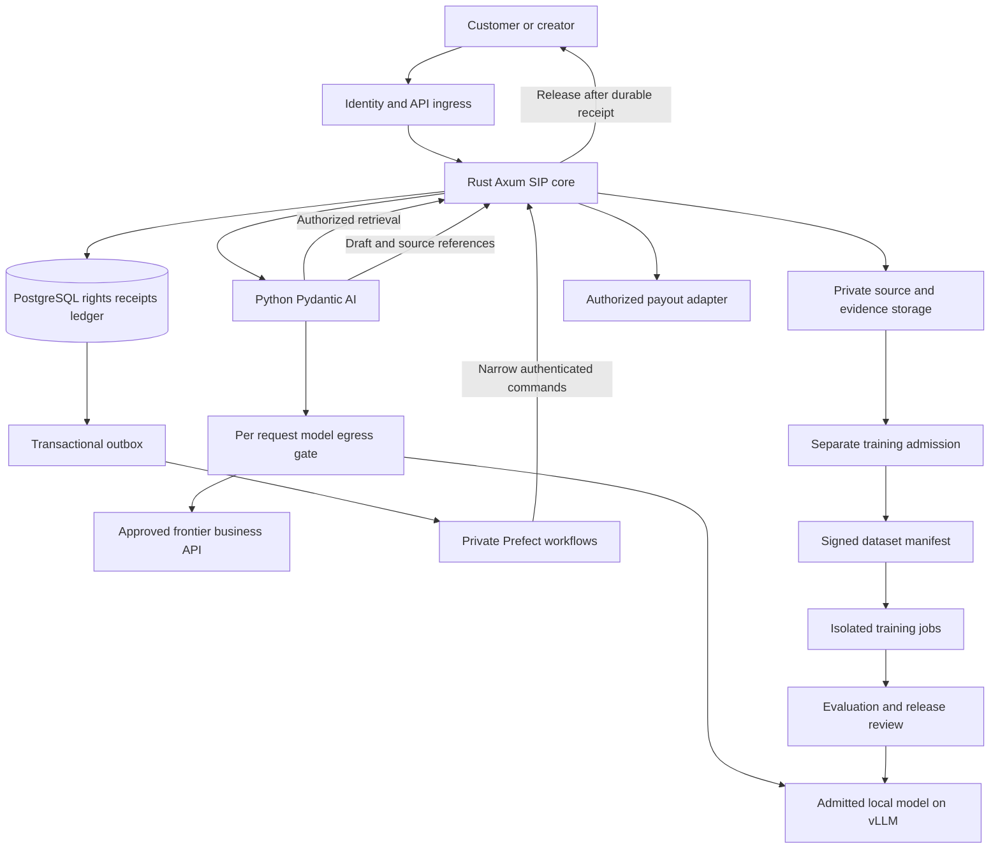

# Production plan for Sovereign Source AI

**Research date:** 12 October 2026. **Status:** proposed production design; implementation, procurement and model qualification remain outstanding.

Build a licensed research and knowledge service on an open-source application core, with separately approved local models and optional frontier APIs. Make source permissions, attribution receipts and creator accounting work before adapting a model. Keep production conversations and frontier responses outside the training pipeline unless their specific reuse permissions have been established.

The first product should answer questions over an enrolled collection, show the evidence behind each answer, and pay contributors under accepted agreements. A frontier-scale training program is a later investment. This plan extends the [solution architecture](SOLUTION_ARCHITECTURE.md) and [model selection research](MODEL_SELECTION_RESEARCH_SUMMARY.md); the existing v0.7 specification and Nemotron 3 Ultra selection remain recorded decisions.

## Recommended production decisions

| Decision | Proposed choice | Reason and release condition |
| --- | --- | --- |
| First customer product | Research assistant for a bounded, licensed technical collection | A measurable source-to-answer-to-payment journey; avoid an unrestricted general chatbot at launch. |
| Application authority | Rust, Axum and PostgreSQL | Permissions, accepted attribution, syndicate shares and ledger entries remain deterministic. |
| AI integration | Python, Pydantic and Pydantic AI | Typed evidence bundles and provider adapters; models propose answers and relationships. |
| Background work | Self-hosted Prefect | Ingestion, evaluation, manifest construction, reconciliation and training supervision. |
| Retrieval | PostgreSQL full-text search first; pgvector after embedding admission | A useful service can launch without an unaudited embedding or reranking model. |
| Local model research | KL3M specialist pilot; gpt-oss-20b as a conditional general-serving candidate | Evaluate these roles separately. Neither has passed this project's production gates. |
| Frontier integration | One approved business API initially; GPT-6.1 Sol is the first commercial inference candidate to assess | Compare it with Gemini 3.8 Flash and approved Claude or Meta routes on the actual workload. No hosted teacher is enabled by default. |
| Deployment | Private US regional environment, redundant application instances, private GPU pool | Start with managed infrastructure where contracts permit; retain exportable databases, artifacts and deployment definitions. |
| Training | Human-authored examples and admitted source material first | Optional local teachers require their own license, provenance and purpose approval. |
| Creator rewards | Core-owned usage records and balanced ledger; contracted payout provider | Citation, contractual entitlement and completed payment are distinct facts. |

**The earlier US-only and no-Chinese-model-lineage requirements remain active.** A US supplier is not evidence that its weights, teachers, filters or datasets satisfy the lineage requirement. The reviewed frontier services and general local candidates remain unverified on that requirement; Ultra has disclosed excluded dependencies. Production routes stay disabled where a required admission condition fails or remains unresolved. The system can still provide authorized search, source receipts, marketplace operations and human-reviewed answers while qualification proceeds. A policy change would need an explicit recorded decision; this plan does not make one.

Open-source infrastructure and downloadable model weights are different categories. An Apache license on weights does not establish an entirely open training process, source-by-source clearance or a preexisting creator royalty system. Preserve each upstream license; the draft SS-SIP license does not overwrite it. [Licensing framework](../licenses/README.md).

## Model roles and commercial boundaries

### Local models and training tools

| Candidate | Suitable experiment | Conditions |
| --- | --- | --- |
| `alea-institute/kl3m-003-3.7b` | Narrow extraction, source-grounded specialist fine-tuning and provenance workflow | CC BY 4.0; 4,096-token context and limited instruction alignment. Verify original corpus evidence and exact checkpoint scope. It is not a ready general assistant. [Model card](https://huggingface.co/alea-institute/kl3m-003-3.7b). |
| `openai/gpt-oss-20b` | Lower-footprint local serving and teacher experiments | Apache 2.0 download route; use its required template and supported runtime. The published 16 GB inference claim is not a concurrency or training-memory guarantee. Upstream rights and lineage remain unresolved. [Model card](https://huggingface.co/openai/gpt-oss-20b). |
| `openai/gpt-oss-120b` | Higher-capability local teacher or serving comparison | Separate downloaded-model terms from OpenAI's hosted API contract. Admit generated examples only after source and teacher review. [Weight license](https://huggingface.co/openai/gpt-oss-120b/blob/main/LICENSE), [usage policy](https://huggingface.co/openai/gpt-oss-120b/blob/main/USAGE_POLICY). |
| Gemma 4 | Alternative local serving and adaptation comparison | Apache-licensed family with multiple sizes. Select an exact artifact before testing; commercial permission alone does not close the lineage or source-rights audit. [Google model card](https://ai.google.dev/gemma/docs/core/model_card_4). |
| Muse Glimmer-30B | Conditional local teacher and multimodal comparison | Downloaded license and disclosed Spark distillation ancestry require separate assessment. Do not transfer Meta API permissions to the local release or vice versa. [Existing Meta audit](META_MUSE_SOVEREIGN_SOURCE_RESEARCH.md). |
| Nemotron 3 Ultra | Recorded large-model adaptation target | Keep behind its unresolved release gate. NVIDIA discloses Qwen and DeepSeek dependencies. Its 550B total parameters and cluster requirements make it a separate capacity project. [NVIDIA card](https://huggingface.co/nvidia/NVIDIA-Nemotron-3-Ultra-550B-A55B-BF16), [compute plan](SOLUTION_ARCHITECTURE.md#compute-and-execution-profiles). |
| OLMo-core with newly initialized weights | Future foundation trained on SIP-admitted sources | Apache-licensed training software, not an already cleared checkpoint. Independently admit the tokenizer, data, filters and any teachers. [Ai2 repository](https://github.com/allenai/OLMo-core). |

Select the smallest admitted model that passes the task evaluation. Benchmark one candidate at a time on the same source collection, prompt budget and acceptance criteria. Maintain the KL3M pilot recommendation without assuming that its provenance orientation establishes sufficient answer quality.

### Frontier APIs

The following are commercial inference candidates, not approved training teachers or a measured capability ranking. Available models and prices were checked on the research date; pin a supported version and revalidate before launch.

| Provider and candidate | Proposed production role | Commercial boundary |
| --- | --- | --- |
| OpenAI `gpt-6.1-sol`; `gpt-6-astra` for separately budgeted difficult tasks | Customer answers where the business API agreement and source grants permit processing | The agreement allows API customer applications, but §3.3 restricts output-based development of competing models, subject to defined exceptions. Keep the service's model-development purposes separate and obtain permission where needed. [Model catalog](https://developers.openai.com/api/docs/models), [Services Agreement](https://openai.com/policies/services-agreement/). |
| Google `gemini-3.8-flash` | Alternative stable inference route for approved content | Paid Gemini API terms exclude provider training on prompts/responses, but prohibit developing competing models. Vertex AI has separate contracts; approval for one access route does not approve another. [Model catalog](https://ai.google.dev/gemini-api/docs/models), [API terms](https://ai.google.dev/gemini-api/terms). |
| Anthropic `claude-sonnet-5-5` or `claude-opus-5-5` | Quality comparison and possible inference route after commercial approval | §D.4 covers competing products and services as well as competing models. For sovsrc's stated business, inference-only separation is not enough to assume permission; require express approval for the proposed use. [Model catalog](https://platform.claude.com/docs/en/models/overview), [commercial terms](https://www.anthropic.com/legal/commercial-terms). |
| Meta `muse-spark-1.3` or `muse-wonder-1.0`, Standard mode | Conditional evaluation or inference option | Terms restrict competing development and dataset collection; evaluation has a stated exception, while competitive public benchmark marketing has a separate restriction. Confirm the intended deployment in writing. Contributor mode authorizes Meta training and is excluded by default. [API terms](https://dev.meta.ai/legal/terms-of-service), [Standard and Contributor modes](https://dev.meta.ai/docs/pricing-rate-limits). |

Provider promises not to train on customer data do not grant the customer permission to train a competitor. A retrieval application also cannot promise attribution for the frontier model's undisclosed pretraining sources. It can account for the enrolled material that the application actually retrieved, supplied or reused.

For every route, separately approve its contract, exact purpose, processors, processing region, retention, tools, output reuse and lineage status. OpenAI documents endpoint-specific storage, abuse monitoring and exceptions to Zero Data Retention; `store=false` alone does not establish zero retention. Record the actual approved account configuration instead of a generic provider privacy label. [OpenAI data controls](https://developers.openai.com/api/docs/guides/your-data). For other routes, require equivalent endpoint-specific evidence before handling restricted material.

## Architecture and deployment

The [OpenCode 2 assessment](OPENCODE_2_SOVEREIGN_SOURCE_RESEARCH.md) proposes a self-hosted engineering and experiment interface with separately admitted models. Keep that optional development service behind scoped SIP tools; production authorization, durable workflows and creator settlement remain in the core services below.



Keep `sip-core` and `sip-ai` as the two application services. Add workers and model servers as independently operated workloads, not a separate microservice for each domain. Python receives scoped evidence and submits typed proposals; it has no general SIP database credentials. Frontier API credentials live only in the approved egress service, and training workers cannot obtain them.

| Layer | Initial production choice | Portability and operational requirement |
| --- | --- | --- |
| Identity | OpenID Connect with Keycloak or an approved enterprise identity provider | Tenant membership and syndicate mandates remain in SIP. Enforce MFA for administrative and payout actions. [Keycloak](https://www.keycloak.org/). |
| Compute | Kubernetes with separate application, GPU and batch pools; managed control plane where acceptable | Version deployment manifests and OpenTofu infrastructure definitions. Maintain a documented second-provider restore path. [OpenTofu](https://opentofu.org/). |
| Database | PostgreSQL with primary and synchronous standby in separate failure domains | Managed PostgreSQL initially if sovereignty terms allow; CloudNativePG is the self-operated alternative. Separate application and Prefect databases and roles. |
| Storage | Private S3-compatible object storage | Managed storage first; Ceph Object Gateway is the self-operated alternative. Test needed S3 operations, encryption, lifecycle and export behavior. [Ceph gateway](https://docs.ceph.com/en/latest/radosgw/). |
| Serving | Private vLLM deployment for compatible admitted weights | Pin model, tokenizer, template, parsers, runtime and container digests together. Keep management and metrics endpoints private. [vLLM security](https://docs.vllm.ai/en/latest/usage/security/). |
| Workflows | Prefect server, background services, workers and documented Redis messaging configuration | Use an approved Redis 8 release under its AGPLv3 option; review obligations and test the exact combination. Broker loss must not lose SIP outbox records. [Prefect scaling](https://docs.prefect.io/v3/advanced/self-hosted), [Redis licensing announcement](https://redis.io/blog/agplv3/). |
| Observability | OpenTelemetry, Prometheus and an approved dashboard/log stack | Collect operational metadata by default; keep excerpts, prompts, identities and provider responses out of shared telemetry. [Sensitive data handling](https://opentelemetry.io/docs/security/handling-sensitive-data/). |

This uses open-source components while allowing managed hosting. A fully self-operated installation also needs staff to operate identity, Kubernetes, storage, databases and recovery. The bill of materials must record the exact release, license, notices and support owner of every component; managed hosting and frontier APIs remain commercial dependencies. vLLM and Prefect publish Apache 2.0 licenses for their respective software. [vLLM license](https://github.com/vllm-project/vllm/blob/main/LICENSE), [Prefect license](https://github.com/PrefectHQ/prefect/blob/main/LICENSE).

For a limited paid pilot, deploy at least two application replicas and independently recoverable database and storage services. A single GPU worker is acceptable only with an explicitly reduced availability commitment and an authorized degraded mode. For the proposed general-availability target, budget two independent serving replicas of a model that fits each replica's tested hardware, and prove that either can handle the accepted degraded load. Do not interpret two GPUs as enough for Ultra.

Use private subnets, workload identities, TLS, restricted administrative access and default-deny egress. vLLM documents insecure-by-default inter-node communications; isolate the entire distributed inference network. Disable production model-management shortcuts and unreviewed remote code. Parse untrusted documents in resource-limited workers with no production credentials. Model tool access never grants SQL, payment execution or unrestricted network access.

## Request routing and release

1. **Authorize the request.** The core binds actor, tenant, purpose, source permissions, budget and deadline to an immutable request ID. A model cannot choose these fields.
2. **Retrieve only eligible evidence.** Apply tenant and resource authorization before returning any text. Start with full-text search; use an embedding adapter only after independent model admission. Preserve document versions, passage locations and grant versions.
3. **Select an eligible route.** Intersect customer policy, every source grant, provider contract, approved region/retention configuration and model admission. An empty intersection returns authorized search results, abstention or a human-review option.
4. **Generate within a fixed budget.** Use the approved local model for routine questions and an eligible frontier route for tasks its evaluation justifies. Bound total tokens, calls, tool actions and wall time. A model's self-reported confidence is not the escalation criterion.
5. **Validate the draft.** Check schema, reference identities, quotation spans, required notices and factual support. Structural checks are deterministic; semantic support needs calibrated evaluation and human review for consequential uses. Prompt injection in sources cannot change routing or payment policy.
6. **Reauthorize and commit.** Recheck current grants, mandates and expiry in the release transaction. Persist the answer reference, attribution receipt, qualifying economic events and outbox record atomically before sending answer text. A conflicting revocation effective before commit prevents release.
7. **Return the same result on retry.** A retry retrieves the committed result with a fresh access check. If the client disconnected after commit, do not create another economic event. Distinguish authorized release from acknowledged delivery when an agreement uses delivery as its trigger.

Pydantic AI supplies provider integrations and fallback support; SIP must constrain the permitted route set. Never let a generic fallback send local-only evidence to a cloud provider. Reauthorize before each new processor attempt. Do not retry a safety or permission denial through another provider. Provider outages and rate limits can trigger bounded retry or an eligible alternate, with every attempt counted in cost. [Pydantic AI model integration](https://pydantic.dev/docs/ai/models/overview/).

Initially buffer the complete generated answer until release commits; stream progress indicators only. Partial answer streaming requires a separate design for per-segment authorization, receipts and revocation. Keep cache keys scoped to tenant, permission version, evidence digest and route policy. Disable reuse across tenants, and reauthorize cached responses. Cache hits do not suppress contractual earning events or manufacture new ones.

Use non-owner database runtime roles without `BYPASSRLS`, transaction-local tenant context and appropriate forced row security. Test connection reuse between tenants. PostgreSQL warns that privileged roles and normally table owners bypass row security. [PostgreSQL RLS](https://www.postgresql.org/docs/current/ddl-rowsecurity.html). When introducing approximate vector indexes, measure authorized recall against exact search; post-scan filters can reduce returned matches. [pgvector filtering](https://github.com/pgvector/pgvector#filtering).

## Attribution and creator rewards

The durable receipt should identify the response, admitted source versions and passages, permission decision, processor route, required public credits and governing economic agreements. Keep private contracts and identity evidence out of public receipts. Source hashes establish version identity, not ownership. Citations establish the application's evidence references, not causal influence from a model's hidden pretraining corpus.

| Event | Evidence | Economic treatment |
| --- | --- | --- |
| Licensed retrieval | Accepted permission, asset version and recorded use | Pay a per-use fee only under the applicable agreement. |
| Training exposure | Approved manifest plus records of data actually consumed | Eligible corpus points only under the registered model-cohort contract. A planned manifest alone is insufficient. |
| Workflow execution | Accepted workflow version and verified eligible paid execution | Prompt/workflow track under its accepted rules. |
| Adopted contribution or influence | Reviewed adoption and an accepted beneficiary schedule | Agreed allocation; an AI similarity score creates no entitlement. |
| External payout | Approved payable balance plus provider/bank confirmation | Changes payment status; it does not recalculate rights or shares. |

Retain the specification's proposed **20% of eligible collected revenue**, divided **60% corpus, 20% prompts/workflows and 20% ideas/contributions/influences**, only for agreements that adopt it. Deduct only the specified refunds, chargebacks, taxes and payment-processing fees from eligible revenue. Compute and content supplier expenses do not silently reduce the pool. Zero eligible scores reserve that track's allocation under its published terms. A retrieval-only launch cannot assign the corpus portion to imagined frontier training exposure. [Royalty engine and syndicate rules](SOVEREIGN_SOURCE_AI_CODEX_SPEC.md#12-royalty-engine).

Direct creator contracts are the first source channel. TollBit is a possible additional supplier: its documented summarization, full-display and custom licenses have different uses. Preserve the actual transaction license, asset identity and price. Buying retrieval access is not automatic permission to train, indefinitely cache or redistribute. [TollBit license types](https://docs.tollbit.com/docs/setting-rates).

Post balanced, append-only ledger entries in integer minor units with deterministic rounding. Keep per-request supplier charges, creator liabilities, customer charges and payout attempts separate. Member splits total 100%; overlapping syndicates cannot multiply the same entitlement. Corrections use linked adjustments, and disputes hold only affected amounts.

Use Stripe Connect as the existing payout candidate after onboarding, jurisdiction and business-model approval. Authenticate callbacks, deduplicate events and reconcile to provider objects. Stripe documents duplicate and out-of-order webhooks, and finite retention of idempotency keys; maintain permanent business identities internally rather than relying on provider keys forever. [Webhook handling](https://docs.stripe.com/webhooks), [idempotent requests](https://docs.stripe.com/api/idempotent_requests). A timeout leaves payment status unknown until reconciliation; never blindly issue a new transfer. Real payout launch requires finance controls, payee verification, applicable tax reporting and accepted dispute procedures.

## Independent training pipeline

Operate separate storage namespaces, service identities and admission permissions for customer inference, evaluation, and training. Restricted provider outputs carry a persistent purpose restriction through copies, human edits, labels and derived examples. Training workers cannot read inference archives. The manifest builder checks every dependency, including teachers, judges, model-based filters, tokenizers and inherited datasets; it rejects missing evidence.

1. Freeze source-family evaluation holdouts before model development. Record rights, content digests, deduplication and contamination checks.
2. Commission original demonstrations, citation corrections and verifiers from paid experts using admitted sources. Contributor consent is separate from ordinary customer use.
3. Admit any local teacher through its downloaded license, usage policy, provenance and hosting terms. Record source IDs and teacher revision with every synthetic example; independently validate outputs.
4. Apply supervised fine-tuning to a qualified small model and compare it with the unchanged model under identical retrieval conditions. Keep a no-fine-tuning baseline.
5. Add verifiable-reward training only for measured failures that justify it. SkyRL is a framework candidate; executable checks and validated citation behavior are model-training signals, not creator payment calculations. [SkyRL research](SKYRL_SOVEREIGN_SOURCE_RESEARCH.md).
6. Freeze the consumed-data manifest, executed recipe, container and checkpoint hashes, credits, inherited limits and evaluations. Require save/resume, export, rollback and revocation-remedy evidence before release.

Hosted frontier outputs, critiques, preference labels and synthetic corpora stay excluded unless the exact competing-development use has contractual permission. Evaluation-only artifacts do not automatically qualify for later optimization. Neither human paraphrasing nor a second model removes the original dependency. Architectural separation supports compliance evidence; it is not, by itself, a legal clean-room defense. This repository's AI-assisted research and chat archives are planning artifacts, not an admitted training corpus. [Independent development pathway](CHATGPT_TO_INDEPENDENT_LLM_PATHWAY.md).

Train a new foundation with OLMo-core only after the smaller system proves source supply, learning quality and rewards accounting. Ultra adaptation needs a separately approved lineage decision and resource budget. Deleting a source from retrieval does not remove learned influence from weights; checkpoint retention, retraining, validated unlearning or retirement must follow the accepted agreement.

## Reliability and production acceptance

These are proposed service objectives and launch gates, not measured results. Test the accepted load with a failed replica, not just an idle healthy system.

| Area | Initial target or required evidence |
| --- | --- |
| Load profile | 100,000 completed answers/month; 5 incoming requests/second for a five-minute burst. Enforce bounded concurrency, queue length and admission limits. |
| Availability | 99.9% monthly successful completion for in-scope, authorized requests, including dependency failures. Count unplanned errors and timeouts; report planned denials and abstentions separately. |
| Latency | p95 complete validated answer under 30 seconds for the defined short-answer workload. Route longer research to an explicitly asynchronous product. |
| Quality | At least 1,000 held-out, source-family-separated tasks; proposed ≥95% supported-citation precision and ≥90% answer acceptance. Report confidence intervals and performance by source, language and task. |
| Abstention | Include unanswerable and adversarial tasks; measure false answers and unnecessary abstention separately. A high refusal rate cannot satisfy the quality gate. |
| Critical controls | Zero observed unauthorized cross-tenant releases, disallowed processor transfers or duplicate financial postings in the adversarial and fault suite. Any such finding blocks release; finite tests do not prove zero future risk. |
| Receipts and accounting | Every delivered answer resolves to its committed receipt; every payable event resolves to an agreement. Ledger balances and allocations reconcile exactly by currency. |
| Failover and disaster recovery | No acknowledged transaction loss in the tested synchronous local failover. Proposed regional-disaster RPO ≤5 minutes and RTO ≤4 hours, subject to restore drills and permitted backup regions. |
| Security and operations | Independent review of identity, tenant isolation, source parsing, model egress and payout controls; owned on-call runbooks and tested route/payout kill switches. |

Measure quality with independent human review and executable checks where appropriate; an unrestricted frontier judge is not the only acceptance authority. Permission and payment tests need exact outcomes, not average model scores. Changing the model, prompt, parser, retrieval index or provider configuration reruns the affected evaluations.

Backups require database base backups plus WAL archives, source objects, manifests, permissions and recoverable keys. Database replication is not backup. CloudNativePG documents the need for both base backups and WAL for point-in-time recovery. [Backup design](https://cloudnative-pg.io/docs/1.28/backup/). Perform quarterly full restore drills and more frequent sampled restores. After disaster recovery, keep payouts paused until external transfers and any events beyond the recovery point are reconciled; RPO loss must not become duplicate payments.

Monitor queue depth, model errors, token use, complete-answer latency, citation failures, outbox lag, unposted receipts, ledger imbalance, unknown payout status and cost per accepted answer. vLLM exposes serving health and Prometheus metrics; protect those endpoints. [Serving interfaces](https://docs.vllm.ai/en/latest/serving/online_serving/), [metrics](https://docs.vllm.ai/en/latest/usage/metrics/). Alert on approaching source/contract expiry and provider deprecation as well as infrastructure failures. Before an expiry or changed term becomes effective, reapprove or disable the route.

Roll out model and application revisions through offline evaluation, authorized shadow traffic, a small canary and a staged increase. Shadow calls require processor permission and have costs too. Keep an eligible previous model available. Rollback may restore binaries and routing, but must preserve current revocations and posted financial records.

## Capacity and operating budget

The following calculation illustrates a paid pilot after model and provider admission. It is not a supplier quote, a capacity benchmark or a frontier-training budget. Assume 100,000 monthly answers, 10% routed to a frontier API, 1.2 billable API attempts per routed answer, 6,000 uncached input tokens and **800 total billable output tokens per attempt**, including any billed reasoning. Tool fees, long contexts and larger reasoning budgets require separate scenarios.

```text
API attempts = 100,000 × 10% × 1.2 = 12,000
Input tokens = 12,000 × 6,000 = 72 million
Billable output tokens = 12,000 × 800 = 9.6 million
API cost = 72 × input price per million + 9.6 × output price per million
```

At the published GPT-6.1 Sol rates of $2 input and $10 output per million tokens, the example is **$240/month**. With the same token counts, Astra's $10/$50 rates produce **$1,200/month**. These are token-cost comparisons, not equal-quality or equal-reasoning comparisons. [Current OpenAI catalog and prices](https://developers.openai.com/api/docs/models). Replace averages with measured p50/p95/p99 consumption before contracting.

| Monthly item | Illustrative amount | Basis |
| --- | ---: | --- |
| Two independent GPU serving replicas | $4,380 | Assumed $3 per GPU-hour × 2 × 730 hours; hypothetical rate and capacity. |
| Frontier API | $240 | Sol token scenario above. |
| CPU services, database, storage, backups and monitoring | $2,000 | Planning allowance, not a priced bill of materials. |
| Licensed retrieval costs | $500 | Planning allowance; minimum guarantees could materially increase it. |
| Creator pool allocation or reserve | $4,000 | Assumed $20,000 eligible collected revenue × agreed 20%. |
| **Illustrative total before people and other exclusions** | **$11,120** | No duplication or offset of supplier payments assumed. |

The pool divides into $2,400 corpus, $800 workflows and $800 contributions/influences under the proposed formula. If the initial service has no eligible trained-model cohort, reserve the corpus allocation under the agreement rather than reallocating it without consent. Minimums, bounties and retrieval obligations remain separate unless their contracts allow an identified offset.

Budget personnel separately: seven full-time-equivalent roles at an **assumed** loaded $18,000–$25,000 per person/month imply **$126,000–$175,000/month**, before specialist counsel and independent audits. Taxes not already included, additional networking, procurement commitments, training jobs, support contracts and contingency are outside the illustrative total. This is a staffing scenario for a limited product, not evidence that seven people can sustain a frontier lab or every enterprise SLA.

At this workload, reserved GPUs can cost more than API tokens. Local processing is justified by confidentiality, control and eligible workloads, not an automatic cost advantage. Size serving from measured input/output throughput, KV-cache use, latency and failure headroom. For a five-request/second burst averaging 800 generated tokens, the fleet may need about 4,000 output tokens/second before retries, plus prefill capacity; two replicas are not presumed to meet that load. Reduce admitted burst load, add measured capacity or queue work if the test fails.

For adaptation, calculate `GPU count × measured run hours × contracted hourly rate`, then add dataset preparation, evaluation, storage and failed-run allowance. As arithmetic only, an 8-GPU, 24-hour experiment at $3/GPU-hour costs $576 in GPU time; it does not establish enough compute for a useful model. A new foundation and Ultra training each require a separate learning and capacity study.

## Delivery sequence and ownership

The schedule assumes a dedicated team, timely source agreements and accessible infrastructure. Gates determine progression; the calendar does not certify production readiness.

The [startup go-to-market plan](STARTUP_GO_TO_MARKET_PLAN.md) sequences paid readiness work, design partnerships and limited production pilots around these gates. Its marketing budget is separate from implementation funding, and its proposed prices and revenue targets require customer validation.

| Phase | Planning window | Owner and deliverable | Exit evidence |
| --- | --- | --- | --- |
| Scope and admission | Weeks 1–2 | Product/rights lead: one customer workflow, source contracts, processor policy and model register | Accepted earning rules and benchmark tasks; unresolved model routes remain disabled. |
| Local system | Weeks 3–6 | Two core engineers, two AI/data engineers: M0–M4 rights, retrieval, receipts and simulated accounting | Isolation, revocation, idempotency and golden financial tests pass. |
| Private staging | Weeks 7–10 | Platform/security engineer with core team: deployment, provider adapter, backups and failure recovery | Approved route works with allowed data; restore, denied-egress and incident exercises pass. |
| Limited paid pilot | Weeks 11–16 | Product/rights and finance/contributor operators: enrolled customers and creators | Reviewed source receipts, reconciled real transactions, quality and load results within the pilot's stated limits. |
| Broader availability | After pilot gates | Named service and security owners | Independent review, redundancy, support coverage, measured SLOs and exit/restore evidence. |
| Adaptation program | After data and capability gates | AI/data lead with rights review | Admitted corpus, permitted teacher if any, improved held-out results and reproducible release package. |

The seven-role illustration comprises two core engineers, two AI/data engineers, one platform/security engineer, one product/rights operator and one finance/contributor operator, with external legal and security specialists. Assign explicit incident coverage or paid operational support; do not assume these roles supply unlimited on-call capacity. The existing 24-person laboratory proposal concerns a broader research program.

The implementation backlog should add a model/provider admission register, purpose-bound route policy, a per-attempt usage record, durable response receipts, restricted training manifests, payout reconciliation and recovery runbooks to the existing domain model. Reuse current `ModelVersion`, `RightsGrant`, `AgreementVersion`, `ResearchRequest` and `EvaluationRun` records rather than creating parallel authorities. Link the resulting production acceptance evidence to the [specification's M5 and later gates](SOVEREIGN_SOURCE_AI_CODEX_SPEC.md#16-verification-requirements).

The release package must include exact dependency and model revisions, source and processor approvals, evaluation results, deployment/restore instructions, public attribution exports, financial reconciliation proof and named operational owners. Publishing this plan does not approve a provider contract, change the lineage requirement, spend infrastructure funds or deploy a system.
