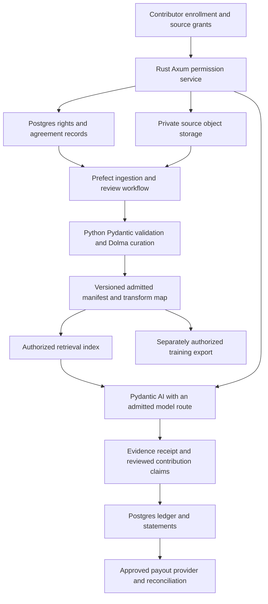

# Sovereign Source SaaS: business plan for markets and community syndicates

**Strategy, operations and tactics — 12 October 2026**

**Recommendation:** build a SaaS through which a publisher, association or community sponsor can operate an AI research service over an authorized collection, credit contributors and administer agreed content rewards. Launch in industry and knowledge markets first. Enter financial and investment research markets as a separate second phase, after validating demand, data permissions and sector-specific controls.

The commercial unit is a **paying organization operating a syndicate**, with invited contributors and authorized users. Start with a useful research workflow and a small source collection. Expand into additional content licensing and tenant-specific model development when customers purchase those capabilities. A new foundation model remains a separately financed research program.

This is a proposed business plan, not evidence of an operating business. The repository is at specification stage; customer interviews, revenue, staffing, funding, model admission and production performance are unverified. Prices, conversion rates, costs and dates below are **planning assumptions in USD**. Month 1 starts when the relevant work is funded and staffed, rather than automatically on this document's date.

This plan extends the [startup go-to-market plan](STARTUP_GO_TO_MARKET_PLAN.md), its [139-tactic register](STARTUP_GTM_TACTIC_REGISTER.md) and the [production system plan](PRODUCTION_SYSTEM_PLAN.md). It retains their managed-service price and six-customer base case, and adds community economics, a Dolma integration, syndicate operations and a distinct financial-market launch. It does not change the project's model-lineage policy or adopt contracts on anyone's behalf.

## 1. Business thesis and decisions

Research communities produce valuable knowledge, but an AI service needs more than an archive: permission to process each source, usable provenance, a reliable answer workflow and a way to administer contributor agreements. The hypothesis is that an organization will pay to operate those functions together when they improve a recurring research job and make source use accountable.

The proposed customer promise is: **“Turn your community's authorized knowledge into a research service, with source receipts and agreed rewards for the people behind it.”** Validate whether buyers value this enough to pay; ethical positioning alone does not establish a budget.

| Decision | Proposed approach | Evidence needed |
| --- | --- | --- |
| Initial buyer | US specialist technology publishers and analyst firms; associations with a funded research service are an adjacent segment | A recurring workflow, budget owner and authority over a useful collection |
| Community participation | A sponsor purchases the service; members voluntarily enroll selected contributions | Accepted mandates, demonstrable member benefit and manageable administration |
| Initial product | Permission-aware research, source receipts, contribution review and rewards accounting | Useful answers, isolation, revocation and reconciled statements |
| Dolma | Evaluate its open-source curation toolkit on the syndicate's own admitted data | Preserved provenance, reproducible transformations and measured operating cost |
| Marketplace | Begin with contracted transactions inside each syndicate; add cross-syndicate discovery after repeated demand | Actual paid orders, supply coverage and enforceable permissions |
| Financial markets | Launch a separate professional research offer after Phase 1 evidence | Sector review, appropriate data licenses, entitlements and two qualified design partners |
| Model development | Progress from retrieval to separately permitted adaptation, then a funded foundation program | Admitted models and data, held-out improvements and a paying use case |
| Financing | Validate through bounded paid readiness work before committing to a production team | Two paid readiness engagements and an approved funding/capacity plan |

The base commercial goal is six managed subscriptions and **$540,000 exit ARR** at Month 12, conditional on delivery and sales gates. The illustrative funded production case needs approximately **$2.40 million of opening capital including a three-month operating buffer**, after assumed collections and creator reserves. That is a capacity-planning scenario, not a fundraising valuation or a claim that this amount is available. Section 8 shows the calculation.

## 2. Strategy: customers, sequence and defensibility

### Phase 1 — industry knowledge and community syndicates

Focus on one job: preparing a recurring client or member research brief from a specialist archive. The first buyer is the CEO, general manager or product lead at a technology research publisher or analyst firm, typically with 10–50 researchers/editors and a potentially licensable collection. A research lead is the champion; the rights owner and security reviewer can veto access.

An association or expert community qualifies when a sponsor can fund the service, appoint an accountable administrator and secure appropriate contributor grants. Community size alone is insufficient. Defer communities that want an unlimited free assistant, cannot identify who controls submitted material, or need extensive bespoke moderation before a useful collection can be admitted.

| Participant | Job and benefit | Commercial role |
| --- | --- | --- |
| Publisher or community sponsor | Offer a useful research service and understand source obligations | Signs the SaaS agreement and pays the platform bill |
| Syndicate administrator | Enroll contributors, curate collections and administer accepted rules | Acts only within the members' delegated mandate |
| Contributor | Set permitted uses, receive credit, inspect earning evidence and contest errors | Grants specified rights; receives contracted payments if eligible |
| Research user | Produce a supported brief faster and inspect evidence | Uses the sponsor's entitlement or a separately purchased access right |
| External content buyer | Obtain a particular collection, answer service or training permission | Signs a separate order; receives only its stated rights |

For the first 90 days, keep the existing target of 50 named buyer accounts, 20 buyer interviews, 10 contributor/rights interviews, six workshops, three design partners and two paid readiness engagements. These are targets, not measured conversions. Start with 5–10 contributor agreements tied to actual research questions. Do not build a broad marketplace before identifying the buyer's unmet source needs.

### Phase 2 — financial and investment research

Target a professional research publisher or analyst community preparing issuer, industry or investment-research briefs from sources it is authorized to use. An initial workflow might compare an issuer's filings with licensed research and produce an internally reviewed evidence pack. Public availability, a subscription login or an exchange feed does not by itself establish every proposed AI use right.

Here, a financial-market syndicate means a collective producing and licensing research. Pooling investment capital, managing portfolios, executing trades or providing personalized recommendations would need a separate business scope and legal analysis. Product labels and disclaimers alone cannot settle whether a particular service is regulated.

Discovery can begin in Months 6–8. A paid financial pilot is a **Month 10–12 hypothesis**, contingent on all of these gates:

1. At least two Phase 1 customers have used the service for eight weeks and accepted the continuation/renewal case; two monthly statement cycles reconcile.
2. Ten financial-research interviews identify one bounded workflow, two qualified design partners and a buyer willing to fund data and review costs.
3. Counsel and the customer's responsible reviewer approve the actual service scope, communications process, retention duties and contract allocation of responsibilities.
4. Every intended feed and content supplier permits the relevant storage, retrieval, display, processing, third-party hosting and downstream distribution. Training requires its own permission.
5. The product proves user/source entitlements, as-of timestamps, correction handling, information barriers, export restrictions and audit reproduction.
6. A separate price and staffing model covers incremental data, security, review and support costs. A general community subscription cannot subsidize an unpriced financial feed.

Nasdaq's published AI policy requires uses consistent with the applicable agreement, auditable entitlements and appropriate permissions for third-party AI tools and derived-data distribution. It also restricts providing Nasdaq information to an open-source AI model without written agreement and addresses data removal when rights terminate. Review the actual contract and proposed architecture before admitting such data; an existing data subscription is insufficient evidence. [Nasdaq Data AI Policy](https://www.nasdaqtrader.com/content/AdministrationSupport/AgreementsData/Data_AI_Policy.pdf)

CME's AI advisory likewise ties training and downstream access to the applicable licenses and requires effective technical entitlement controls, including access to derived works. This supports building contract-specific controls into the service; it does not establish that every CME license prohibits every AI use. [CME AI data-services advisory](https://www.cmegroup.com/files/download/ai-data-services-advisory.pdf)

For FINRA member-firm customers, existing supervisory and communications obligations continue to apply to generative AI, including third-party tools. The notice is not a certification scheme for SaaS vendors, and a nonmember publisher is not automatically a FINRA member. Assign obligations based on the actual customer and service. [FINRA Regulatory Notice 24-09](https://www.finra.org/rules-guidance/notices/24-09)

### Competitive position and market sizing

| Alternative | Publicly described capability | Proposed Sovereign Source response |
| --- | --- | --- |
| Enterprise search, such as Glean | Search across enterprise sources with existing permissions respected. [Glean](https://www.glean.com/enterprise-search) | Demonstrate the added value of contributor mandates, agreement-based rewards and portable evidence for a bounded research business. Permission-aware search alone is not differentiation. |
| Community platforms, such as Circle | Community, content, events and revenue functions. [Circle](https://circle.so/platform) | Integrate with the customer's existing community; avoid recreating discussions, events and membership software. |
| Content-access infrastructure, such as TollBit | Publisher controls, license management and AI content monetization. [TollBit](https://tollbit.com/docs/) | Evaluate as a supply channel where its contracts fit; retain syndicate governance and beneficiary accounting in SIP. Do not claim these suppliers lack attribution or payment capabilities. |
| An internal research team and custom retrieval system | Customer-specific baseline, to be documented during discovery | Compare total operating work, accepted answer quality and source administration, including the option of retaining the existing process. |

The defensibility hypothesis is accumulated trust, useful contracted collections, repeatable rights operations, evaluation evidence and distribution through sponsoring organizations. A volume of scraped text is not the intended advantage. Portability must remain a product feature: customers should stay because the service is useful, not because their attribution records are trapped.

Build market estimates from a deduplicated account list. Count qualified organizations, establish the budget for this workflow, and multiply by a validated contract value. A hypothetical 150-account annual program yielding 30 qualified opportunities and a 20% close rate supports six customers; it does **not** establish total addressable market. Score financial buyers separately rather than adding the entire financial-services industry to a knowledge-market estimate.

## 3. Product and the path toward customer-owned models

The SaaS should let an administrator create a syndicate, document its mandate, enroll a collection, configure permitted uses, offer a research workspace, review contribution proposals and issue statements. A model assists the workflow; the service's permission and accounting records remain authoritative.

| Product stage | Customer outcome | Release condition |
| --- | --- | --- |
| Readiness service | A scoped workflow, source-rights gap list, baseline and pilot proposal | Can be delivered manually within its agreed scope |
| Managed research workspace | Useful answers and exportable source receipts over an admitted collection | Production gates, signed contracts and an admitted serving route |
| Syndicate administration | Member mandates, contribution decisions, order records and reconciled statements | Accepted earning rules and an independently checked ledger |
| Community template | A repeatable, bounded shared service with low administrative cost | Two successful managed deployments and measured unit economics |
| Licensed collection export | A reproducible collection with provenance and permitted-use manifest | Separate grant for that buyer, purpose and distribution |
| Tenant-specific adaptation | A tested adapter or checkpoint for a defined task | Suitable model license/lineage, admitted training sources and funded evaluation |
| New foundation program | Newly initialized weights trained on admitted sources | Separate research finance, sufficient data, compute study and release governance |

For the initial pilot, preserve the existing proposed ceiling of one collection, 1,000 admitted documents, 25 named users and 5,000 answers/month. Add measured token, document-size, concurrency, storage and support limits before contracting. Documents and answer counts alone do not bound cost. A readiness engagement is not a deployed assistant; label any manual demonstration or simulated payout accordingly.

A receipt should identify the request, source versions used, permitted purpose, authorized model route, relevant terms and evidence spans. It should distinguish quoted or retrieved evidence from a proposed conceptual influence. The reviewer can inspect, correct or dispute the contribution proposal. Do not equate a citation or similarity score with causal influence from pretraining.

Retain the [model-selection recommendation](MODEL_SELECTION_RESEARCH_SUMMARY.md): evaluate KL3M for a provenance-focused pilot and OLMo-core with newly initialized weights for a later foundation. Neither recommendation establishes that a candidate has passed the product's quality or rights gates. The existing Nemotron 3 Ultra selection has a disclosed lineage conflict with the no-Qwen requirement; this business plan does not admit it. US company ownership alone does not prove the absence of Chinese learned lineage. Embeddings, rerankers, learned filters, teachers and synthetic training data also require review.

Offer hosted frontier inference only when the provider contract, source permissions and project admission policy all allow that exact route. Keep hosted outputs out of model-training exports unless separately authorized. No frontier teacher is presumed qualified. If no eligible route passes, sell the bounded readiness service and continue evaluation rather than representing an assistant as production-ready.

For model development, compare retrieval, supervised adaptation and only then optional [SkyRL post-training](SKYRL_SOVEREIGN_SOURCE_RESEARCH.md) on the same held-out tasks. Optimize factual support, permission compliance and calibrated abstention. An RL score trains behavior; creator money is calculated from accepted agreements and verified records. Start cross-tenant training only after every relevant grant permits that combination and its distribution.

## 4. Dolma and the solution architecture

### What Dolma supplies

Ai2's Dolma project includes both a published pretraining dataset and a curation toolkit. The toolkit supports tagging, filtering, data mixing and deduplication; its repository describes Rust Bloom-filter deduplication, custom taggers, S3-compatible storage and operation on a single machine or larger infrastructure. The software is Apache-2.0 licensed. These are curation capabilities, not a rights registry, model trainer or creator-payment service. [Dolma project](https://allenai.github.io/dolma/), [toolkit repository](https://github.com/allenai/dolma)

The current dataset card lists ODC-BY and records a license change on 15 April 2024. Older ImpACT references should not be copied as the current dataset license. Capture the precise dataset version and its applicable terms when assessing any proposed import. [Dolma dataset card](https://huggingface.co/datasets/allenai/dolma)

ODC-BY covers database rights and has attribution requirements; it does not grant every independent right in the individual contents. Therefore, the published Dolma collection is **not automatically admitted into SIP**. A database-level license is not a beneficiary register or evidence that every item can be used for every commercial training purpose. [ODC-BY sections 2.4 and 4](https://opendatacommons.org/licenses/by/1-0/)

Use the toolkit first on a small syndicate-owned or otherwise authorized collection. Evaluate any published dataset subset independently, including source permissions, personal data, applicable notices and beneficiary evidence. No bulk corpus download or training is necessary to validate the SaaS business.

### Proposed implementation

This is a proposed design, not an implemented integration. It extends existing domain records rather than establishing a second authority for rights or money.

| Layer | Responsibility and proposed boundary |
| --- | --- |
| Rust/Axum | Authenticate tenant and actor; enforce purpose, model route and source grants; execute order and ledger transitions with idempotency |
| PostgreSQL/pgvector | Store authoritative agreements, source versions, beneficiary splits, receipts and ledger entries; constrain retrieval by authorized source set before generation |
| Python/Pydantic | Validate import contracts, manifests, transform maps, evaluation inputs and export schemas against the same versioned definitions |
| Prefect | Run bounded ingestion, reprocessing, export, evaluation and settlement jobs; retries must not duplicate liabilities or payouts |
| Dolma toolkit | Run selected curation steps on the approved input set; emit quality decisions and retained provenance, never decide legal authority |
| Pydantic AI | Orchestrate evidence-grounded answers and propose attribution links; cannot approve grants, alter splits or authorize disbursements |
| Object storage and serving | Keep tenant/purpose restrictions, encryption, retention and backups; serve only an admitted model revision within a measured budget |
| Payout provider | Execute approved payments and return settlement events; SIP retains the earning record and reconciles provider results |

Implement a small processing contract first. Each input should have an immutable asset/version ID, tenant, content hash, source locator, grant reference, permitted purpose, attribution record and applicable retention restrictions. Each output must retain a pointer to its input, transformation configuration, software revision and filtering decision. Record actual training consumption separately from mere eligibility in an export.

Deduplication can reduce repeated text while preserving several legitimate source relationships. Keep the mapping from a retained passage to all relevant source versions and reviewed beneficiary claims. A Bloom filter or similarity model must not delete credit, establish ownership or decide who gets paid. Preserve required notices in the artifact or associated attribution record, as the applicable license allows. Quarantine ambiguous ownership and conflicting mandates for review.

**Dolma evaluation deliverable:** process up to 1,000 authorized or synthetic documents, measure wall time and CPU/storage cost, inspect a stratified sample of 100 transformation decisions, and prove every retained record has valid provenance and an admitted grant. Test a duplicate with two claimants, a withdrawn source, a malformed record and a retry. Require zero lost required provenance fields and zero rights-policy bypasses. Pin the evaluated toolkit revision and every learned tagger; do not infer tagger ancestry from the toolkit's US origin.

Run this as an offline batch job. Small pilots do not justify a distributed data platform unless measurements do. Leave model training, privacy review, source-contract interpretation and payout eligibility outside Dolma.

## 5. Syndicate governance, rights and marketplace design

### Separate the records that have different meanings

| Record | What it establishes | What it cannot establish alone |
| --- | --- | --- |
| Source provenance | Origin, version, author information and transformation history | Permission to use or sublicense |
| Rights grant | Uses the authorized grantor has actually permitted | Rights the grantor never held |
| Contribution or influence claim | A documented relationship proposed or accepted by reviewers | Exclusive ownership of an abstract idea |
| Syndicate mandate | Specific administration delegated by a member | Transfer of all member IP |
| Earning agreement | Eligibility, revenue base, formula, timing and beneficiaries | A payment obligation for a nonparticipant |
| Source receipt | Evidence recorded for a particular workflow | Complete causal attribution through existing model weights |

Use the project's [SIP license draft](../licenses/SS-SIP-0.1.md), [marketplace terms draft](../licenses/SYNDICATE-MARKETPLACE-TERMS-0.1.md) and [licensing guide](../licenses/README.md) as working materials for legal review and explicit adoption. They are not already accepted contracts or an OSI-approved license. Existing open rights must remain exercisable without marketplace membership or an added royalty. Software, source content, model weights and commercial services need separately identified terms.

A syndicate charter should identify its contracting entity, members, delegated authority, voting rules, administrator fees, conflicts policy, contributor admission, allocation procedure, appeals and exit process. Start with a named administrator and member-approved rules. A token, DAO or tradable royalty instrument is unnecessary for this launch. Members retain ownership except for an express transfer; the operator cannot sell ungranted rights.

### Begin with a small, useful market

Launch with four order types: a commissioned contribution, licensed retrieval, access to a specified collection, and a separately negotiated training permission. Each order needs an identified buyer, authorized supplier, covered assets, purpose, delivery terms, beneficiary split and acceptance criteria. Use fixed fees and human review where transaction volume is low.

Initially charge the sponsor for SaaS and readiness work. Set marketplace administration/transaction fees to **zero unless an accepted order explicitly says otherwise**. Later negotiated fees must state their own base and relationship to creator rewards. Marketplace gross transaction value, funds due to suppliers and the platform's revenue are different numbers; an accountant must determine principal-versus-agent reporting for each arrangement.

Cross-syndicate discovery should open only after at least three independent syndicates have completed repeat paid orders, with no unresolved material authority disputes and a demonstrated need for outside supply. A listing exposes only approved metadata. Search access never grants access to the underlying content. Contracts can be nonexclusive; portability and member exits must remain workable.

### Content rewards and upstream influences

The existing proposed creator pool is **20% of eligible collected revenue**, where an agreement adopts that formula. Only its specified refunds, chargebacks, sales taxes and direct processing fees reduce the base; compute, salaries, content acquisition and overhead do not silently reduce it. The allocation is **60% corpus, 20% eligible prompts/workflows and 20% accepted ideas, contributions and influences**. Separate fixed retrieval fees or minimum guarantees remain payable according to their contracts.

At $7,500 of eligible monthly collections with no deductions, the pool is $1,500: $900 corpus, $300 workflows and $300 contributions/influences. If there is no eligible trained-model cohort, reserve the $900 corpus portion under the agreed rules. Reserve any other track with no eligible scores as well. A retrieval-only pilot must not manufacture training exposure or silently move the reserved amount into operating income. Early contributors can instead earn explicitly contracted retrieval fees or commissions, with any offsets separately agreed.

Recognize indirect influences through a recorded chain: source or idea, evidence, claimed downstream use, reviewed acceptance and applicable agreement. For example, a scientist's accepted method might be linked to a later benchmark design and rewarded under a negotiated contribution order. This is an evidence-and-contract mechanism, not proof that every novel answer can be causally traced to a particular paper. Unsupported AI-generated influence proposals earn nothing until reviewed.

Issue statements showing estimated, earned, reserved, disputed and paid amounts separately. Prevent the same entitlement being paid twice through overlapping syndicate mandates; do not deduplicate distinct contractual obligations merely because the beneficiary is the same person. Use adjustment entries rather than deleting history. Ledger holds are not legal escrow. Obtain a suitable settlement arrangement before holding or moving participant funds, and preserve creator liabilities when assessing runway.

## 6. Operating model and service delivery

### Staffing and accountability

The funded production scenario uses the existing seven-role plan: two core engineers, two AI/data engineers, one platform/security engineer, one product/rights operator and one finance/contributor operator. The founder's product or commercial time must be included in one of these roles or separately budgeted. Legal and independent security specialists remain external. This team is a planning assumption, not current headcount.

| Process | Responsible role | Accountable decision and review |
| --- | --- | --- |
| Buyer discovery and pricing | Founder/commercial lead | Founder approves scope and capacity before making offers |
| Source enrollment | Product/rights operator | Authorized rights holder signs; counsel reviews novel grants |
| Data curation and evaluation | AI/data engineers | Technical lead accepts manifests and held-out results |
| Permissions and ledger implementation | Core engineers | Technical lead approves release; finance checks monetary invariants |
| Security, recovery and incidents | Platform/security engineer | Named incident owner; independent reviewer checks release evidence |
| Contribution decisions | Syndicate-appointed reviewer | A conflicted contributor cannot approve their own claim |
| Statements and disbursements | Finance/contributor operator | Separate approver authorizes payout batch; provider reconciliation follows |
| Financial-market admission | Product/rights with sector counsel | Customer's responsible reviewer and founder approve the specific service |

Early staff may hold several roles, but keep independent review for their own claims, money movement and critical security decisions. Seven people do not provide unlimited on-call coverage. Sell business-hours support until funded coverage and measured reliability support a broader commitment.

### Standard operating cadence

| Cadence | Work and required evidence |
| --- | --- |
| Each enrollment | Verify identity/authority, grant, exclusions, notices, beneficiary instructions and term version; quarantine unresolved items |
| Each import/export | Validate purpose and permissions, retain transformation map and manifest, check access and expiry before release |
| Each answer | Authorize sources and model route, enforce budgets, preserve source receipt, record permitted usage events |
| Daily | Review failed jobs, access alerts, aging quarantines and spending; reconcile incoming payment events with idempotent processing |
| Weekly | Inspect answer quality and abstentions, source-demand gaps, onboarding time, pipeline stages and unresolved contributor issues |
| Monthly | Close the earning period, reconcile collections, calculate agreed liabilities/reserves, obtain payout approval and issue statements |
| Quarterly | Review charter and provider changes, access lists, contributor satisfaction, allocation concentration, restore evidence and unit economics |
| At exit or withdrawal | Apply contract-specific future-use restrictions, block expired access, handle derived artifacts, export permitted records and preserve accrued entitlements |

Adopt the draft terms' proposed complaint targets only if accepted: acknowledge within five business days and aim for an initial decision within 30 calendar days. Hold only disputed amounts where feasible, provide a reasoned decision and an independent appeal route. Response targets are not promises that every dispute can be resolved within that period.

Tenant isolation must cover database queries, vector search, object access, caches, job logs and model context. A tenant label in a prompt is not an access control. Customer and source restrictions must follow a request into external processing and exports. Test permission revocation against retrieval, cached answers and derived artifacts. Removing an item from retrieval does not remove its learned influence from weights; checkpoint retention, retraining, validated unlearning or retirement must follow the relevant agreement.

Before a real paid production pilot, require the [production plan's release evidence](PRODUCTION_SYSTEM_PLAN.md): held-out task evaluation, isolation, revocation, accounting, load and restore exercises, admitted dependencies and named service owners. Keep local payout demonstrations synthetic until the payment integration, contracts and reconciliation are ready. A failed rights or tenant-isolation gate blocks the affected route regardless of the sales deadline.

## 7. Offers, pricing and commercial boundaries

These are pricing hypotheses for testing, not a public tariff or a current offer.

| Offer | Proposed price | Included outcome and conditions |
| --- | --- | --- |
| Readiness | $5,000 once | Two weeks, up to 20 delivery hours, one collection and a sample of up to 100 assets; baseline, rights gaps and pilot proposal |
| Managed pilot | $15,000 once | Eight weeks, bounded production scope from Section 3; starts only after release gates; proposed 50% at start and 50% at acceptance |
| Managed knowledge syndicate | From $7,500/month | Proposed annual agreement billed monthly; one sponsor, agreed collections, users, support and capacity |
| Community syndicate template | Test $1,500/month, plus quoted onboarding | Conditional shared deployment, one administrator, up to 25 named users and 1,000 answers/month; measured token/storage limits and no dedicated GPU |
| Financial research syndicate | Test from $12,500/month, plus quoted readiness, pilot and data licenses | Separate contract and launch gates; entitlement, review and audit requirements priced for the actual workflow |
| Collection licensing or adaptation | Separately scoped order | Source acquisition, data export or model-development deliverable with explicit rights, acceptance criteria and compute cap |

Do not credit readiness or pilot fees against subscription revenue in the financial model below; if sales later offers a credit, revise the forecast. Avoid unlimited usage, guaranteed research accuracy, guaranteed earnings or blanket infringement-free claims. Price dedicated deployment, integrations and exceptional review work separately.

The community tier is a **later unit-economics experiment**. At $1,500, a 20% pool leaves $1,200. To retain a 50% contribution margin after the pool, total direct delivery cost must be at most $450. Test an allocation of up to $250 for serving/hosting and $200 for support plus rights operations, including a fair share of common costs. At an assumed $100/hour, $200 buys only two operator hours. Additional content fees must also fit that envelope or trigger a different quote. These limits are unproven; if they fail, retain the managed offer or raise the community price.

Do not absorb market-data minimum guarantees into the financial tier's illustrative price. A buyer's direct supplier contract can reduce platform working-capital exposure only if it authorizes the platform's processing. If the platform purchases and resells content, recognize the resulting obligations and any agreed reward base correctly; relabeling a charge as a pass-through does not decide its legal or accounting treatment.

## 8. Economics, funding and sensitivity

### Separate unit contribution from company sustainability

Reuse the production plan's monthly operating stress case: $4,380 GPU capacity, $240 conditional frontier usage, $2,000 CPU/database/storage/operations and $500 licensed retrieval, totaling **$7,120**. These are scenario allowances, not supplier quotes or proof of capacity for a particular model. If the frontier route is inadmissible, re-estimate the alternative; do not enable it because it appears in a budget.

At six managed customers: $45,000 collections less $9,000 creator pool, $7,120 shared delivery and $1,200 allocated support gives **$27,680 monthly contribution, or 61.5%**. The $200/customer support allocation measures delivery effort; the company cash budget includes that labor in payroll, so it must not be added again as cash expense. One customer carrying that fleet and $200 support produces **negative $1,320 contribution**. Early deployment economics therefore matter as much as the steady-state percentage.

The community tier needs its own cost allocation and the financial tier its own data/review budget. Do not average them into a superficially healthy blended margin. Source fees and founder delivery hours belong in the analysis even when temporarily subsidized.

### Base-case collections schedule

Assume six readiness engagements at $5,000, six pilots at $15,000, no bad debt/refunds, no credits, no churn and monthly subscriptions starting after successful pilots. Readiness fees are collected within their delivery month. Pilot receipts follow the proposed 50/50 milestones. Six pilots start in Months 4–9, one each month; two overlapping eight-week pilots fit the proposed capacity ceiling. The first subscription starts in Month 6. This is a cash planning convention, not accrual revenue recognition.

| Month | Managed subscriptions | Readiness receipts | Pilot receipts | Subscription receipts | Total receipts |
| --- | ---: | ---: | ---: | ---: | ---: |
| 1 | 0 | $0 | $0 | $0 | $0 |
| 2 | 0 | $5,000 | $0 | $0 | $5,000 |
| 3 | 0 | $5,000 | $0 | $0 | $5,000 |
| 4 | 0 | $5,000 | $7,500 | $0 | $12,500 |
| 5 | 0 | $5,000 | $15,000 | $0 | $20,000 |
| 6 | 1 | $5,000 | $15,000 | $7,500 | $27,500 |
| 7 | 2 | $5,000 | $15,000 | $15,000 | $35,000 |
| 8 | 3 | $0 | $15,000 | $22,500 | $37,500 |
| 9 | 4 | $0 | $15,000 | $30,000 | $45,000 |
| 10 | 5 | $0 | $7,500 | $37,500 | $45,000 |
| 11 | 6 | $0 | $0 | $45,000 | $45,000 |
| 12 | 6 | $0 | $0 | $45,000 | $45,000 |
| **Year 1** | **6 at exit** | **$30,000** | **$90,000** | **$202,500** | **$322,500** |

This successful-cohort case assumes **all six pilots convert**, a stronger assumption than the earlier GTM plan's illustrative 50% conversion across 12 pilots. Do not treat it as a proven base rate. To achieve six conversions at 50%, deliver twice as many pilots or extend the schedule, with corresponding delivery capacity and collection changes. The downside case below directly exposes the risk.

The conservative cash model allocates 20% of all illustrated collections to creator liabilities/reserves: **$64,500**, leaving $258,000 before other expenses. Actual earning schedules may differ by offer, but service fees are not silently excluded. Record processing charges separately and apply only the deductions the accepted agreement permits.

### Funded production budget

| Annual allowance | Calculation | USD |
| --- | --- | ---: |
| Seven full-time-equivalent roles | 7 × $20,000 loaded/month × 12 | $1,680,000 |
| Serving, infrastructure and licensed retrieval | $7,120/month × 12 | $85,440 |
| Marketing cash | $2,000/month × 12 | $24,000 |
| External legal and contracting | Planning allowance | $60,000 |
| Independent security work | Planning allowance | $30,000 |
| Insurance, finance administration and other overhead | $3,000/month × 12 | $36,000 |
| **Operating allowance before contingency and creator obligations** | Sum above | **$1,915,440** |
| Contingency | 15% of operating allowance | $287,316 |
| **Capacity including contingency** | Operating allowance + contingency | **$2,202,756** |
| Creator liabilities/reserves | 20% × $322,500 | $64,500 |
| Less collected customer cash | Base-case schedule | **−$322,500** |
| **Year 1 net cash requirement** | Capacity + creator allocation − collections | **$1,944,756** |
| Additional operating buffer | 3 × ($140,000 payroll + $7,120 infrastructure + $2,000 marketing + $3,000 overhead) | $456,360 |
| **Illustrative opening funding need** | Net requirement + buffer | **$2,401,116** |

This assumes all seven roles and the infrastructure allowance are funded throughout the year. It includes founder compensation only if the founder occupies a budgeted role. It excludes a foundation-training program, unusual legal disputes, major source guarantees, taxes not included in loaded costs and financial-market expansion costs. The contingency is assumed consumed for this funding calculation. Restrict creator reserves from operating use; no assumption of interest earnings is made.

For a simple cash stress test, spread operating allowances and contingency evenly: $183,563/month before creator allocations. Cumulative funding consumed is $542,689 after Month 3, $1,045,378 after Month 6, $1,502,067 after Month 9 and $1,944,756 after Month 12. With positive burn every month, the modeled trough is at year end. Actual hiring dates, payment terms and one-off costs require a dated cash forecast before expenditure.

| Scenario | Month 12 recurring mix | Exit MRR / ARR | Year 1 receipt implication |
| --- | --- | --- | --- |
| Downside conversion | 3 managed customers | $22,500 / $270,000 | With conversions in Months 6, 8 and 10, 15 subscription-months produce $112,500; with the same six readiness/pilot engagements, total receipts are $232,500 |
| Successful core cohort | 6 managed customers | $45,000 / $540,000 | 27 subscription-months plus readiness/pilots produce $322,500 |
| Conditional expansion | 6 managed, 8 community, 1 financial | $69,500 / $834,000 | If communities reach 2/4/6/8 in Months 9–12 and one financial subscription starts in Month 12, add $42,500 subscription receipts; $365,000 total before separately quoted expansion services |

The expansion case excludes incremental onboarding, data licensing, staffing and delivery costs, so **it is not a profit or funding forecast**. It assumes the financial pilot has concluded successfully before its subscription starts, and excludes that pilot's unquoted fees. If gates move beyond Year 1, remove that revenue. Holding the core cost capacity unchanged, the downside case increases net funding required by $72,000 after the 20% pool adjustment. A two-month delay to all base-case customer receipts similarly removes $90,000 of Year 1 collections and increases the modeled requirement by $72,000, before any cost deferral.

At the six-customer mix, retained receipts after the pool are only $36,000/month against a $159,620 monthly operating allowance before contingency. The apparent SaaS margin does not make the company cash-positive. A fixed-cost illustration would require at least 27 managed subscriptions at $6,000 retained each to cover that allowance, **before increased capacity or support costs**. Use it as a warning about scale assumptions, not as a break-even sales target proven by this infrastructure plan.

Use two financing steps. First validate paid readiness and the source supply with a bounded founder-led budget; two engagements yield only $10,000 gross collections. Then secure funding or contracted sponsorship for an explicitly staffed build. If that funding is unavailable, stay with readiness and a smaller prototype and replan the schedule. Grants, research partners and cloud credits can be pursued, but none is assumed awarded and none replaces cash needed for wages or creator liabilities.

## 9. Go-to-market across acquisition, activation, retention, referral and revenue

The existing [17-factor current-state audit](STARTUP_GO_TO_MARKET_PLAN.md#3-current-state) totals 10/85 based on repository evidence. Reuse it as the baseline rather than treating the research library as market validation. The new work should produce customer evidence and delivery proof before adding channels.

| Stage | Proposed operating motion | Evidence and decision rule |
| --- | --- | --- |
| Acquisition | Founder-led account discovery; one useful LinkedIn/research artifact each week; introductions through publishers and association operators | Reach 20 buyer interviews and two paid readiness engagements by Day 90; log budget, authority and loss reasons |
| Activation | Onboard one bounded collection and five users around real historical tasks | Five users accept real tasks with source receipts within 14 days of production access; track contract-to-access delay separately |
| Retention | Weekly workflow review and monthly sponsor/contributor statements | At least five weekly active users for four weeks, accepted workflow benefit, reconciled statements and cost within scope |
| Referral | Ask a successful sponsor to introduce one peer; invite contributors through administrator-approved enrollment | Qualified introductions that become workshops; no promise of rewards for recruiting members |
| Revenue | Readiness to gated pilot to monthly managed subscription; later community and financial offers | Customer-funded continuation and measured contribution margin, with services and recurring revenue reported separately |

Acquisition should initially consume the existing $2,000/month cash allowance. Use a proposed split of $500 tools/hosting, $600 evidence assets, $600 workshops/partner activity and $300 reserve. Founder time is separately costed within payroll; reserve roughly eight hours/week across account work, content, relationships and follow-up, then adjust to recorded workload. No broad paid acquisition until several sales follow a repeatable process.

The first sales materials should be a one-page workflow brief, a source receipt example, a sample statement with synthetic parties, a rights-readiness checklist and a measured before/after case study when a customer permits publication. Show the benefit in the customer's terms: for example, accepted time savings and faster research turnaround. A hypothetical 150 hours/month at $100 loaded/hour represents $15,000 of capacity value, not guaranteed cash savings.

Interview buyers about their last real research request, current review time, rejected sources, previous AI trials, security requirements and purchasing authority. Interview contributors separately about rights, control, expected payment and acceptable influence evidence. Do not invent quotations, use private community content without permission, or count complimentary feedback as willingness to pay.

For community activation, recruit the administrator before recruiting a large membership. Run an enrollment session, publish the accepted charter, review the first small collection and walk contributors through a sample statement. Reward useful accepted contributions under the agreed rules; raw posting volume or invitation counts are poor proxies for value.

Keep a lightweight CRM, interview repository, event analytics, contract register and finance ledger. Link account and contract identifiers but avoid copying confidential source text into marketing tools. Track source of opportunity, stage dates, consent for quotations and approved claims. Continue using the [full GTM tactic register](STARTUP_GTM_TACTIC_REGISTER.md) for channel options; the register below prioritizes this business plan's execution.

## 10. Roadmap with launch gates

| Window | Strategy milestone | Operating deliverable | Gate to proceed |
| --- | --- | --- | --- |
| Days 1–30 | Select one Phase 1 workflow | First ten buyer interviews, five contributor interviews, sample charter and 20 historical task examples | Three credible workflow/budget signals and an authorized sample collection; otherwise narrow the segment |
| Days 31–60 | Validate willingness to pay | Remaining interviews, six workshops, three design partners; first paid readiness; synthetic end-to-end receipt/statement demonstration | One paid engagement and no unresolved blocker to a bounded source grant |
| Days 61–90 | Decide whether to fund production | Second paid readiness; Dolma evaluation; measured prototype and staffing/funding decision | $10,000 gross readiness receipts target plus an approved build budget; no production promise on this evidence alone |
| Months 4–6 | Run the first gated production pilots | Customer onboarding, real receipts, supervised accounting and first managed conversion | Production acceptance passes; useful answers and accepted pilot results |
| Months 7–9 | Make delivery repeatable | Managed template, two statement cycles, community cost experiment and financial discovery | Two successful managed deployments; community cost envelope; qualified financial demand |
| Months 10–12 | Expand only proven offers | Additional managed customers; conditional community subscriptions; separately gated financial pilot | Reconciled economics and sector gates; otherwise defer expansion |
| Year 2 option | Licensed collections and model adaptation | Paid source orders, admitted training manifests and controlled adaptation comparison | Buyer-funded task improvement and lawful distribution; new foundation work has separate finance |

The production plan's earliest paid-pilot window is Weeks 11–16 with its dedicated team. The schedule here uses Month 4 pilot starts and Month 6 subscriptions as commercial assumptions. If customer discovery occurs before the team is funded, reset the implementation clock; the discovery and fully funded timelines cannot be combined to imply a faster cheap launch.

Maximum initial delivery capacity is two overlapping eight-week pilots. Track engineering, rights and support hours as well as calendar slots. Keep financial pilot capacity separate; do not add it on top of a full queue without allocating an owner and budget.

## 11. Prioritized tactics and stop conditions

These are proposed work items, not instructions to send outreach or spend money now. IDs below are local to this plan and do not replace the existing 139-item register. Cash caps are within the $2,000/month GTM allowance unless the item explicitly belongs to delivery or legal budgets.

| ID / timing | Concrete tactic and artifact | Owner and resource cap | Success or stop condition |
| --- | --- | --- | --- |
| B01 / Week 1 | Build a deduplicated list of 50 Phase 1 sponsor accounts, each with a workflow hypothesis | Founder; 6 hours | Every account has a named buyer role and a reason to qualify |
| B02 / Weeks 1–6 | Conduct and record 20 buyer interviews with permission | Founder; 60–90 minutes including synthesis per interview | Identify three recurring paid problems; if none recur, revise the segment |
| B03 / Weeks 1–6 | Conduct ten rights-holder/contributor interviews | Rights lead; 15 hours | Establish feasible grant and rewards expectations; reject incompatible supply |
| B04 / Week 2 | Produce one 20-task historical workflow baseline | Product/AI lead; delivery budget | Accepted baseline and review rubric; no fabricated customer results |
| B05 / Weeks 2–4 | Draft a one-page offer, charter example and source receipt | Founder/rights lead; up to $500 design support | Buyers understand the outcome and administrators can explain the mandate |
| B06 / Weeks 3–8 | Run six sponsor workshops using authorized or synthetic examples | Founder; up to $600/month | Three design partners with workflow, owner and next decision date |
| B07 / Weeks 4–12 | Sell and deliver two bounded readiness engagements | Founder/rights lead; 20 delivery hours each | $10,000 gross receipts and accepted deliverables; reprice if review hours exceed scope |
| B08 / Weeks 3–8 | Review five to ten relevant contributor agreements | Rights lead/counsel; legal budget | Useful source coverage with no unsupported authority claims |
| B09 / Weeks 5–10 | Evaluate Dolma on the bounded corpus and publish an internal manifest report | AI/data lead; delivery budget, compute capped before run | Section 4 provenance and cost tests pass; simplify if toolkit overhead exceeds benefit |
| B10 / Weeks 5–10 | Demonstrate a receipt, influence review and synthetic statement together | Core/finance leads; delivery budget | Sponsor and contributor can reconcile the explanation without developer assistance |
| B11 / Weekly after Week 3 | Publish one approved research/evidence artifact and adapt it for LinkedIn | Founder; 2 hours/week, up to $100/month design | Qualified conversations; stop high-effort formats after four attempts without useful engagement |
| B12 / Day 60–90 | Assemble a production funding and capacity decision memo | Founder; 1 day plus role-owner estimates | A funded team/scope decision before a delivery commitment |
| B13 / Months 4–6 | Run pilot acceptance reviews against agreed tasks and release evidence | Product lead; at most two overlapping pilots | Convert only if usefulness, permissions, reliability and cost gates pass |
| B14 / First two statement cycles | Reconcile collections, all track allocations, holds and provider settlements | Finance with independent approver | Zero unexplained ledger variance; stop affected payouts on material mismatch |
| B15 / Month 6 onward | Request one peer introduction after each successful customer review | Founder; 1 hour/customer | Qualified workshop; discontinue incentives that distort contributor decisions |
| B16 / Months 7–9 | Offer a community template to two funded sponsors for a cost test | Product/rights lead; delivery budget | Direct cost at most $450/month at the proposed scope; otherwise reprice or defer |
| B17 / Months 7–9 | Run one sponsor/contributor onboarding clinic and collect objections | Rights lead; up to $300 event support | Members can explain consent, credit, statements and appeals |
| B18 / Months 6–8 | Conduct ten financial-research buyer interviews | Founder; separate CRM segment, 15 hours | Two qualified design partners with data budgets and review owners |
| B19 / Months 8–10 | Produce a source-by-use licensing matrix for one financial workflow | Rights lead/sector counsel; separately approved legal scope | Written permissions and responsibilities cover the actual architecture |
| B20 / Months 9–11 | Exercise financial entitlements, information barriers and as-of corrections | Security/AI lead; separate delivery scope | No unauthorized data flow; reconstruct reviewed outputs and their versions |
| B21 / Months 10–12 | Quote one financial pilot with data and review costs visible | Founder/finance; incremental budget required | Positive scoped economics and all Phase 2 gates; otherwise defer |
| B22 / After repeat paid orders | Test three cross-syndicate licensing requests manually | Marketplace operator; no new marketplace build initially | Buyers pay for external supply and rights can be administered repeatedly |
| B23 / Quarterly | Refresh evidence-based audit, price assumptions and supplier terms | Founder/rights/finance; one review day | Retire unsupported claims and revise the next quarter's funded priorities |

## 12. Measurement and risk controls

The primary product metric is **accepted paid research tasks with valid source receipts per active sponsor**. Count a task only when an authorized user accepts it for the intended workflow and its receipt passes the defined checks. Track unique requests and repeat use; do not reward repeated queries merely to inflate usage or contributor earnings.

| Metric | Definition and proposed decision threshold | Owner |
| --- | --- | --- |
| Commercial learning | Interviews, paid readiness, stage conversions and loss reasons | Founder |
| Activation | Five users accepting real tasks within 14 days after production access; also report signing-to-access time | Product lead |
| Retention | Four weeks of repeated usage and documented sponsor benefit; cohort renewal/continuation decision | Product lead |
| Task quality | Acceptance rate, unsupported claims and abstention on held-out tasks, against the customer's baseline | AI/data lead |
| Permission integrity | Unauthorized disclosures/exports; expired sources still accessible; target zero critical failures | Security/rights leads |
| Provenance completeness | Every admitted retained artifact resolves to its required source and grant records | Data lead |
| Creator accounting | Pool, track reserves, allocations and settlements reconcile to cents; no unexplained variance | Finance lead |
| Contributor experience | Enrollment completion, decision time, disputes, concentration of earnings and on-time statements | Syndicate operator |
| Unit economics | Contribution after creator allocation, source costs, serving and allocated support for each offer | Finance lead |
| Acquisition efficiency | Acquisition-only cash and labor cost per converted cohort; disclose sample size | Founder/finance |
| Delivery capacity | Staff hours per readiness, pilot, tenant and source review; queue age | Product lead |
| Runway | Unrestricted cash, committed spend, customer refund exposure and creator liabilities separately | Finance lead |

The earlier GTM arithmetic of $24,000 annual marketing cash plus $36,000 founder time divided by six customers gives $10,000 planned GTM cost/customer. It is not measured CAC. Founder time is already within this plan's payroll if budgeted there; do not add the same $36,000 twice. Avoid lifetime-value forecasts until retention data supports them.

| Risk | Leading signal | Planned response |
| --- | --- | --- |
| Buyers like the mission but will not pay | Workshops without budget or paid readiness | Narrow the job/segment; pause product expansion before increasing acquisition spend |
| Source authority is missing | High quarantine rate or incompatible contributor expectations | Change the collection; do not make promises based on unauthorized supply |
| No admissible model reaches useful quality | Repeated held-out failures or unresolved lineage | Continue bounded services; fund focused evaluation before selling the assistant |
| Community economics do not work | More than two operator hours or excessive serving cost | Reduce scope, reprice or retain the managed tier |
| Financial-data rights exceed budget | Minimum guarantees, redistribution limits or model-removal duties cannot be met | Start with a different licensed collection or defer Phase 2 |
| Rewards are gamed | Duplicate uploads, self-dealing reviews, fabricated influences or repeated billable queries | Verify beneficiaries, require independent review, detect abuse and hold disputed entitlements |
| Contributor concentration undermines trust | Most rewards accrue to a few disputed claims | Publish aggregate distribution and appeal outcomes; change prospective rules only through accepted governance |
| Tenant leakage or accounting failure | Critical release-test or reconciliation failure | Suspend the affected path, preserve evidence, remediate and verify before resuming |
| Sales outruns delivery | More pilots than available rights/engineering capacity | Queue starts and renegotiate dates; do not silently remove release gates |
| Cash is mistaken for spendable revenue | Creator reserves or pass-through supplier funds fund payroll | Separate obligations in treasury reporting and obtain finance review |

## 13. Open decisions and research basis

The plan can proceed to validation with these assumptions; the following decisions belong before their dependent commitments.

| Decision | Default used here | Evidence that should replace it |
| --- | --- | --- |
| First industry subsegment | Specialist technology research | Interview evidence identifying the highest-frequency paid job |
| Contracting entity and geography | US-oriented launch | Actual entity, customer location, member location and counsel's scope |
| Funding and team | No funding or existing headcount assumed; seven-role funded scenario modeled | Cash available, hiring commitments, founder draw and actual rates |
| Sponsor price and willingness to pay | $5,000 readiness, $15,000 pilot, $7,500/month managed | Paid commitments, delivery hours and renewal evidence |
| Reward schedule | Existing 20% pool where adopted; separately contracted source fees | Signed offer-specific agreements and reserve/settlement terms |
| Community economics | $1,500/month only after a bounded cost test | Two sponsored cohorts with measured cost and retention |
| Financial scope | Professional research service with separate launch | Specific workflow, supplier contracts and sector review |
| Model/provider admission | Existing strict US-origin/no-Chinese-learned-lineage policy remains | Documented model register and task evaluation; no assumed exception |
| Dolma use | Toolkit on the syndicate's authorized corpus | Pinned implementation experiment; any public dataset import assessed separately |
| Marketplace expansion | Manual orders before automated discovery | Repeated cross-syndicate demand and manageable authority disputes |

Primary sources were reviewed on **12 October 2026**. Dolma's project, repository and dataset card support the toolkit/dataset distinction; ODC-BY supports the license-scope distinction. Nasdaq, CME and FINRA sources support the separate financial-market controls. Glean, Circle and TollBit pages establish supplier-described capabilities, not independently verified performance or exclusivity. Citations appear alongside the relevant claims.

Commercial design, prices, budgets, thresholds and timelines are this plan's proposals derived from the project's existing specifications and the user's two-phase direction. No customer interviews or supplier negotiations were conducted to produce it. Recheck contracts and supplier terms before procurement, source admission or commercial launch.
