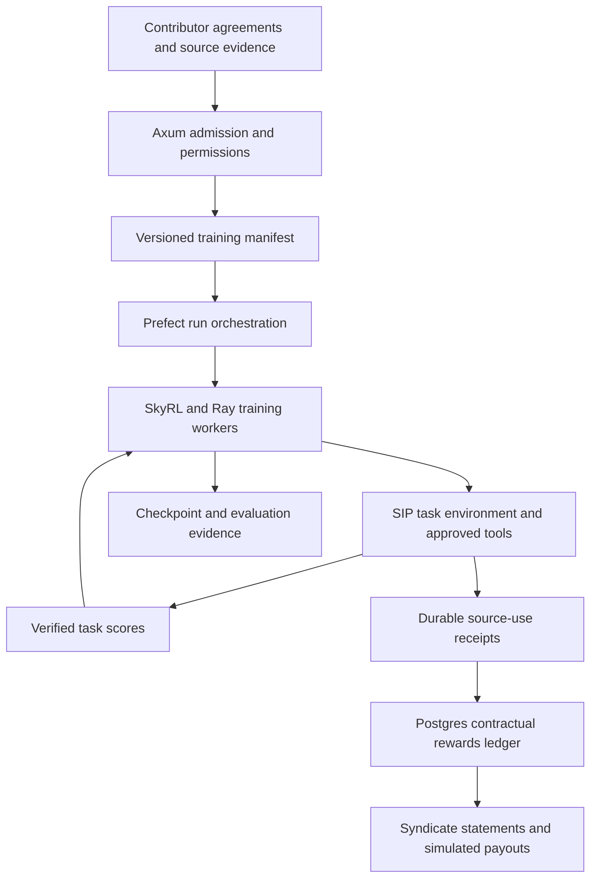

# SkyRL for Sovereign Source

**Research date:** 12 October 2026. **Project:** Super Sovereign Source LLM IP. **Status:** research and proposed pilot; no installation, GPU training or deployment performed.

**Source snapshot:** NovaSky-AI/SkyRL `main` at [`a1e34dbf21003f66bd7921487fd47db6c154aba2`](https://github.com/NovaSky-AI/SkyRL/tree/a1e34dbf21003f66bd7921487fd47db6c154aba2), committed 12 October 2026. This identifies inspected source, not a production-qualified release. Linked live documentation can change independently.

## Recommendation

**Shortlist SkyRL as an optional, self-hosted post-training framework for SIP's research assistant.** It offers a practical way to train tool use and verifiable behavior on an admitted corpus. Its Apache-2.0 software license permits commercial development, including competing models, subject to its conditions. Model weights, datasets and external services retain their own terms. [SkyRL license](https://github.com/NovaSky-AI/SkyRL/blob/a1e34dbf21003f66bd7921487fd47db6c154aba2/LICENSE).

Keep the existing Nemotron 3 Ultra selection and NVIDIA training path as the reference. SkyRL's reviewed support matrix names Nemotron Nano variants but does not establish an end-to-end Ultra training configuration. Treat Ultra integration as an experiment with explicit acceptance criteria. [Supported models](https://docs.skyrl.ai/docs/getting-started/supported_models).

SkyRL supplies training infrastructure. SIP must still supply permission checks, source evidence, contribution agreements and accounting. An RL reward is a numerical learning signal; a creator reward is a contractual financial entitlement. They need separate records and decision rules.

## The SkyRL approach in practice

**Improve an existing LLM by letting it attempt tasks, checking the results and updating its weights to favor successful behavior.** For Sovereign Source, the proposed task environment would contain admitted documents, approved tools and reviewed evaluation criteria.

The training loop is:

1. Give the model a task and access to selected tools.
2. Let it answer or take several actions, such as searching a collection and reading a source.
3. Check the outcome and assign a numerical learning score.
4. Update the model parameters using the scored attempts.
5. Repeat, then evaluate on tasks excluded from training.

SkyRL coordinates attempts, environments and parameter updates; the operator supplies the model, task material and scoring rules. [System overview](https://docs.skyrl.ai/docs/getting-started/overview).

For example, a proposed SIP task could ask the model to explain a scientific result using an authorized paper. Evaluation would check whether the cited passage supports the answer, required credit survives, and the source-use receipt matches the actual tool activity. Missing evidence should lead to appropriate abstention. Permission checks in the tool service would block unauthorized access independently of the model's learned behavior.

Rule-based validators can provide learning scores without requiring ChatGPT or Claude as a teacher. Semantic judgments, such as whether a passage supports a scientific claim, still need carefully reviewed criteria and reference answers. [Custom environments and scoring](https://docs.skyrl.ai/docs/tutorials/new_env).

**Creator payments follow a separate path:** accepted agreements and verified use determine financial eligibility in the SIP ledger. A higher training score does not create a royalty. Begin with the [small-model pilot](#pilot-and-adoption-criteria), comparing the original model, supervised fine-tuning and supervised fine-tuning plus RL. Base-model lineage and Ultra compatibility remain separate gates, detailed below.

## Ten-parameter assessment

These are project judgments supported by the evidence below, not benchmark rankings.

| Parameter | Assessment |
| --- | --- |
| 1. Project origin | Berkeley Sky Computing Lab, collaborating with Anyscale. |
| 2. Commercial competing-model use | Permitted by the framework's Apache-2.0 license; other inputs require review. |
| 3. Sovereign operation | Training can run on infrastructure controlled by the operator. |
| 4. Model lineage | Determined by selected weights, teachers and learned dependencies. |
| 5. No-Qwen condition | Requires replacing Qwen-based examples and excluding ineligible learned components. |
| 6. Nemotron 3 Ultra | Compatibility remains unverified in SkyRL for this project. |
| 7. Attribution behavior | Custom environments can train observable citation and evidence-handling behavior. |
| 8. Creator royalties | Separate SIP implementation required. |
| 9. Training provenance | SIP must connect data manifests, trajectories and checkpoints. |
| 10. Deployment readiness | Research candidate; pin dependencies, validate numerics and measure costs first. |

## What SkyRL is

UC Berkeley describes SkyRL's origins as reinforcement learning for long-horizon, stateful agent tasks. The project is associated with its Sky Computing Lab. [Berkeley project page](https://sky.cs.berkeley.edu/project/skyrl/).

The current repository combines earlier `skyrl-train` and `skyrl-tx` work into the unified `skyrl` library. It also contains `skyrl-agent` for agent training and `skyrl-gym` for environments. The repository credits Anyscale collaboration and upstream projects including veRL, OpenRLHF, Search-R1, OpenReasonerZero and NeMo RL. This is US university-led work with an open-source supply chain, not evidence that every dependency or research influence originated in the US. [Repository overview and acknowledgments](https://github.com/NovaSky-AI/SkyRL).

Its training architecture separates:

| Component | Responsibility |
| --- | --- |
| Trainer | Update model parameters from trajectories and scores. |
| Generator | Produce trajectories and associated rewards. |
| Inference engine | Run the policy model during generation. |
| Environment | Execute actions, return observations and score outcomes. |
| Controller | Coordinate placement, initialization and execution. |

Ray actors coordinate training workers. This division allows SIP to implement a rights-aware environment without putting financial decisions inside the optimizer. [System overview](https://docs.skyrl.ai/docs/getting-started/overview).

Documented methods include GRPO, which compares sampled responses within a group, and DAPO, which adds sampling and optimization controls. LoRA is supported with FSDP and Megatron backends. These are capabilities to evaluate, not evidence that every combination works with Ultra. [GRPO quickstart](https://docs.skyrl.ai/docs/getting-started/quickstart), [DAPO](https://docs.skyrl.ai/docs/algorithms/dapo), [LoRA](https://docs.skyrl.ai/docs/examples/lora).

## Commercial rights and independent development

Apache-2.0 grants broad rights to use, modify and distribute the covered software. Redistribution requires the license, relevant notices, modification notices and applicable NOTICE material. The license includes a limited contributor patent grant and provides no warranty of non-infringement. It does not require paying SkyRL a share of a trained model's revenue. [License, §§2–4 and 7](https://github.com/NovaSky-AI/SkyRL/blob/a1e34dbf21003f66bd7921487fd47db6c154aba2/LICENSE).

For SIP, keep four reviews distinct:

1. **Framework:** comply with SkyRL and dependency licenses; retain an inventory of redistributed components.
2. **Model:** review the exact base checkpoint, adapters, tokenizer, reward model and teachers.
3. **Data:** admit prompts, labels, tool observations and evaluation material for their intended use.
4. **Services:** review cloud, search, logging and hosted-model contracts whenever a run uses them.

Self-hosting SkyRL does not waive a hosted provider's restrictions on outputs obtained elsewhere. The [Perplexity audit](PERPLEXITY_SOVEREIGN_SOURCE_RESEARCH.md) remains relevant if Perplexity is proposed as a search tool or teacher. Likewise, training on a permitted dataset does not establish that the base model's earlier training was independent. See the [KL3M research](KL3M_CLEAN_ROOM_RESEARCH.md) for that distinction.

SIP can offer voluntary rewards for software contributions or documented influences through its own agreements. It must preserve upstream license rights rather than claim its custom license automatically replaces them. A legally reviewed release manifest is still needed; this document is not a legal opinion or clean-room certification.

## Lineage: framework, examples and checkpoints

**Using the framework does not require using its example model weights.** The standard GSM8K quickstart selects `Qwen/Qwen2.5-1.5B-Instruct`; the multi-turn search example selects `Qwen/Qwen2.5-3B-Instruct`. Those recipes do not meet the project's no-Qwen requirement as written. Review all recipe-selected models, including retrievers, judges and teachers, before adapting them. [Quickstart](https://docs.skyrl.ai/docs/getting-started/quickstart), [search example](https://docs.skyrl.ai/docs/examples/search).

The SkyRL-Agent paper's **SA-SWE-32B** is trained from Qwen3-32B, so that released checkpoint also fails the requirement. The authors report an improvement from 24.4% to 39.4% Pass@1 on SWE-Bench Verified and a 1.55× dispatcher speedup in their setup. These are author-reported, task-specific results; they do not measure IP compliance or predict improvements for a different base model. [SkyRL-Agent paper](https://arxiv.org/abs/2511.16108).

For a strict lineage policy, require evidence for every learned component, including synthetic-data generators and filtering models. An unknown dependency remains pending. Open algorithm implementations and code acknowledgments should be recorded as software/research influences, separately from weight and training-data ancestry. No nationality is inferred from contributor names.

The selected **Nemotron 3 Ultra** already has disclosed Qwen and DeepSeek training inputs. SkyRL cannot remove that ancestry. Preserve the conflict recorded in the [architecture](SOLUTION_ARCHITECTURE.md#nemotron-checkpoint-selection). [Ultra training disclosures](https://huggingface.co/nvidia/NVIDIA-Nemotron-3-Ultra-550B-A55B-BF16#training-and-evaluation-datasets).

## Nemotron 3 Ultra compatibility

SkyRL documents FSDP with Transformers and vLLM, and a Megatron backend using Megatron Bridge with multiple parallelism dimensions. Its explicit Nemotron entries are **Nano-4B-BF16 and Nano-30B-A3B-BF16**. A general statement that other Bridge/vLLM models should work is not an Ultra validation result. [Model matrix](https://docs.skyrl.ai/docs/getting-started/supported_models), [Megatron backend](https://docs.skyrl.ai/docs/examples/megatron).

The inspected [Nano training script](https://github.com/NovaSky-AI/SkyRL/blob/a1e34dbf21003f66bd7921487fd47db6c154aba2/examples/train/nemotron_3/run_nemotron_3_nano_4b_gsm8k.sh) selects `nvidia/NVIDIA-Nemotron-3-Nano-4B-BF16`, eight GPUs and GRPO. That confirms the recipe's target, not its suitability for Ultra. Its adjacent README mixes the 4B name with a MoE description; verify the actual model configuration before relying on narrative details or reported performance.

NVIDIA publishes an **Ultra-specific NeMo RL guide** covering post-training on GB200 NVL72 hardware. This gives NeMo RL stronger directly documented alignment with the selected model. It is nightly documentation and still requires version validation; its teacher and dataset recipes do not automatically meet SIP's admission rules. [NVIDIA Ultra guide](https://docs.nvidia.com/nemo/rl/nightly/guides/models/nemotron/nemotron-3-ultra.html).

Before adopting SkyRL for Ultra, require a reproducible test of:

- Loading the exact checkpoint, tokenizer and chat template.
- Forward/log-probability agreement between training and inference implementations, with stated tolerances.
- A finite optimization step and correct transfer of updated weights or adapters to rollout workers.
- Save, resume and export, including optimizer state when required.
- Memory and throughput at the proposed sequence lengths and parallelism settings.

Until then, retain SkyRL as a candidate backend; do not replace the project's training plan solely because both stacks use Megatron or vLLM.

## Proposed SIP integration

This is a design proposal, not functionality already present in the repository.

| Existing technology | Proposed responsibility |
| --- | --- |
| Python and Pydantic | Validate manifests, task definitions, tool results and receipt schemas. |
| Pydantic AI | Build evaluation workflows and reviewed attribution proposals; not the distributed optimizer. |
| Prefect | Manage admission, run submission, checkpoint registration and settlement jobs. |
| SkyRL and Ray | Execute rollouts, score trajectories, synchronize weights and optimize the policy. |
| Rust and Axum | Authorize tool access and delivered outputs; enforce rights outside the model. |
| PostgreSQL and pgvector | Store authoritative agreements and usage records; retrieve admitted source material. |

Prefect should submit and monitor a training job rather than schedule each tensor operation or token. Ray and the training backend own that inner loop. Give workers a fixed manifest, scoped credentials and approved tool endpoints. Do not expose production payout actions to a training agent.

### Training tasks and reward design

SkyRL-Gym permits a custom environment that returns observations, a numerical reward, completion state and metadata. SIP could use that interface to teach the following behaviors. [Environment tutorial](https://docs.skyrl.ai/docs/tutorials/new_env).

| Task | Proposed evidence for scoring |
| --- | --- |
| Select authorized material | Tool access is checked against the task's immutable permission snapshot. |
| Cite a scientific claim | Source identifier and passage are valid, and support is checked against reviewed answers. |
| Preserve upstream credit | Required notices and accepted contribution relationships appear in the response. |
| Handle uncertainty | Abstention or referral is correct when evidence or permission is missing. |
| Record contribution use | A receipt matches actual tool events, with no invented asset or beneficiary. |

Enforce prohibited access in the tool service even if the model requests it. A low training score is not an access-control mechanism. Citation formatting alone should not earn a successful outcome: a well-formed citation can still be irrelevant or fabricated.

Keep **learning scores**, **task success** and **financial eligibility** separate. The environment tutorial's default `pass_at_n` treats a positive final reward as success; custom partial-credit rewards therefore need a separate strict success metric. [Reward metrics](https://docs.skyrl.ai/docs/tutorials/new_env).

Creator payouts must follow accepted terms and verified use. Repeated RL samples, failed runs and duplicated receipts should earn only where the agreement explicitly covers them. Store `run_id`, `episode_id`, asset version, permission version and idempotency key. Training exposure is measurable participation, not proof that a particular source caused a future answer. Influence shares require reviewed evidence and agreement.

## Operating constraints and cost planning

The installation guide currently recommends Docker, Python 3.12, Ray 2.57.0 and CUDA 13.0 with an r580-or-newer driver. The inspected package configuration pins backend dependencies, including vLLM 0.30.0 and specific Megatron revisions. Use one tested commit, lockfile and container digest together; do not mix instructions from old examples with current dependencies. [Installation](https://docs.skyrl.ai/docs/getting-started/installation), [pinned package configuration](https://github.com/NovaSky-AI/SkyRL/blob/a1e34dbf21003f66bd7921487fd47db6c154aba2/pyproject.toml).

The local Tinker-compatible API offers another interface to training and sampling. It does not require moving training to the managed Tinker service. However, its documented limitations include missing prompt log-probabilities and KL-penalty support, restricted loss conversion, and backend-specific multi-tenant LoRA support. Choose the interface after checking the algorithm's requirements. [Tinker integration](https://docs.skyrl.ai/docs/tinker/overview), [limitations](https://docs.skyrl.ai/docs/tinker/limitations).

For sovereign operation, configure local logging or an approved destination, control worker networking and review downloaded artifacts. The quickstart uses Weights & Biases logging, so default instructions are not evidence of an isolated deployment. [Quickstart logging](https://docs.skyrl.ai/docs/getting-started/quickstart).

Budget in measured GPU-hours: **allocated GPUs × wall-clock hours × contracted GPU-hour rate**, plus CPU environments, storage, transfer, engineering and contributor compensation. Eight GPUs for 24 hours is 192 GPU-hours; this is arithmetic, not an estimate of the work needed for SIP. Rollout length, samples per task, retries and environment latency can dominate costs.

Ultra's 550 billion parameters imply approximately **1.1 TB for BF16 weights alone**, calculated at two bytes per parameter. Optimizer state, activations, rollout copies and runtime buffers add requirements. Its 55 billion active parameters do not reduce total weight storage to a 55-billion-parameter model. Do not apply a Nano GPU count to Ultra. [Ultra model card](https://huggingface.co/nvidia/NVIDIA-Nemotron-3-Ultra-550B-A55B-BF16).

## Pilot and adoption criteria

1. **Build evidence fixtures first:** use authored or admitted examples with known source rights, beneficiary splits and reviewed answers. Test the environment without GPU training.
2. **Qualify a small model:** separately review its license and lineage, then validate backend compatibility. A prototype checkpoint does not replace the selected Ultra target.
3. **Compare a baseline, SFT and SFT-plus-RL:** use a held-out set grouped by source/work to reduce leakage; include permission refusals, missing evidence and disputed attribution.
4. **Measure useful behavior:** supported-claim accuracy, citation validity, unauthorized tool attempts, unnecessary abstention, receipt completeness, duplicate settlement prevention and cost per accepted answer.
5. **Decide on Ultra only after compatibility and cost evidence:** retain failed and successful run records, pin the complete environment and document the remaining ancestry conflict.

Adopt the RL stage only if it improves the predeclared quality measures without degrading permission enforcement or accounting. A higher average learning reward is insufficient. Use simulated payouts until the contractual and payment system is ready.

**Research limits:** primary project documentation, the authors' paper, NVIDIA documentation and selected pinned source files were reviewed. No full dependency-license audit, training reproduction, security audit, GPU benchmark or legal clearance was performed. Reported capabilities and performance remain upstream claims until locally validated.
