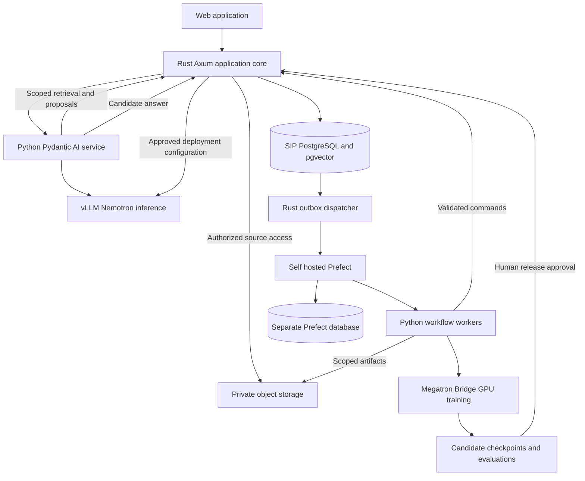

# Super Sovereign Source LLM IP Solution Architecture

**Date:** October 10, 2026. **Status:** Proposed architecture for implementation specification v0.7.

Build the SIP platform with a Rust and Axum application core, Python services using Pydantic and Pydantic AI, Prefect for background workflows, and PostgreSQL as the authoritative store. **NVIDIA Nemotron 3 Ultra** is the user-selected target for inference and subsequent supervised LoRA adaptation on admitted SIP data.

**Current selection:** use `nvidia/NVIDIA-Nemotron-3-Ultra-550B-A55B-BF16` as the reference checkpoint, with its NVFP4 variant evaluated for serving. This replaces the Nano target and Minitron recommendation. It is the Nemotron 3 Ultra release, distinct from the older Llama-Nemotron Ultra 253B. NVIDIA describes 550B total / 55B active parameters and a hybrid Mamba-Transformer LatentMoE architecture. [Official release](https://research.nvidia.com/labs/nemotron/Nemotron-3-Ultra/).

**Ancestry conflict:** Ultra's disclosed training sources include Qwen and DeepSeek. Selecting Ultra does not satisfy or silently waive the earlier no-Chinese-teacher requirement. Record that criterion as **does not meet**, keep it unresolved for release, and do not describe the model as Qwen-free. The [index](USA_SOVEREIGN_AI_INDEX.md) records selection separately from eligibility; the [older-model research](NEMOTRON_NO_QWEN_RESEARCH.md) remains available as an alternative. [Ultra training disclosures](https://huggingface.co/nvidia/NVIDIA-Nemotron-3-Ultra-550B-A55B-BF16#training-and-evaluation-datasets).

This design serves the [SIP implementation specification](SOVEREIGN_SOURCE_AI_CODEX_SPEC.md): voluntary syndicates, scoped permissions, reviewed attribution and reproducible contributor accounting. M0–M4 remain a local application pilot using deterministic model and payment adapters. GPU experiments follow separately. Component responsibilities, workload limits and rollout gates below are project design choices; linked documentation supports the underlying technology capabilities.

The [production system plan](PRODUCTION_SYSTEM_PLAN.md) extends this design with conditional local and frontier model routes, deployment and recovery choices, creator-payment operations, launch gates and a worked operating budget. It preserves the current lineage requirement and keeps restricted inference outputs outside training admission.

Contributor-facing views call the compensation program **SIP Creator Rewards** and distinguish qualified use, estimated earnings, earned balances and payouts. These labels map to the existing usage, agreement, ledger and settlement records; eligibility decisions and exact calculations remain in the Rust core. Every pilot payout is labeled simulated.

## Commercial platform and integration boundaries

The [specification's commercial-platform research](SOVEREIGN_SOURCE_AI_CODEX_SPEC.md#commercial-platform-decision-and-research), checked October 10, 2026, recommends NVIDIA AI Enterprise with NeMo for the Ultra production program. Confirm commercial support for the exact checkpoint, runtime and hardware; retain vLLM until any replacement passes compatibility checks. Databricks remains a managed-governance alternative, and ProRata a content-rewards partnership alternative. Neither is an adopted dependency.

Use TollBit or direct creator agreements as candidates for licensed content supply and Stripe Connect as the payout candidate. Content adapters pass source, license, price and transaction evidence to the Rust core for admission; an external fetch charge does not establish training permission or a SIP earning event. Payment adapters execute core-authorized amounts, authenticate callbacks and reconcile provider status without recalculating beneficiary shares. Supplier costs, qualified-use rewards and actual payouts remain distinct records linked to their agreements. Preserve section 12's proposed pool formula unless an accepted amendment changes it.

Start with licensed retrieval and verified usage accounting before model adaptation. The specification defines M5 proof for use restrictions, duplicate transactions, payment-state recovery and deployment/exit controls. M0–M4 retain deterministic local adapters; these recommendations create no new cloud dependency or production integration in the local pilot.

## Component responsibilities

| Component | Proposed responsibility | Authority boundary |
| --- | --- | --- |
| Rust with Axum, Tokio and SQLx | Public API, authentication context, rights decisions, syndicate transitions, authorized search, final response authorization, receipts and exact accounting | Sole application writer for accepted rights, agreements, graph decisions, usage and ledger records |
| Python with Pydantic | Strict request and result models, extraction, data preparation, evaluation and training configuration | Validates structure; cannot establish rights or approve business transitions |
| Pydantic AI | Research answers, citation candidates and proposed contribution or influence links | Calls a small set of authorized tools; submits proposals for review |
| Prefect | Ingestion, attribution batches, manifest construction, evaluation, training job supervision and settlement scheduling | Coordinates work; calls the Rust core for authoritative transitions |
| PostgreSQL with pgvector | Domain records, reviewed contribution graph, document index, transactional outbox and financial ledger | Constraints and transactions enforce invariants independently of model output |
| Private object storage | Sources, confidential evidence, dataset shards, checkpoints and restricted workflow results | Access through scoped credentials or an authorization gateway |
| vLLM with Nemotron 3 Ultra | Private model inference through a Chat Completions compatible interface | Generates candidate text and tool arguments; never determines financial eligibility |
| NVIDIA NeMo Megatron Bridge | Nemotron checkpoint conversion and GPU training | Runs approved, versioned experiments against frozen manifests |

Axum provides typed extraction and integrates with Tokio and Tower middleware. SQLx provides asynchronous PostgreSQL access, transactions, migrations and checked-query facilities. Use those capabilities to keep the application core modular within one Rust workspace. [Axum documentation](https://docs.rs/axum/latest/axum/), [SQLx documentation](https://docs.rs/sqlx/latest/sqlx/).

Use two application services initially: `sip-core` in Rust and `sip-ai` in Python. The Python package also supplies Prefect workers. Keep rights, syndicates, attribution review and accounting as modules of `sip-core`. This gives Python direct access to the model ecosystem while placing permission checks and financial state changes under one implementation. It adds a cross-language API and operational boundary that must be tested; it does not justify separate services for each domain.

The [license and marketplace framework](../licenses/README.md) adds a marketplace module inside `sip-core`: reviewed listings, immutable offers, authenticated order acceptances, fulfillment, corrections and agreed economic events. Add Pydantic contracts for license applications, release attribution and marketplace orders. A graph credit or listing cannot bypass rights review, and a paid service order cannot revoke an independent public license. M0–M4 use synthetic parties and simulated transactions.

## Contracts between Rust and Python

Define the shared wire contracts in a dedicated Pydantic package and export versioned JSON Schema. Generate Rust transport structs where practical and validate both implementations against the same positive and negative fixtures. Keep business rules in Rust and database constraints; a successful deserialization is not an authorization decision. Pydantic supports JSON Schema generation and strict validation, though JSON inputs retain some type-specific allowances that need explicit contract tests. [Pydantic JSON Schema](https://pydantic.dev/docs/validation/latest/concepts/json_schema/), [strict mode](https://pydantic.dev/docs/validation/latest/concepts/strict_mode/).

| Contract | Required content |
| --- | --- |
| RequestContext | Request ID, authenticated actor, tenant, purpose, region, permitted processor, deadline and trace ID |
| EvidenceBundle | Immutable source versions, excerpt locations and digests, permitted credit view, grant/mandate versions and expiry |
| ResearchDraft | Answer text, claim-to-evidence references, observed tool uses and declared attribution limitations |
| AttributionProposal | Source/target versions, relationship type, evidence, declared or estimated basis, model/method version and uncertainty |
| WorkflowCommand | Business job ID, schema version, input digest, resource references, idempotency key and requested operation |
| TrainingRunSpec | Base model revision, approved manifest digest, recipe and container revisions, training settings, resource ceiling and output location |
| TrainingRunResult | External job ID, checkpoint digests, consumed-data/exposure summary, metrics, failures and restart lineage |

Reject unknown fields and ambiguous coercions. Use explicit discriminated types for proposals and accepted records. Encode money in the API as integer-minor-unit decimal strings with a currency, avoiding JavaScript integer precision loss; parse to checked integer types in Rust and PostgreSQL. Use exact rational or decimal shares, RFC 3339 UTC timestamps and immutable version identifiers. Fail requests outside numeric or schema bounds.

The core authenticates service calls and binds the supplied context to the original actor. An agent cannot choose a tenant by writing an ID in a tool argument. Python has no general credential to the SIP database. It accesses approved resources and submits results through narrow internal APIs; Prefect uses its own database credentials.

## Research request and attribution flow

1. Axum authenticates the request, fixes its actor/tenant/purpose and records a request identifier. A repeated idempotency key with changed input is a conflict.
2. Python obtains a query embedding from an independently versioned embedding adapter, then asks the core to search the authorized corpus. Nemotron is the generator; its chat endpoint is not assumed to be an embedding API.
3. The core applies tenant, membership, resource and current grant restrictions before returning excerpts. It verifies the selected model endpoint is an allowed processor and region.
4. Pydantic AI receives the bounded evidence bundle and approved tools. It creates a typed draft with citations; proposed influence relationships remain separately reviewable.
5. Python validates output shape and evidence references. Axum independently validates references and output obligations, rechecks effective grants and mandates, and resolves the applicable economic agreement.
6. The core atomically commits the response record, receipt, eligible usage references and outbox event before exposing the answer. A failure prevents delivery. Do not hold a database transaction open during model inference.
7. A reconnect retrieves the same authorized response and event identity. Recheck access on later reads; a persisted response is not a perpetual permission grant.

Use a defined response-release transaction: concurrent revocation and release serialize through the same permission-version locks. A revocation effective before release commit wins. A revocation after an authorized release governs subsequent access and contractual remediation; already delivered bytes cannot be recalled. Time-based expiry is checked inside the release transaction as well as before generation.

Pydantic AI supports custom compatible endpoints and a vLLM provider. Select `OpenAIChatModel` for this interface, explicitly configure the provider/profile, and keep endpoint selection in trusted configuration. Compatibility with Chat Completions does not imply support for the Responses API or every structured-output feature. [Compatible APIs](https://pydantic.dev/docs/ai/models/compatible-apis/).

Prefer constrained native JSON output if the exact model/server combination passes the compatibility checks. Otherwise use tested tool output, with prompted JSON and bounded validation retries as a fallback. Schema validity still does not prove a citation is correct. Pydantic AI documents these three output modes and their different guarantees. [Structured output modes](https://pydantic.dev/docs/ai/core-concepts/output/).

Use NVIDIA's Ultra-specific vLLM cookbook as the serving reference. Pin weights, tokenizer, template, parsers and container digest together; review any required remote code before deployment. The current card names `nemotron_v3` for reasoning and `qwen3_coder` for tool parsing. The parser name is a format implementation, not a separate Qwen checkpoint; the ancestry finding comes from the training disclosures. Begin with a proposed 8K application context limit and bounded output, then raise limits only after measurement. [Ultra serving cookbook](https://github.com/NVIDIA-NeMo/Nemotron/blob/main/usage-cookbook/Nemotron-3-Ultra/vllm_cookbook.ipynb), [card configuration](https://huggingface.co/nvidia/NVIDIA-Nemotron-3-Ultra-550B-A55B-BF16#vllm).

## PostgreSQL and authorized retrieval

Use relational tables for the existing spec's assets, grants, syndicates, memberships, mandates, decisions, contributions, attribution links, schedules, receipts and ledger. Add `research_requests`, `workflow_jobs`, `outbox_events`, `training_runs`, `evaluation_runs` and `model_releases`. Keep bulky content in private storage and reference immutable object digests. One migration sequence, owned by the Rust core, manages the SIP database.

Store `license_applications`, `release_attributions`, `marketplace_listings`, `marketplace_offer_versions` and `marketplace_orders` alongside these records. Bind acceptances to exact offer/terms digests and required parties. Classify permission bases and their survival rules so mandate withdrawal, listing removal and service cancellation do not erase public-license rights. Public grants are technology-neutral; tenant-scoped private service access remains independently authorized.

Serve deliberately released source packages, license text and public credits through a public export view, with no paid order required. Keep those packages separate from private originals, identity evidence and review notes. An anonymous public-download request receives only the explicitly published artifact; it never gains general access to a syndicate's private storage.

Enforce foreign keys, unique economic-event keys, valid version references and nonoverlapping active split schedules. Post ledger entries through a single transaction that verifies balanced amounts by currency. Application roles cannot update or delete posted financial rows. Use linked adjustments for corrections and a stable residual-allocation rule for rounding.

Enable row-level security for tenant-scoped data, use transaction-local authenticated tenant context and make pooled-connection reuse tests mandatory. Runtime roles must not be superusers, table owners or possess `BYPASSRLS`; apply `FORCE ROW LEVEL SECURITY` as appropriate. RLS supplements explicit resource and syndicate checks. PostgreSQL documents owner and privileged-role bypass behavior, so merely enabling RLS is insufficient. [PostgreSQL row security](https://www.postgresql.org/docs/current/ddl-rowsecurity.html).

Start with PostgreSQL full-text search and exact vector distance over a small authorized set. Keep embedding model revision, vector dimensions and chunking version with each index generation. Re-embedding creates a new generation and switches only after recall and access checks pass. Use tenant partitions or separate deployments when isolation requirements warrant them.

Introduce HNSW only after measuring corpus size and latency. Approximate vector indexes can apply filters after index scanning, reducing the number of permitted results; iterative scans and partitioning help recall. SQL authorization remains mandatory, and no unauthorized candidate text may leave the core. Compare authorized recall against the exact-search baseline. [pgvector filtering and multitenancy](https://github.com/pgvector/pgvector#filtering).

## Prefect workflows and reliable effects

Self-host Prefect for sovereign deployments. Give it a separate database and role, even if the pilot shares one PostgreSQL server. Start with a process worker; separate CPU and GPU work pools when training starts. Prefect workers poll matching work pools and launch runs in the selected execution environment. [Prefect workers](https://docs.prefect.io/v3/concepts/workers).

| Workflow | Work performed | Durable output |
| --- | --- | --- |
| Ingest asset | Check admission, extract and normalize, deduplicate, chunk, embed, submit index generation | Source/chunk digests and core-approved index version |
| Propose attribution | Analyze only authorized evidence, validate candidates, submit review proposals | Proposed graph links with evidence and method versions |
| Build training manifest | Select training-permitted examples, verify agreements, split source families, tokenize and freeze | Signed manifest, dataset shards and exposure mapping |
| Train Nemotron | Validate run approval, launch or reconnect to GPU job, checkpoint and report | Run record and candidate checkpoint |
| Evaluate candidate | Run fixed citation, refusal, privacy, tool and capability suites | Versioned evaluation report and release decision inputs |
| Prepare settlement | Ask the core to freeze inputs and calculate deterministic allocations | Preview and reconciliation artifacts; authorized core posting |
| Revoke and remediate | Recheck effective scope, invalidate index/cache entries, identify affected runs/releases | Auditable remediation records and required follow-up |

The Rust core writes an outbox record in the same transaction as the business change. A dispatcher leases pending records, creates a Prefect run with a stable business key and records the external run ID. Every workflow command remains idempotent in the core. Recover a lost launch acknowledgment by looking up the business key before resubmitting. Periodically reconcile unacknowledged and stuck jobs; process restarts cannot erase the queue.

Treat execution as at least once. Prefect task caching does not make an external payment, model request or database side effect exactly once. Database uniqueness, immutable inputs and command idempotency supply that guarantee for SIP records. Payment-provider idempotency and reconciliation are a separate production integration.

Use normal asynchronous Pydantic AI calls for interactive requests. For long-running agent workflows, the current Pydantic AI integration offers `PrefectDurability` inside an explicit Prefect flow; its older `PrefectAgent` wrapper is deprecated. Choose the documented API matching the pinned package version and test restart behavior. Do not layer a second orchestration engine over Prefect. [Pydantic AI Prefect integration](https://pydantic.dev/docs/ai/capabilities/durable_execution/prefect/).

Persist only necessary workflow results in approved storage. Cache pure transformations by tenant, source digest, processing version and relevant permission version. Reauthorize when resuming; never cache final authorization or settlement posting. Keep raw prompts, confidential excerpts and private reasoning out of Prefect parameters, logs and public artifacts; configure result persistence explicitly.

A single-server local profile can use Prefect's integrated services. For a deployment with separated Prefect server and background services, follow the documented Compose topology, which also includes Redis for Prefect messaging. Redis is an orchestration dependency in that profile, not the SIP source of truth or financial event queue. Pin a tested server/worker/database combination instead of copying moving `latest` tags from examples. [Prefect Docker](https://docs.prefect.io/v3/how-to-guides/self-hosted/server-docker), [Prefect Compose](https://docs.prefect.io/v3/how-to-guides/self-hosted/docker-compose).

## Nemotron checkpoint selection

These artifacts define the selected Ultra program. Pin exact revisions and license copies before execution. Selection sets the implementation direction; it is not evidence that release requirements have passed.

| Candidate | Intended role in this project | Decision |
| --- | --- | --- |
| `nvidia/NVIDIA-Nemotron-3-Ultra-550B-A55B-BF16` | Reference inference baseline and supervised LoRA adaptation | Selected primary checkpoint |
| `nvidia/NVIDIA-Nemotron-3-Ultra-550B-A55B-NVFP4` | Lower-memory serving comparison | Selected deployment candidate; benchmark against BF16 |
| `nvidia/NVIDIA-Nemotron-3-Ultra-550B-A55B-Base-BF16` | Continued pretraining and a new instruction-tuning program | Later experiment; not the initial assistant |

NVIDIA publishes post-trained BF16, NVFP4 and Base BF16 releases separately. Base is not an escape from upstream teacher dependencies: its own data table identifies Qwen and DeepSeek-generated material. Minitron and Nano are no longer default fallbacks; a different model would require an explicit selection change. [Release artifacts](https://research.nvidia.com/labs/nemotron/Nemotron-3-Ultra/), [Base disclosure](https://huggingface.co/nvidia/NVIDIA-Nemotron-3-Ultra-550B-A55B-Base-BF16).

Use BF16 training checkpoints as the baseline. Quantized inference artifacts are separate deployment candidates and must be evaluated after conversion. Avoid assuming that a generic transformer LoRA target list, a QLoRA recipe or live adapter serving works for the hybrid Mamba/MoE architecture.

Megatron Bridge supplies Ultra conversion, inference, pretraining, full SFT and LoRA PEFT examples. Use an Ultra-specific recipe, record target modules, and prove save/resume and deployable export before scaling. Replace sample training data with the admitted SIP manifest; neither the sample corpus nor a generic Nano recipe is selected by this architecture. [Ultra model guide](https://docs.nvidia.com/nemo/megatron-bridge/latest/models/nemotron/nemotron3-ultra.html), [Ultra training examples](https://github.com/NVIDIA-NeMo/Megatron-Bridge/blob/main/examples/models/nemotron/nemotron_3_ultra/README.md).

## Training program and SIP provenance

Train for evidence-grounded answers, accurate citation structure, useful relationship proposals, uncertainty, abstention and bounded tool use. Grants, votes, beneficiary percentages and balances remain live database facts; the model is not trained to act as their authority. Keep knowledge requiring prompt revocation in retrieval where possible.

| Stage | Proposed experiment | Exit condition |
| --- | --- | --- |
| T0 | Evaluate unmodified Ultra BF16, then its NVFP4 serving candidate, on frozen SIP tasks and identical retrieval inputs | Measured baseline for support precision, missing credit, JSON validity, tool use, latency and memory |
| T1 | Validate extraction, rights filtering, family-level splits and tokenizer/chat-template formatting | Every included example has an approved basis; no evaluation-family leakage |
| T2 | LoRA supervised fine-tuning on reviewed SIP examples; start with 4,096-token packing aligned with the Ultra recipe | Finite loss, reproducible data lineage, save/resume success and no critical behavioral regression |
| T3 | Compare adapted and unmodified models using the same task set, retrieval and inference budget | Predeclared improvement target met, preserved capability floor and all rights/privacy gates passed |
| T4 | Merge/export candidate, test loading and re-evaluate the deployed precision and parser configuration | Serving outputs remain valid; promotion and rollback are reproducible |
| T5 | Consider preference optimization or continued pretraining of Ultra Base | A measured remaining failure justifies the additional data, method and compute |

Do not automatically include example datasets shipped with training recipes. Replace them with an explicit admitted manifest and fail a real run if it falls back to mock or default data. Separate train, validation and test by source family and related contributions before generating synthetic variants. Preserve reviewed negative examples: insufficient evidence, independent invention, rejected attribution and prompts that attempt to override permissions.

Each training example must resolve to asset/contribution versions, grants, mandates where relevant, agreements, transforms, generator/model revisions for synthetic data and a source-family split. Maintain a sidecar map from packed token spans to source examples, including loss masks and deduplication weights. Record exposure according to the accepted contractual rule, distinguishing attempted/replayed steps from updates in the final checkpoint lineage. Model training retries must not manufacture additional royalty eligibility.

Training manifests are immutable, but permission is time-dependent. Check authorization before staging data and launching, then define safe checkpoints at which newly effective restrictions are applied. A revoked manifest version cannot silently launch another run. For work already incorporated into a checkpoint, follow the accepted remedy and quarantine the candidate where required. Deleting an adapter or a source is not general proof of unlearning.

The initial derivative can claim controlled provenance for its SIP-added examples and transformations. It cannot claim that all upstream Ultra training data was individually admitted under SIP. Retain disclosed synthetic generators and remaining source-permission gaps in the release record. A model trained entirely from SIP-admitted data remains a separate research program. [Ultra Base training-data disclosure](https://huggingface.co/nvidia/NVIDIA-Nemotron-3-Ultra-550B-A55B-Base-BF16#training-and-evaluation-datasets).

The reviewed Ultra releases identify **OpenMDW-1.1** as their governing download license. It permits use and modification, requires preservation of the agreement and applicable origin notices on distribution, and includes a litigation-triggered termination provision with a defensive-litigation exception. It places third-party rights clearance on the user and does not impose obligations on model outputs. Preserve the exact grant with each revision; do not substitute older NVIDIA model licenses or treat this grant as automatic enrollment in SIP. [OpenMDW-1.1](https://openmdw.ai/license/1-1/).

## Performance and cost evaluation

Use the supplied [BestAIFor Super-versus-Qwen article](https://www.bestaifor.com/blog/nemotron-3-super-vs-qwen-3-5-when-speed-and-accuracy-point-in-opposite-directions) as motivation to assess completed work, retries and cost together. Its Super results do not establish Ultra performance. The [source review](NEMOTRON_PERFORMANCE_SOURCE_REVIEW.md) records primary-source checks and corrections to the comparison.

For T0 and T3, compare Ultra BF16 and NVFP4 on identical SIP tasks and retrieval inputs. Record first-attempt and bounded-retry success, citation support, answer coverage, abstention, tool validity, p50/p95 completion latency, reasoning/output tokens, memory and total attributable cost. Freeze acceptance criteria and retry limits before evaluation. A faster setting cannot compensate for failing the required attribution, access-control or privacy criteria.

Define **cost per verified outcome** as total attributable inference, retry, tool and validation cost divided by accepted outcomes. Include failed attempts and paid human review where used, disclose shared-cost allocation and avoid double counting retries. Report zero-success runs as undefined for this metric, with spend and failures still visible. Pin workload, precision, runtime, hardware, concurrency, reasoning mode, cache state and price date. These are proposed evaluation requirements; no benchmark results are claimed.

## Compute and execution profiles

Ultra is a cluster-scale target. Using the nominal 550 billion parameters at two bytes each gives approximately **1.1 TB of raw BF16 weights alone**. Actual artifacts and runtime memory must be measured, including auxiliary tensors, cache, activations, gradients and optimizer state. The 55B active count is not a VRAM sizing rule; NVFP4 serving capacity also needs measurement.

NVIDIA's Ultra Bridge examples reserve at least **2.5 TB for conversion storage**, before training outputs. Their LoRA starting point is **4 × 8-H100 nodes (32 H100 GPUs)** or **4 × 4-GB200 nodes (16 GB200 GPUs)**; the full-SFT examples are substantially larger. These are recipe starting points, not minimum hardware guarantees or an approved compute purchase. Inference and training allocations are separate, and Nano estimates no longer apply. [Ultra hardware and storage guidance](https://github.com/NVIDIA-NeMo/Megatron-Bridge/blob/main/examples/models/nemotron/nemotron_3_ultra/README.md).

| Profile | Services and resources | Purpose |
| --- | --- | --- |
| Local application | Axum core, Python AI service, PostgreSQL, local private storage, Prefect server and process worker; deterministic model adapter | Complete M0–M4 without GPU or external credentials |
| GPU integration | Local application plus a private vLLM endpoint for Ultra BF16 or evaluated NVFP4 | Verify tools, structured outputs, citations and request limits |
| Training experiment | Isolated GPU worker, pinned Megatron Bridge container, approved dataset staging and checkpoint storage | Short, budget-capped training and restart experiment before a full run |
| Production region | Independent data, model endpoints, credentials, storage, Prefect state and operational access for the contracted region | Enforce residency and restore/rollback requirements |

Prefect submits and observes an external GPU job; the training framework and GPU scheduler handle distributed ranks. Record the scheduler's job ID and reconnect after an orchestration restart. Confirm a prior job's state before launching another, and resume from an approved complete checkpoint with optimizer/RNG state when supported. Start with an existing GPU host; integrate a cluster scheduler only when the chosen recipe requires it.

Before selecting a GPU allocation, measure peak memory, tokens per second, checkpoint size/time and serving latency on the chosen sequence length and batch. Estimate training hours as planned processed tokens divided by measured aggregate tokens per second, then add measured evaluation, restart and checkpoint overhead. Hardware, budget and corpus size remain inputs to this gate; no procurement or training job is authorized by this architecture.

## Deployment and observability

Keep model, object and workflow endpoints private. Service credentials are scoped to the relevant operation and region. Prefect's UI is an operator surface behind authentication, not a customer rights-review interface. Separate inference and training resources so a training run cannot consume the serving capacity or financial worker budget.

Propagate one trace ID through Axum, Python, Prefect and model calls. Record model revision, prompt-template version, token counts, validation retries, permission denials, workflow lag, failed jobs and ledger reconciliation. Export telemetry to approved storage; redact content by default. Third-party monitoring is opt-in to the deployment's permitted processors.

Back up the SIP database and object store with a tested restoration procedure; preserve required grants and financial evidence while observing content retention rules. Restore Prefect metadata independently and reconcile it to SIP job records. A model release records checkpoint, tokenizer, parser, prompt/configuration and evaluation digests so rollback returns to a complete tested serving configuration.

Use separate dependency environments for CPU application code, vLLM serving and GPU training. Pin Python, Rust toolchain, Pydantic, Pydantic AI, Prefect, Axum, SQLx, PostgreSQL/pgvector, CUDA, PyTorch, Megatron Bridge, model revision and container digests in the environment that uses them. Do not require the training container to share the application's Python environment. Resolve exact compatible versions in M0 and T0 instead of treating unrelated `latest` releases as a tested set.

## Implementation sequence and proof

| Step | Deliverable | Required proof |
| --- | --- | --- |
| M0 | Rust/Python workspaces, exported schemas, one migration owner, local PostgreSQL and Prefect, fake model endpoint | Both languages accept/reject identical contract fixtures; no external credentials |
| M1 | Rights, syndicates, mandates, split schedules and private resource access in the Rust core | RLS and resource checks survive tenant switching, pooled connections and unauthorized transitions |
| M2 | Python research service, authorized retrieval and reviewed graph proposals | Invalid references fail; model output cannot approve rights; revocation wins before release |
| M3 | Outbox, Prefect jobs, Rust allocation engine and simulated settlement | Crash/retry tests cannot duplicate usage, launch identity, allocations or postings |
| M4 | Exit, revocation, review, export and operator recovery flows | Existing SIP end-to-end and financial examples pass across both services |
| M5 | Nemotron 3 Ultra serving compatibility and production integrations | Tested model/profile/parser, measured performance, signed agreements and independent review |
| M6 | Nemotron 3 Ultra LoRA adaptation and release registry | T0–T4 gates pass, ancestry conflict has a recorded resolution, checkpoint provenance is explicit and rollback is demonstrated |

The first integration proof should exercise one admitted source, one authorized answer, one reviewed influence proposal and the existing `$2,000` syndicate allocation. Introduce a worker restart, a duplicated event and a permission change during generation. This tests the architecture's boundaries before expanding the corpus or model.

The Nemotron compatibility proof must cover chat formatting, tools, structured output, reasoning separation, truncation, malformed responses, cancellation and timeout behavior. Training proof must include checkpoint import, one optimizer update, save/resume, merge/export and inference on the exported artifact. Passing schema checks or successfully loading weights alone is insufficient.

The remaining choices are the GPU inventory and budget, the size and permissions of the training corpus, the embedding model, production region, and the exact pinned dependency set. These affect capacity and deployment, while the local application work can proceed with synthetic data and deterministic adapters.
