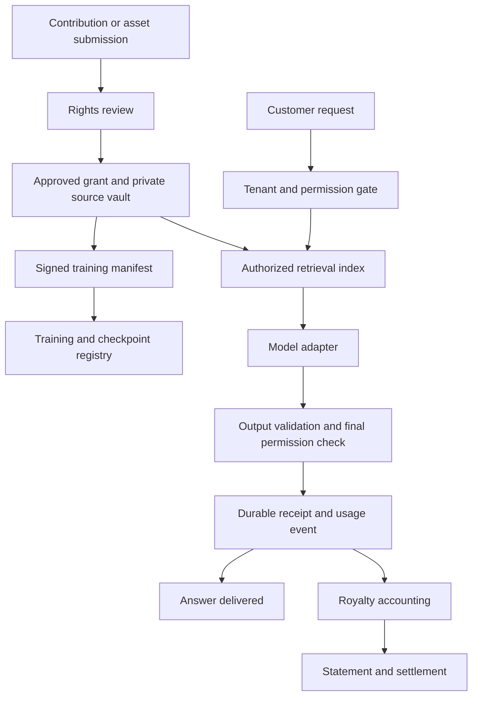

# Sovereign Source AI

## Product and implementation specification for Codex

- **Project:** `sovsrc.llm`
- **Version:** `0.2`
- **Date:** 2026-10-10
- **Status:** Proposed implementation specification; no model, funding, licenses or production deployment implied.
- **Source:** Adapted from the Sovereign Source AI project specification v0.1. This version adds implementation boundaries, data contracts, API behavior and development milestones.
- **Policy reference date:** 2026-10-10, carried forward from v0.1. Revalidate policy applicability before making a production compliance claim.

`MUST` means a required acceptance condition. `SHOULD` means a recommended default. Royalty rates, staffing, schedules and performance targets are proposed project choices, not statutory requirements.

## 1. Objective

Build an AI laboratory and model platform that respects intellectual property, gives evidence-based attribution and compensates contributors for licensed works and accepted ideas, suggestions, prompts and workflows.

The initial product is a research assistant using an approved corpus, with source receipts, contributor registration and reproducible royalty accounting. The long-term objective is an independently trained, competitively evaluated foundation model with auditable data provenance and sovereign deployment options.

The deliverable is a system around a model as well as a model development program. Model weights alone cannot establish ownership, enforce permission or administer royalties.

## 2. Instructions for Codex

When asked to implement this specification:

1. Read applicable `AGENTS.md` files and inspect the repository before choosing a stack or editing files.
2. Treat all synced files under `sources/` as read-only references. Create implementation files outside that directory.
3. Reuse existing architecture, authentication, storage, components and test tooling where suitable.
4. For an empty repository, use the proposed architecture in section 6 and record consequential deviations in a short architecture decision record.
5. Implement milestones M0 through M4 as a working local pilot. Complete the end-to-end flow before adding breadth.
6. Use clearly labeled synthetic fixtures, a deterministic model adapter and a simulated payment adapter by default. Fixtures must not masquerade as real ownership, contracts or payouts.
7. Keep paid services, real payouts, production publishing and large training runs outside the local pilot. Their integration points must be explicit; actual activation requires the relevant credentials, agreements and authorization.
8. Verify permission isolation, payment arithmetic, idempotency and revocation using meaningful automated tests.
9. Report implemented behavior, evidence from verification and remaining dependencies. Never label a mock integration, estimated attribution or simulated payment as a completed production capability.
10. Stop when the local definition of done is met. The frontier research milestones are subsequent work, not prerequisites for finishing the pilot.

This file defines work to perform when implementation is requested. Generating this file does not itself authorize deploying a service, spending funds or training a model.

## 3. Product principles

| ID | Requirement |
| --- | --- |
| P01 | Check permission for the specific use before admitting or serving an asset. Public availability alone is insufficient under this project's admission policy. |
| P02 | Treat permission, attribution and payment as separate obligations. Credit or payment does not cure missing rights. |
| P03 | Keep customer conversations out of shared training by default. Contribution enrollment must be explicit. |
| P04 | Compensate accepted contractual use; do not promise that every submitted idea or ordinary prompt automatically earns royalties. |
| P05 | Distinguish retrieved evidence, recorded reuse, training participation and estimated influence. Never fabricate an origin. |
| P06 | Preserve contributor balances and contractual obligations through model updates and product changes. |
| P07 | Make data residency, administrative access, keys, model versions and update authority explicit for each deployment. |
| P08 | Provide understandable statements, disputes and independent appeals. |

## 4. Scope

### Initial pilot

- English text and code.
- Private contributor registration and evidence submission.
- Asset registry with use-specific permissions and review decisions.
- Approved document ingestion and tenant-isolated retrieval.
- Research assistant with claim-level citations and attribution receipts.
- Accepted prompt templates and adopted suggestion records.
- Durable usage events and a configurable royalty engine.
- Monthly statements and simulated settlement.
- Disputes, payment holds and revocation.
- Reviewer and administrator views with an audit trail.

### Later milestones

- Real identity, tax and payment integrations.
- Independent financial, security and rights audits.
- Dedicated regional and disconnected deployments.
- An owned text and code model trained on admitted data.
- Larger models, additional languages and additional modalities after separate gates.
- Any open-weight release after evaluating rights, safety and downstream payment feasibility.

### Excluded from the initial pilot

- Internet-wide scraping or automatic training on conversations.
- Automated legal determinations of ownership, infringement, patent validity or fair use.
- A blockchain, cryptocurrency or speculative rights token.
- Claims of perfect attribution, guaranteed noninfringement or universal unlearning.
- A public marketplace for trading purported ownership of abstract ideas.
- Unrestricted autonomous agents or external actions.
- Training a frontier model as part of the application scaffold.

## 5. Users and essential journeys

| Role | Capabilities |
| --- | --- |
| Contributor | Submit material, specify permissions, accept terms, inspect adoption and statements, request revocation, dispute a decision. |
| Customer | Query authorized sources, inspect citations and receipts, export allowed material, report incorrect or missing credit. |
| Rights reviewer | Inspect confidential evidence, approve scoped grants, quarantine assets, record reasons and resolve permission questions. |
| Finance operator | Reconcile revenue, preview settlements, inspect holds, approve permitted payment batches and record corrections. |
| Research operator | Build approved dataset manifests, register runs and checkpoints, attach evaluations and request release review. |
| Independent reviewer | Audit relevant evidence or hear an appeal through limited access. |
| Deployment administrator | Configure residency, access and operational controls without silently altering contracts or posted financial records. |

The core demonstration MUST show one contributor submitting a work, a reviewer admitting it, a customer obtaining a supported answer, a recorded eligible use, a calculated statement and an auditable simulated settlement.

## 6. Proposed architecture

Use a modular monolith and one background worker for the pilot. Prefer the repository's existing stack. For a greenfield project, the suggested baseline is:

- React and TypeScript for the web interface.
- Python and FastAPI for the application API and research integration.
- PostgreSQL for transactional records, permissions, receipts and accounting.
- PostgreSQL vector search for the initial document index where suitable.
- Private object storage for sources and confidential evidence; a filesystem adapter for local development.
- A PostgreSQL transactional outbox and worker for indexing and settlement tasks.
- Provider-neutral model and payment adapters.
- Containers for repeatable local dependencies.

Select and pin supported dependency versions during implementation. Do not introduce Kubernetes, Kafka, a separate graph database or multiple independently deployed services without an observed need.



The model cannot issue grants, approve ownership claims, change royalty terms or authorize transfers.

Retrieved text is untrusted data. Instructions embedded in a source cannot override access controls, system policy or financial logic.

## 7. Rights and consent requirements

### Legal distinctions

U.S. copyright protects qualifying expression rather than an underlying idea, method or system. Copyright can arise without registration. A timestamp or registry record is evidence of receipt, not conclusive ownership. [Copyright Office Circular 31](https://www.copyright.gov/circs/circ31.pdf)

The Copyright Office distinguishes sufficient human authorship from prompting alone when assessing AI output copyrightability. The product must explain output rights subject to that distinction and to third-party rights. [AI Report Part 2](https://www.copyright.gov/ai/Copyright-and-Artificial-Intelligence-Part-2-Copyrightability-Report.pdf)

Patents, trademarks, copyright and trade secrets require different review. Permission to use text describing an invention is separate from a license to practice applicable patent claims. [USPTO intellectual property guidance](https://www.uspto.gov/learning-and-resources/getting-started)

### Admission rules

| ID | Requirement |
| --- | --- |
| R01 | Record the claimant, evidence, scope, jurisdiction, term, attribution obligations and reviewer for every approved grant. |
| R02 | Separate permissions for evaluation, preprocessing, training, retrieval, quotation, transformation, public attribution, sublicensing and weight distribution. |
| R03 | Quarantine missing, disputed, expired, incompatible or unverifiable permissions. |
| R04 | Default training admission to licensed, owned or verified public-domain material. Any legal-exception path requires a recorded specialist decision and must not be an automatic fallback. |
| R05 | Preserve notices and applicable license conditions for openly licensed material and code. Openly licensed is not synonymous with public domain. |
| R06 | An upload permits only agreed task processing or submission evaluation until broader uses are affirmatively accepted. |
| R07 | Verify that the grant permits every intended recipient, processor, region and output mode. A retrieval license does not automatically permit sending a source to a third-party model provider. |
| R08 | Treat confidential information, brand permissions, likeness and media rights separately where relevant. Never imply endorsement merely because a source is licensed. |

Use an explicit permission decision service. Its input includes the actor, tenant, resource version, requested use, purpose, region, recipients and current time. Its output includes `allow` or `deny`, a reason code and the exact grant and policy versions evaluated.

## 8. Contribution lifecycle

```text
submitted -> under_review -> accepted -> adopted -> earning -> retired
                         -> rejected
```

Dispute state is tracked separately so a contested contribution can retain its adoption history while the affected payment is held.

- **Submitted:** issue a private receipt. No production adoption is permitted.
- **Under review:** check relevant rights, duplicates, usefulness, confidentiality and supporting evidence.
- **Accepted:** both parties accept the versioned agreement, compensation rules, term and credit preferences.
- **Adopted:** link the contribution to a deployed template, implementation change or admitted dataset and its evaluation evidence.
- **Earning:** count contract-eligible uses or adoption points.
- **Rejected:** preserve the reason and appeal route; do not use the submission in production.
- **Retired:** stop new eligibility as specified by the agreement while preserving accrued obligations.

### Earning mechanisms

| Kind | Eligibility trigger | Evidence |
| --- | --- | --- |
| Licensed work | Agreed training, retrieval or other licensed use | Grant, manifest or eligible usage record |
| Idea | Accepted concrete proposal implemented by the laboratory | Agreement, component/change reference and adoption decision |
| Suggestion | Accepted improvement validated on a predefined evaluation | Baseline, change, test method and reviewed result |
| Prompt or workflow | Accepted version used in an eligible paid session | Template version and deduplicated execution event |

Training use of a prompt requires a separate grant. Mere semantic similarity to a suggestion does not prove adoption.

Cluster duplicate submissions before scoring. Independent contributors may share credit; first submission does not create a monopoly on an abstract idea. Rejected contributions later suspected of adoption must be reviewable. Confidential submissions must not be publicly disclosed to establish their internal timestamp.

## 9. Domain records

All mutable business entities need versioning and an audit trail. Use immutable identifiers, UTC timestamps and explicit tenant or deployment scope. Do not expose raw database identifiers as proof of ownership.

| Record | Minimum fields |
| --- | --- |
| Contributor | `id`, private identity reference, public alias, contact preferences, payment profile reference, status |
| AssetVersion | `asset_id`, `version`, digest, parent versions, private object reference, media type, origin, confidentiality, tenant |
| RightsGrant | `id`, asset version, claimant, evidence reference, permitted uses, recipients, territories, validity, attribution rules, revocation terms, state, reviewer, policy version |
| Contribution | `id`, version, kind, contributor IDs, evidence reference, review state, agreement version, adoption reference, earning term, track, beneficiary splits |
| AgreementVersion | parties, accepted terms digest, acceptance evidence, effective dates, royalty rules, minimums, offsets, termination and descendant obligations |
| AdoptionRecord | contribution version, deployed component or manifest, evaluation reference, reviewer, adoption date |
| DatasetManifest | included asset versions, grant snapshots, transforms, deduplication decisions, exposure units, digest, signature |
| ModelVersion | base model and license, manifest or disclosed provenance limitation, run ID, code version, checkpoint digest, evaluation references, release status |
| AttributionReceipt | response ID, model version, evidence types, claim-to-source references, locations, permission versions, contribution uses, timestamp |
| UsageEvent | stable event ID, tenant alias, response ID, asset/contribution version, event type, quantity, occurrence time, grant version, agreement version, billing reference, eligibility state |
| RevenueRecord | collection ID, product/cohort, currency, collected amount, permitted deductions, adjustment references, period |
| LedgerTransaction | immutable ID, currency, balanced debit/credit entries, business event, settlement version, correction reference |
| Statement | contributor, period, revenue basis, score breakdown, allocations, minimums, adjustments, holds, payable balance, calculation version |
| Dispute | claimant, affected records, evidence, status, amount held, decisions, appeal and remediation |

Personal identity documents, source contents and prompts belong in access-controlled stores, not the append-only accounting log. Audit records reference opaque identifiers. Retention and deletion must distinguish confidential content from required financial evidence.

## 10. API contract

Endpoint names are suggested; preserve existing repository conventions. Mutating endpoints MUST enforce role and tenant authorization and support idempotency where retries could create duplicate business events.

| Method and route | Behavior |
| --- | --- |
| `POST /v1/assets` | Register a private asset version; no automatic public indexing. |
| `POST /v1/grants` | Create a proposed grant with evidence. |
| `POST /v1/grants/{id}/review` | Record an authorized approval, rejection or quarantine decision. |
| `POST /v1/grants/{id}/revoke` | Record effective revocation and schedule permitted remediation. |
| `POST /v1/contributions` | Submit an idea, suggestion, prompt or work with scoped evaluation consent. |
| `POST /v1/contributions/{id}/acceptances` | Record the parties' acceptance of an agreement version. |
| `POST /v1/contributions/{id}/adoptions` | Record authorized adoption with implementation evidence. |
| `POST /v1/research` | Answer using only authorized resources; return a receipt identifier. |
| `GET /v1/receipts/{id}` | Return the caller-authorized receipt view. |
| `GET /v1/contributors/me/statements` | Return the contributor's own accounting statements. |
| `POST /v1/disputes` | Open a claim with evidence references. |
| `POST /v1/settlements/preview` | Produce a reproducible finance-only dry run. |
| `POST /v1/settlements/{id}/post` | Atomically post an approved calculation once; no automatic external transfer. |

Internal ingestion of usage and revenue events MUST authenticate their origin. Customers cannot submit arbitrary payable events or self-approved scores.

Return consistent errors such as `permission_denied`, `grant_expired`, `grant_revoked`, `region_not_allowed`, `agreement_missing`, `invalid_transition` and `idempotency_conflict`. Do not disclose another tenant's resource existence through error detail.

## 11. Attribution and serving behavior

Every response MUST distinguish:

1. **Verified quotation:** a matched passage with an identified source and location.
2. **Retrieved support:** evidence supporting a specific claim.
3. **Recorded contribution reuse:** an executed template, workflow or adopted component.
4. **Training participation:** membership in a model manifest, without asserting causation for this answer.
5. **Estimated influence:** a labeled research estimate with method and limitations.
6. **No verified source:** no invented citation or recipient.

Data attribution research such as TRAK does not by itself establish an auditable royalty entitlement for every generated token. The pilot must use agreed allocation rules and direct usage evidence. [TRAK research paper](https://proceedings.mlr.press/v202/park23c.html)

### Serving sequence

1. Authenticate the request and determine its tenant, region and purpose.
2. Restrict the candidate set before retrieval using resource access and use permissions.
3. Check any selected prompt template and external processor permissions.
4. Generate through the model adapter.
5. Validate citations, source locations and output restrictions; apply appropriate reproduction and code-license checks.
6. Recheck permissions immediately before making content available. Handle grant changes during inference.
7. Persist the receipt and usage event durably before delivery. Keep billing status distinct from observed use; not every retrieval is payable.
8. Deliver the answer and permitted receipt view.

If durable event capture fails, pause the affected metered operation rather than delivering unrecorded licensed content. Use a transactional outbox to make background retries safe. A network retry must not create another payment for the same economic use.

For the pilot, deliver complete validated responses. Do not stream protected content before final authorization unless later implementation proves an equivalent safe protocol.

Required attribution must survive supported exports. Confidential credits use only a permitted alias or restricted view. Do not use a source whose mandatory credit cannot be supplied in the chosen output mode.

## 12. Royalty engine

### Proposed economics

For a monthly accounting period and one currency:

```text
R = collected revenue attributed to covered products
    - refunds
    - chargebacks
    - sales taxes
    - directly charged payment processing fees

P = 20% of positive eligible revenue R

Corpus allocation       = 60% of P
Prompt allocation       = 20% of P
Idea/suggestion allocation = 20% of P
```

Do not deduct compute, salaries, marketing or general overhead. Bundle and model-cohort revenue rules must be versioned and disclosed before use. Negative adjustments must be recorded under the agreement's correction rules; they must not silently erase accrued liabilities.

For contribution `i` in track `k`:

```text
allocation[i] = track_pool[k] * eligible_score[i] / sum(eligible_scores[k])
```

| Track | Proposed score basis |
| --- | --- |
| Corpus | Deduplicated, capped training exposure units multiplied by predefined quality weights within a revenue-bearing model cohort. Retrieval fees follow the applicable contract; they must not be silently treated as training exposure. |
| Prompts | Verified eligible paid executions of accepted versions with disclosed task weights and fraud exclusions. |
| Ideas and suggestions | Contracted adoption points based on reviewed implementations and validated evidence. |

Actual scorecards and weights require an accepted configuration. Codex must not invent production valuation rules. Zero eligible scores reserve the track allocation for reconciliation under its published terms. An accounting reserve is not a claim that cash is held in legal escrow.

Minimum guarantees, per-use fees and bounties remain payable under their agreements even if the total exceeds the pool. Offset against the same contributor's allocation only where expressly allowed. Do not reduce other contributors' shares. Record beneficiary splits separately from asset ownership claims.

Renaming a product, distilling a checkpoint or changing a bundle must not erase agreed descendant obligations. Distinct uses may earn in multiple tracks only where permitted by their agreement.

### Calculation requirements

- Use integer minor currency units and exact decimal or rational intermediates, never binary floating-point money.
- Settle separately by currency. A later foreign-exchange conversion needs an explicit rate, timestamp and fee record.
- Apply deterministic rounding with a documented residual allocation rule and stable tie-breaking identifiers.
- Validate that beneficiary shares sum to 100% and track shares sum to 100%.
- Deduplicate economic events independently of worker delivery attempts.
- Snapshot eligible revenue, scores, grants, agreements and policy versions at settlement cutoff.
- Post balanced ledger transactions atomically and once.
- Handle late events and refunds through linked adjustment transactions; do not rewrite a posted period.
- Hold only contested amounts. Previously accrued eligibility is evaluated under its applicable agreement, not erased by current grant expiry.
- Separate calculation, posting, external payout initiation and payout confirmation.

### Golden example

If `R = $1,000,000`, `P = $200,000`: corpus `$120,000`, prompts `$40,000`, ideas/suggestions `$40,000`.

- A contributor with 2% of prompt points receives `$800`.
- A suggestion with 5% of adoption points receives `$2,000`.
- A licensor with a `$10,000` allocation and a `$12,000` minimum receives `$12,000` where that minimum offsets its allocation. The extra `$2,000` is a laboratory obligation.

Proposed operational defaults: statements within 15 days of month end; undisputed payment within 45 days; a `$25` threshold that carries forward without forfeiture and is paid annually where legally permitted. Keep these settings configurable and subordinate to signed terms.

## 13. Privacy and sovereign operation

| ID | Requirement |
| --- | --- |
| S01 | Keep raw sources, prompts, embeddings, caches, backups and logs in permitted locations. Record support access and subprocessors. |
| S02 | Enforce tenant boundaries in object access, retrieval, receipts, statements and background jobs. Embeddings are not a privacy exemption. |
| S03 | Offer explicit contribution enrollment separate from ordinary chat use. Never train on routine customer prompts by default. |
| S04 | Record customer control of keys and updates where contracted. Use signed software/model versions and tested rollback. |
| S05 | Restrict privileged access; separate permission review, financial posting and audit roles. |
| S06 | Keep confidential customer activity out of public credits and contributor statements. |
| S07 | Document dependencies and portability. Regional hosting alone does not prove complete technological sovereignty. |

### Revocation

Immediately enforce effective revocation in the permission service. Remove affected online index entries and caches within a proposed 24-hour target. A stale index must not bypass the current permission check.

For trained checkpoints, record the agreed remedy: exclusion from future training, retraining, validated unlearning or retirement. Deleting a source object is not proof of removing its influence from weights. Existing checkpoint rights and remedies must be clear before admission.

Disconnected deployments are a later milestone. Use signed local usage logs and agreed reconciliation, or a fixed deployment license when precise metering cannot be supported. Critical deployments need agreed continuity terms; royalty enforcement must not secretly interrupt contracted operation.

## 14. Governance and safety

Require research, security and rights approval for model release, with finance approval for settlement operations. Commercial pressure cannot waive an unresolved critical rights or security defect.

Establish a contributor council for allocation policy review and independent reviewers for disputes. Publish conflicts of interest and protect confidential evidence.

Before higher-capability deployment, evaluate cyber, biological, chemical, privacy, manipulation, deception and autonomous-action risks in controlled environments. Define critical findings before testing. Any unresolved critical scenario failure blocks the affected release regardless of average capability scores.

Use scoped tools, explicit action authorization, resource limits and human control over consequential external actions. Protect weights, source vaults and signing systems with segmented access and tested recovery.

Proposed incident target: internal escalation of suspected critical compromise within one hour. External notification follows applicable law and contracts; this is not a universal statutory deadline.

Disputes should be acknowledged within five business days, receive an initial evidence-based decision targeted within 30 calendar days and support independent appeal. Preserve unrelated earnings and offer confidential audit access when evidence cannot be publicly disclosed.

## 15. Development milestones

| Milestone | Deliverable | Completion evidence |
| --- | --- | --- |
| M0 — Foundation | Repository setup, architecture decision, domain model, migrations, local adapters and fixtures | Repeatable setup; no external credentials required; fixture status clearly visible |
| M1 — Rights and contributions | Private intake, review, scoped grants, agreement acceptance and adoption | Unauthorized transitions fail; missing or expired permission prevents admission; two tenants remain isolated |
| M2 — Research assistant | Approved ingestion, retrieval, deterministic model adapter and receipts | Supported answer with valid source locations; private sources cannot leak; final revocation check works |
| M3 — Accounting | Usage capture, revenue import fixtures, royalty calculation, statements and simulated payout | Golden example matches exactly; replay cannot duplicate liabilities or payouts; ledger balances |
| M4 — Review and operations | Disputes, targeted holds, revocation remediation, exports and audit views | Complete end-to-end demonstration and failure tests; documented local run procedure |
| M5 — Commercial pilot | Live integrations, signed licenses, identity/tax handling and independent review | Actual payment reconciliation, deployment assessment and measured unit economics |
| M6 — Owned model | Admitted corpus, training pipeline and evaluated 7–14B research model | Complete manifest lineage, reproducible run records and independent evaluation |
| M7 — Frontier candidate | Larger model research and sovereign deployment options | Capability, rights, security and financial gates all pass |

Suggested repository structure, adaptable to existing conventions:

```text
apps/web/
services/api/
workers/
domain/rights/
domain/contributions/
domain/attribution/
domain/accounting/
adapters/models/
adapters/storage/
adapters/payments/
research/
tests/fixtures/
tests/integration/
docs/decisions/
```

Prefer modules over separately deployed services. Create only directories needed by the current milestone.

## 16. Verification requirements

### Local pilot tests

| Test | Required behavior |
| --- | --- |
| Missing training grant | An asset approved for retrieval cannot enter a training manifest. |
| Processor restriction | A document cannot be sent to a model provider outside its permitted recipients or regions. |
| Cross-tenant access | Direct URLs, search, receipts, statements and background jobs cannot expose another tenant's private records. |
| Revocation race | A grant revoked during generation prevents unauthorized delivery despite a stale retrieved result. |
| Prompt injection | Source text attempting to approve itself, change a royalty rate or reveal secrets has no such authority. |
| Citation validation | Nonexistent sources and invalid locations are rejected or labeled unsupported. |
| Contribution state | An unaccepted or rejected contribution cannot become a production template or eligible adoption. |
| Duplicate delivery | Replaying a usage event or settlement request produces the original result without duplicate financial entries. |
| Conflicting idempotency key | Reusing a key with different input returns a conflict. |
| Decimal arithmetic | Golden examples, split remainders and minimum offsets reproduce exactly. |
| Zero scores and refunds | Reserved allocations and adjustments remain visible and ledger-balanced. |
| Disputed payment | Only the affected amount is held; other earnings remain payable. |
| Worker outage | Durable events survive restart without duplicate processing or lost liability. |
| Late event | A closed period stays immutable; correction appears in a linked adjustment. |
| Privacy deletion | Deleting confidential content does not disclose it through the accounting history. |

### Production and model gates

- **Rights:** every admitted asset resolves to an approved basis for its intended use; no unresolved critical defect.
- **Manifest integrity:** every released checkpoint resolves to approved data and code versions, with third-party provenance limits disclosed.
- **Attribution:** at least 1,000 independently reviewed claims; lower 95% confidence bound on support precision of at least 95%. Report coverage and abstention separately.
- **Memorization:** at least 10,000 stratified adversarial extraction attempts and no unresolved severe unauthorized disclosure. Report observed rates and limits.
- **Accounting:** independent reconciliation without unexplained differences; complete test coverage of required financial invariants.
- **Operations:** proposed 30-day pilot with 99.5% availability under a declared load and demonstrated recovery.
- **Sovereignty:** verified regional boundaries, access control, key rotation and rollback for the offered deployment profile.
- **Capability:** freeze a balanced suite and three leading comparison models at evaluation start; match their median normalized aggregate with no priority domain more than 10% relatively below its comparison median.
- **Safety:** no unresolved critical finding; independent assessors verify controls against observed capability.

Register test definitions, samples and scoring before evaluating. Do not count local fixtures as independent production evidence. A frontier label is conditional on this evidence and does not establish general superintelligence.

## 17. Model and laboratory program

Start with text and code research in the 7–14B parameter range. Compare dense and mixture-of-experts candidates through smaller controlled experiments. Scale only after validating learning curves, corpus sufficiency, security and economics.

A third-party model can support the application pilot where permitted. It cannot support an end-to-end permissioned training claim unless its upstream provenance is audited. The first model making that claim must use admitted data and audited dependencies.

Training records MUST preserve source families, deduplication, transforms, data mixtures, tokenizer, code, hyperparameters, checkpoints and compute consumption. Pay instruction writers, raters and domain experts under explicit agreements. Synthetic data and distillation require authorized inputs and generators, with preserved lineage.

Keep evaluation holdouts separate before training and check contamination. Additional modalities require separate media rights and evaluation gates.

Illustrative scale calculation, not a hardware quote or capability forecast:

```text
C ≈ 6 × parameter_count × training_tokens
  ≈ 6 × 70 billion × 2 trillion
  ≈ 8.4e23 FLOPs

Assuming 512 accelerators each sustaining 250 TFLOP/s:
idealized runtime ≈ 76 days
accelerator hours ≈ 0.93 million
```

Budget separately for retries, preparation, post-training, evaluations, serving, licensing, personnel and reserves for contractual obligations. Use measured throughput and contracted prices before committing resources.

A proposed 24-person pilot laboratory includes six researchers, six data/provenance engineers, four product/platform engineers, three security/evaluation specialists, three rights/contributor operators and two finance/program operators, plus specialist counsel and independent evaluators. Larger training programs require a separate staffing plan.

The indicative program is foundation in months 0–3, paid pilot in months 3–6, an owned research model in months 6–12, scaling decisions in months 12–24 and a frontier candidate from month 24 onward. Funding, hiring, rights supply and evaluation results govern progression.

## 18. Trump administration policy mapping

These are selected primary references carried forward from the original specification. Distinguish executive directions, procurement terms, legislative recommendations and this project's voluntary commitments. Policy text informs the implementation; it is not executable application authorization or a claim of government endorsement.

| Reference | Relevance and proposed project response |
| --- | --- |
| [Inaugurating the Era of Super Intelligence — EO 14434, September 29, 2026](https://www.whitehouse.gov/presidential-actions/2026/09/inaugurating-the-era-of-super-intelligence/) | Directs specified executive-branch terminology changes and uses the existing statutory AI definition on an interim basis. Supply an SI terminology crosswalk for applicable federal materials; do not treat terminology as proof of technical superintelligence. |
| [National Policy Framework for Artificial Intelligence — March 2026](https://www.whitehouse.gov/wp-content/uploads/2026/03/03.20.26-National-Policy-Framework-for-Artificial-Intelligence-Legislative-Recommendations.pdf) | Legislative recommendations discuss protection against infringing outputs and collective licensing while leaving contested training fair-use questions to courts. This is not a universal royalty mandate or existing antitrust immunity. The project's contributor compensation rests on its own agreements. |
| [Promoting Advanced Artificial Intelligence Innovation and Security — EO 14409, June 2, 2026](https://www.whitehouse.gov/presidential-actions/2026/06/promoting-advanced-artificial-intelligence-innovation-and-security/) | Directs a voluntary covered-frontier-model framework, including protected government access for up to 30 days before release to other trusted partners. Prepare a protected evaluation interface; do not claim the order creates universal mandatory model preclearance. |
| [America's AI Action Plan — July 2025](https://www.whitehouse.gov/wp-content/uploads/2025/07/Americas-AI-Action-Plan.pdf) | Covers innovation, infrastructure, international strategy and frontier national-security evaluations. Develop research capacity, interoperable provenance tools and credible evaluations. The plan does not set the proposed royalty percentages. |
| [Preventing Woke AI in the Federal Government — EO 14319, July 23, 2025](https://www.whitehouse.gov/presidential-actions/2025/07/preventing-woke-ai-in-the-federal-government/) | Addresses truth-seeking and ideological neutrality in covered federal LLM procurement. Test factual integrity and viewpoint consistency; disclose uncertainty and policies without manufacturing political outcomes. |
| [OMB M-26-04 — December 11, 2025](https://www.whitehouse.gov/wp-content/uploads/2025/12/M-26-04-Increasing-Public-Trust-in-Artificial-Intelligence-Through-Unbiased-AI-Principles-1.pdf) | Implements procurement and transparency requirements subject to its scope and exceptions. Maintain acceptable-use policies and model, system and data cards; assess actual solicitation terms. |
| [NSPM-11 — June 5, 2026](https://www.whitehouse.gov/presidential-actions/2026/06/national-security-presidential-memorandum-nspm-11/) | Addresses national-security adoption, assurance, accountability and mission continuity. For separately authorized deployments, negotiate customer-controlled operation, approved updates and continuity without concealed remote shutdown. |
| [Promoting the Export of the American AI Technology Stack — July 23, 2025](https://www.whitehouse.gov/presidential-actions/2025/07/promoting-the-export-of-the-american-ai-technology-stack/) | Supports coordinated American AI export packages. Check current export, sanctions, territorial-license and local requirements for each deployment; it is not blanket export permission. |

## 19. Local definition of done

The local implementation is complete when:

- A fresh checkout can start using the documented setup and seeded synthetic data.
- All M0–M4 journeys work through the application and persisted API state.
- A user can inspect an answer's supporting sources and attribution limitations.
- A contributor can see a reproducible royalty statement and a clearly simulated settlement.
- Permission failures, revocation, tenant isolation, disputes and retry behavior satisfy their tests.
- Settlement is exact, auditable and independent of model-generated judgments.
- No external credential is required for the default demonstration.
- Configuration, migrations, backup assumptions and adapters are documented.
- The repository's relevant lint, type, unit and integration checks pass.
- The completion report names real integrations still required and distinguishes local proof from production acceptance gates.

Document launch dependencies without blocking independent pilot work: legal entity and governance instruments; signed licenses and contribution terms; approved production scorecards; commercial model/provider terms; deployment jurisdiction and residency; identity/tax/payment providers; independent reviewers; and funded operations.

## 20. Suggested Codex implementation prompt

```text
Implement the local Sovereign Source AI pilot described in
docs/SOVEREIGN_SOURCE_AI_CODEX_SPEC.md.

Read repository instructions and reuse existing patterns first. Implement M0–M4
as one working end-to-end product, using synthetic fixtures and deterministic
model and payment adapters by default. Keep sources/ read-only.

Prioritize scoped permissions, tenant isolation, honest attribution, durable
usage capture, exact royalty accounting, revocation and disputes. Complete the
specified local verification and document how to run the result.

Do not claim that a frontier model has been trained or that simulated payments,
fixture licenses or attribution estimates establish production readiness.
Finish with implemented behavior, verification evidence and launch dependencies.
```
