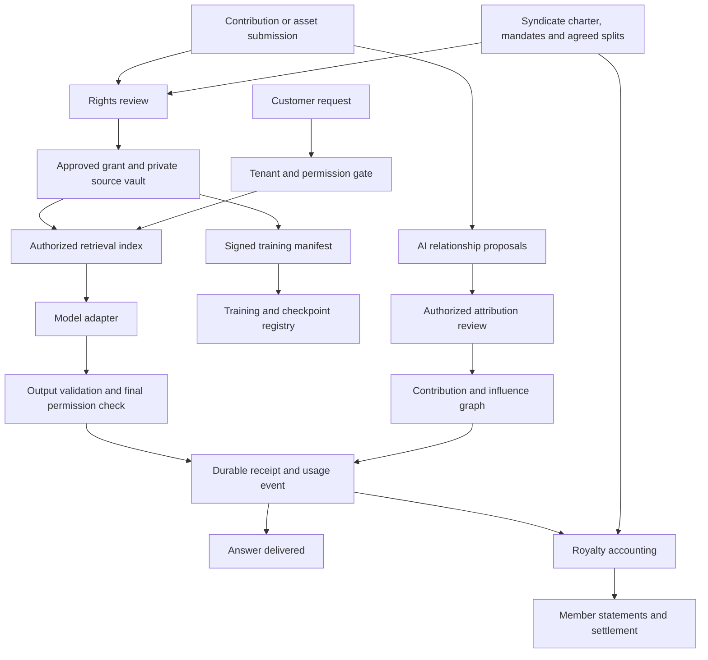

# Super Sovereign Source LLM IP

## Product and implementation specification for Codex

- **Project:** Super Sovereign Source LLM IP (`sovsrc.llm`)
- **Core framework:** Super Intellectual Property (`SIP`)
- **Creator program:** SIP Creator Rewards, the proposed program for compensation under accepted contribution agreements.
- **Version:** `0.7`
- **Date:** 2026-10-10
- **Status:** Proposed implementation specification; no model, funding, licenses or production deployment implied.
- **Source:** Adapted from the Sovereign Source AI project specification v0.1 and implementation specifications v0.2–v0.6. This version adds the commercial-platform recommendation and content-licensing/payment integration requirements, retaining Nemotron 3 Ultra, the SIP license proposal, opt-in syndicate marketplace and Python, Pydantic, Pydantic AI, Prefect, Rust, Axum and PostgreSQL architecture. The original v0.1 document remains a historical reference; this specification governs the current project scope.
- **Architecture:** [Solution architecture and Nemotron training plan](SOLUTION_ARCHITECTURE.md), researched against primary documentation on 2026-10-10.
- **Model selection addendum:** [USA Sovereign Source AI index](USA_SOVEREIGN_AI_INDEX.md), 2026-10-10. Ten US lab/provider candidates and ten open-source paths compared across ten parameters.
- **Selected model:** NVIDIA Nemotron 3 Ultra; [exact checkpoints and training plan](SOLUTION_ARCHITECTURE.md#nemotron-checkpoint-selection). The [older-model review](NEMOTRON_NO_QWEN_RESEARCH.md) remains historical alternative research.
- **Commercial platform recommendation:** NVIDIA AI Enterprise with NeMo; TollBit or direct creator agreements for licensed content, and Stripe Connect as the payout candidate. See [commercial platform research and requirements](#commercial-platform-decision-and-research). No vendor agreement or live integration is established by this recommendation.
- **Licensing:** [SS-SIP-0.1 and marketplace drafts](../licenses/README.md). Custom proposals, not OSI-approved or automatically applied to repository or third-party material.
- **Development permissions addendum:** [Pathway from ChatGPT to an independent LLM with content rewards](CHATGPT_TO_INDEPENDENT_LLM_PATHWAY.md). Proposed routes through explicit permission or independently authorized development; prior AI assistance and source rights need artifact-specific review.
- **Policy reference date:** 2026-10-10, carried forward from v0.1. Revalidate policy applicability before making a production compliance claim.

`MUST` means a required acceptance condition. `SHOULD` means a recommended default. Royalty rates, staffing, schedules and performance targets are proposed project choices, not statutory requirements.

**Current model decision:** use **NVIDIA Nemotron 3 Ultra** as requested. This supersedes the earlier Nano and Minitron default recommendations. Ultra does not meet the earlier no-Qwen/no-Chinese-teacher requirement: NVIDIA discloses those dependencies in its training data. The requirements register MUST retain that conflict until explicitly resolved; selection is not a provenance certification or a silent waiver. Review tokenizers, synthetic data, filtering models, reward models and other learned dependencies in the release manifest. Unknown evidence remains pending. [Training disclosures](https://huggingface.co/nvidia/NVIDIA-Nemotron-3-Ultra-550B-A55B-BF16#training-and-evaluation-datasets).

## 1. Objective

Build **Super Sovereign Source LLM IP**, an AI laboratory and model platform organized around **Super Intellectual Property (SIP)**: an expanded framework for recognizing, stewarding, attributing and sharing value from intellectual property, ideas, contributions and influences.

SIP connects formal IP rights with voluntary agreements covering research, proposals, improvements, prompts, workflows, curation, evaluation and acknowledged influences. Contributors can form syndicates to administer selected permissions, negotiate agreed uses, preserve credit and distribute proceeds. AI helps discover relationships and maintain evidence at a scale that manual attribution alone cannot support.

The expansion is in what the project records, recognizes and rewards. SIP is a proposed project and contractual framework, not a claim that a new statutory property right already exists. Ownership, permission, attribution, governance and economic participation remain separate, explicit records.

The initial product is a research assistant using an approved corpus, with source receipts, contributor and syndicate registration, a reviewed contribution graph and **SIP Creator Rewards** backed by reproducible royalty accounting. Creators can track qualified use, earnings and payout status under their accepted agreements. Nemotron 3 Ultra is the target for inference and subsequent adaptation on admitted SIP data. A foundation model trained entirely on SIP-admitted data remains a separate long-term objective, with auditable provenance and sovereign deployment options.

The deliverable is a system around a model as well as a model development program. Model weights alone cannot establish ownership, enforce permission or administer royalties.

## 2. Instructions for Codex

When asked to implement this specification:

1. Read applicable `AGENTS.md` files and inspect the repository before choosing a stack or editing files.
2. Treat all synced files under `sources/` as read-only references. Create implementation files outside that directory.
3. Reuse existing architecture, authentication, storage, components and test tooling where suitable.
4. Use the selected architecture in section 6 and read `docs/SOLUTION_ARCHITECTURE.md`. Reuse compatible repository patterns and record consequential deviations in a short architecture decision record.
5. Implement milestones M0 through M4 as a working local pilot. Complete the end-to-end flow before adding breadth.
6. Use clearly labeled synthetic fixtures, a deterministic model adapter and a simulated payment adapter by default. Fixtures must not masquerade as real ownership, contracts or payouts.
7. Keep paid services, real payouts, production publishing and large training runs outside the local pilot. Their integration points must be explicit; actual activation requires the relevant credentials, agreements and authorization.
8. Verify permission isolation, payment arithmetic, idempotency and revocation using meaningful automated tests.
9. Report implemented behavior, evidence from verification and remaining dependencies. Never label a mock integration, estimated attribution or simulated payment as a completed production capability.
10. Stop when the local definition of done is met. The frontier research milestones are subsequent work, not prerequisites for finishing the pilot.

This file defines work to perform when implementation is requested. Generating this file does not itself authorize deploying a service, spending funds or training a model.

## 3. Product principles

| ID | Requirement |
| --- | --- |
| P01 | Check permission for the specific use before admitting or serving an asset. Public availability alone is insufficient under this project's admission policy. |
| P02 | Treat permission, attribution and payment as separate obligations. Credit or payment does not cure missing rights. |
| P03 | Keep customer conversations out of shared training by default. Contribution enrollment must be explicit. |
| P04 | Compensate accepted contractual use; do not promise that every submitted idea or ordinary prompt automatically earns royalties. |
| P05 | Distinguish retrieved evidence, recorded reuse, training participation and estimated influence. Never fabricate an origin. |
| P06 | Preserve contributor balances and contractual obligations through model updates and product changes. |
| P07 | Make data residency, administrative access, keys, model versions and update authority explicit for each deployment. |
| P08 | Provide understandable statements, disputes and independent appeals. |
| P09 | Recognize works, ideas, contributions and influences through SIP while identifying the legal, contractual or credit-only basis of each claim. |
| P10 | Make syndicate participation voluntary and scoped. Membership, credit, voting power, ownership and revenue shares are distinct. |
| P11 | Use AI to propose attribution relationships and explain evidence; require authorized review before proposals change permissions, accepted credit or payment eligibility. |
| P12 | Preserve accepted lineage and accrued obligations across syndicate changes, derivative work and model updates according to the applicable agreements. |
| P13 | Keep open-license grants independent of marketplace accounts, membership, fees and optional revenue agreements. Delisting does not revoke a compliant recipient's public grant. |
| P14 | Admit marketplace orders only after authority review, complete terms and all required acceptances; a listing or AI proposal creates no economic entitlement. |

### Super Intellectual Property coverage

| Subject | What SIP records and recognizes |
| --- | --- |
| IP and source works | Text, code, datasets, inventions and other materials, with separately reviewed rights, claimants and permitted uses. |
| Ideas and research | Concrete proposals, hypotheses, designs and research directions, with submission evidence, adoption decisions and agreed credit or compensation. |
| Contributions | Implementation, corrections, prompts, workflows, curation, evaluation, annotation and other documented work that improves a product or model. |
| Influences | Acknowledged intellectual inputs, prior work, mentorship and inspiration, with the source of the acknowledgment, supporting evidence and uncertainty. A relationship may be credit-only. |
| Combinations and descendants | Joint work, adaptations, assembled workflows, datasets and model versions, preserving applicable upstream obligations and recording new contributions separately. |

For each subject, the platform MUST distinguish five dimensions: the asserted rights and their basis; consent for specific uses; attribution and provenance; contractual economic participation; and authority to make decisions. A person may receive credit without owning an asset, receive an agreed share without controlling a license, or hold rights without joining a syndicate. An AI-generated suggestion is evidence for review, not an additional rights holder or beneficiary.

### Creator rewards language

Use the following terms in contributor-facing explanations and statements. They describe the existing agreement and accounting model; internal record names and the royalty engine remain unchanged. The [licensing guide](../licenses/README.md#creator-rewards-language) records the language reference.

| Term | Project meaning |
| --- | --- |
| Eligible creator | A contributor, rights holder or agreed beneficiary satisfying the applicable rights, authority and compensation terms. |
| Original contribution | The identifiable idea, analysis, implementation or improvement a participant adds, with upstream credit preserved. This description does not establish ownership or replace permission review. |
| Qualified use | An evidenced, deduplicated earning event under an accepted agreement: training exposure, paid execution, adoption or accepted delivery where specified. |
| Creator rewards | Contractual compensation calculated from the accepted earning mechanism and split schedule. |
| Estimated earnings | A provisional calculation, separate from posted accounting entries. |
| Earned balance | The balance from posted entries, showing holds and adjustments separately; not necessarily all currently payable. |
| Payout | A payment event with its initiation and confirmation status visible; pilot payments are explicitly simulated. |

Licensed source material and agreed influence shares can earn under their own terms without being presented as newly authored work. A credit-only influence remains credit-only. Rewards language MUST NOT make accrued compensation discretionary or introduce new earning conditions through interface copy.

## 4. Scope

### Initial pilot

- English text and code.
- Private contributor registration and evidence submission.
- Asset registry with use-specific permissions and review decisions.
- Approved document ingestion and tenant-isolated retrieval.
- Research assistant with claim-level citations and attribution receipts.
- Accepted prompt templates and adopted suggestion records.
- Voluntary syndicates with versioned charters, accepted memberships and scoped representation mandates.
- Syndicate portfolios of works, ideas, contributions and influences, with reviewed attribution links and agreed beneficiary splits.
- AI-assisted relationship proposals using a deterministic local adapter; authorized review, correction and rejection of those proposals.
- Explicit license-application and release-attribution records, with distinct public, negotiated and third-party license bases.
- A local syndicate marketplace catalog, versioned offers, acceptance and fulfillment/cancellation flows using synthetic parties and simulated payments.
- Durable usage events and a configurable royalty engine.
- Monthly statements and simulated settlement.
- Disputes, payment holds and revocation.
- Reviewer and administrator views with an audit trail.

### Later milestones

- Real identity, tax and payment integrations.
- Independent financial, security and rights audits.
- Dedicated regional and disconnected deployments.
- A Nemotron derivative adapted on admitted SIP data, with upstream provenance limitations disclosed.
- A separately gated foundation-model program trained entirely on admitted data.
- Larger models, additional languages and additional modalities after separate gates.
- Any open-weight release after evaluating rights, safety and downstream payment feasibility.
- Agreements between syndicates, delegated collection and more complex portfolio licensing after separate review.

### Excluded from the initial pilot

- Internet-wide scraping or automatic training on conversations.
- Automated legal determinations of ownership, infringement, patent validity or fair use.
- A blockchain, cryptocurrency or speculative rights token.
- Claims of perfect attribution, guaranteed noninfringement or universal unlearning.
- A public marketplace for trading purported ownership of abstract ideas.
- Mandatory fees or account enrollment as a condition of using an open-license grant.
- Tradable syndicate interests, nested syndicate payment chains or automatic AI valuation of rights.
- Unrestricted autonomous agents or external actions.
- Training a frontier model as part of the application scaffold.

## 5. Users and essential journeys

| Role | Capabilities |
| --- | --- |
| Contributor | Submit material, specify permissions, accept terms, inspect adoption and statements, request revocation, dispute a decision. |
| Syndicate member | Join or leave under accepted terms, enroll selected contributions, approve mandates and splits, inspect permitted collective decisions and personal earnings. |
| Syndicate steward | Administer a portfolio and propose agreements within delegated authority; cannot grant rights or redirect payments merely by holding this role. |
| Marketplace operator | Review listing authority and disclosures, administer versioned offers and orders, and handle service disputes without rewriting public licenses or beneficiary agreements. |
| Customer | Query authorized sources, inspect citations and receipts, export allowed material, report incorrect or missing credit. |
| Rights reviewer | Inspect confidential evidence, approve scoped grants, quarantine assets, record reasons and resolve permission questions. |
| Finance operator | Reconcile revenue, preview settlements, inspect holds, approve permitted payment batches and record corrections. |
| Research operator | Build approved dataset manifests, register runs and checkpoints, attach evaluations and request release review. |
| Independent reviewer | Audit relevant evidence or hear an appeal through limited access. |
| Deployment administrator | Configure residency, access and operational controls without silently altering contracts or posted financial records. |

The core demonstration MUST show a syndicate with three contributors: one supplying a licensed source work and implementation, one supplying an adopted idea and one supplying a documented influence on that idea. Members accept scoped mandates and the 60/25/15 allocation agreement illustrated in section 12; a reviewer admits the eligible material and relationship evidence; a customer obtains a supported answer; an eligible use produces member statements and an auditable simulated settlement. Include a separate credit-only influence and an individual contribution outside a syndicate to demonstrate both paths.

Add a synthetic marketplace journey: a steward publishes a reviewed commission or service listing, the required parties accept a complete versioned order, delivery includes the agreed attribution, and a $2,000 distributable amount yields the agreed member statements. An open-material listing must also demonstrate license/source access without a paid order. Keep any marketplace fee separate from the public license grant.

## 6. Proposed architecture

Use a modular Rust application core and a Python AI service, with Python background workflows managed by Prefect. The [solution architecture](SOLUTION_ARCHITECTURE.md) defines component boundaries, request and training flows, failure recovery, source references and acceptance gates.

| Technology | Selected responsibility |
| --- | --- |
| React and TypeScript | Contributor, syndicate, customer and reviewer web interface |
| Rust, Axum and Tokio | Public API, authenticated context, permission decisions, domain transitions, final response authorization and exact accounting |
| SQLx and PostgreSQL | One migration owner, transactional domain records, durable receipts, outbox jobs and financial ledger |
| pgvector and PostgreSQL full-text search | Authorized retrieval with a separately versioned embedding adapter; exact search first, approximate indexing only after measurement |
| Python and Pydantic | Shared wire contracts, structured validation, data preparation, evaluation and training configuration |
| Pydantic AI | Bounded research assistance and evidence-backed attribution proposals using authorized tools |
| Prefect | Ingestion, batch attribution, manifest construction, training supervision, evaluation and settlement scheduling |
| Nemotron 3 Ultra with vLLM | Private inference endpoint; deterministic model adapter remains the local pilot default |
| NVIDIA NeMo Megatron Bridge | Model-specific Nemotron conversion and training recipes for later GPU work |
| Private object storage | Sources, evidence, dataset shards and checkpoints; a private filesystem adapter for local development |

The Rust core owns accepted rights, syndicate decisions, usage records and ledger mutations. Python and Prefect submit scoped commands to that core and cannot write those tables directly. Keep rights and finance logic out of model tools. Pydantic schemas define transport shape; Rust and database constraints enforce business invariants.

Use one PostgreSQL server with separate SIP and Prefect databases/roles for local development, one Prefect process worker and repeatable containers. Prefect's durable state is separate from the SIP financial ledger. A production profile with separated Prefect services may also require Redis for its messaging, as described in the architecture. Do not add Kafka, a separate graph database or Kubernetes without a demonstrated need.

The outbox is committed atomically with business changes. Workflow effects use stable business identifiers, input digests and idempotent core commands. Prefect retries or cached task results cannot replace financial uniqueness checks. Protect tenant and member boundaries with explicit authorization and PostgreSQL row-level security using nonprivileged runtime roles.

Pin a tested set of runtime, library, model, tokenizer, parser and container versions before implementation or GPU execution. Keep CPU application, inference and training environments separate; do not assume their latest releases are mutually compatible.



The model cannot issue grants, approve ownership claims, ratify syndicate decisions, change royalty terms or authorize transfers. Store the contribution graph as versioned relational records in the pilot; a separate graph service is not required.

Retrieved text is untrusted data. Instructions embedded in a source cannot override access controls, system policy or financial logic.

### Commercial platform decision and research

**Recommendation, researched October 10, 2026:** use **NVIDIA AI Enterprise with NeMo** as the commercial AI foundation for the selected Ultra program, on US infrastructure under project-controlled administration. NVIDIA offers commercially supported AI software and deployment tooling; its Megatron Bridge documentation supplies Ultra-specific adaptation recipes. This is the preferred fit for the project's model control and customization requirements, not a measured cost or performance ranking. GPU operations and SIP application engineering remain necessary.

The reviewed offerings do not establish a complete product for SIP's source permissions, reviewed idea/influence attribution, syndicate agreements and royalty accounting. Retain Rust/Axum and PostgreSQL as the authority for those functions. Commercial support, model licensing, content permission and creator compensation are separate agreements.

| Platform | Research finding | Project decision and boundary |
| --- | --- | --- |
| **NVIDIA AI Enterprise + NeMo** | Commercial software suite for AI development and deployment; separate Ultra recipes cover conversion, inference, SFT and LoRA. [AI Enterprise](https://www.nvidia.com/en-us/data-center/products/ai-enterprise/), [Ultra recipes](https://docs.nvidia.com/nemo/megatron-bridge/latest/models/nemotron/nemotron3-ultra.html). | Recommended commercial foundation. Confirm support for the exact Ultra checkpoint, runtime and GPU configuration in the proposed contract; published recipes do not by themselves establish enterprise support coverage. Retain the proposed vLLM serving route subject to compatibility checks; NIM adoption would require its own compatibility proof. |
| **Databricks Mosaic AI + Unity Catalog** | Managed AI services and governance, including lineage for data and model services. [Serving and governance](https://developers.databricks.com/perspectives/databricks-model-serving-runs-generative-ai-inference-at-production-scale), [lineage documentation](https://docs.databricks.com/aws/en/data-governance/unity-catalog/data-lineage). | Alternative when managed data operations are the priority. Exact Ultra hosting and deployment suitability remain unverified. Operational lineage does not establish intellectual influence, rights clearance or royalty entitlement. It does not replace the SIP ledger. |
| **TollBit** | Content licensing and metered access, with summarization, full-display and custom licenses plus transaction records. [Licenses and rates](https://docs.tollbit.com/docs/setting-rates), [developer content API](https://docs.tollbit.com/docs/content). | Preferred candidate for external licensed retrieval alongside direct creator agreements. Admit each asset under its actual license; an access purchase or API intent is not automatic training permission. Integration remains unimplemented. |
| **ProRata** | Advertises licensed content, attribution services and 50% revenue sharing with content partners. [Provider description](https://prorata.ai/). | Partnership alternative closest to the content-rewards concept. Reviewed public material does not establish a self-hostable Ultra platform, integration rights or negotiated revenue definitions. Its advertised percentage does not replace SIP's proposed economics. |
| **Stripe Connect** | Marketplace onboarding, multi-party transfers and payouts. [Connect](https://stripe.com/connect). | Recommended payout candidate for M5. SIP determines accepted beneficiaries and amounts; the provider executes payments and returns status. Account eligibility, supported fund flows and terms must be established for the deployment. |

### Commercial integration requirements

1. **Begin with licensed retrieval and recorded use.** Demonstrate the research assistant, valid citations, qualified-use receipts and agreement-based rewards before adapting Ultra. Credit-only relationships and estimated influence MUST remain distinct from payable use. An AI estimate cannot activate a beneficiary share.
2. **Preserve source and license evidence.** A content adapter MUST retain provider/source identifiers, an asset-version digest, the applicable license version or retained terms, permitted uses and recipients, price/currency and billing unit, request/transaction references and the corresponding SIP permission decision. Missing or incompatible permission fails admission. Recheck permission for indexing, caching, retrieval, output and training separately; a network listing or payment is not authority to grant broader rights.
3. **Separate supplier charges from creator rewards.** A provider-billed fetch is not automatically a qualified SIP earning event. Map each obligation to its accepted agreement and stable use identifier. Retry reconciliation MUST prevent accidental duplicate charges, liabilities or payouts while preserving independently agreed obligations. Identify whether an external payment satisfies a named obligation or is a separate source cost. External content fees MUST NOT silently change section 12's eligible-revenue formula or beneficiary splits; do not subtract them from the proposed pool without a separately accepted amendment.
4. **Keep payout execution outside reward calculation.** The Stripe adapter MUST consume core-authorized payout instructions, preserve idempotency and provider references, authenticate callbacks, tolerate duplicate and out-of-order notifications, and reconcile refunds, failures and returned funds. Provider request acceptance is not proof of completed payout. Keep calculation, posting, transfer and confirmed payout states separate and apply corrections through linked ledger entries.
5. **Verify the deployment and support boundary.** Before M5, record the exact model/runtime/hardware support scope, commercial terms, approved processors, US region, administrative access, storage and telemetry locations, export/exit provisions and measured operating cost. US vendor headquarters alone does not satisfy the sovereignty gate. Preserve exportable SIP evidence and balances independently of vendor lifecycle changes.
6. **Keep the local pilot independent.** M0–M4 continue with synthetic sources, deterministic model behavior and simulated payments. Paid connectors and GPU services are later adapters, not new prerequisites for the local demonstration. Model grants, content licenses and signed reward agreements remain independent of the custom SS-SIP draft.

This recommendation does not resolve Ultra's disclosed Qwen/DeepSeek ancestry conflict. Maintain the existing model decision and release requirements. No vendor has been contracted, content purchased, payout initiated or training run authorized through this research.

## 7. Rights and consent requirements

### Legal distinctions

U.S. copyright protects qualifying expression rather than an underlying idea, method or system. Copyright can arise without registration. A timestamp or registry record is evidence of receipt, not conclusive ownership. [Copyright Office Circular 31](https://www.copyright.gov/circs/circ31.pdf)

The Copyright Office distinguishes sufficient human authorship from prompting alone when assessing AI output copyrightability. The product must explain output rights subject to that distinction and to third-party rights. [AI Report Part 2](https://www.copyright.gov/ai/Copyright-and-Artificial-Intelligence-Part-2-Copyrightability-Report.pdf)

Patents, trademarks, copyright and trade secrets require different review. Permission to use text describing an invention is separate from a license to practice applicable patent claims. [USPTO intellectual property guidance](https://www.uspto.gov/learning-and-resources/getting-started)

### Admission rules

| ID | Requirement |
| --- | --- |
| R01 | Record the claimant, evidence, scope, jurisdiction, term, attribution obligations and reviewer for every approved grant. |
| R02 | Separate permissions for evaluation, preprocessing, training, retrieval, quotation, transformation, public attribution, sublicensing and weight distribution. |
| R03 | Quarantine missing, disputed, expired, incompatible or unverifiable permissions. |
| R04 | Default training admission to licensed, owned or verified public-domain material. Any legal-exception path requires a recorded specialist decision and must not be an automatic fallback. |
| R05 | Preserve notices and applicable license conditions for openly licensed material and code. Openly licensed is not synonymous with public domain. |
| R06 | An upload permits only agreed task processing or submission evaluation until broader uses are affirmatively accepted. |
| R07 | Verify that the grant permits every intended recipient, processor, region and output mode. A retrieval license does not automatically permit sending a source to a third-party model provider. |
| R08 | Treat confidential information, brand permissions, likeness and media rights separately where relevant. Never imply endorsement merely because a source is licensed. |
| R09 | For syndicate-administered use, verify the relevant rights holders' accepted mandates as well as the asset grants. A steward cannot extend the scope, duration, recipients or territory of a member's authority. |
| R10 | Record credit-only relationships separately from rights grants and economic agreements. Acknowledgment, semantic similarity or an influence estimate cannot authorize use or create a payment claim. |
| R11 | Record human contributions and AI assistance separately for mixed work, including relevant inputs, tools and provenance limits. An SIP entry cannot itself establish authorship or exclusive rights. |
| R12 | Record public-license grants separately from revocable service access and representation mandates. A fee dispute, member exit or listing removal cannot revoke surviving public rights. |
| R13 | Apply SS-SIP only through an explicit authorized grant over identified material; preserve upstream license terms and verify source/attribution obligations before release. |
| R14 | Before using externally generated material to develop a competing model, record evidence that its source terms or a specific permission authorize the intended use under the [development pathway](CHATGPT_TO_INDEPENDENT_LLM_PATHWAY.md). Independently sourced replacements need their own reviewed basis. Include design, code, labels, evaluations and feedback; this specification and earlier chats are not automatically cleared model-development inputs. |

Use an explicit permission decision service. Its input includes the actor, tenant, resource version, requested use, purpose, region, recipients and current time. Its output includes `allow` or `deny`, a reason code and the exact grant, mandate and policy versions evaluated. A syndicate bundle requires permission for every included resource; it cannot override a missing member grant. Syndicate membership does not itself confer access to another member's private material or another tenant's records.

### Syndicate model

A **syndicate** is a voluntary, agreement-based group that stewards a defined portfolio of SIP entries. An entry references an existing asset or contribution version and its rights, credit relationships and economic terms. The default is nonexclusive administration: members retain their underlying rights unless a separately reviewed agreement expressly provides otherwise. Contributors can participate individually or in more than one syndicate, subject to compatible mandates.

| Element | Required terms and behavior |
| --- | --- |
| Charter | Purpose, admitted contribution types, membership rules, steward powers, voting and quorum rules, conflicts, appeals, fees, exit and dissolution. Store accepted versions and effective dates. |
| Membership | Explicit acceptance by the member and admission under the charter; identify the member's role and access scope. Membership alone enrolls no assets and grants no licenses. |
| Representation mandate | The granting party, evidence of authority, covered asset/contribution versions, permitted negotiations or approvals, uses, territory, recipients, duration, exclusivity and withdrawal terms. |
| Portfolio entry | The selected asset or contribution, review status, authority references, attribution links and any applicable split schedule. An entry may be credit-only and must say so. |
| Decisions | Versioned proposals, eligible voters, votes or other required approval evidence, conflicts and effective dates. A collective vote cannot expand a member's mandate or rewrite an accepted beneficiary agreement. |
| Benefit sharing | Contribution-specific, accepted split schedules with named beneficiaries, calculation basis, any disclosed administration fee and effective period. Credit weights and voting weights do not automatically become payment percentages. |
| Exit and dissolution | End future representation as agreed, remove future eligibility where required and preserve accrued earnings, accepted history and surviving licenses. Retain an accountable party and an exportable reconciliation record for outstanding obligations. |

The pilot supports one level of syndicate administration and direct simulated settlement to contributors. A contribution can appear in several compatible portfolios, but every payable use MUST resolve to one applicable agreement and split schedule per earning mechanism. Displaying it in another portfolio cannot multiply its score or liability.

A charter or split change requires the approvals specified in the governing agreements, including consent from parties whose accepted economic terms change. Apply changes prospectively from their effective time; corrections to posted periods use linked adjustments. Syndicates may negotiate collective licenses only within recorded mandates; formation does not establish ownership, authorization to represent nonmembers or blanket permission to use a portfolio.

### License and marketplace contract model

The proposed [SS-SIP license](../licenses/SS-SIP-0.1.md) governs explicitly covered material and its applicable source/attribution obligations. The [marketplace terms](../licenses/SYNDICATE-MARKETPLACE-TERMS-0.1.md) govern only identified participants and accepted transactions. The license's influence notices acknowledge documented relationships; contractual beneficiary schedules determine payments. Neither graph registration nor a credit record creates ownership of an idea.

Use these listing categories: open material, commission/bounty, service, additional permission and voluntary revenue participation. Disclose existing public rights, exactly what is being sold, authority, deliverables, acceptance criteria, source access, applicable credits, fees and refund/exit rules. A seller cannot market rights already granted publicly as an unavoidable paid license or promise exclusivity over them.

The core MUST reject activation of orders missing real required fields in a production environment, or the corresponding clearly synthetic fields in a local fixture. Identity, mandate, governing terms, consideration, allocation, delivery and required party acceptance must resolve to immutable versions. The supplied unaccepted example files remain nonexecutable until those fields are completed. A public license needs no marketplace acceptance to grant rights to its recipients.

## 8. Contribution lifecycle

```text
submitted -> under_review -> accepted -> adopted -> earning -> retired
                         -> rejected
```

Dispute state is tracked separately so a contested contribution can retain its adoption history while the affected payment is held.

- **Submitted:** issue a private receipt. No production adoption is permitted.
- **Under review:** check relevant rights, duplicates, usefulness, confidentiality, supporting evidence and any proposed influence links or syndicate authority.
- **Accepted:** all required parties accept the versioned agreement, compensation rules, term and credit preferences, including any syndicate mandate and beneficiary split schedule.
- **Adopted:** link the contribution to a deployed template, implementation change or admitted dataset and its evaluation evidence; record accepted upstream contribution and influence links.
- **Earning:** count qualified use: the contract-eligible events or adoption points defined by the accepted agreement.
- **Rejected:** preserve the reason and appeal route; do not use the submission in production.
- **Retired:** stop new eligibility as specified by the agreement while preserving accrued obligations.

### Earning mechanisms

| Kind | Eligibility trigger | Evidence |
| --- | --- | --- |
| Licensed work | Agreed training, retrieval or other licensed use | Grant, manifest or eligible usage record |
| Idea | Accepted concrete proposal implemented by the laboratory | Agreement, component/change reference and adoption decision |
| Suggestion | Accepted improvement validated on a predefined evaluation | Baseline, change, test method and reviewed result |
| Prompt or workflow | Accepted version used in an eligible paid session | Template version and deduplicated execution event |
| Curation, evaluation or implementation | Accepted work adopted under a bounty, service agreement or an agreed existing pool track | Versioned deliverable, acceptance criteria and reviewed adoption evidence |
| Influence | Reviewed acknowledgment linked to an adopted contribution, with compensation only where expressly agreed | Identified source, acknowledgment and supporting evidence; agreement and split schedule if payable |

Training use of a prompt requires a separate grant. Mere semantic similarity to a suggestion does not prove adoption.

Credit-only influence records use a separate relationship lifecycle: `proposed -> under_review -> accepted` or `rejected`, with corrections recorded as new versions. They do not need to enter an earning state. An accepted influence link can support acknowledgment while an economic proposal remains unaccepted. Syndicate enrollment follows rights and contribution review; enrollment does not convert a rejected or unaccepted submission into an adopted contribution.

Cluster duplicate submissions before scoring. Independent contributors may share credit; first submission does not create a monopoly on an abstract idea. Rejected contributions later suspected of adoption must be reviewable. Confidential submissions must not be publicly disclosed to establish their internal timestamp.

## 9. Domain records

All mutable business entities need versioning and an audit trail. Use immutable identifiers, UTC timestamps and explicit tenant or deployment scope. Do not expose raw database identifiers as proof of ownership.

| Record | Minimum fields |
| --- | --- |
| Contributor | `id`, private identity reference, public alias, contact preferences, payment profile reference, status |
| AssetVersion | `asset_id`, `version`, digest, parent versions, private object reference, media type, origin, confidentiality, tenant |
| RightsGrant | `id`, asset version, claimant, evidence reference, permitted uses, recipients, territories, validity, attribution rules, revocation terms, state, reviewer, policy version, syndicate mandate reference if represented |
| LicenseApplication | rights holder/authority, covered versions and exclusions, license ID/text digest, express grant evidence, Source Form location, public or negotiated basis, survival/termination rules |
| ReleaseAttribution | release/artifact versions, license applications, source references, contributor credits, documented influence links and their basis, upstream notices, privacy-safe correction history |
| Contribution | `id`, version, kind, contributor IDs, evidence reference, human/AI contribution disclosure, review state, agreement version, adoption reference, earning term, track, split schedule reference |
| AgreementVersion | parties, accepted terms digest, acceptance evidence, effective dates, royalty rules, minimums, offsets, termination and descendant obligations |
| Syndicate | `id`, tenant, name, purpose, charter version and terms digest, approval evidence, effective dates, steward IDs, governance rules, status |
| SyndicateMembership | syndicate, contributor, role, access scope, accepted charter version, acceptance/admission evidence, start/end dates, status |
| SyndicateMandate | `id`, version, syndicate, granting party, authority evidence, covered asset/contribution versions, delegated powers, scope, term, exclusivity, withdrawal terms, acceptance evidence, state |
| SyndicateEntry | syndicate, asset/contribution version, mandate references, credit-only or economic status, split schedule reference, enrollment/exit dates, review evidence |
| SyndicateDecision | syndicate, proposal and target versions, governing charter, eligible voters, approvals/votes, conflicts, decision, effective time, audit references |
| AttributionLink | `id`, version, source and target references, relationship type, assertion basis, evidence references, proposer, AI model/method and uncertainty if used, reviewer, state, visibility, correction reference |
| SplitScheduleVersion | `id`, version, contribution/agreement, earning mechanism, syndicate if applicable, beneficiaries and exact shares, fee beneficiary and share if any, effective interval, acceptance evidence, state |
| MarketplaceListing | seller/syndicate, category, covered contribution versions, authority references, rights/public-license disclosures, attribution record, visibility, review state, listing versions |
| MarketplaceOfferVersion | listing version, parties, proposed deliverable and criteria, permission scope, credits, price/revenue basis, fees, splits, adjustments, term, source obligations, immutable digest |
| MarketplaceOrder | offer/terms versions, required party acceptances, authority snapshots, buyer/seller/operator, jurisdiction/forum, fulfillment and cancellation state, economic-event references, disputes |
| AdoptionRecord | contribution version, deployed component or manifest, evaluation reference, reviewer, adoption date |
| DatasetManifest | included asset versions, grant snapshots, transforms, deduplication decisions, exposure units, digest, signature |
| ModelVersion | base model and license, manifest or disclosed provenance limitation, run ID, code version, checkpoint digest, evaluation references, release status |
| AttributionReceipt | response ID, model version, evidence types, claim-to-source references, locations, permission versions, contribution uses, accepted attribution link versions, syndicate credit view, limitations, timestamp |
| UsageEvent | stable event ID, tenant alias, response ID, asset/contribution version, event type, quantity, occurrence time, grant version, agreement version, mandate and split schedule versions if applicable, billing reference, eligibility state |
| RevenueRecord | collection ID, product/cohort, currency, collected amount, permitted deductions, adjustment references, period |
| LedgerTransaction | immutable ID, currency, balanced debit/credit entries, business event, settlement version, correction reference |
| Statement | contributor, period, revenue basis, score breakdown, gross contribution allocations, syndicate and split schedule references, beneficiary shares, fees, minimums, adjustments, holds, payable balance, calculation version |
| Dispute | claimant, affected records, evidence, status, amount held, decisions, appeal and remediation |
| ResearchRequest | stable request ID, actor/tenant, input digest, permission context, status, response reference, release transaction and idempotency key |
| WorkflowJob / OutboxEvent | business key, command/schema version, input digest, tenant, lease/attempt state, external Prefect or GPU job ID, result reference, timestamps |
| TrainingRun | base model/tokenizer revisions, approved manifest digest, recipe/container versions, hyperparameters, resource limit, external job ID, checkpoint lineage and exposure summary |
| EvaluationRun | model artifact digest, frozen evaluation dataset/configuration, metrics, failures, reviewer and release-gate result |
| ModelRelease | model/checkpoint, tokenizer, parser, prompt/configuration and evaluation digests, approval evidence, deployment scope and rollback target |

Personal identity documents, source contents and prompts belong in access-controlled stores, not the append-only accounting log. Audit records reference opaque identifiers. Retention and deletion must distinguish confidential content from required financial evidence.

The SIP portfolio view composes these records; it is not a second ownership registry. Require referential integrity and effective-date validation for mandates, decisions and split schedules. Reject duplicate accepted links and self-links. Derivation lineage must be acyclic; acknowledgment and influence links may be reciprocal but are never recursively traversed to calculate money. Preserve independent-origin findings and review history when merging duplicate candidates.

## 10. API contract

Endpoint names are suggested; preserve existing repository conventions. Mutating endpoints MUST enforce role and tenant authorization and support idempotency where retries could create duplicate business events.

| Method and route | Behavior |
| --- | --- |
| `POST /v1/assets` | Register a private asset version; no automatic public indexing. |
| `POST /v1/grants` | Create a proposed grant with evidence. |
| `POST /v1/grants/{id}/review` | Record an authorized approval, rejection or quarantine decision. |
| `POST /v1/grants/{id}/revoke` | Record effective revocation and schedule permitted remediation. |
| `POST /v1/contributions` | Submit a work, idea, suggestion, prompt, workflow, other contribution or documented influence with scoped evaluation consent. |
| `POST /v1/contributions/{id}/acceptances` | Record the parties' acceptance of an agreement version. |
| `POST /v1/contributions/{id}/adoptions` | Record authorized adoption with implementation evidence. |
| `POST /v1/syndicates` | Propose a syndicate and versioned charter; no automatic authority over member assets. |
| `POST /v1/syndicates/{id}/memberships` | Record member acceptance and admission under the charter; never infer consent from an invitation. |
| `POST /v1/syndicates/{id}/mandates` | Propose a scoped mandate and record the granting party's verified acceptance. |
| `POST /v1/syndicates/{id}/entries` | Enroll a reviewed asset or contribution within accepted authority. |
| `POST /v1/syndicates/{id}/decisions` | Record a proposal and authenticated approval evidence; enforce charter rules and affected-party consent before activation. |
| `POST /v1/syndicates/{id}/exits` | Record member exit, mandate withdrawal or dissolution with effective dates and surviving obligations. |
| `POST /v1/split-schedules` | Propose or accept an immutable schedule version; validate shares, authority, effective dates and required party acceptances. |
| `POST /v1/attribution-links` | Submit a human or AI relationship proposal with evidence and visibility restrictions. |
| `POST /v1/attribution-links/{id}/review` | Accept, reject or supersede a proposal with reasons; cannot itself approve ownership or payment. |
| `GET /v1/syndicates/{id}/portfolio` | Return only caller-authorized entries, mandates, accepted relationships and agreement summaries. |
| `POST /v1/license-applications` | Record an authorized grant over identified material; cannot relicense excluded upstream components. |
| `POST /v1/marketplace/listings` | Propose a listing with authority, public-rights disclosures, attribution and category. |
| `GET /v1/marketplace/listings` | Return published, caller-visible offers and public source/license locations without disclosing private review evidence. |
| `POST /v1/marketplace/listings/{id}/review` | Approve, reject or delist with reasons; preserve surviving license and order rights. |
| `POST /v1/marketplace/offers` | Propose an immutable offer version with complete transaction terms. |
| `POST /v1/marketplace/orders` | Create an unaccepted draft order referencing an exact offer version; creates no permission or payment obligation. |
| `POST /v1/marketplace/orders/{id}/acceptances` | Record authenticated acceptance of the exact offer; activate only when all required fields and consents are valid. |
| `POST /v1/marketplace/orders/{id}/transitions` | Record authorized fulfillment, acceptance, cancellation or correction under the accepted order; deduplicate economic effects. |
| `POST /v1/research` | Answer using only authorized resources; return a receipt identifier. |
| `GET /v1/receipts/{id}` | Return the caller-authorized receipt view. |
| `GET /v1/contributors/me/statements` | Return the contributor's own accounting statements. |
| `POST /v1/disputes` | Open a claim with evidence references. |
| `POST /v1/settlements/preview` | Produce a reproducible finance-only dry run. |
| `POST /v1/settlements/{id}/post` | Atomically post an approved calculation once; no automatic external transfer. |

Internal ingestion of usage and revenue events MUST authenticate their origin. Customers cannot submit arbitrary payable events or self-approved scores.

Return consistent errors such as `permission_denied`, `grant_expired`, `grant_revoked`, `region_not_allowed`, `agreement_missing`, `mandate_missing`, `mandate_scope_exceeded`, `split_not_accepted`, `invalid_transition` and `idempotency_conflict`. Do not disclose another tenant's resource existence through error detail.

## 11. Attribution and serving behavior

Every response MUST distinguish:

1. **Verified quotation:** a matched passage with an identified source and location.
2. **Retrieved support:** evidence supporting a specific claim.
3. **Recorded contribution reuse:** an executed template, workflow or adopted component.
4. **Training participation:** membership in a model manifest, without asserting causation for this answer.
5. **Acknowledged influence:** a reviewed contributor acknowledgment with its evidence and scope; it does not assert causal influence on a particular model output.
6. **Estimated influence:** a labeled research estimate with method and limitations.
7. **No verified source:** no invented citation or recipient.

Data attribution research such as TRAK does not by itself establish an auditable royalty entitlement for every generated token. The pilot must use agreed allocation rules and direct usage evidence. [TRAK research paper](https://proceedings.mlr.press/v202/park23c.html)

### AI-assisted contribution and influence graph

AI SHOULD help extract source references, match quotations, identify possible duplicates, suggest contribution relationships and surface potentially missing credit. It MAY summarize permission terms for reviewers, but permission decisions use the accepted structured records. The pilot demonstrates this workflow through reproducible synthetic proposals; production attribution quality requires separate evaluation.

Each proposed relationship MUST identify its source and target, type (`quotes`, `supports`, `derived_from`, `implements`, `improves`, `informed_by` or `acknowledged_by`), evidence location, assertion basis, proposing actor or model, method/version, uncertainty and review state. Preserve whether the basis is a direct record, a contributor declaration or an AI estimate. Similarity alone is insufficient evidence of authorship, adoption or influence; reviewers can record independent development or insufficient evidence.

Only authorized, reviewed relationships enter the accepted graph. Participants can request missing credit or corrections and appeal disputed links. Public views and exports respect the evidence's confidentiality and accepted credit preferences, including aliases or restricted acknowledgment. Reviewing a graph link does not approve an economic agreement, and no graph traversal automatically assigns ownership or royalties.

Receipts SHOULD explain the relevant chain from source work through adopted ideas and contributions to a response, dataset or model version wherever that chain is supported. Show syndicate administration and individual credit separately. Mark unknown links and estimated influence explicitly; never fill gaps with generated provenance. For AI-assisted work, distinguish recorded human contributions from tool use without claiming exhaustive causal attribution.

### Serving sequence

1. Authenticate the request and determine its tenant, region and purpose.
2. Restrict the candidate set before retrieval using resource access and use permissions.
3. Check any selected prompt template, syndicate-administered grant and external processor permissions.
4. Generate through the model adapter.
5. Validate citations, source locations and output restrictions; apply appropriate reproduction and code-license checks.
6. Recheck permissions immediately before making content available. Handle grant and applicable mandate changes during inference, including any license that survives a mandate withdrawal under its accepted terms.
7. Persist the receipt and usage event durably before delivery, including applicable agreement, mandate and split schedule versions. Keep billing status distinct from observed use; not every retrieval is payable.
8. Deliver the answer and permitted receipt view.

If durable event capture fails, pause the affected metered operation rather than delivering unrecorded licensed content. Use a transactional outbox to make background retries safe. A network retry must not create another payment for the same economic use.

For the pilot, deliver complete validated responses. Do not stream protected content before final authorization unless later implementation proves an equivalent safe protocol.

Required attribution must survive supported exports. Confidential credits use only a permitted alias or restricted view. Do not use a source whose mandatory credit cannot be supplied in the chosen output mode.

## 12. Royalty engine

This engine calculates **SIP Creator Rewards**. Contributor-facing views use qualified use, estimated earnings, earned balances and payouts as defined in section 3, while statements retain the precise contractual basis for each amount.

### Proposed economics

For a monthly accounting period and one currency:

```text
R = collected revenue attributed to covered products
    - refunds
    - chargebacks
    - sales taxes
    - directly charged payment processing fees

P = 20% of positive eligible revenue R

Corpus allocation       = 60% of P
Prompt allocation       = 20% of P
Idea/contribution/influence allocation = 20% of P
```

Do not deduct compute, salaries, marketing or general overhead. Bundle and model-cohort revenue rules must be versioned and disclosed before use. Negative adjustments must be recorded under the agreement's correction rules; they must not silently erase accrued liabilities.

For contribution `i` in track `k`:

```text
allocation[i] = track_pool[k] * eligible_score[i] / sum(eligible_scores[k])
```

| Track | Proposed score basis |
| --- | --- |
| Corpus | Deduplicated, capped training exposure units multiplied by predefined quality weights within a revenue-bearing model cohort. Retrieval fees follow the applicable contract; they must not be silently treated as training exposure. |
| Prompts | Verified eligible paid executions of accepted versions with disclosed task weights and fraud exclusions. |
| Ideas, contributions and influences | Contracted adoption points for reviewed implementations, improvements and other accepted contributions. An influence earns only through an expressly agreed share of an adopted contribution or a separately evidenced, nonduplicative adoption agreement. |

Actual scorecards and weights require an accepted configuration. Codex must not invent production valuation rules. Zero eligible scores reserve the track allocation for reconciliation under its published terms. An accounting reserve is not a claim that cash is held in legal escrow.

Minimum guarantees, per-use fees and bounties remain payable under their agreements even if the total exceeds the pool. Offset against the same contributor's allocation only where expressly allowed. Do not reduce other contributors' shares. Record beneficiary splits separately from asset ownership claims.

Renaming a product, distilling a checkpoint or changing a bundle must not erase agreed descendant obligations. Distinct uses may earn in multiple tracks only where permitted by their agreement.

### Syndicate allocation

The proposed pool remains 20% of eligible revenue with the same 60/20/20 track proportions. Syndicates administer member allocations within those tracks; they do not create an additional pool or charge. Classify each earning mechanism in its agreement before use. Additional bounties and service fees must identify their separate funding basis.

The pool is a proposed contractual option, not a fee imposed by SS-SIP or every marketplace listing. A marketplace order must expressly select the pool policy or its own fixed-fee/revenue formula. Disclose whether administration fees are deducted before splitting or included within beneficiary shares; never apply both treatments to the same fee. Public-license use alone cannot create a payable event.

First calculate the eligible contribution's gross allocation, then distribute that amount using its accepted split schedule. Each schedule must allocate exactly 100%, including any explicitly approved administration share. The pilot defaults to no administration fee and direct simulated payment to each beneficiary. Any minimum guarantee or offset must identify whether it applies to the contribution or a named beneficiary; apply it only at that agreed level, once, and show its effect separately.

Economic shares are explicit agreement terms; do not derive them from AI confidence, credit order, graph centrality or syndicate voting power. An influence included in a split does not also receive adoption points for that same economic contribution. Deduplicate across individual and syndicate registrations and across overlapping portfolios. Hold only the disputed portion while preserving the rest of the allocation.

Resolve the effective schedule under the agreement at the eligible event or adoption time and freeze its version for settlement. Multiple active schedules for the same earning mechanism and time are a conflict requiring review, not a reason to pay twice. Member departure, a later vote or a newly estimated influence cannot retroactively change a posted allocation.

### Calculation requirements

- Use integer minor currency units and exact decimal or rational intermediates, never binary floating-point money.
- Settle separately by currency. A later foreign-exchange conversion needs an explicit rate, timestamp and fee record.
- Apply deterministic rounding with a documented residual allocation rule and stable tie-breaking identifiers.
- Validate that beneficiary shares sum to 100% and track shares sum to 100%.
- Deduplicate economic events independently of worker delivery attempts.
- Snapshot eligible revenue, scores, grants, mandates, agreements, split schedules and policy versions at settlement cutoff.
- Post balanced ledger transactions atomically and once.
- Handle late events and refunds through linked adjustment transactions; do not rewrite a posted period.
- Hold only contested amounts. Previously accrued eligibility is evaluated under its applicable agreement, not erased by current grant expiry.
- Separate calculation, posting, external payout initiation and payout confirmation.

### Golden example

If `R = $1,000,000`, `P = $200,000`: corpus `$120,000`, prompts `$40,000`, ideas/contributions/influences `$40,000`.

- A contributor with 2% of prompt points receives `$800`.
- A suggestion with 5% of adoption points receives `$2,000`.
- If that suggestion belongs to a syndicate with an accepted 60/25/15 split among its idea contributor, implementation contributor and acknowledged influence contributor, the same `$2,000` pays `$1,200`, `$500` and `$300`. The influence is payable because of that agreement, not because an AI estimated a relationship. A separate credit-only influence receives acknowledgment and no allocation.
- A licensor with a `$10,000` allocation and a `$12,000` minimum receives `$12,000` where that minimum offsets its allocation. The extra `$2,000` is a laboratory obligation.

Proposed operational defaults: statements within 15 days of month end; undisputed payment within 45 days; a `$25` threshold that carries forward without forfeiture and is paid annually where legally permitted. Keep these settings configurable and subordinate to signed terms.

## 13. Privacy and sovereign operation

| ID | Requirement |
| --- | --- |
| S01 | Keep raw sources, prompts, embeddings, caches, backups and logs in permitted locations. Record support access and subprocessors. |
| S02 | Enforce tenant boundaries in object access, retrieval, receipts, statements and background jobs. Embeddings are not a privacy exemption. |
| S03 | Offer explicit contribution enrollment separate from ordinary chat use. Never train on routine customer prompts by default. |
| S04 | Record customer control of keys and updates where contracted. Use signed software/model versions and tested rollback. |
| S05 | Restrict privileged access; separate permission review, financial posting and audit roles. |
| S06 | Keep confidential customer activity out of public credits and contributor statements. |
| S07 | Document dependencies and portability. Regional hosting alone does not prove complete technological sovereignty. |
| S08 | Scope syndicate access by role and enrolled resource. Members cannot inspect other members' private sources, identity records, customer activity or statements without specific authorization. |

### Revocation

Immediately enforce effective revocation of revocable permissions in the permission service. Preserve independently surviving public-license grants and distinguish license breach/termination from delisting, membership exit or withdrawal of representation. Remove affected online index entries and caches within a proposed 24-hour target where the effective rights or service-access decision requires it. A stale index must not bypass the current permission check.

For trained checkpoints, record the agreed remedy: exclusion from future training, retraining, validated unlearning or retirement. Deleting a source object is not proof of removing its influence from weights. Existing checkpoint rights and remedies must be clear before admission.

Disconnected deployments are a later milestone. Use signed local usage logs and agreed reconciliation, or a fixed deployment license when precise metering cannot be supported. Critical deployments need agreed continuity terms; royalty enforcement must not secretly interrupt contracted operation.

## 14. Governance and safety

Require research, security and rights approval for model release, with finance approval for settlement operations. Commercial pressure cannot waive an unresolved critical rights or security defect.

Establish a contributor council for allocation policy review and independent reviewers for disputes. Publish conflicts of interest and protect confidential evidence.

Syndicate stewards are accountable to their accepted charters. Members must be able to inspect applicable decisions, mandates, fees and their own allocation calculations, export their records and use an independent appeal route. Reviewers and stewards must disclose conflicts and recuse themselves from adjudicating their own contested credit or payment. A majority vote cannot confiscate accrued earnings, disclose private evidence or authorize rights beyond accepted mandates.

Evaluate AI attribution assistance for unsupported links, omitted credit and systematic preference for prominent or well-documented contributors. Preserve contributor declarations and dissent alongside reviewed decisions. Automated suggestions must remain contestable, and model updates cannot silently rewrite accepted attribution or split schedules.

Before higher-capability deployment, evaluate cyber, biological, chemical, privacy, manipulation, deception and autonomous-action risks in controlled environments. Define critical findings before testing. Any unresolved critical scenario failure blocks the affected release regardless of average capability scores.

Use scoped tools, explicit action authorization, resource limits and human control over consequential external actions. Protect weights, source vaults and signing systems with segmented access and tested recovery.

Proposed incident target: internal escalation of suspected critical compromise within one hour. External notification follows applicable law and contracts; this is not a universal statutory deadline.

Disputes should be acknowledged within five business days, receive an initial evidence-based decision targeted within 30 calendar days and support independent appeal. Preserve unrelated earnings and offer confidential audit access when evidence cannot be publicly disclosed.

## 15. Development milestones

| Milestone | Deliverable | Completion evidence |
| --- | --- | --- |
| M0 — Foundation | Rust/Python workspaces, shared Pydantic schemas, domain model, core-owned migrations, PostgreSQL, local Prefect and deterministic adapters | Repeatable setup; Rust/Python contract parity; no external credentials required; fixture status clearly visible |
| M1 — Rights, contributions and syndicates | Private intake, license applications, scoped grants, charters, mandates, portfolio enrollment, reviewed marketplace listings/offers, order and split acceptance, adoption | Unauthorized transitions and overbroad mandates fail; incomplete orders remain inactive; public rights survive optional commerce; two tenants remain isolated |
| M2 — Research assistant and attribution | Python/Pydantic AI research service, core-authorized retrieval, deterministic model and relationship-proposal adapters, reviewed contribution graph and receipts | Supported answer with valid source locations; accepted acknowledgment is distinct from estimation; private evidence cannot leak; final revocation check works |
| M3 — Accounting | Core-owned usage capture and allocation engine, transactional outbox, Prefect jobs, revenue fixtures, member splits, statements and simulated payout | Golden examples and member splits match exactly; overlapping portfolios and worker restarts cannot duplicate liabilities; ledger balances |
| M4 — Review and operations | Disputes, targeted holds, release-attribution corrections, order cancellation/delisting, mandate withdrawal, member exit/dissolution, revocation remediation and exports | Complete individual, syndicate and marketplace demonstrations; accrued obligations and surviving public grants persist; documented local run procedure |
| M5 — Commercial pilot | Verified Ultra serving and commercial support scope; licensed-content and payout adapters under section 6; signed licenses, identity/tax handling and independent review | Model/provider compatibility, source/license receipts, supplier-charge and payout reconciliation, deployment assessment and measured unit economics; pass the commercial integration proof below |
| M6 — Nemotron 3 Ultra adaptation | Admitted SIP corpus, supervised LoRA training pipeline and evaluated Ultra derivative | Complete provenance for added data, recorded resolution of the ancestry conflict, disclosed upstream limits, reproducible save/resume and export, independent evaluation and rollback |
| M7 — Frontier candidate | Larger model research and sovereign deployment options | Capability, rights, security and financial gates all pass |

Suggested repository structure, adaptable to existing conventions:

```text
apps/web/
crates/sip-core/             # Axum, domain modules, SQLx, accounting and outbox
python/sip-contracts/        # Pydantic models and schema export
python/sip-ai/               # Pydantic AI service and model adapters
python/sip-workflows/        # Prefect flows and workers
python/sip-training/         # Approved training and evaluation entry points
contracts/schema/           # Generated cross-language wire schemas
migrations/                 # One SIP migration sequence owned by the core
infra/                      # Local profiles and later deployment configuration
tests/fixtures/
tests/integration/
docs/decisions/
```

Prefer modules over separately deployed services. Create only directories needed by the current milestone.

## 16. Verification requirements

### Local pilot tests

| Test | Required behavior |
| --- | --- |
| Missing training grant | An asset approved for retrieval cannot enter a training manifest. |
| Processor restriction | A document cannot be sent to a model provider outside its permitted recipients or regions. |
| Cross-tenant access | Direct URLs, search, receipts, statements and background jobs cannot expose another tenant's private records. |
| Revocation race | A grant revoked during generation prevents unauthorized delivery despite a stale retrieved result. |
| Prompt injection | Source text attempting to approve itself, change a royalty rate or reveal secrets has no such authority. |
| Citation validation | Nonexistent sources and invalid locations are rejected or labeled unsupported. |
| Contribution state | An unaccepted or rejected contribution cannot become a production template or eligible adoption. |
| Membership consent | An invitation or accepted membership cannot enroll material, disclose private sources or grant representation without the required mandate. |
| Syndicate authority | A steward or majority vote cannot license outside a mandate; a portfolio with a missing member grant fails authorization for the affected use. |
| Mandate withdrawal race | A withdrawal effective during generation blocks uses that depend on it; separately surviving licenses are evaluated under their accepted terms. |
| AI attribution proposal | An unsupported relationship remains unaccepted and creates no permission, credited fact or financial entitlement. |
| Acknowledgment versus estimate | A reviewed influence acknowledgment is labeled by its basis; an AI estimate cannot masquerade as proof of causal influence on an answer. |
| Credit-only influence | An accepted acknowledgment appears in its permitted credit view without generating a payable event or adoption points. |
| Graph integrity | Duplicate links, derivation cycles and self-links are rejected; reciprocal acknowledgments cannot cause recursive payouts. |
| Syndicate split | The `$2,000` golden allocation produces exactly `$1,200`, `$500` and `$300`; unauthorized fees and shares other than 100% are rejected. |
| Overlapping portfolios | Registering the same contribution individually or in two syndicates cannot multiply its score, usage or payment; conflicting schedules require review. |
| Split approval and timing | Unaccepted changes cannot activate; valid changes affect only the agreed effective period; earlier posted amounts remain immutable. |
| Member exit and dissolution | Future representation follows termination terms while accrued balances, applicable surviving licenses and audit history remain reproducible. |
| Syndicate confidentiality | Portfolio, graph, receipt and statement views reveal only authorized member and tenant information. |
| Duplicate delivery | Replaying a usage event or settlement request produces the original result without duplicate financial entries. |
| Conflicting idempotency key | Reusing a key with different input returns a conflict. |
| Decimal arithmetic | Golden examples, split remainders and minimum offsets reproduce exactly. |
| Zero scores and refunds | Reserved allocations and adjustments remain visible and ledger-balanced. |
| Disputed payment | Only the affected amount is held; other earnings remain payable. |
| Worker outage | Durable events survive restart without duplicate processing or lost liability. |
| Late event | A closed period stays immutable; correction appears in a linked adjustment. |
| Privacy deletion | Deleting confidential content does not disclose it through the accounting history. |
| Cross-language contracts | Rust and Python accept/reject the same versioned fixtures, including unknown fields, numeric bounds and invalid enum values. |
| Pooled tenant context | A reused database connection cannot inherit a previous request's tenant; the runtime role cannot bypass RLS. |
| AI service authority | A service credential or model tool cannot approve a grant, accept a split, inspect another tenant or post a settlement. |
| Outbox launch recovery | A crash between workflow submission and acknowledgment preserves one business job identity and cannot duplicate effects. |
| Workflow resume | A resumed or cached flow rechecks current permission and does not replay an irreversible action as a new economic event. |
| License adoption | A draft license or incomplete template cannot establish an actual grant; excluded third-party material keeps its own license. |
| Open grant independence | Open-license use requires no marketplace enrollment or paid order, and delisting/nonpayment of an optional service cannot withdraw the public grant. |
| Required credit | Distributed covered material includes source access and relevant contributor/influence records; unsupported AI claims do not become mandatory credits. |
| Order acceptance | Missing identities, authority, terms, allocation or party acceptances prevent execution; a changed offer digest invalidates acceptance of that changed offer. |
| Marketplace allocation | The synthetic fixed-fee order yields the same $1,200/$500/$300 split exactly once; fees and pool deductions cannot be charged twice. |
| Marketplace cancellation | Apply the accepted refund and fulfillment rules, preserve posted history and preserve unrelated open-license rights. |

### Commercial integration proof (M5)

| Test | Required behavior |
| --- | --- |
| External content scope | Paid summarization access cannot authorize training or a prohibited processor; missing terms prevent admission. A permitted use retains source, license, price and transaction evidence. |
| Supplier usage and SIP rewards | A duplicated request or delayed billing acknowledgment reconciles to its stable identity without multiplying an obligation. A supplier charge alone creates no SIP earning event; separately agreed obligations remain visible without changing the pool formula. |
| Payout lifecycle | Authenticated duplicate/out-of-order callbacks and an ambiguous initiation response cannot duplicate a payment or mark an unconfirmed payout complete. Reconciliation and linked adjustments preserve balances after failure or return. |
| Deployment and exit | The named Ultra configuration passes compatibility checks within the contracted support scope; permission evidence, financial records and approved artifacts remain exportable, with regional and administrative controls demonstrated. |

### Production and model gates

- **Rights:** every admitted asset resolves to an approved basis for its intended use; no unresolved critical defect.
- **Manifest integrity:** every released checkpoint resolves to approved data and code versions, with third-party provenance limits disclosed.
- **Attribution:** at least 1,000 independently reviewed claims; lower 95% confidence bound on support precision of at least 95%. Report coverage and abstention separately.
- **Memorization:** at least 10,000 stratified adversarial extraction attempts and no unresolved severe unauthorized disclosure. Report observed rates and limits.
- **Accounting:** independent reconciliation without unexplained differences; complete test coverage of required financial invariants.
- **Commercial integration:** section 6's selected services have applicable agreements and verified support scope; source transactions and external payouts reconcile to SIP records, and the M5 integration proof passes. A provider's attribution or revenue-share marketing is not acceptance evidence.
- **Operations:** proposed 30-day pilot with 99.5% availability under a declared load and demonstrated recovery.
- **Sovereignty:** verified regional boundaries, access control, key rotation and rollback for the offered deployment profile.
- **Capability:** freeze a balanced suite and three leading comparison models at evaluation start; match their median normalized aggregate with no priority domain more than 10% relatively below its comparison median.
- **Performance economics:** compare Ultra BF16 and NVFP4 on frozen SIP tasks using first-attempt success, bounded-retry success, p50/p95 latency and total cost per verified outcome. Include failed attempts and validation costs; report coverage and abstention separately. Preserve attribution and privacy thresholds. Follow the [evaluation method and source review](NEMOTRON_PERFORMANCE_SOURCE_REVIEW.md); Super benchmark numbers are not Ultra results.
- **Safety:** no unresolved critical finding; independent assessors verify controls against observed capability.
- **Nemotron integration:** pinned model/server/template/parser configuration passes tool, structured-output, citation, truncation and timeout checks; do not infer compatibility from an API label.
- **Training execution:** import, optimizer update, save/resume, merge/export and serving of the exported checkpoint pass; all run inputs resolve to the approved manifest and pinned recipe.

Register test definitions, samples and scoring before evaluating. Do not count local fixtures as independent production evidence. A frontier label is conditional on this evidence and does not establish general superintelligence.

## 17. Model and laboratory program

Use **Nemotron 3 Ultra**. Start the adaptation program from `nvidia/NVIDIA-Nemotron-3-Ultra-550B-A55B-BF16` using supervised LoRA fine-tuning on admitted SIP examples. Establish an unmodified inference baseline first; compare `nvidia/NVIDIA-Nemotron-3-Ultra-550B-A55B-NVFP4` for serving. Reserve `nvidia/NVIDIA-Nemotron-3-Ultra-550B-A55B-Base-BF16` for later continued pretraining and instruction tuning. Its Base variant is not presumed free of Qwen-derived data. See the [checkpoint selection and training program](SOLUTION_ARCHITECTURE.md#nemotron-checkpoint-selection).

Use the model-specific NVIDIA NeMo Megatron Bridge recipe in a pinned GPU environment and serve evaluated exports through vLLM. Train citation behavior, evidence-grounded responses, attribution proposals and appropriate abstention. Permission decisions and financial rules remain outside the model. Model and framework references, hardware caveats and experiment gates are recorded in the architecture.

The Nemotron derivative can establish admitted provenance for the project's added training data; it cannot imply that upstream Nemotron data was enrolled in SIP. A foundation model making an end-to-end SIP admission claim needs a separate program with approved data and audited dependencies throughout. Record the base model license, provenance limitations and inherited notices with every derivative.

Training records MUST preserve source families, deduplication, transforms, data mixtures, tokenizer, code, hyperparameters, checkpoints and compute consumption. Pay instruction writers, raters and domain experts under explicit agreements. Synthetic data and distillation require authorized inputs and generators, with preserved lineage.

Keep evaluation holdouts separate before training and check contamination. Additional modalities require separate media rights and evaluation gates.

Size GPU work from total checkpoint storage, architecture, sequence length, batch size, optimizer state and measured runtime overhead. Ultra's nominal 550B parameters imply approximately 1.1 TB of raw BF16 weights before auxiliary tensors and training or serving overhead; its active parameter count does not establish GPU memory requirements. The architecture distinguishes NVIDIA's published multi-GPU recipe settings from a universal hardware minimum.

Run a short resource-capped experiment that proves checkpoint import, an optimizer update, save/resume, export and inference before a full training allocation. Budget separately for retries, data preparation, evaluations, serving, licensing, personnel and reserves for contractual obligations. Use measured tokens per second and contracted prices before committing resources.

A proposed 24-person pilot laboratory includes six researchers, six data/provenance engineers, four product/platform engineers, three security/evaluation specialists, three rights/contributor operators and two finance/program operators, plus specialist counsel and independent evaluators. Larger training programs require a separate staffing plan.

The indicative program is foundation in months 0–3, paid pilot in months 3–6, a Nemotron adaptation in months 6–12, scaling decisions in months 12–24 and a frontier candidate from month 24 onward. A model trained entirely on SIP-admitted data has a separate funding and corpus gate. Funding, hiring, rights supply and evaluation results govern progression.

## 18. Trump administration policy mapping

These are selected primary references carried forward from the original specification. Distinguish executive directions, procurement terms, legislative recommendations and this project's voluntary commitments. Policy text informs the implementation; it is not executable application authorization or a claim of government endorsement.

| Reference | Relevance and proposed project response |
| --- | --- |
| [Inaugurating the Era of Super Intelligence — EO 14434, September 29, 2026](https://www.whitehouse.gov/presidential-actions/2026/09/inaugurating-the-era-of-super-intelligence/) | Directs specified executive-branch terminology changes and uses the existing statutory AI definition on an interim basis. Supply an SI terminology crosswalk for applicable federal materials; do not treat terminology as proof of technical superintelligence. |
| [National Policy Framework for Artificial Intelligence — March 2026](https://www.whitehouse.gov/wp-content/uploads/2026/03/03.20.26-National-Policy-Framework-for-Artificial-Intelligence-Legislative-Recommendations.pdf) | Legislative recommendations discuss protection against infringing outputs and collective licensing while leaving contested training fair-use questions to courts. This is not a universal royalty mandate or existing antitrust immunity. The project's contributor compensation rests on its own agreements. |
| [Promoting Advanced Artificial Intelligence Innovation and Security — EO 14409, June 2, 2026](https://www.whitehouse.gov/presidential-actions/2026/06/promoting-advanced-artificial-intelligence-innovation-and-security/) | Directs a voluntary covered-frontier-model framework, including protected government access for up to 30 days before release to other trusted partners. Prepare a protected evaluation interface; do not claim the order creates universal mandatory model preclearance. |
| [America's AI Action Plan — July 2025](https://www.whitehouse.gov/wp-content/uploads/2025/07/Americas-AI-Action-Plan.pdf) | Covers innovation, infrastructure, international strategy and frontier national-security evaluations. Develop research capacity, interoperable provenance tools and credible evaluations. The plan does not set the proposed royalty percentages. |
| [Preventing Woke AI in the Federal Government — EO 14319, July 23, 2025](https://www.whitehouse.gov/presidential-actions/2025/07/preventing-woke-ai-in-the-federal-government/) | Addresses truth-seeking and ideological neutrality in covered federal LLM procurement. Test factual integrity and viewpoint consistency; disclose uncertainty and policies without manufacturing political outcomes. |
| [OMB M-26-04 — December 11, 2025](https://www.whitehouse.gov/wp-content/uploads/2025/12/M-26-04-Increasing-Public-Trust-in-Artificial-Intelligence-Through-Unbiased-AI-Principles-1.pdf) | Implements procurement and transparency requirements subject to its scope and exceptions. Maintain acceptable-use policies and model, system and data cards; assess actual solicitation terms. |
| [NSPM-11 — June 5, 2026](https://www.whitehouse.gov/presidential-actions/2026/06/national-security-presidential-memorandum-nspm-11/) | Addresses national-security adoption, assurance, accountability and mission continuity. For separately authorized deployments, negotiate customer-controlled operation, approved updates and continuity without concealed remote shutdown. |
| [Promoting the Export of the American AI Technology Stack — July 23, 2025](https://www.whitehouse.gov/presidential-actions/2025/07/promoting-the-export-of-the-american-ai-technology-stack/) | Supports coordinated American AI export packages. Check current export, sanctions, territorial-license and local requirements for each deployment; it is not blanket export permission. |

## 19. Local definition of done

The local implementation is complete when:

- A fresh checkout can start using the documented setup and seeded synthetic data.
- All M0–M4 journeys work through the application and persisted API state.
- A user can inspect an answer's supporting sources, reviewed contribution and influence links, and attribution limitations.
- Members can create a syndicate, accept its charter, enroll selected contributions under scoped mandates and accept a contribution-specific split schedule.
- A synthetic marketplace order proceeds from reviewed listing and offer through required acceptances, delivery, attribution and simulated settlement; open-material access also works without a paid order.
- License records preserve required source access, documented credits, upstream exclusions and surviving public grants independently of marketplace state.
- An AI proposal can be reviewed, rejected or corrected without automatically changing rights or money.
- Individual and syndicate contributors can see reproducible royalty statements and clearly simulated settlements; the three-member example and credit-only influence behave as specified.
- Member exit, mandate withdrawal, attribution correction and syndicate dissolution preserve the applicable permissions, privacy and accrued obligations.
- Permission failures, revocation, tenant isolation, disputes and retry behavior satisfy their tests.
- Settlement is exact, auditable and independent of model-generated judgments.
- No external credential is required for the default demonstration.
- Configuration, migrations, backup assumptions and adapters are documented.
- Rust/Python contract parity, core-owned authoritative writes and Prefect/outbox recovery pass the local architecture checks.
- The repository's relevant lint, type, unit and integration checks pass.
- The completion report names real integrations still required and distinguishes local proof from production acceptance gates.

Document launch dependencies without blocking independent pilot work: legal entity and governance instruments; qualified review and intentional adoption of the custom license where appropriate; signed contribution terms, syndicate charters, representation mandates and marketplace agreements; accepted beneficiary schedules and approved production scorecards; commercial model/provider terms; deployment jurisdiction and residency; identity/tax/payment providers; independent reviewers; and funded operations.

## 20. Suggested Codex implementation prompt

```text
Implement the local Super Sovereign Source LLM IP pilot described in
docs/SOVEREIGN_SOURCE_AI_CODEX_SPEC.md.

Read repository instructions and docs/SOLUTION_ARCHITECTURE.md first. Implement M0–M4
as one working end-to-end product, using synthetic fixtures and deterministic
model and payment adapters by default. Keep sources/ read-only.

Use Rust/Axum for the authoritative core; Python/Pydantic/Pydantic AI for
AI workflows; Prefect for background work; and PostgreSQL for domain state,
retrieval and accounting. Prepare the Nemotron 3 Ultra adapter and training contracts
without starting GPU training as part of the local application pilot.

Implement Super Intellectual Property through voluntary syndicates, scoped
mandates, reviewed links among works, ideas, contributions and influences,
and accepted beneficiary splits. Keep legal rights, credit, governance and
economic participation distinct; AI suggestions require authorized review.
Read licenses/README.md and include the synthetic marketplace lifecycle.
Keep public license grants independent of optional commercial agreements.

Prioritize scoped permissions, tenant isolation, honest attribution, durable
usage capture, exact member allocations, mandate withdrawal and disputes.
Complete the specified local verification and document how to run the result.

Do not claim that a frontier model has been trained or that simulated payments,
fixture licenses or attribution estimates establish production readiness.
Finish with implemented behavior, verification evidence and launch dependencies.
```
